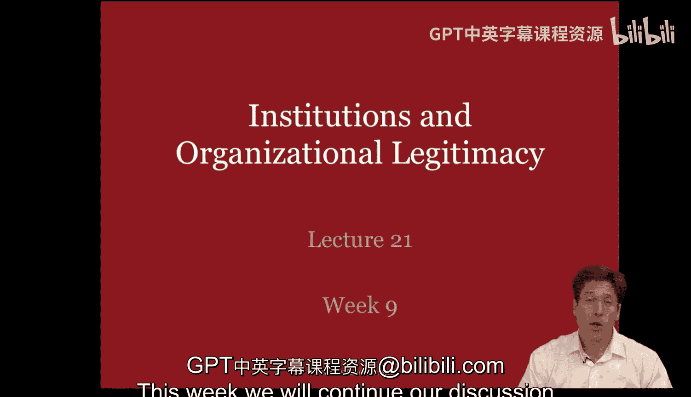
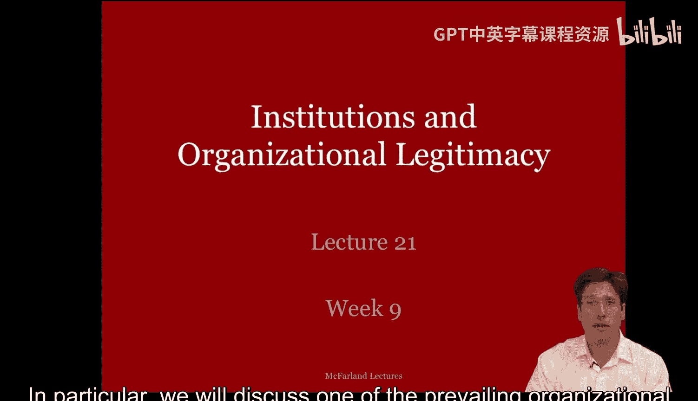
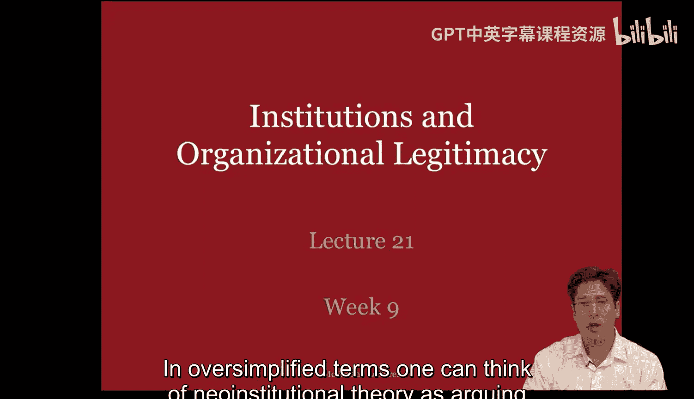
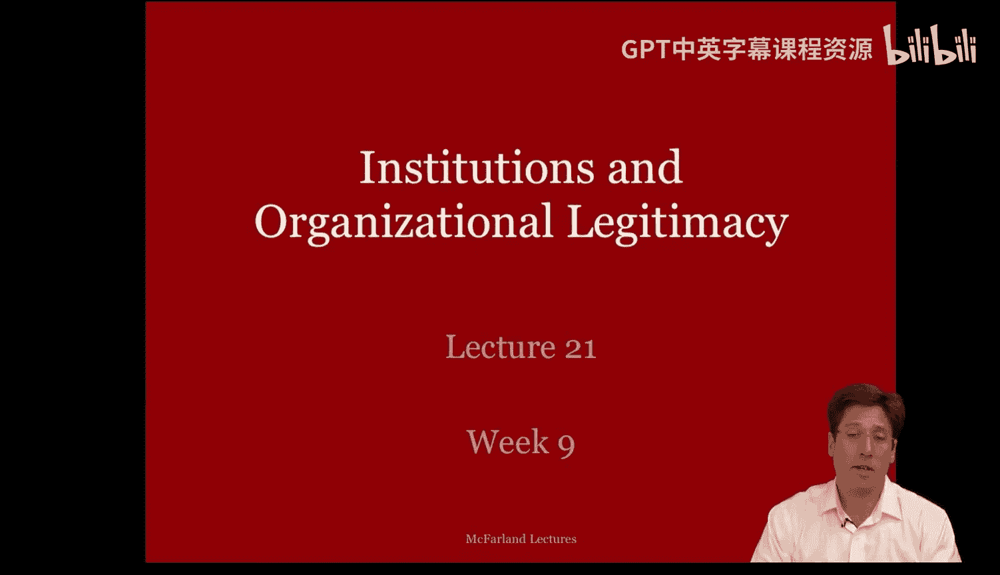
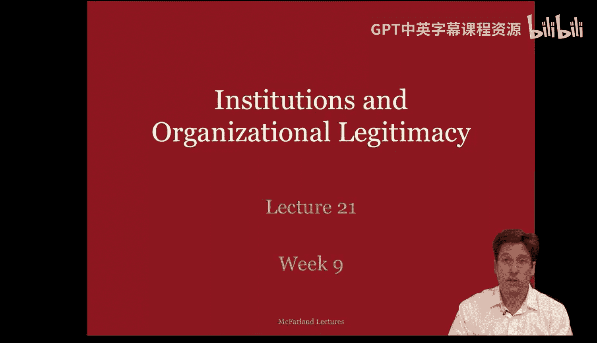
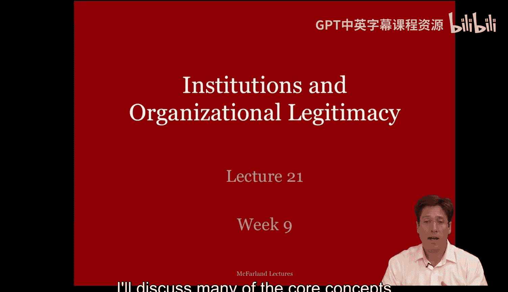
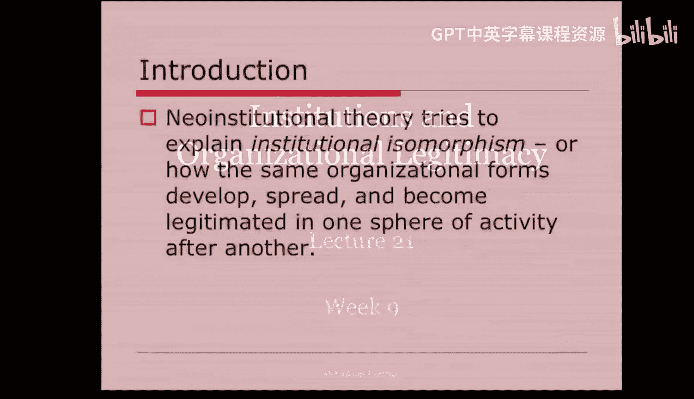
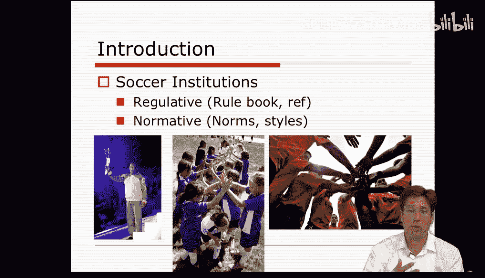
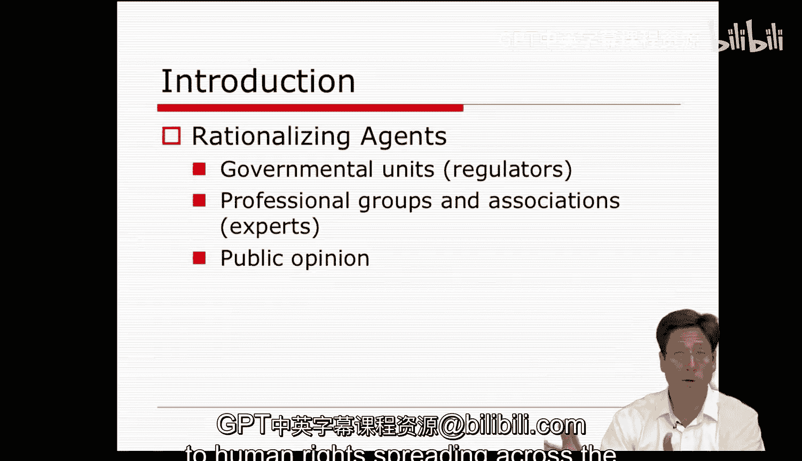

# 斯坦福大学《组织分析｜Organizational Analysis》中英字幕 p89 089_09_01_第二十一讲-制度与组织合法性-第一部分.zh_en -BV17J4m157qN_p89-

This week we will continue our discussion of organizations as open systems whose survival depends on their relationship with the environment。

 in particular， we will discuss one of the prevailing organizational theories stemming from sociology called Neinstitutional theory。

In oversimplified terms， one can think of neoinstitutional theory as arguing that an organization's survival depends on its fit with the cultural environment。

 that is a firm success depends on whether it adopts structures that are deemed rational and legitimate in the external environment。

 that the firm mirrors environmental beliefs about what a legitimate organization of that type should look like。

Neinstitutional theory has always been one of the harder theories for students to fully grasp。

 so I've organized a lecture to be a little repetitive this week。

 I'll discuss many of the core concepts twice and relate them in different ways so that you get a better sense for what this theory conveys neoinstitutional theory tries to explain institutional isomorphism or how the same organizational forms develop。

 spread and become legitimated in one sphere of activity after another the theory tries to explain how and why spheres of activity like organizational fields of biotechnology or education are composed of organizations that look more alike than they differ。

 let's take the example of the organizational field of education。

Why do most schools and classrooms look alike， I recall talking with one of the founders of neoinstitutional theory。

 John Meyer， and he was recounting his travels all over the world， visiting schools and classrooms。

 And as he talked， he described how hed visited typical American schools。

 pooror subsharan African villages with classes taught outside in these ground indenttations without chairs and tables。

 how he had seen religious fundamentalist schools in Saudi Arabia were boys and girls were taught separately。

 and even wealthy Western schools。 all of them had enough similarities that one kind of knew right away what kind of organization it was and what scripts were being referenced。

 all were schools doing real schools。 In many regards。

 all these settings conform to widely held institutional beliefs about what schooling en tales。

 These beliefs and conceptions are cultural cognitive controls or deep social structures in the environment。

As Richard Scott relates， sets of beliefs developed in social interaction provide models。

 schema and guidelines for governing and guiding behavior in social situations so therere these institutional controls or these beliefs in the environment which affect us and conform our behavior institutional controls are practice in several forms。

 and explicit form of institutional control is practiced through regulations or regulatory institutions these constrained behavior through rules or laws and behavioral inducements like incentives and punishments a second deeply ingrained institutional control is normative normative controls guide what we should or should not do or how we should and should not appear in great part these are informal rules and guidelines but they're just as influential un-organizational behavior as laws and regulations Last there are institutions that run very deep and these are cognitive beliefs as Richard Scott。

DeCompliance with cognitive institutions occurs in many circumstances because other types of behavior are inconceivable。

 cognitive beliefs are naturalized， taken for granted ways of doing things such as taken for granted routines and activities in many instances。

 these institutions are layered on top of each other in reinforcing ways like an onion。

But in some instances， they conflict or segments in the environment adhere to one set over another。

 so the cultural environment can be varied， organizations typically respond by building that external complexity into their internal formal structure though。

I always kind of find it easiest to distinguish the three layers of institutions or forms of institutions through the example of a sport I'm going to take the game of soccer something that most of you should be familiar with right and describe how these three institutional controls can be layered so as to make the performance of soccer games relatively the same and recognizable so what are the regulatory controls of soccer those are the rule books and the rules of soccer as well as the referees that act as agents en forcing those regulations penalties are incurred for violating the rules in this case what about the normative controls of soccer so here the norms of soccer characterize our notions of better or worse players better or worse sportsmanship and so on norms lead players to act in certain styles within the tacit activities and the routines that they enact So what is a cognitive or deeper form of institutional control when it comes to soccer？

For soccer these entail the activity of playing itself， whether it's a goal kick， passing， dribbling。

 etc cea， it's inconceivable that someone would approach the game of soccer using a different activity framework or schema or even different roles of say like basketball。

 can you imagine people showing up at a soccer game ready to play basketball。

 we take the enactment of the game or activity of soccer for granted。

 and people engage in that activity unquestionably。

 when they don't everybody gets very upset it's like a breaching experiment when individuals act like a stranger with their family。

 it's just crazy right and we find this cognitive layer is present when we go look at different context of soccer play。

 for example to my side here as a game in 1937， one on a beach， one in a playground。

 they all share a family resemblance to the routine that we regard as soccer。

We recognize it so multiple institutions can control behavior and render them into descripted forms that are deemed legitimate and ideal for any organization。

 their actions might be driven by taken for granted routines and activities。

 norms and expectations of best practices and players and explicit surface regulations that catch violations。

 John Meyer， Brian Rowan， Paul demaggio and Woody Powell where all some of the first neoinstitutional theorists and you get a chance to read them in this course what they wrote about was how organizations come to look alike because there are these processes。

 leading firms， these processes in peer pressures that lead firms to adopt many of the same institutional controls。

 they try to mirror the institutional environment and fit it。In particular。

 they stressed the importance of rationalizing agents who generate institutional controls and these ritual classifications these agents were governmental units。

 professional groups and associations， universities and even public opinion。

 these classifications were considered rational because they came from these legitimate exemplars。

 the classifications they proposed were the aforementioned cultural cognitive categories。

 normative beliefs and regulatory policies and laws。

 and the basic ideas that scientists and professionals increasingly work at this world system level holding international conferences。

 issuing statements providing recipes and policies for reforming and rationalizing one sphere of activity after another。

 whether it be something about health standards to human rights spreading across the world to educational forms of organized。

