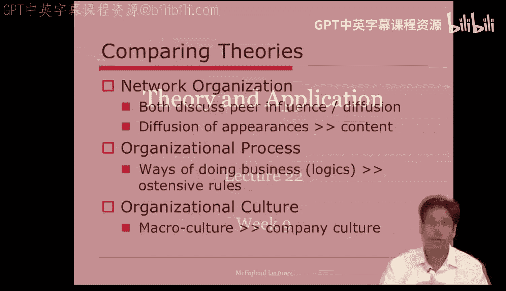
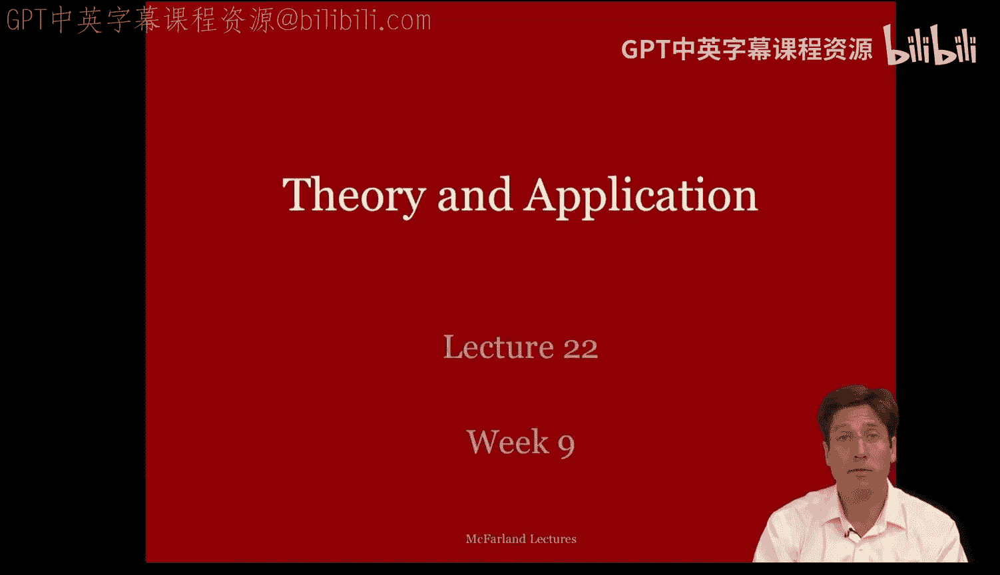
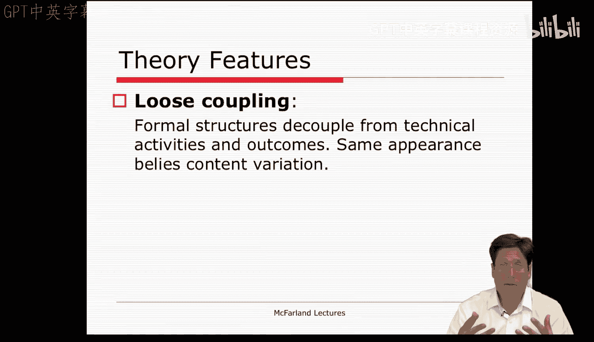

# 斯坦福大学《组织分析｜Organizational Analysis》中英字幕 p91 091_09_03_第二十二讲-理论与应用-第一部分.zh_en -BV17J4m157qN_p91-

This next lecture concerns the core features of the theory of neoinstitutionalism To this point I've given you a general sense of neoinstitutional theory and how it compares to previous theories in the course。

At this point， we can now kind of begin to delve more deeply into the core concepts of new institutional theory。

In this week's readings I assigned readings that were primarily secondary sources and they afford an overview of Ne institutionaltitutional theory in this lecture however。

 I'm going to draw on a couple additional primary sources that you can find in the section for additional reading materials in particular I want to discuss the basic ideas presented in the 1977 piece by Mera and Rowan。

 institutionalsitutionized organizations formal structuress Myth and Crey。

And I want to discuss the 1983 piece by Demaio and Powell calledThe Iron Cage Revisited。

And as we go along， I'm going to draw examples on schools as an application。

 and the reason for this is because both Myra Rowan's 1978 paper that I did assign and Mary Metz's 1989 paper about real schools both do a terrific job of providing concrete examples of how neoinstitutional theory is being applied to real organizations out there in the world。

 the seminal article in Ne institutionalstitutional theory is Myron Rowan's 1977 paper。

And in that paper， the general argument is that independent of the drive for efficiency organizations ceremonially incorporate institutions。

Into their formal structure that are believed to be rational。

And by doing this organizations gain legitimacy and secure social resources from the environment。

So the institutions， they incorporate are things like regulations and procedures， classifications。

 rules and practices， and note that I said that these institutions are incorporated because they are believed to be rational though。

 the adopted practices and formal structures are called rational myths or legitimated institutions that we adopt on the assumption that they're rational。

 but we don't investigate whether they really improve efficiency or not。

 they're taken as for granted as actually accomplishing that。

So these institutions are built into society as typifications and ritual classifications。

 for example， we believe educational institutions are more legitimate when they have buildings。

 classrooms with chairs， lectures， student teacher roles and interactions。

 mathematics and other subject matter， credentials and so forth， these roles。

 classifications and rules are ceremonially applied much like we enact a script and play。

 like we play our parts and give off appearances in say a marriage ceremony。

 the ceremonial adoption of appearances is done on the basis of belief。

 their myths because we believe they are legitimate forms we use and we take them for granted as natural。

 and we view them as rational myths because we think they help the organization function better。

 without actually investigating their relation to efficacy。So in order to survive in modern society。

 organizations must be regarded as legitimate and this legitimacy is accomplished by maintaining ceremonial conformity。

 organizations look their part in an ongoing script or play for that type of organization。

 hence their formal structures are organized to reflect the rational myths located in the external environment。

 and this conformity leads organizational fields to have organizations that look more or less alike more than they do different。

The key point here is that organizations adopt institutional rules as rationalized myths。

 and let me explain what that means a little more carefully。

 they are rationalized because they are impersonal prescriptions identified in a rulelike way as the appropriate means to pursue various goals。

 okay。There are myths because we adopt them on faith or in a taken for granted way。

 we believe they are rational constructs， but we seldom look deeply at whether they are efficient or if other constructs would work better。

We are all limited problem solvers is the assumption here， and we adopt rationalized myths。

 we use a shorthand logic that's encoded in the environment。

The efficiency and efficacy of standard operating procedures and organizational structures is kind of presumed on the basis of their wide adoption or the endorsements by professionals like a Stanford academic。

As such， the sources of legitimation vary from public opinion， ideologies， regulatory structures。

 certification and accreditation bodies， professional norms and credentials and even government requirements。

 all of these become rationalizing agents that we put our faith in that they've established these institutional forms in the environment as legitimate。

 so where do rationalized myths come from then， what are their origins。So。

Rationalized myths arise in a context of dense complex networks。

 so they arise in a context of modernization and they arise in an effort to make rational decisions where there's all this ambiguity and uncertainty。

Rational myths and their reliance on rationalizing agents are a shorthand means to deciding things。

 they also diffuse through networks and their past because the practices are believed to be rationally effective。

 we all experience that we see them， rationalized myths are also used because leaders within any organization want their firm to haves legitimacy in the wider environment。

On the one hand， resource dependence theory saw this as arising from the creation of resource demand so managers built greater external dependence on their organization on the other hand neo institutional theory。

 it also seeks to create demand in an environment but by mirroring institutional rationalized myths that are in society by looking like the real deal or as an exemplar they garner attention and resources。

 so it's a different kind of effort and one geared toward cultural fit Now the notion of rationalized myth can extend to organizational products。

 take card advertising as an example， when creating the idea of what a good car is advertisers project appearances of the firm and its product is if they exhibit externally legitimate rational myths。

 for example consider jaguar it's a nice-look car love one。

 but what makes you think it's legitimate is it the car's performance。Sure， perhaps。

 so a neoinstitutional kind of ad would tru trumpet various awards regardless of what they were for so maybe it was an award for safety or speed but regardless they would trumpet them right these awards are rationalizing agents so saying you got any award is great and a good example of this can be seen with movie reviews in newspapers and many of you probably recall looking up a movie listing in the paper and you see all these reviews slapped under the face of the movie right and in many cases the critics giving the new movie good reviews are unknown。

 so they give the movie the appearance of legitimacy when it's likely a pretty bad movie like transformers being called a great movie of our age。

But back to the car note the references into the institutional environment can be even more decoupled from the actual content and performance of the car why not just show an ad of a car moving along and there in the back seatat beautiful back seatat is sting right wouldn't I want what sting the exemplary Englishman。

 wouldn't I want what he likes so lots of advertising does things like this their ads have more to do with appealing to a rational myth or a shared public opinion or sentiment than the actual product itself or its performance。

And if they do mention performance， it's via awards and rationalizing agents。

 not details of performance now of course you can find out such information if you go to the websites and find the specs of each car or whatever。

 but we still frequently consider the products by their impression of fit with some section of the institutional environment or some kind of shared opinion or belief held out there in many regards Mary Metz's article on real school gives you a really clear example of rationalized myths using the case of educational organizations in her paper she describes how educational organizations symbolically code their structures to resemble beliefs about real school that are held in the institutional environment she thinks this is why American high schools all look the same on the surface in spite of really being different internally。

They look the same and plot along in spite of having differences in content and output。

 huge inequities across schools， in spite of them having these structure similarities across them now Mes describe symbolic coding as arising when organizations adopt a common script and the script is like that of a play and educational organizations play the part of a real school in that play so these organizations engage in rituals or ceremonial performances by looking their part in the play when interacting with the environment and this is where real schools have buildings。

 classrooms， desks and chairs， they have graded age graded student roles。

 undifferentiated teacher roles， department chairs。

 principals and various other staff they have differentiated course subjects whose scope and sequence are recognizable to colleges and employers and across each of these schools they have familiar technologies like lessons。

Many of the same tasks， whether they're lecture， recitation， seat work。They use textbooks。

 computers and blackboards， they have coded time into school days， school weeks。

 quarter semesters and school years different notions of time and they use many of the same symbols of ranking and completion like grades。

 test scores and credentials， many of which are used as ritual classifications in other external organizations that rely on them that's how they secure resources and legitimacy so all of these features are typifications that we recognize and expect a school to have we take them for granted and we place confidence in them as being normal and rational without much inspection of their efficacy so in short educational organizations put on a play or the appearance of real school in spite of some kids failing and reality and the scripts serve of symbolic purposes more than technical ones。

Now the same can be said of universities in their development over the last hundred years or more universities are growing increasingly common in societies and their forms are isomorphic such that a new university will quickly adopt courses。

 subject matters， departments credentialed employees and so on。

 they'll have many ceremonial features of the leading universities so they adopt these rationalized myths of what a good universities should be。

 and universities structures have grown increasingly complex over time as they try to appeal to different segments of the institutional environment to seem legitimate to those different segments。

 so consider what new universities look like like Qatar Qatar at university do they adopt dramatic shifts and ceremonial features or do they mirror what exemplary universities look like。

 so how are rationalized myths sustained if they aren't efficient or optimal。

It's a good question the formal structure many organizations is adopted like a sacred ritual。

 I mean rituals are like marriage rights， people adopt a range of appearances。

 they go through a series of scripted actions so they resemble these roles of husband and wife。

And they transform into such an embodiment through that ritual。

 right we begin to believe them as such they've transitioned the role。

And when we say an organization reflects ritual classifications。

 we mean it displays appearances so as to embody a ratified organizational identity that we consider legitimate in the environment。

To maintain the ritual and the plausibility of legitimacy。

 the organization presumes a chain of confidences and adopts an assortment of face saving efforts to preserve this kind of myth。

Here are a few face saving efforts used to preserve these myths。The first is avoidance。

It's maximized when units are segmented， so interaction across them minimized， in this manner。

 one unit can't see into another and question their contents or their performance。

The second is discretion， discretion is maximized when inspection is minimized and participants are cloaked in professional credentialed authority。

 by placing trust in teachers， we give them discretion and we let their profession act as rationalizing agents。

Last is assumption of integrity， organizations often assume ritual performances and appearances have integrity and this sentiment allows them to overlook problems and to label those problems as anomalies so we have all these kind of face saving efforts that sustain logics of confidence whether we avoid things give them discretion or presuppose or presume integrity of them that allows the rationalized myth to be sustained in the face of possibly not being an optimal or efficient solution in education there exists a sequence of confidences that are never fully inspected。

 the state has confidence in the district， the district has confidence in the school the school has confidence in the teacher and the teacher deserves confidence due to their degree and the programs accreditation and the accrediting agency doesn't inspect the teaching and skill of the graduate but has confidence in the college administrators。

In the courses offeredSo these people in turn have confidence in the teachers training them to label certain courses as history or math or algebra or organizational analysis without really carefully inspecting them so it's this larger system of all these interdependent confidences that sustain a lot of these rationalized myths or notions of what is the legitimate form of schooling to adopt the institutional theory also argues that the sequence of confidences is greatly sustained by a structural adaptation that they call loose coupling。

And organizations may all come to look alike in terms of their formal ceremonial aspects。

 but that doesn't really mean that their actual internal practice and activity are the same。

 so many organizations actually decouple their formal structure and appearances from the technical activities and outcomes within them。

 so the question that follows is why， why does that happen？

