# 斯坦福大学《组织分析｜Organizational Analysis》中英字幕 p92 092_09_04_第二十二讲-理论与应用-第二部分.zh_en -BV17J4m157qN_p92-

Let's take the example of schools since it's heavily elaborated in the readings and in the theoretical text on the institutional theory。

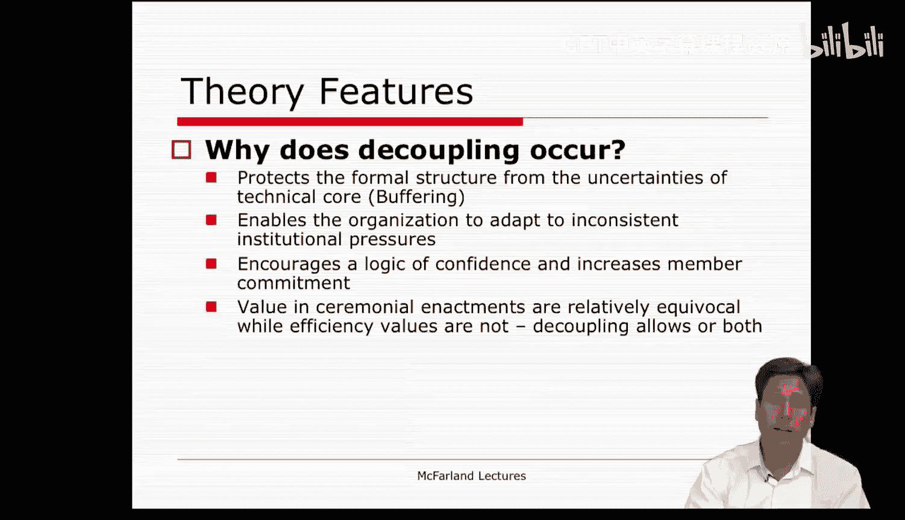

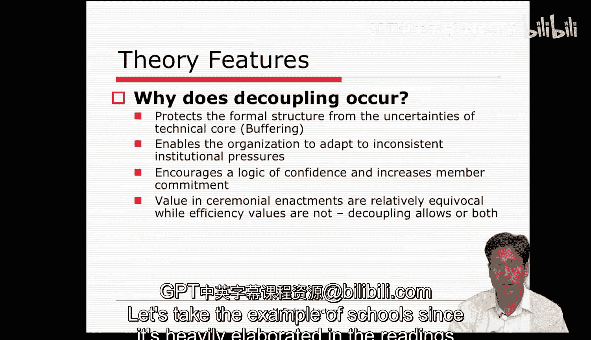

SoFor schools decoupling occurs for a few reasons， the first is that decoupling protects the formal structure from uncertainties of the technical core。

 it's buffering right there's much uncertainty in how say a curriculum is delivered， received。

 and so on and measuring its kind of effect is difficult all too often if we inspect it。

 it creates the doubts about the legitimacy of any form of instruction and we lack clear working alternatives。

Second， decoupling enables the organization to adapt to inconsistent and conflicting institutionalized rules in the environment so flexibility。

 the plurality of environmental pressures can put conflicted demands on the organization by differentiation and isolation。

 the firm can forego coordination and avoidingcompatibilities and inconsistencies， so for example。

 segmenting special education apart or the use of tracking the formation of different departments and so on。

 all of these are means of making an educational organization appear rational。

 but also segmenting contents inspection， and think of what accreditation efforts entail。

 they mostly just count surface features of how many departments and categories。Third。

 decoupling enables participants to avoid inspection。

 and this avoidance is a display of trust and confidence。

 as such decoupling contributes to the logic of confidence and increases the commitment of internal participants。

 responsibility is kind of pushed onto the teachers and a teacher professionalism。

And then finally a great deal of the value in education has little to do with the efficiency of instructional activities is not so much about learning per expended dollar as much as value residing in the ceremonial enactments of schooling that are regarded relatively equivocal so buildings。

 teachers， books， topics， accreditation classrooms。

 desks and so on those are kind of equivocal values。

 so by decoupling formal structures and categories from the core practices and activities。

 uncertainty about the effectiveness of ritual categories is kind of reduced schools can kind of go on and do well without inspection。

But why does this loose coupling arise in the U。S education system in particular。

 and what other systems might this occur in？The reason in the US system。

 it's argued this occurs is because it's decentralized and it kind of co-occurs with decoupling the USS system is decentralized and it relies on resources from the local population like school boards。

 counties， mayors in contrast other countries like yours out there might have centralized structures with examinations and clearing inspection systems that ensure conformity to the activity。

 by contrast to United States exams are privatized and not universal。

 a national system would define almost all a kids from some communities as successful or failures and there's this danger for a system that depends on legitimating itself and obtaining resources from local populations if it does that it would kill itself。

 so local control deprofessionalizes administrators but professionalizes the teachers and American schools have this kind of system where there's weak administrators who struggle to control any kind of educational reform。

So in sum， news theory argues that organizations succeed in the environment by engaging in symbolic coding or the adoption of rationalized myths about structures that rely on the logic of confidence and then they decouple their formal structure from the actual internal activities and their performance。

 and this affords them greater flexibility and buffers the technical core and internal workings of instruction from a likely conflicted concerns of the external environment。

 theural plurality of concerns and external environment。

 decoupling the logic of confidence enables the managers employees of these organizations to do their work without inspection and with some degree of certainty and security that they wouldn't have otherwise。

 why adopt the formal rules and structures when observation or inspection are not all that relevant is the adherence to rationalized myths helpful in some way。

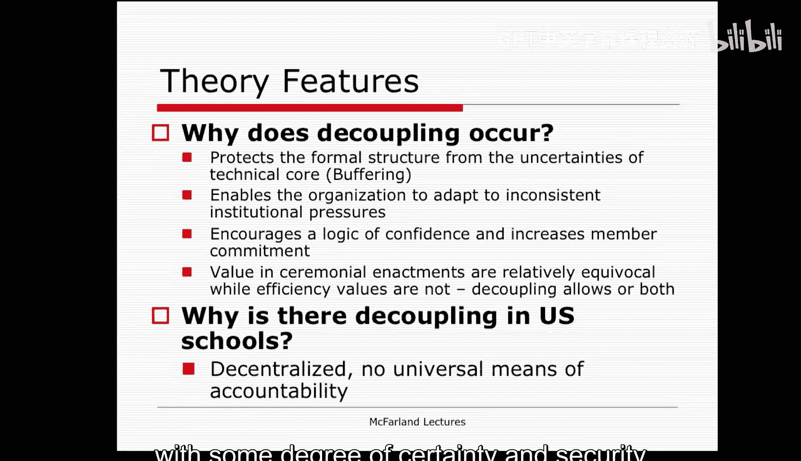

So organizations need legitimacy is the kind of argument a neoinstitutionalist would have。

 they need that legitimacy in order to secure resources and to survive。

 so independent of material needs，Organizations need to look like a real organization。

And at least appear to behave like a real organization。

The creation and adherence to prevailing rationalized myths provides them with all kinds of resources。

 so again， let's look at the case of schools to flesh this out。So they have credentials。

 classifications， and categories of schooling that constitute a language that facilitates exchange across organizations and with the environment。

Funds are frequently allocated in a categorical fashion so if you have vocational education。

 special education， you know college tracks having them in place makes the transfer or the labeling of individuals and transfer of them across these institutions feasible hiring feasible the system of ritual classifications can also be exploited in order to kind of gain prestige I mean you can hire prestigious faculty you can incorporate innovative programs that say or DuOCs at your own institutions and this might increase the status of your own university and finally organizations can rely on ritual classification to provide internal order and identities it kind of helps you organize internally and gives people something to work into so in many ways this is kind of a managerial prescription if you attempt all of this above and conform the institutional environment you're going to reap rewards from it bycorporating incorporating externally define teachers。

and students into a formal structure schools stay legitimate and get the necessary funds and participants so they can operate。

 so in short， the rewards for adheres are the increased ability to mobilize social resources for organizational purposes so anytime you create a new charter school or private school its miraculous how similar it looks to every other school it's not that innovative and distinctive and it's the same with a lot of startup companies and businesses that try to imitate other firms and corporations out there that are deemed to have these kind of legitimate ritualized fe that make it feasible that they can interrelate with other firms and other segments of the environment and to have kind of legitimate facets that are deemed value and rational compatibility The second theory paper I want to discuss is that of demaggio and Powells。

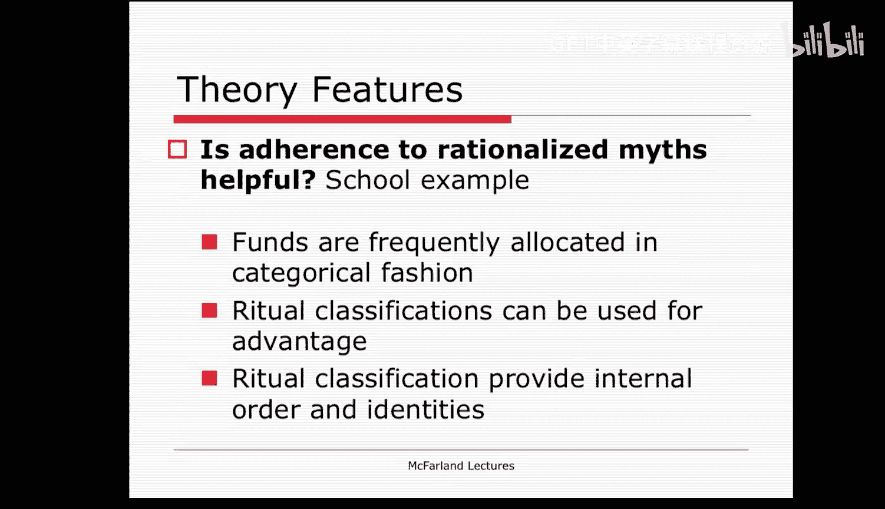

InIron cageage revisited what's great about this article is that it shows how neostitutional theory relates to both resource dependence theory and population ecology and that。

Will be the final theory we'll cover next week in week 10。In addition。

 this article describes a variety of bridging tactics that lead organizations。

To resemble one another in their form。So Damaji and Powell's big question in this article is。

 why do so many organizations look the same？You know within an organizational field。

 why do they imitate each other， why do they appear similar as opposed to why not different and why is there a progression from a diverse set of organizational forms to a homogenous set。

 so Demaggio and Po focus on organizational fields and how organizations within them grow isomorphic。

 kind of just like our example application of how schools have come to look so similar how universities have so let's first define the concept of an organizational field since it really describes the bin in which the process of organizational homogenization arises。

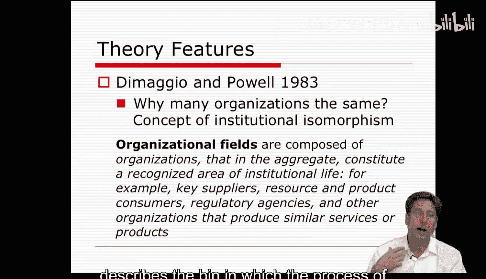

So organizational fields are composed of organizations that in the aggregate constitute a recognized area of institutional life。

 so for example， you have key suppliers， resources， resource and product consumers。

 regulatory agencies， and other organizations that produce similar services， or products。

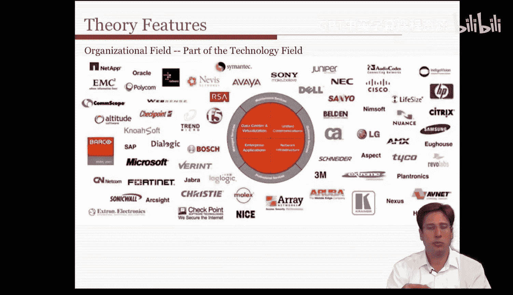

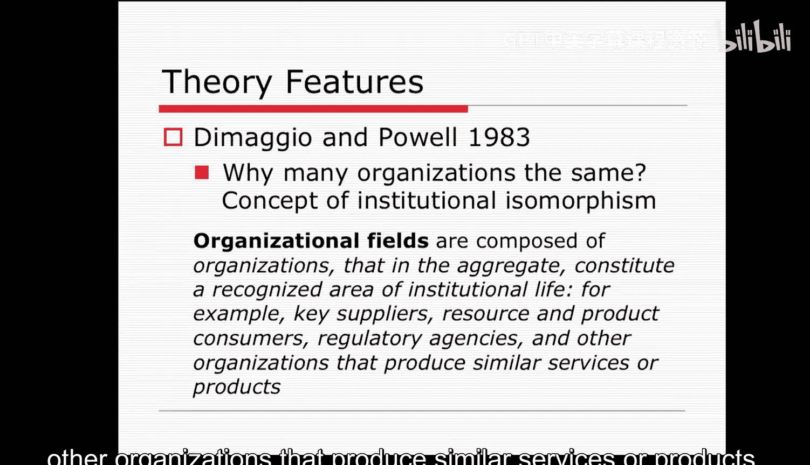

Now here's an example of what might be regarded to be an institutional field for something like the domain of technology。

 now it's not complete of course， but it gives you some sense of the variety of organizations that compose it and might mutually recognize each other。

 so how does a field like this kind of form。Pawell Dimaggio kind of give you the process of field the definition in four parts。

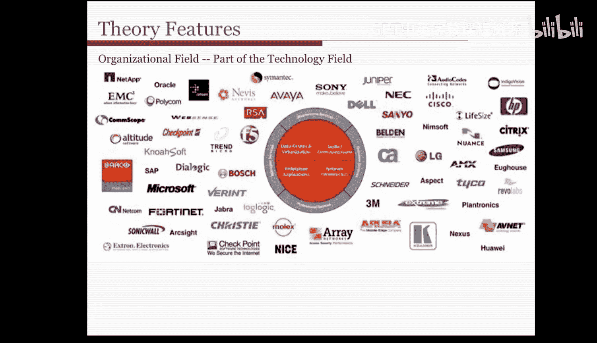

There's an increase first an interaction among these members right。

 and then there's greater interorganizational patterns of hierarchy and coalitions among them。

 and then eventually there's an increase in information load about the activity to contend with。

And then finally。The development of mutual awareness occurs among those members so for Woody Powell for example a lot of his research concerns the emergence of the biotechnology industry and how that field emerged among banks venture capitalists and universities are inD firms as well as biotechnology companies so this field was all of these different groups or organizations that had heightened interaction interorganizational networks that formed in certain forms you have this kind of information load about biotechnology that occurs and then this mutual awareness of themselves as some kind of industry or domain so through that process in addition a lot of the firms come to look like each other they start to resemble one another they start to adopt similar patterns and encode their symbolic structures so that's the kind of argument that a new institutionalists has for a wider field or domain。

Within a field like this， how does organizational homogenization arise so the process is one where one unit of a population comes to resemble others and new institutional theorists call this isomorphism I've already talked about it a little bit。

 but。I want to kind of elaborate further now in usual parlance。

 isomorphism can mean or can be expressed in a variety of ways。

 and visually you can think of it as mirroring or when a building assumes the same form or appearance of another。

 they adopt the same facade and external kind of patterning。

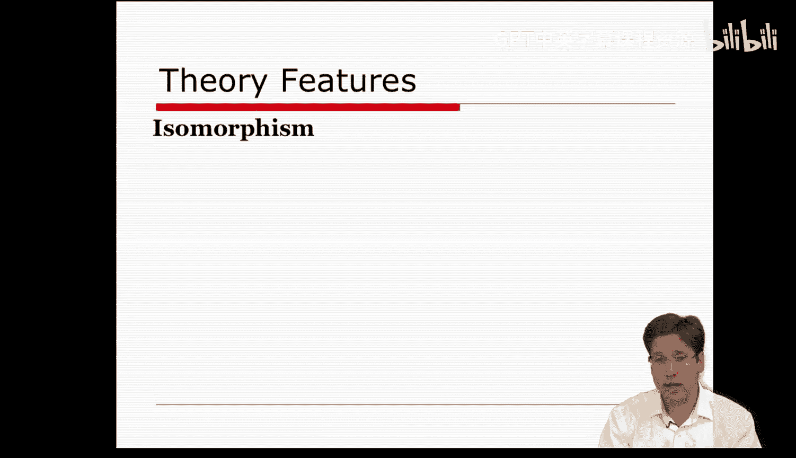

But it can also have more of a mathematical or even geometric expression and notice here1，2，3。

4 have the same pattern of association as 5678， the same for A through D as for G through J theyre structurally equivalent sets of nodes and they're substitutable right so geometrically we can talk about isomorphism。

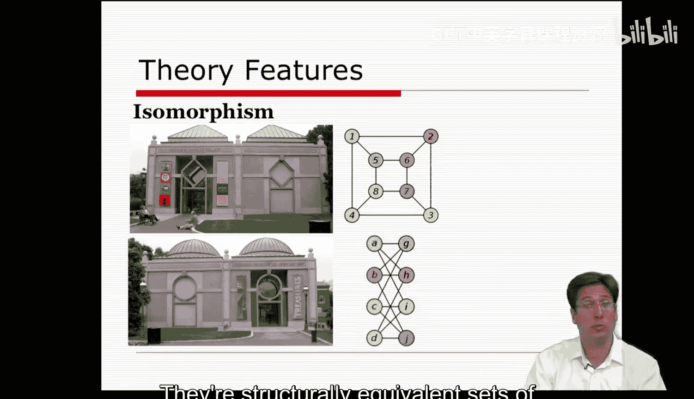

For any institutional theory， these appearances can decouple from function。

 so perhaps this last image may help even more， it's of an orchid whose flower mimics a bee。

 and by showing appearances of one sort， it attracts resources， so pollen。

Now none of these are perfect siimmiles or metaphors by any means。

 but hopefully they give you some better sense of what it means to be isomorphic or to engage in isomorphism Demaio and Powell describe multiple processes by which isomorphism arises and the first process is one they call competitive isomorphism and in these instances certain forms of organizing don't survive because they're suboptimal and because decision makers learn appropriate responses and adapt their organizations so they can survive Demaio and Powell suggests this occurs in fields where open competition exists and this is actually a reference to population ecology or a theory that we're going to read much more about next week so I'm going to to punt as they say or take a time out on that one and wait till next week the second form of isomorph isomorphism is institutional and this is。

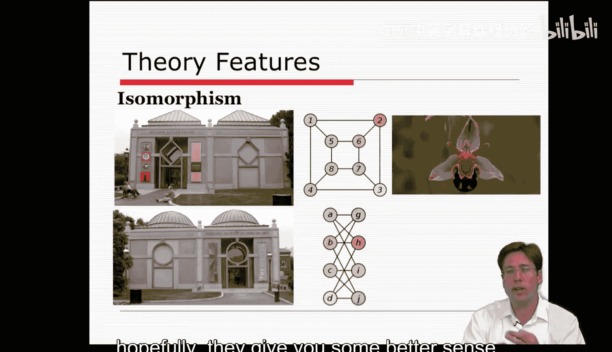

The core process of neo institutional theory here， organizations don't just compete for resources and customers。

 but for political power and institutional legitimacy。

The concept of institutional isomorphism is useful for understanding the politics and ceremony that pervade modern organizational life。

 so it's much more than this kind of natural selection and fit and competition。

 it's this much more sociological process of social and political and cultural kinds of issues of fit and alignment and legitimacy Powell and demaggio describe three forms of institutional isomorphism。

 and I want to relate each here and a little more detail。

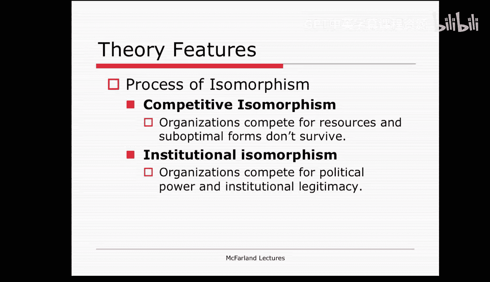

The first is a coercive form of institutional isomorphism。

 and it most closely resembles those observed in dependence relations as discussed in resource dependence theory。

Here a dependent firm is subject to political influence。

 and this coercive influence results from both informal and formalal pressures exerted by other organizations upon which a focal organizations dependent and by societal and cultural expectations within which the organization functions。

 so the firm is coercce to conform and this leads them to follow and adopt organizational forms of the organizations that they're dependent on。

 so that's the kind of coercive isomorphism that they first talk about。

The second form is mimedic isomorphism and mimedtic institutional isomorphism is different from the coercive form mimetic isomorphism is a standard response to uncertainty and ambiguity。

 so whenever ambiguity arises organizations begin to model themselves on other exemplary organizations or those that they think are particularly legitimate and successful。

 so the mimetic process here is one driven by the focal organization and their effort to secure resources。

 so many universities do like Stanford does， not from the certainty about efficiency but because in a context of ambiguity and uncertainty they can rise through the ranks by looking more like a leading institution or this innovative one say。

Norative forms are different yet again and they're different from both coercive and mimedic heremorph isomorphism is associated with professionalism and professionalism is defined as the collective struggle of members of an occupation to define the conditions and methods of their work to control the production of producers and to establish a cognitive base and legitimation for their occupational autonomy so rather than direct coercion or imitation。

 the firms in these instances try to fit in and mirror professional norms from which they draw legitimacy and two aspects are really key here I think。

 the emphasis on formal educational credentials and the development of professional networks via kind of associations right and these create pools of individuals who are relatively the same and substitutable across these institutions so in this way professionalization and。

norative forms of isomorphism and renders firms relatively similar in terms of who they hire what tools they use and so on so that's the kind of notion of normative isomorphism so to sum up the theoretical features of neoinstitutionalism are buffering strategies on the one hand and the theory argues that firms buffer themselves from the environment by symbolic coding of their formal structure so a new university will adopt many of the same subject matters and departments that established universities have and that manner their formal structure fits ceremonial classifications and these constructs are supported by a logic of confidence that extends throughout society the labels are assumed to be rational because rationalizing agents support them there's a confidence in elite universities and their accreditation per se。

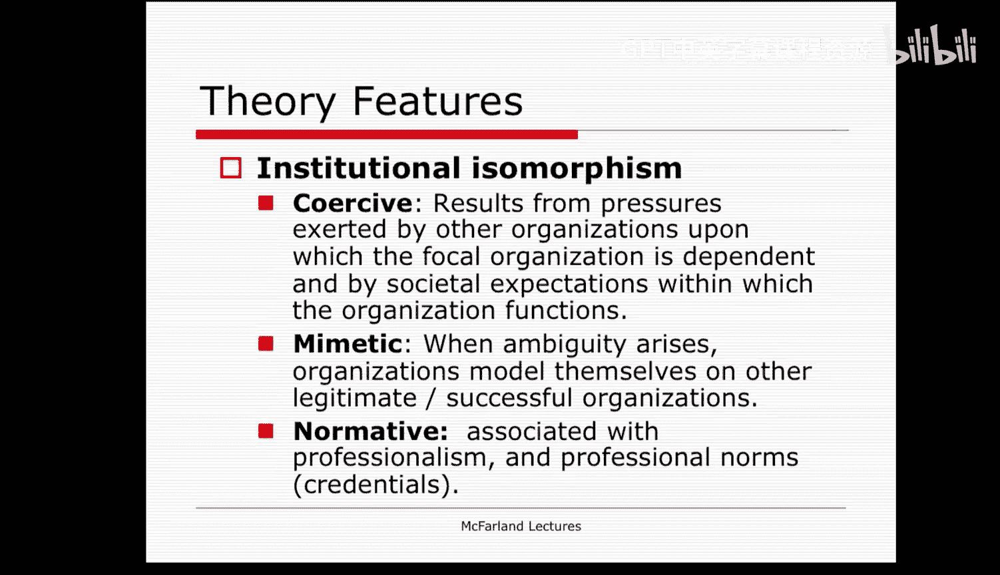

Further buffering of the core activities in firms is accomplished by the process of loose coupling。

And here， the formal structures and coatings of the firm are distinct。

And I'mrelated to the actual activity。By segmenting them apart。

 the firm exudes rational competence and cultural fit， but it doesn't allow them to be inspected。

In relation to the particular or the actual activity， okay。

 so this decoupling enables the firm to run on trust and not have to confront the potentially unsolvable issues of what works best and why。

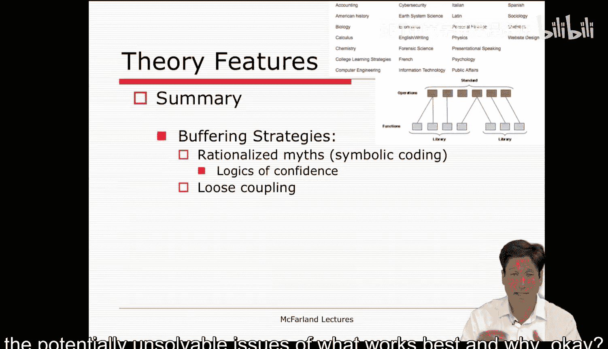

Firms also bridge in the environment， but here it's mostly done through networks and Demaju and Paulwell argue that these networks of association lead to isomorphism via various routes and the first entailed political pressure as we learned about in resource dependence theory。

 the second entailed mime behavior where firms look to exemplars and peer firms and imitate what they seem to do that works well or as legitimate or trendy and last firms respond to pressures of professional networks like professional norms and standards on how to assess and consider their firm's performance so all of these bridging efforts render the firm more institutionalize and legitimate in the cultural environment and which they are found and this in turn draws in social resources and continues the firms。

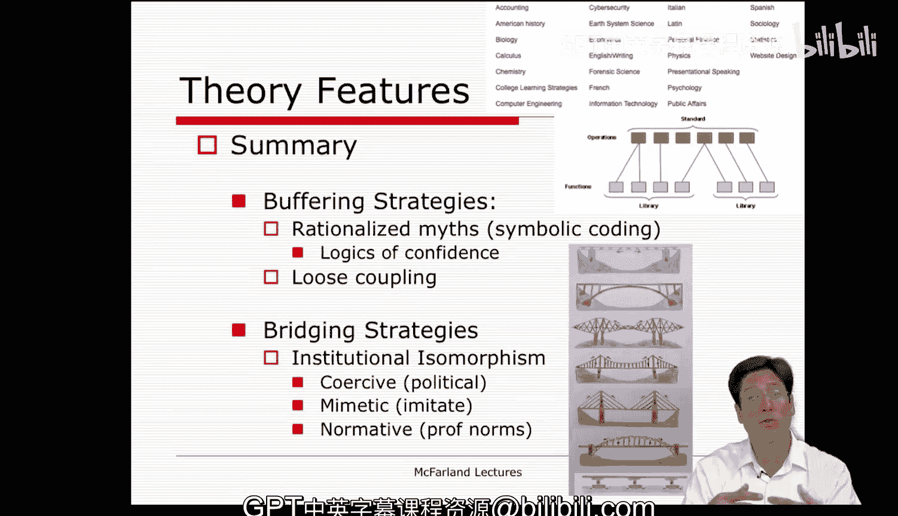