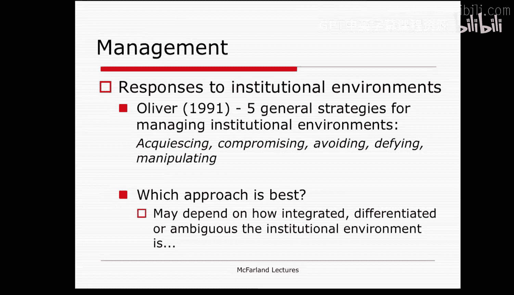
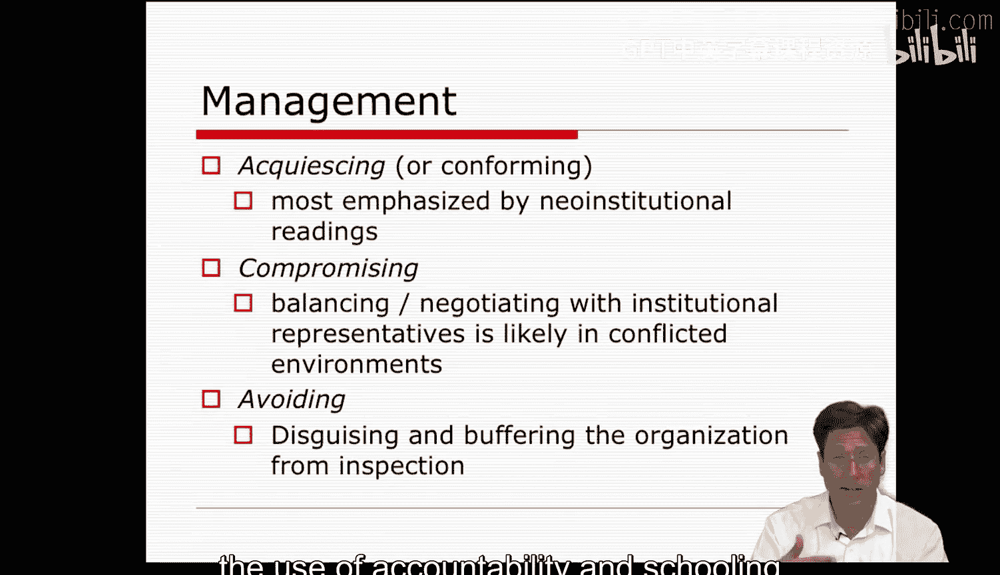
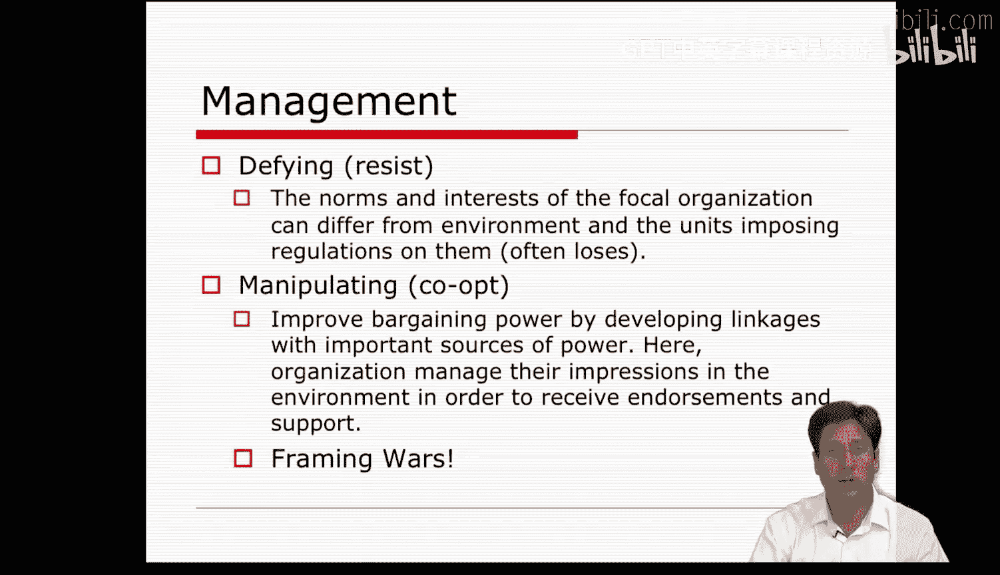
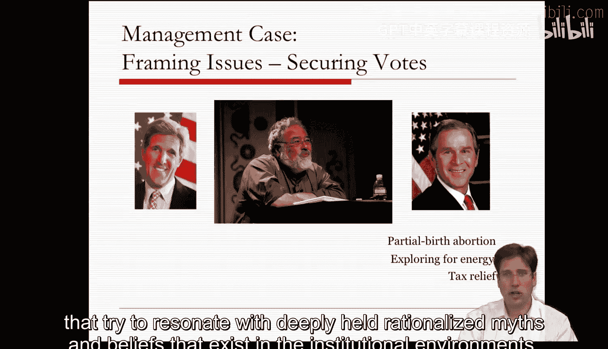
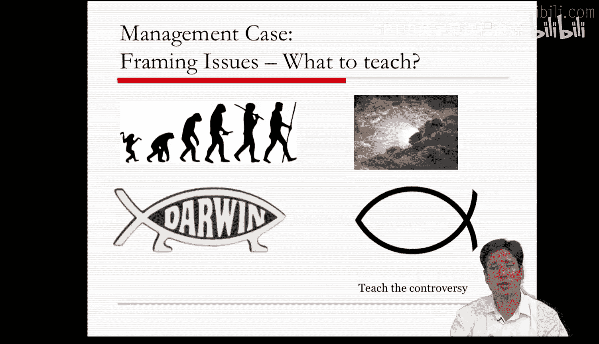
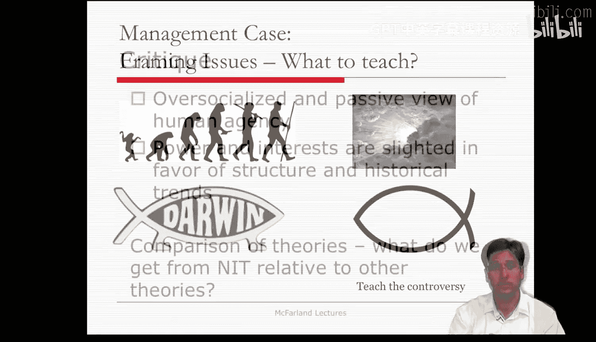
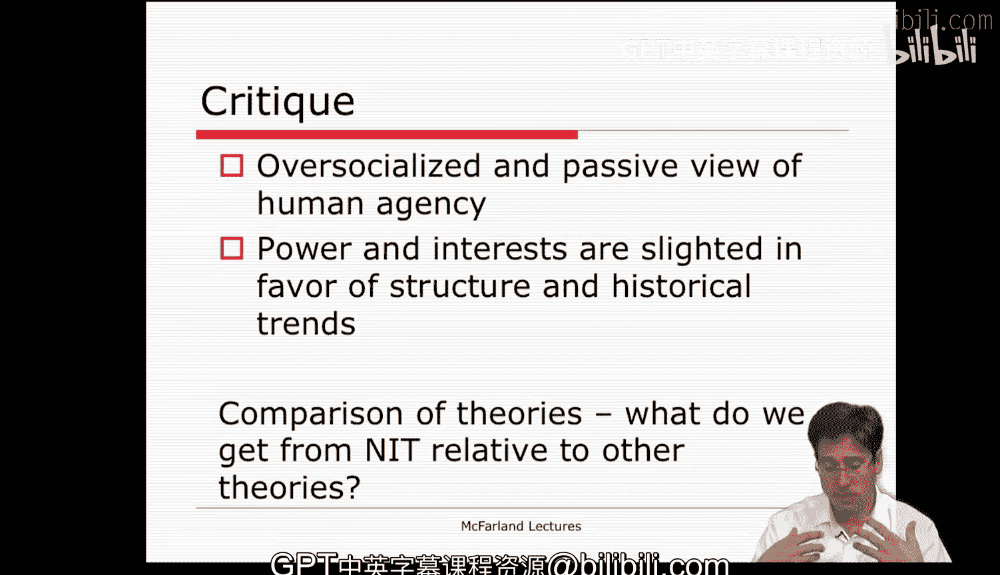

# 斯坦福大学《组织分析｜Organizational Analysis》中英字幕 p93 093_09_05_第二十三讲-管理与应用-第一部分.zh_en -BV17J4m157qN_p93-

What you've heard so far， how do we manage a firm using new institutional theory？

In many ways it's hard to gauge because it seems like you just fit right however I think there are a variety of different strategies and Dick Scott kind of alludes to it in his book as does Pam Oliver in her work Pam Oliver describes a series of strategic responses organizations can take to their institutional environments and she says you can acquiesce you can compromise you can avoid defy。

 manipulate and implicit in her response is some sense of how integrated。

 differentiated and ambiguous the surrounding institutional environments are。

 if you recall week six right and culture， these are references to that and I think the salience of any particular approach here might depend on how that institutional environment is currently arranged and what you can do internally with regard to encoding your structure or buffering and bridging with that environment so as to better your circumstances。

So let's look at Pam Oliver's distinct strategies one at a time The first one is acquiescing and acquiescing is the most common one described in the literature that you read by neo institutionaltutional theorists there the firm merely adopts and aligns with the institutional environment as if it's kind of a natural thing to do this makes a lot of sense if there's consensus in the environment or if the firm appeals to a niche institution and set of beliefs right the second kind of strategy is to compromise and compromising is different and it entails balancing differentiated demands and negotiating with institutional representatives right so this typically occurs in conflicted and differentiated institutional environments where one must play off one perspective off the other right？

The third strategy is avoidance and this can be accomplished via buffering strategies like loose coupling since it kind of prevents careful inspection in a way this move is akin to disguising the firm and using smoke and mirror tactics to distract。

So in those instances， decoupling is used when institutional rules conflict with the technical requirements so the ritual features are not appropriate for the organization's outcomes。

 or when the institutional environments are themselves in conflict with each other。

 and in those instances， decoupling helps a firm or particularly an open system firm。

 and it avoids prevents confrontation of these internal and external inconsistencies。By contrast。

 coupling and an alignment across ritual classifications and technical output kind of occurs when organizations are centralized and they reward technical performance or when the institutional environment is focused on certain issues and dependence is highest there so for example。

 the use of accountability in schooling in the United States right now has created a more focused coupling Oliver also mentions how firms can defy or resist their institutional environments and they can do this by adopting norms and interests that are different from the surrounding environment and the regulations being imposed upon them。

 and in most cases when firms do this they lose and the literature is pretty consistent in terms of depicting this。

 it seems kind of deterministic toward defiant responses and not in their favor。

The last kind of response is manipulation and you can co-op and manipulate institutional environments in an effort to improve your bargaining power。

 and this is often done by developing symbolic linkages with sources of power and this is kind of what the bridging efforts。

Avic andmorphism were about of coercion， mimesis and norming。So in sum。

 the manager has to find ways to align the institutional environment。

Or to find ways to help the organization wind its way through conflicting institutions in the environment。

 or internally to do this。They often conform and adjust their ritual classifications in outward appearances and they buffer their technical practice via decoupling or they manipulate the situation by playing to the myths in the environment so managers can hire these planners and economists to waste their time ratifying plans that have already been made just for the sake of legitimacy or hire human relations professionals to deflect blame from conflicts so there are all kinds of ways to kind of manipulate institutional environments like that I think we can actually go further than literature suggests to this point in regard to discussing marketing and advertising and how that's used to receive endorsements and support from the environment and this is kind of what I want to turn to next which is framing and framing wars in the case materials I assign this week you were introduced to the notion of framing framing better capture strategic aspects of cultural mirroring and fit since it's all about。

Cultural alignment efforts。The two assigned articles concern framing wars in politics and intelligent design versus evolution debates。

 right？Those articles describe how organizations and their leaders manipulate narratives and meanings so as to better align with both the national consciousness or even segments of the environment。

Now， the beauty of the Frraming war article。Is that it captures both aspects of this tension？

Both strategy and cognition。And just to give you a little background back in 2004。

 we had a presidential election between John Kerry and then George W。 Bush。

And both candidates had stances on a variety of issues。

 but they wanted to legitimate themselves with voters so as to secure their votes to get a social resource right and in the end Bush won and linguistic experts like George Leoff argued that Bush won because his strategists framed positions in a way that resonated more with the voters or as we might say the Republicans frame their positions in a way that resonated with deeply ingrained rationalized myths so Lakeoff in his analysis of all this makes it clear that the issue here isn't about finding the right words。

 these conceptions are grand metaphors don't just suddenly emerge and the right words will not suddenly change the national taken for granted understandings of the world around us right they have to kind of resonate with beliefs and arguments that many of us hold。

And because of this， Bush related that things like that he was against partial birth abortion。

 not intact dilation extraction of a fetus， which is the technical term that's used among physicians instead partial birth abortion has this contradiction between birth and abortion so of course it's kind of odd that you would be for it in a way and the way it's framed。

 he also said that he was for exploring energy， not oil drilling and fracking which are seen as potentially damaging the environment。

And that he was for tax relief， not tax cuts for the rich。

 which can be seen as unfair right so by reframing their policies in ways that make them appealed to deeply held beliefs and resonate with them。

 even if they're inaccurate kind of seemed to work right now the Democrats have gotten why since this and they have their own framings of course。

 like tax cuts for the rich is one statement or the Wall Street Wall Street bailout is another and on it goes。

 there are these framings of issues that try to resonate with deeply held rationalized myths and beliefs that exist in the institutional environments。

 another example of this can be found in the perennial debates about what the teach in our schools in the United States and given the nation was partially formed on puritanical immigrants。

There are subsections of the population that are fundamentalist Christians。

 and they sometimes take a literal view of the Bible in regard evolutionary theory as lacking and as an affront to their beliefs。

 and they'd much rather see creationism be taught in schools where the Bible says the universe is 3。

000 years old。Now， what's interesting about this controversy is how again， framing plays a part。

Here again the religious right has successfully found ways to frame their arguments such that they resonate more fully in the environment in fact the most common refrain in this debate is teach the controversy right given education and science rest on teaching and exploring evidence through debate the pressure to teach the controversy seems appealing on its surface it seems rational right it's just that evolutionary scholars and biologists and most educated people think that there is no controversy to begin with so the use of wording to resonate withhel rational myths serves to undermine the efforts of rational agents like professors。

 universities natural science fields and medical professionals so in some ways this is a way in which defiant use of rationalized myths can counterrationized agents in society now whether it holds for very long it's doubtful but it's interesting nonetheless now what I'm trying to suggest here is that we can use rhetoric。

To manipulate opinions and to secure social resources from the environment。

 we just need to find interesting ways to appeal to rational myths neostitutional theory like any theory isn't perfect and it's prone to critique and most readers regard neoinstitutional theory as describing over socialized and passive human actors because it's always about matching or mirroring and it seems kind of deterministic in this model parochial and power interests are slighted by neostitutional theory what matters is the external environment and mirroring those rational myths and many argue that neostitutional theory is gone too far。

In the direction of cognition and shared understanding of modernity。

Thereby trivializing power and politics， I think the framing literature provides a potential means forward。

And a potential means around these critiques， but it's currently empirically underdeveloped。

 right it's qualitative in many regards。And some criticize the neo institutionaltution approach。

 mostly as a theory that affords negative evidence in support of itself。

 and by this critics mean that the neo institutionalsution theory。

Mosley identifies weaknesses in other theories instead of revealing direct evidence for its own claims。

But I think this is actually harder in practice than it is theory to demonstrate the actual diffusion of cognitive scripts and conceptual frames。

 these grand metaphors， is a lot easier to do Xpost and through proxies than through X-ant kind of prediction or the direct measurement of institutional variables。

 the theory is this intuitive appeal to us and we can identify cases where diffusion and isomorphism occur but it's hard to distinguish processes of normative and mimedic isomorphism and to identify the features being homogenized right so knee institutional theory is one of the most vibrant theories of organizational analysis。

 but it's also one that needs further empirical development before it has kind of this mass appeal I。

