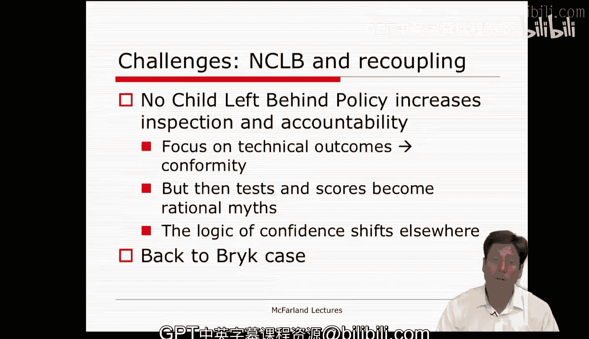
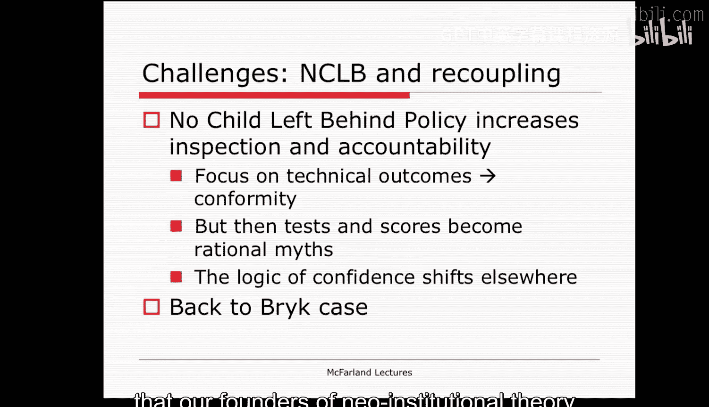
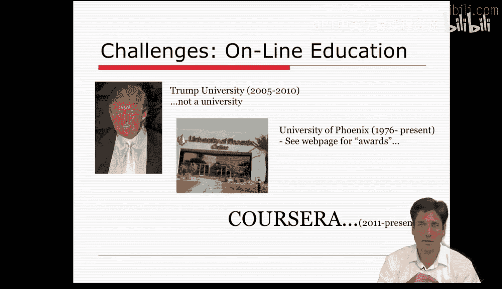

# 斯坦福大学《组织分析｜Organizational Analysis》中英字幕 p94 094_09_06_第二十三讲-管理与应用-第二部分.zh_en -BV17J4m157qN_p94-

Certain trends in educational institutions that seem to counter neoinstitutional arguments I want to consider them for a moment because I think if we reflect on them a little bit we can see how neo institutionaltitutional theory as a theory needs to change or possibly how it can help explain these new phenomena that just haven't been articulated well enough yet one of the interesting paradoxes and education right now involves no child Left behind and educational policies that strongly rely on inspection and accountability so it's the centralization。

 effort and accountability reupling on the one hand。

 no Chil Left behind and policies like it increase inspection so much so that they seem to challenge this notion of loose coupling within education and it forces teachers to conform and it places greater power and responsibility in the administrators。

At the same time the reform creates greater pressure for conformity to a particular myth of the real school and the appropriate elements that a school should reflect。

 it calls them to question these myths as well， other myths in spite of reinforcing one so now the ritual categories are more focused。

 innovation in methodology is minimize minimized， and conformity is imposed by a testing regime。

 so test scores developed by rationalizing agents like testing services and academics become standard bearers that test scores indicate whether one school is successful and another is not in spite of all these other things that could be a sign of efficacy or efficiency。

What happens then is that teachers teach those tests。

 and in some cases they even cheat so as to sustain appearances of adhering to that particular rationalized myth。

But you kind of end up wondering if this is a clear sense of what works better and whether we've really confronted whether learning is more efficient and desirable in this new form。

I think there is a sense of this but it's conveyed through the lens of a test and interesting。

 the Bke article that we read very early in the quarter could be interpreted as a strategic management effort to do reupling to counterloose couplingling and changes in that regulatory environment led to strategic responses like those described by BI and we saw that the system adapted and conform。

 but it wasn't clear that it had become more efficient and successful than before teachers felt deprofessionalized and their motivation began to wane so it wasn't clear that that had really succeeded。

 so it's not clear whether reupling and centralization render organizations any less reliant on rationalized myths they just seemed to focus them on certain standard bearers more than others ambiguity and uncertainty remained and only one face of the institutional environment and currently a dominant one as being linked to and aligned with in some ways。

reupling has kind of called into question other rationalized myths right that schools are really serving a variety of purposes。

 and we have this debate now about the legitimacy of testing even。

 so whether that it identifies certain communities in schools as failures as even valid or ethical in some cases。

We have this ongoing debate it hasn't been resolved。

 but it is interesting to think how the reupling of the educational institutions is a shift away from the loose coupling argument that our founders of Neinstitutional theory had applied to educational institutions another conundrum for neoinstitutional theory is the creation of massive open online courses or MOCs and what they mean for the organization of universities。

Could MOOs threaten the rationalized myths upon which the modern university is constructed？

Does Coursera challenge the common script？Of universities or new institutional conceptions of organizational fields like education。

How， I mean， it's a big question， why might a MOC lack environmental legitimacy， you know。

 how do MOOCs challenge myths of schooling and question the legitimacy of higher education institutions？

What？Will MOOCs do to community colleges， what will they do to the University of Phoenix say。

 and what do they do to the actual classroom experience itself。

 what if superstar teachers can effectively convey material online and students can learn it almost as well as if you were here with me in person but at a fraction of the cost？

What does that do， what if Coursera and other platforms like it begin to offer a degree or they can show that it's just as effective or almost as effective as an actual credentialed university degree or course。

 what would that do， what might happen to educational organizations as a whole？

That's a big question and I think a lot of us are grappling with it right now and I think a lot of us online I'm going to make sure this is a forum post this week that we have a lot of opinions about it or thoughts about it。

 it seems to be that the whole societal apparatus，Seeks credentials as standardized language by which exchanges can be made across institutions so whether you get a degree as someone that's substitutable worker in your firm with an MBA or the like with Coursera this kind of success in credentialing might not be a scarce commodity so a lot of people who can't get into Stanford might get the same credential or accomplish the same course does it mean that the credential is a legitimate at Stanford could be it kind of calls into question whether that myth is rational or not。

 the market would be flooded too with lots of people who have the same skills since Coursera has room for far more people than Stanford could ever house so as a result you'd have these employers with little room to hire some people you know they just who would want to do janitorial work if everyone was overqualified and was willing to。

A manager right who would stand out as being able to do complex tasks if so many people were subsitutable and had that level of skill。

And what if the credential is associated with tons of variants。

 like a courseursera certificate might belie the fact that there was tons of variability in how well people performed。

 right？Mocs raised a lot of questions about the legitimacy of one of our most central societal institutions and the rationalized myths upon which it rests。

 for example。What if my course online is about as 50% as effective as my in- class experience。

 but it's free this calls into question why bother with the classroom experience to some extent and maybe more efficient and effective but per dollar。

 it's not necessarily clear to me so I think a lot of issues we have to work out in the Stanford' side by offering materials free some of the students feel like it's belittled the value of the content it's no longer a scarce resource to some degree so we have similar issues of legitimacy going on in the opposite direction so we're trying to figure this out and we're trying to think of ways to make the in-class experience of value to the students here as well as providing this product to the rest of the world in a way of maybe bringing everybody up and affording access to。

These kinds of things， those are wonderful ideals， but in the process。

 it kind of calls into question。呃。Whether classrooms are needed。

 what if I can do advanced pedagogical kinds of exercises online it's feasible maybe next year but that also means more and more of what's unique to the classroom experience could be done at a scale。

 what if we can deal with cheating far easier over time so it can be recognized I think we will we're already getting pretty good at it。

 what if that's feasible you know that's going to make it more and more possible that a credential degree is affordable so I think all of these things will occur and then in addition what if Stanford gets very successful at these kind of courses。

 what does it mean for the survival of all the local institutions and other faculty who needed jobs am I killing their jobs by offering this at scale？

So there are all these questions we're not sure what it means or what will happen。

 but I think it's extremely interesting from an organizational standpoint and part of the reason why with my students in my class here。

 they're constantly thinking about it and trying to think of ways on how to theorize or make sense of it and I encourage you to do the same on the forum this week and I think we'll have a wonderful discussion so thank you。

