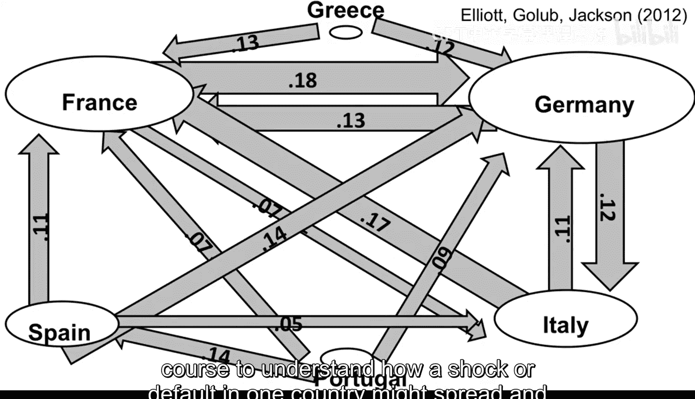
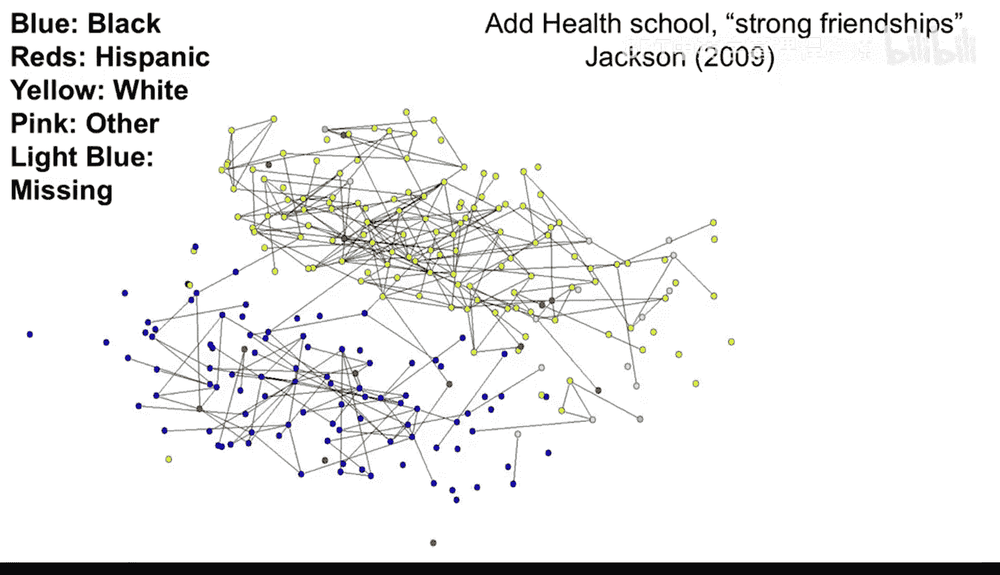
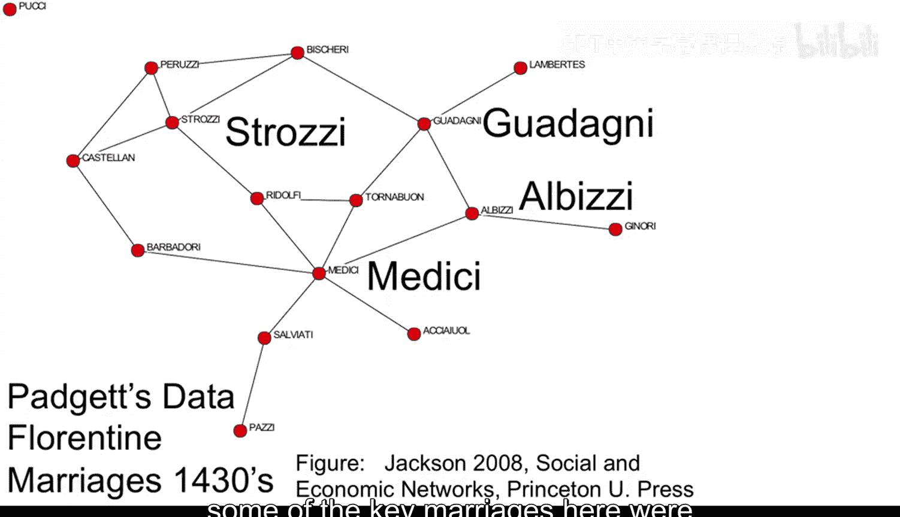

# 斯坦福大学《社会和经济网络：建模与分析｜Social and Economic Networks： Models and Analysis》中英字幕 p01 01_01_01_课程介绍.zh_en -BV1v1421U7Nk_p1-

Hello welcome， I was just working with some data from a project using network analysis to understand financial contags。

 more on that in a minute， let me begin by introducing myself， I'm Matthew Jackson。

 what I'm really here to tell you about is an exciting new MOOC， massive online open course。

And it's a course on the analysis and modeling of social and economic networks。

 the course is designed primarily for people who might be using network analysis and research and so it's aimed at a master's to PhD level with some extra bits for people who are really interested。

It should be easily accessible for advanced undergraduates。

 it's partly based on a PhD course that I've been teaching here at Stanford and the lectures will be at two different levels。

 there'll be a basic set of lectures that make up the bulk of the course as well as some extra advanced lectures that provide technical details for those who really want to immerse themselves in the subject。

Let us take a quick peek at some of the types of questions that we'll be analyzing。

So here is a figure from research I've been doing with two of my former students。

 Matt Elliott and Ben Goub， on understanding financial contags。

 it shows the amount of sovereign debt of each of the six European countries that's held inside another country。

 and we're using some of the modeling techniques that we'll explore in this course to understand how a shock or default in one country might spread and impact others。

The next figure depicts friendships among high school students in one of the high schools in what's known as the ad health data set。

Nodes are coded by race and you can see that this network exhibits what's known as homophily Students are strongly segregated by race How can we measure and explain the formation of this network What's the impact on learning and communication of the segregation in such a network so there's lots of interesting questions there This third figure is another fascinating one it depicts the marriages among 16 major families in 15th century Florence This was a period during which the Medidici rose to prominence and some of the key marriages here were engineered by cosimmo de Medidici so how do we measure the positions of different families can this network help us explain why the Medidici rose to power during this period。

So the course will bring together models not only from economics and sociology。

 but also from computer science， physics， random graph theory and mathematics， statistics。

 and my aim is to provide a synthesis and an introduction to the very multi and interdisciplinary approaches of analyzing networks It should give you a toolbox to go forward with and draw upon as you analyze and model networks。

 and we'll study basic measures of networks， models of network formation， models of diffusion。

 learning， contagion as well as how networks impact behaviors and we'll be using some statistical techniques for analyzing networks and I'll point out some important areas for new research as we go along。

What sort of background do you need Well the course is going to assume that you're comfortable with matrixtri algebra since coding and analyzing networks these days makes heavy use of matrices we'll also be using basic concepts from probability and statistics and some light calculus there'll be a little bit of game theory used in the course but I'll make sure that it will be self-contained and you should feel pretty comfortable on a computer we'll be exploring some network data as we go along。

Now the course is going to run for about eight weeks of lectures and then a final exam each week there'll be video lectures available as well as a problem set and some occasional data exercises。

 there'll be interactions through the forms where you can communicate with your fellow students and people who complete the course with a high enough score and the problem sets and final will earn a certificate of completion。

We'll begin the course soon and you can find updates on the timing on my website。

 so please tell at least two of your friends who might be interested in the course。Why at least two。

 well join the course to find out， hope to see you again soon， take care。

