# 斯坦福大学《社会和经济网络：建模与分析｜Social and Economic Networks： Models and Analysis》中英字幕 p02 02_01_03_1-1-引言.zh_en -BV1v1421U7Nk_p2-

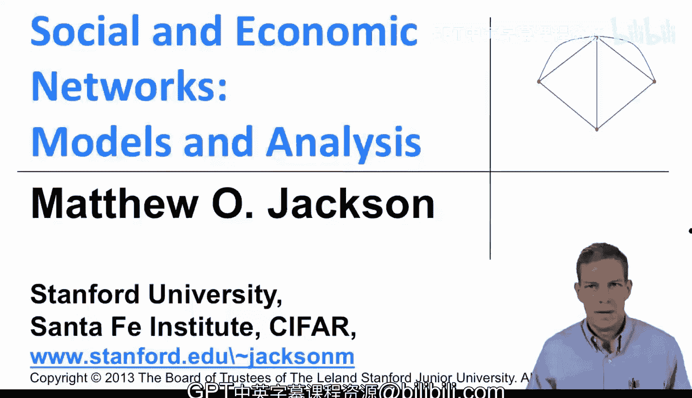

Hello， this is Matthew Jackson from Stanford University and this is our first lecture in social and economic networks。

 and I'm going to start with just a brief introduction of some of the material we'll be covering and of course。

 the most important question we can start with is why study networks and I think from social scientists perspective it's that many economic political and social interactions are embedded in social settings and the structure of those relationships is very important in both determining how people behave and determining what outcomes are so things like trades of goods and services。

 most markets are actually not centralized， but about a curve between different parties and bilateral relationships。

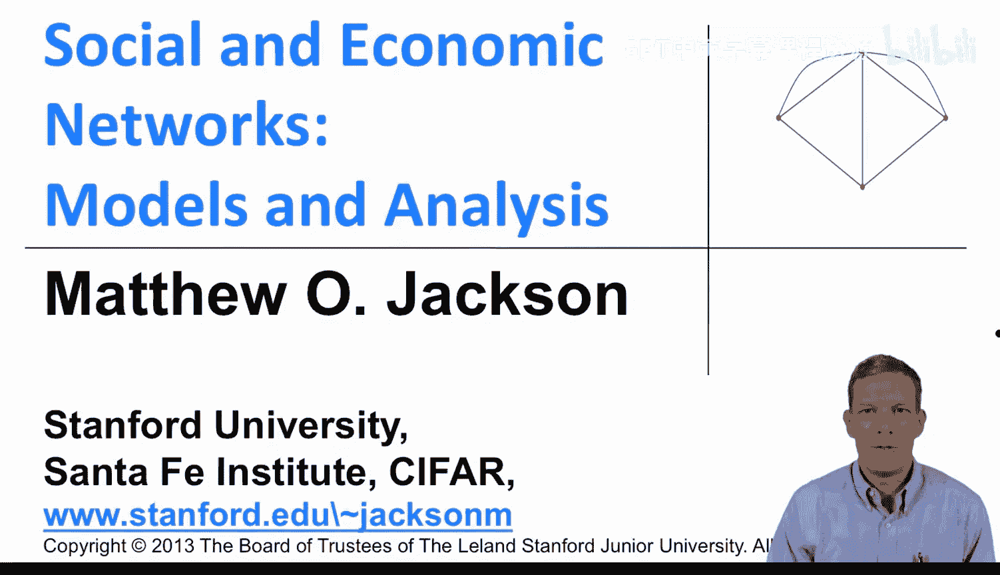

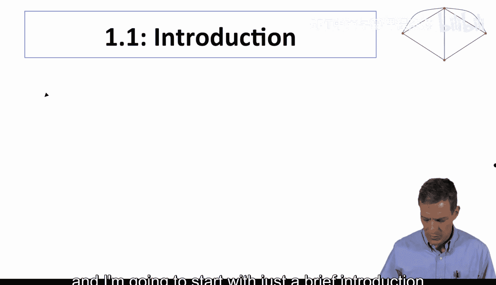

Sharing of information， sharing of favors， risks， transmission of viruses， opinions。

 How did you find out about a job， often through somebody you knew， you know。

 how do you choose who you vote for， How do you make decisions about products。

 A lot of times you're talking to different individuals， What did they hear。

 How do you hear about your information， Polit alliances can be representatives， networks。

 trade alliances， There's all kinds of different settings where network structure is very important。

And the critical to this is the fact that the networks actually influence the behavior。

 so if we look at crime， we look at employment， we look at people's investment in human capital education。

 how they vote， whether they smoke， all kinds of decisions they make。

are embedded in these settings and are influenced by the social structure。

 so most important from our perspective is that networks come in different shapes and sizes and understanding how they're shaped what they look like is going to be very important in understanding what the outcomes are and so there's a lot to understand and to model。

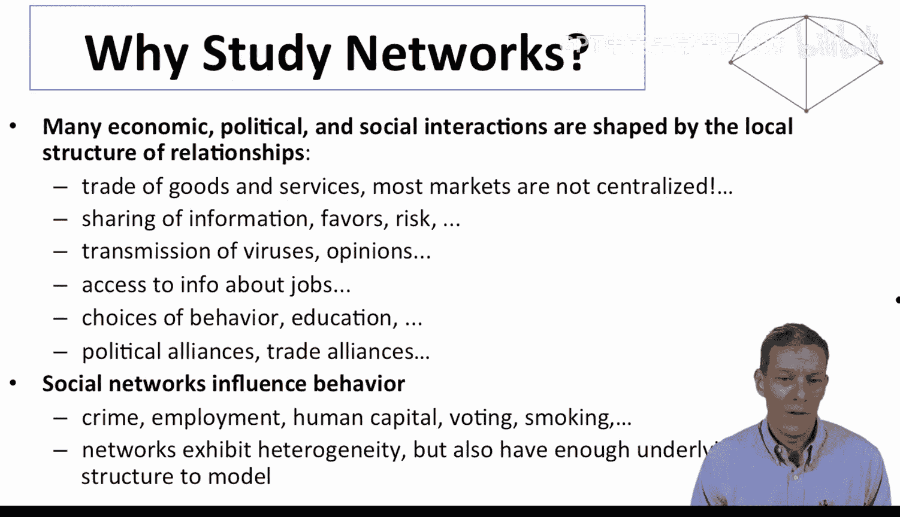

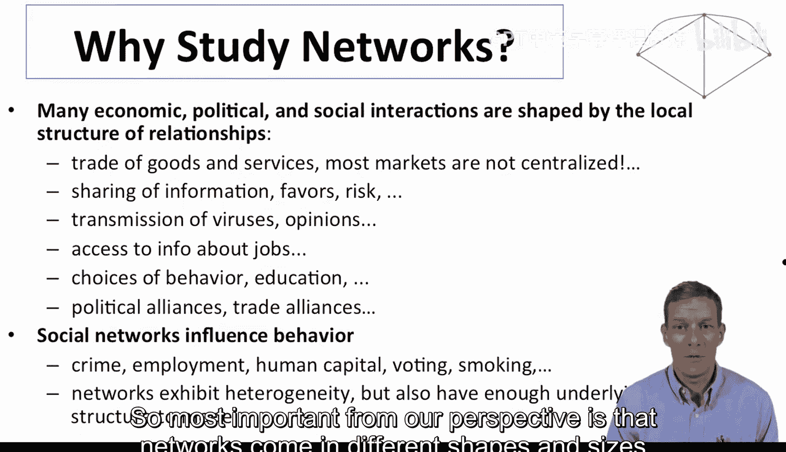

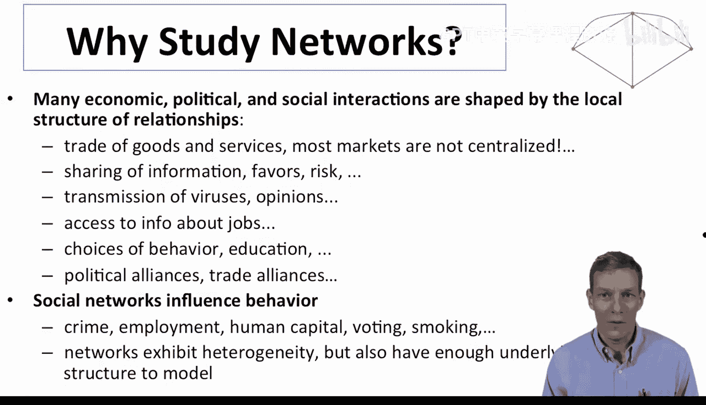

So the primary questions we're going to be interested in this course we'll start with just some background on structure of social networks。

 what we know about social networks， most of the course will'll be looking at how networks form。

 so do the right ones form if we could actually affect the network formation from different perspectives would we want to how do networks influence behavior。

 so what's that relationship between how dense the networks is and what the outcomes are and so forth。

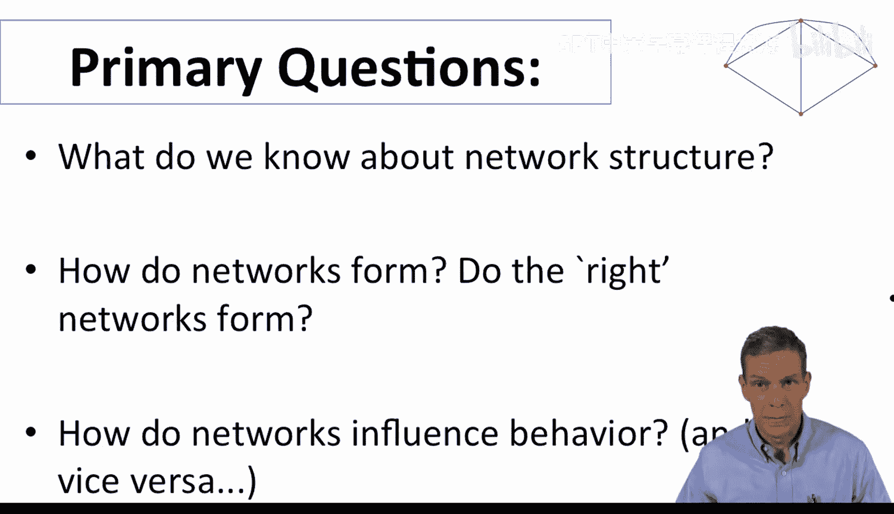

Now this is an area obviously which has been researched in many different disciplines and so when we look at the literatures。

 there's sociology， economics， computer science， statistical physics， mathematics。

 random graph theory， and so what we'll do here is try and synthesize some of these and bring together a unified viewpoint and pulling models from different perspectives and trying to understand what we've learned and also what are important areas for future research as we go along。

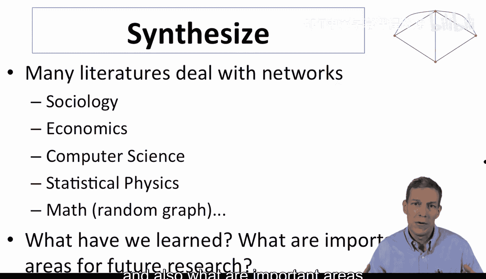

Now in terms of areas for future research and current research。

 we'll be looking at theoretical foundations of modeling basically of network formation。

 modeling of dynamics， design of networks then understanding how networks influence behavior。

 there'll be some emphasis at the end of the course on co-evolution， so what does that mean。

 that means that who my friends are， influences my behavior。

 but my behavior also influences who my friends are， so there's a a co-determination。

 it's not as if one is set in stone and affects the other， but both evolve and together。

We'll be looking at a lot of empirical work and experimental work as we go along， observing networks。

 seeing what patterns we do see and also with an emphasis on testing theory and understanding regularities and patterns that are out there in the data One other thing that we'll see as the course goes along is methodology so there'll be a whole series of definitions about networks for instance。

 understanding who central in a network can be measured many different ways and we'll try and say something about what are good and bad ways of doing it for different applications。

 so there might not be a single way to approach a problem but understanding what are the different methods and is there something we can say about the methods themselves。

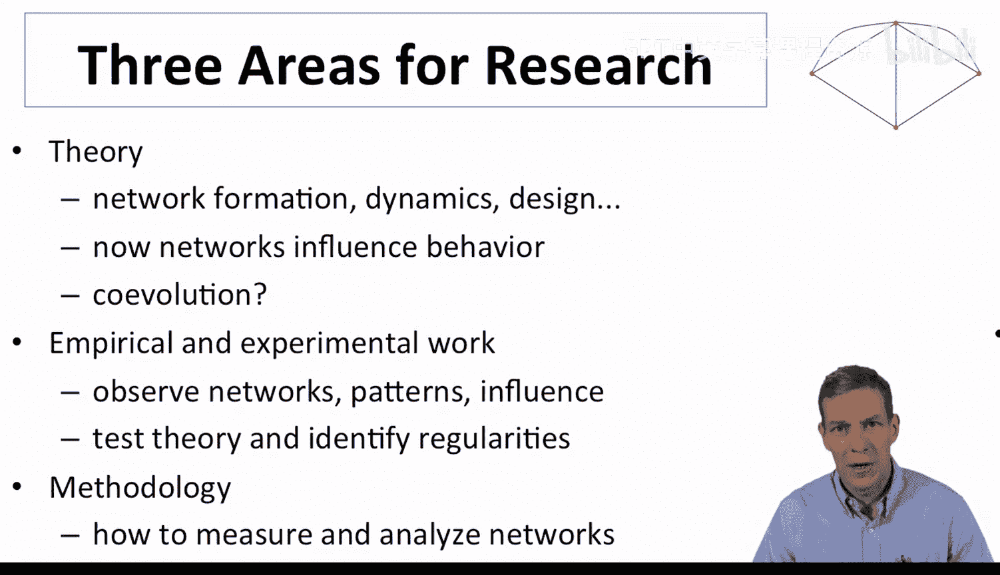

Central focus in this course is really going to be on the models and that the types of techniques we'll be using are one pulled from random graph theory。

 pulled from mathematics， the other we'll be using some strategic and game theoretic techniques and we'll also be using some hybrid models that involve both choice and chance and looking at some statistical models for fitting and analyzing networks and dealing with data。

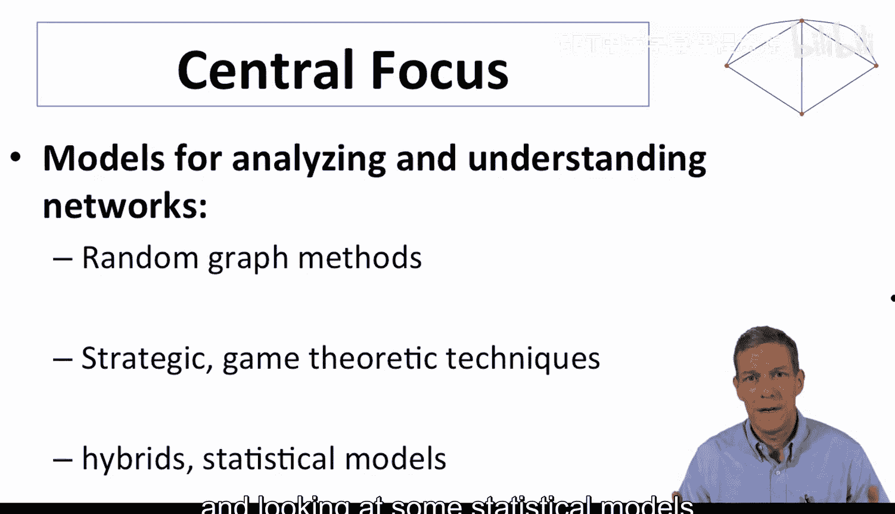

The goals I'm not going to presume prior knowledge of network analysis。

 I'm going to try and introduce you to a variety of different approaches so the idea here is really breadth more than depth so it's an idea of giving you some exposure so that you know what's out there。

 what the types of different tools which tools might be appropriate in different settings there's a lot more that can be said about each of the subjects we're going to talk about but this will be more or less an introduction to give you an idea of exactly what the tools are that might be appropriate for different parts of analysis it'll also give you some sense of different disciplines techniques and what the kinds of questions and perspectives that they take are。

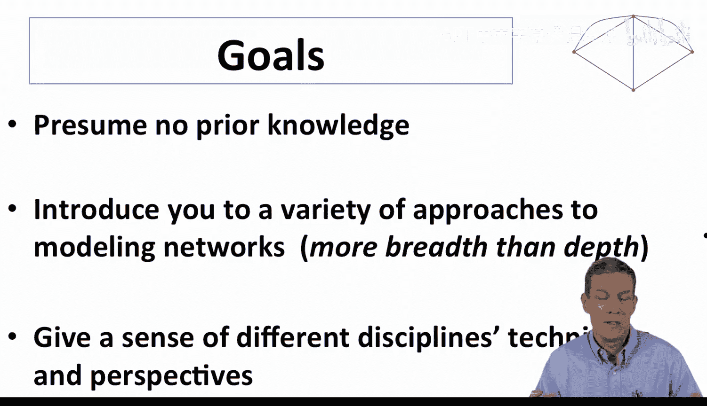

In terms of one important aspect when I start the course here。

Is is really emphasis why do we care about modeling things to begin with。

 And I think this is an important question that will shape the structure of what kinds of models we work with and how they're formed。

 And you know， when we look at models， one thing they do for us is give us perspective into why we see certain things。

 So why do social networks have short average path lengths， for instance。

 So why is it that there's six degrees of separation in the world。

 Well we'll see an answer to that that will come out of random graph models。

 so that just understanding a structure of how things arise at random can help us understand why we might see something like that。

 So understanding a basic tree structure that underlies social networks will help us understand path length。

modelsels also allow for comparative statics， so if we understand that models change as we change different parameters that can help us make predictions about how the world might change。

 so how does a component structure change with density so as we if a network has more and more links。

 what does that do to the overall component structure of a network it'll help us to make predictions out of sample so if you want to come in with a new policy for instance。

 you're trying to stamp out a flu epidemic how effective does a vaccine have to be in order to limit the extent of an epidemic。

That's a question that we can begin to answer with network analysis things will also the models will allow for statistical estimation。

 so if we want to understand， for instance， is there significant clustering which means you know are my friends friends with each other does that happen because of some social force or is it happening just at random we can test models so we can take models and then ask does it appear that this happened at random or does it appear that something else was going on so there'll be statistical tests that we can use once we have models for analyzing that kind of question。

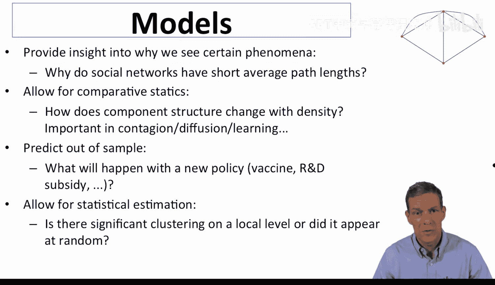

In terms of a basic outline of the course it's going to break into three parts the first part is going to be background and fundamentals so definitions。

 how do we analyze networks， what are some basic properties of networks characteristics and along with this will be empirical background the second part of the course and the central part of the course is going to be network formation models so we'll look at random graph models and then we'll also look at strategic formation models when people are actually making choices The third part of the course is networks and behavior that's going to then take networks and understand how the shape of networks and a structure of networks。

 who do you know how many people do you know who do they know and so forth。

 how does that influence what your decisions are， your behavior and so forth so we'll look at things like。

Diffusion and contagions。 We look at learning models。

 And then finally what's known as games on network or situations where what I do depends on the choice of my friends。

 So if there's a new app out there， Do I want to get it。

 Well it might depend on how many of my friends get it and that might depend on how many of their friends get it and so forth。

 And so how do we analyze that in a network context。

 So more or less these three main parts are going to be the core structure of the course And there's also a textbook which is completely optional that I've written where a lot of the material is going to be pulled for。

 And in terms of this outline the numbers on the side here indicate the chapters So1，2，3，4。

5 and so forth， these indicate the relative chapters out of the book that correspond to the lecture structure of the course。

 So will be moving along through the book。With a couple of exceptions in terms of which chapters are covered and which part。

 so that's a basic outline and so let's get started。

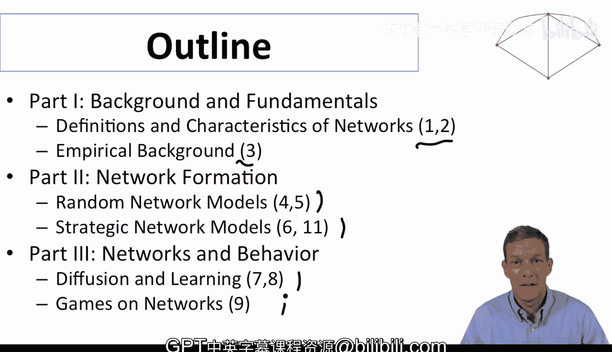