# 斯坦福大学《社会和经济网络：建模与分析｜Social and Economic Networks： Models and Analysis》中英字幕 p03 03_01_04_1-2-案例与挑战.zh_en -BV1v1421U7Nk_p3-

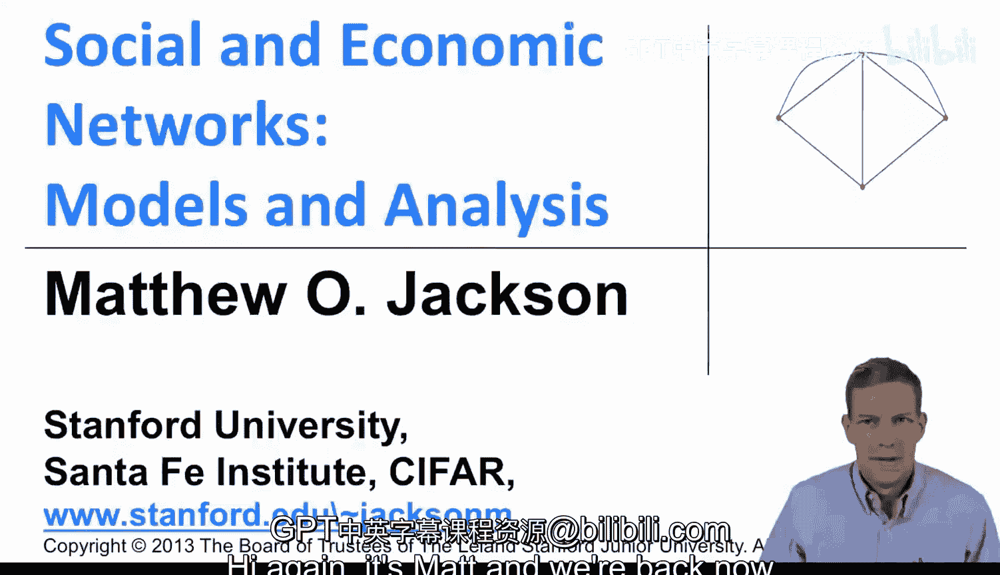

Hi again， it's Matt and we're back now looking at a couple of examples and talking a little bit about the challenges of modeling and analyzing networks and why there's actually something interesting in the course to talk about So in terms of outline the part we're basically in the first part of the course so we're looking at background and fundamentals。

 definitions and characteristics and what I'm going to do is start with a couple of examples and the idea here is is to give you some idea of feeling for data view of applications and previewing the kinds of questions we're looking at and the word network is a very broad one。

 it covers a lot of different possible applications and the kinds of things that we're really going to be looking at our ones where we have some sort of decision making people are going to tend to be the nodes so things like phone networks。

 email networks， marriages friendships， co-。

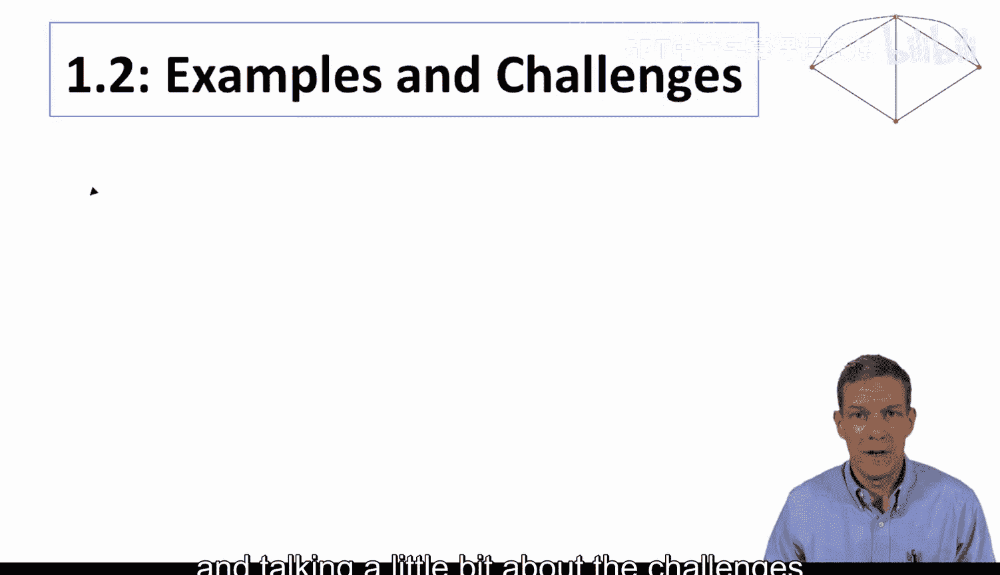

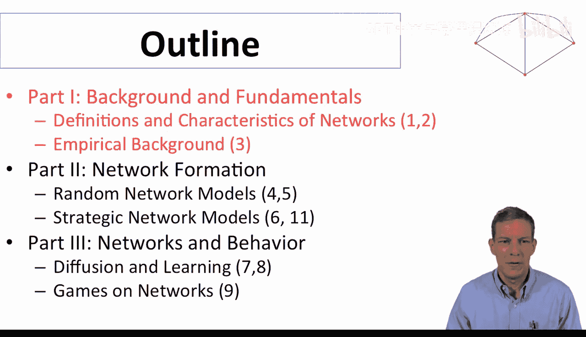

ships， collaborations， different kinds of relationships between different individuals。

 and often we'll be taking the nodes as single people making decisions。

 but often sometimes well look at organizations and other kinds of things。

 so maybe countries or firms and so forth。

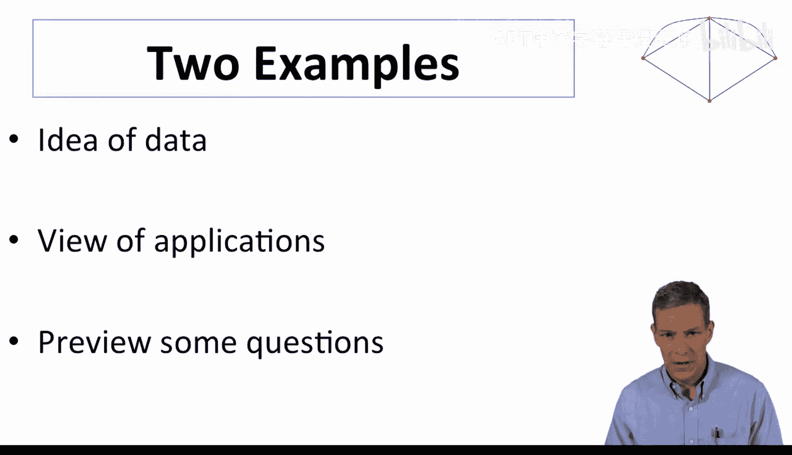

So just to fix ideas， let me start with an example that comes out of a paper by Paget and Ansl。

 which is based on data that was originally。colllected by Kent and here what I'll do in terms of references is I'll standardly just give you the names of the authors in a year and there'll be bibliographic information that you can find。

 which a full bibliography of the course which has a list of the places where you can find everything thing that I refer to in the course。

And so here， what they were looking at is interrelationships between the 16 major families in Florence in the 1430s。

 so this was Renaissance Italy， and these different families in this particular picture that you're looking at are a tie between two families here is indicating that there's marriage between two families。

 so you know for instance， this tie right here is a marriage between the Reddolphs and the Medidici。

And the important aspect of what's going on in this picture is that there are a series of different families。

 the period before 1430s was one where there was basically an oligarchy so there were many different families that were powerful and at this point in time the Medidici rose to power and in particular。

 the numbers here that we're going to talk about later in the course are indicating how central these different families are in terms of how many paths between other families in the network passed between a given family。

 so for instance， if the Radolphs and the salvis want to get together in this network they have to pass through the Medidici。

 so the Medidici lie on a path， the shortest path between the Raolphs and the salviati。

So in this particular situation， what is if the 52 percent indicate。

 it indicates that when you look at two families in the network and you look at a shortest path between them。

 52% of the time when you're looking at different shortest paths， the Medidici lie between them。

That gives you an idea that the Medidici were in some sense very central here and the Medidici rose to power。

 they became the ruling family essentially of Florence during this time period。

 there's a lot of analysis in Paget and Ansel's paper that you can read about。

 but the basic idea from looking at the network analysis is understanding that they were more central。

 gives us an idea of why they might have rose to power even though they were not the wealthiest at the time or the most politically connected at that time period。

 so we're dealing with a situation where there's a network which helps us understand what was going on socially。

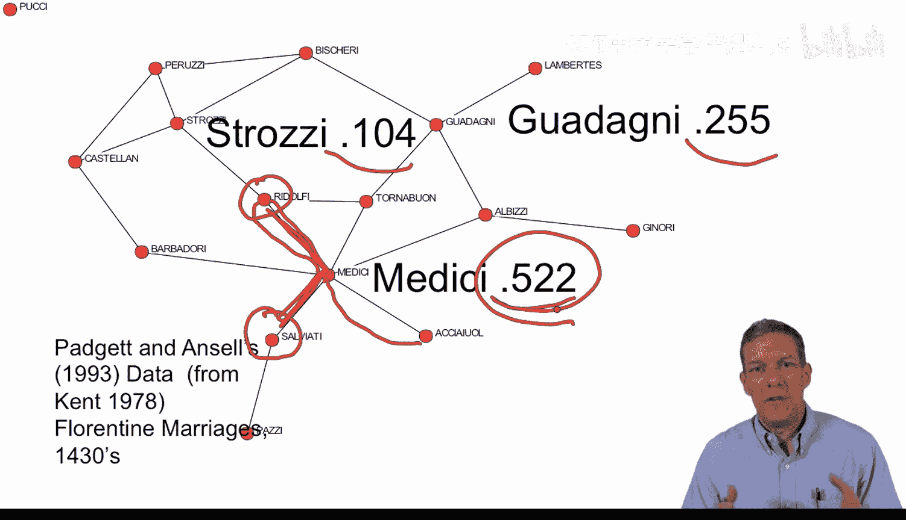

The next slide here。Situations where we have countries as the nodes instead of individuals。

 So these are European countries。 We've got Germany， France， Greece， Italy， Portugal and Spain。

 So six of the major countries in Europe。 And in particular。

 now we've got a weighted and directed network indicating how much of a country's。Debt。

 national debt， sovereign debt is held by entities inside another country so for instance。

 18% of French national debt is held in Germany， 13% of Germany's debt is held in France by entities in France what does this network do for us。

 it helps us understand how shocks in one country can propagate to affect another so when we look at some of our models of contagion and diffusion and so forth。

 what we'll do is we'll analyze networks which will be very helpful in analyzing how this works so this is from a recent paper I've been doing with Matt Elliott and Bengolo in understanding the transmission of financial shocks and crises in one country and how they might lead to devaluation or problems in another country。

 so some sort of transmission of financial stress。So these are two examples that give us an idea of things that。

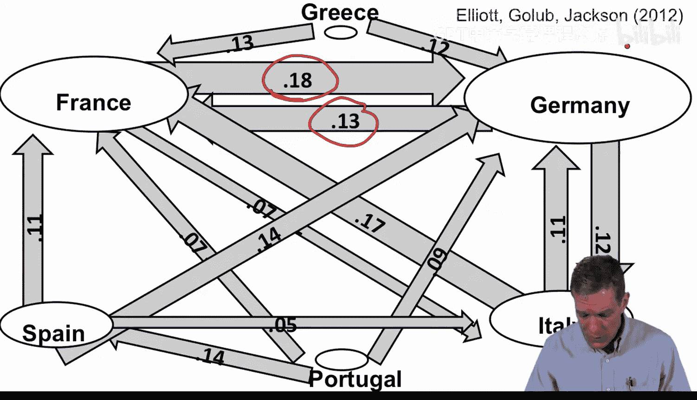

Are illuminated by looking at network data and the kinds of things that we'll be studying in the course are going to take advantage of building models of networks so that then we can understand these interactions and what we know about networks is that they're critical in many settings。

 job context， crime， risk sharing， trade and politics there's a rich sociology literature。

 which shows that network structure does impact behavior and as we just saw the Medicis were not necessarily the wealthiest or the strongest politically。

 but they were the most central and a well-defined sense and one of the things we're going to start with here is that there will be something systematic we can say about networks。

And。In particular， when we start thinking about the importance of networks。

 the fact that these specific relationships are going to matter means that we have to be able to talk about what's the shape of a network。

 can we say something systematic about how networks are shaped and how the shape transmits into behavior so what do we know about networks we know many things and in particular networks are important in a variety of different settings from how people hear about jobs finding information about employment to crime to risk sharing so if I have problem and amount out of work for a while。

 can I borrow money from friends， can I get help from friends。

 how does trade occur understanding political alliances and behavior and legislature as a whole series of things and there's a very rich？

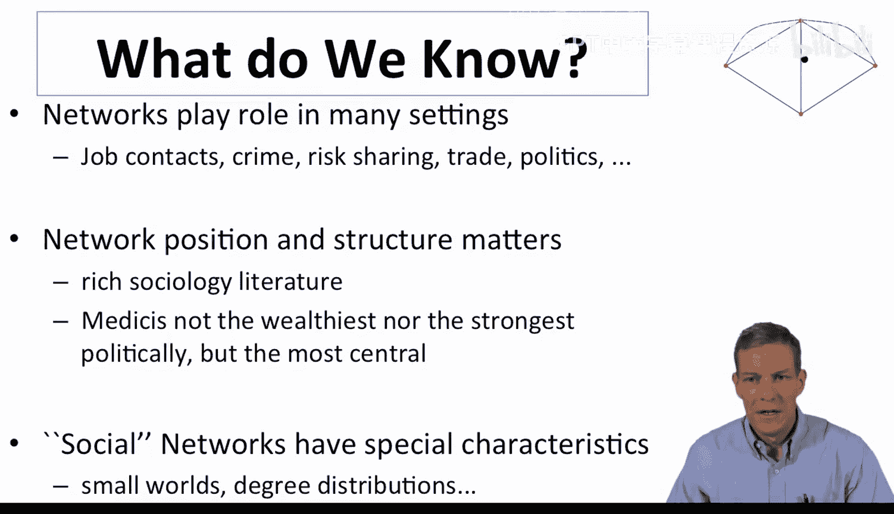

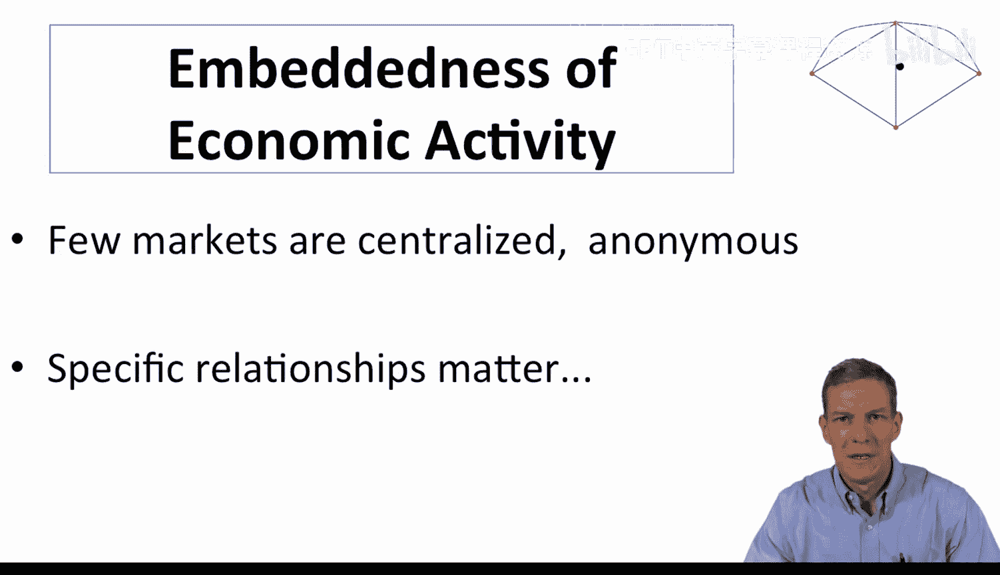

sology literature， which makess clear how some of these things matter and as we just saw。

 the Medis were not necessarily the wealthiest or strongest。

 but looking at networks can help us understand something about why they might have been。

Able to take advantage of position to advance themselves understanding characteristics and networks is going to be very important so we'll be looking at things like the pathlinks and local properties of networks。

 small worlds， what's known as small worlds degree distribution So how how skewed as a network are there people who have lots of connections and other people have few or does everybody typically have the same number of connections。

 those kinds of things are going to matter Now in understanding things。

 it's going to be important that we embed whatever the behaviors are inside a network So if we want to understand how markets work。

 we'll have to understand something about what the different links represent in a network So specific relationships are going to matter。

 how do they matter， what's the process by which people make trades and so forth。

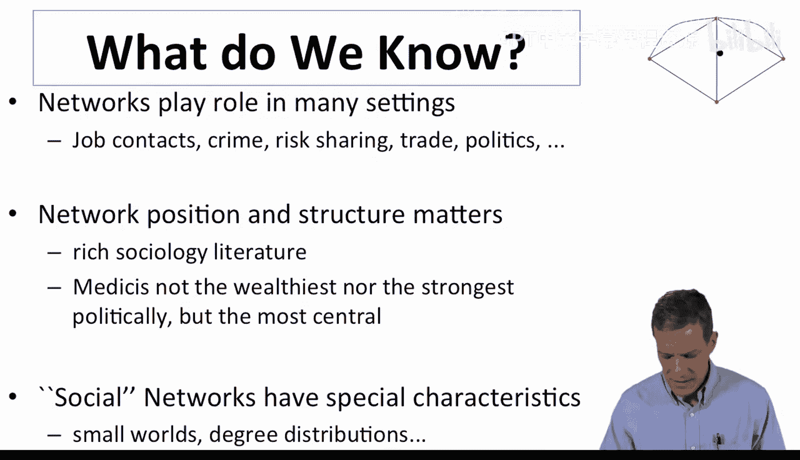

Just in terms of giving basic motivation and background。

 one thing we can say is that there's a number of settings where we know that networks play important role and one of the classic areas that's been studied quite extensively is the role of networks in labor markets and in particular how people end up planning out about jobs so some of the early work in this area。

 Myers and Schchultz looked at what they did is they survey a series of textile workers in the late 1940 so the paper is published in 1951 and what they found was that you know asking people how did you find out about your job actually 62% found out about their first job in the textile industry from somebody already there so they had a contact who was in the textile industry that was what got them in there only 23% in contrast found by their job just by applying directly 15% by agency。

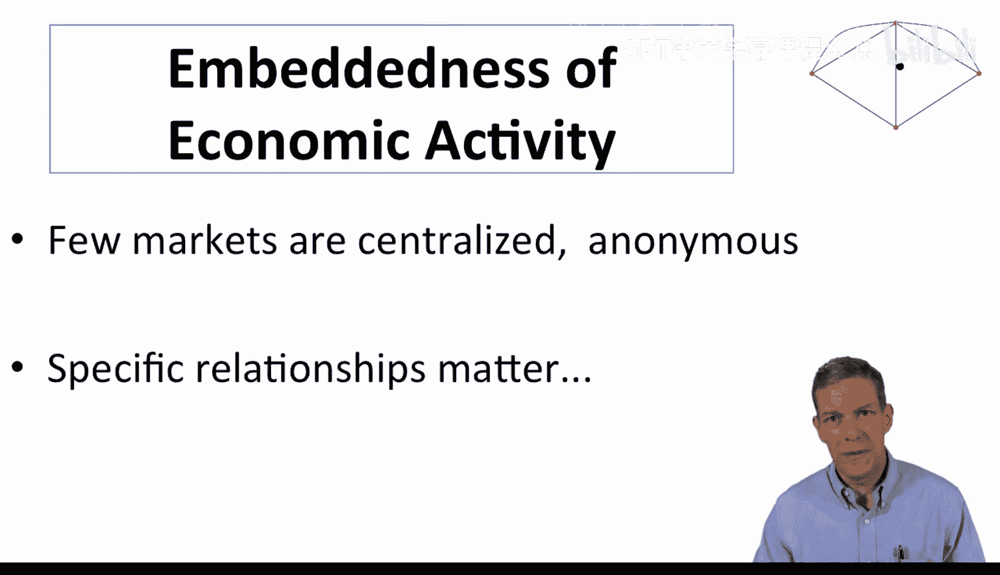

and ads and so forth。 So you can see that the actual network of context was a very important player in how people were finding out about jobs in the textile industry。

 Later studies reason Schultzford since 1970s and other classic What they did is they went around and interviewed people in different areas。

 different professions。 and they found that it wasn't simply textile workers that were finding their jobs through contact networks。

 typists don't really exist anymore， but at the time， if you wanted something typed up。

 you had a typist， 37% of those people were finding their jobs through contact accountants 23。

5 material handlers 73。8 janitors 65 electricians 57。

 So there was a range know ranganging from 20 to 80% roughly but overall word of mouth and being connected to individuals was an important way of finding jobs and no matter what profession you were in。

There's been a whole series of other studies， Grnavetter's work on this is quite influential。

 there's a nice survey of this literature by Unius and Lowry in 2004。

And when we begin to look at this， it's not just that networks are important in labor markets。

 but we see that networks have played a role in a series of other settings as well。

 so just to mention a few to keep this in our minds as we go through the course networks have been looked at in criminal settings。

 so two thirdds of criminals actually commit crimes together with others so they're not acting alone。

 there's evidence that social interactions play important roles in determining who becomes a criminal and youth and have delinquency rates。

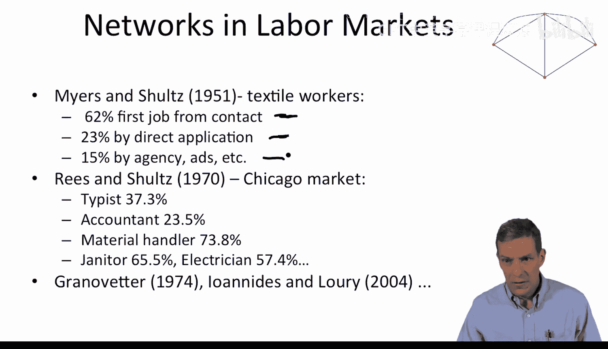

In markets， there's a whole series of。Of studies that have looked at things like how people make business contacts。

 who you end up working with， who you end up contracting with Brian Newey has a nice paper looking at the importance of specific contracts in the garment industry so who ends up producing garment for which designer。

 there are things like repeated interactions in fish markets it can be represented as network structures social insurance risk sharing。

 when we look at diffusion， they're going to be important roles here so understanding which farmers end up taking up hybrid corn at which point in time which doctors end up prescribing certain drugs at different time so there'll be a whole series of different things and the range here is going to be quite extraordinary so the main challenge we're going to face in the course is the complexity of networks and what do I mean by the complexity。

Do a very simple calculation， so imagine that you have just 30 nodes， so a fairly small society。

 30 individuals， say a classroom in a school。And we ask。

 how many different possible networks could there exist that represent the friendships in that classroom？

Well， it could be that it's an empty network。 Nobody's friends with anybody。

 It could be that it's a complete network。 Everybody's friends with everybody else。

 The number of possible networks in that classroom is actually enormously large。

 So person 1 could have 29 different friendships， right， They could be friends with person 2，3，4，5。

 what 2，30。Person 2 could have 28 friendships not counting person one and so forth。

 So if we ask how many， what are the number of different friendships that could be either present or not present in that classroom when you total all those numbers up that's。

435 in total。 so that's 30 choose 2 in terms of the combinatorics。

 435 different possible friendships of pairs of individuals who could be friends with each other。

 so that's 435 possible links that could be there present or not and when we look at 435 friendships。

 we've got two to the 435 possible networks that could be there。

 So each one of those links could either be present or not two to the 435 well。

 435 doesn't not like that big a number， but two raised to the 435th power is an enormous number。

 So the estimates of how many atoms in the universe。

 there are somewhere between two to the 158th and two to the 246。

 So if we look just at one network in one classroom we've got more possible networks then there are atoms in the universe by orders of magnitude。

 So there's no possible way that we can just describe networks by。It's network number 53。

 we're going to have to find ways of describing these networks that are going to capture the basic properties of the network in a very succinct and simple way so that we don't have to just go through a giant catalog of different possible set networks that are out there。

 it's simply overwhelming。So the main part of the challenge that we're going to have to deal with first is just representing networks and thinking about how do we capture this complexity in a way that makes sense。

 and so that's going to be the beginning of our definitions， how do we represent networks。

 how do we capture them。

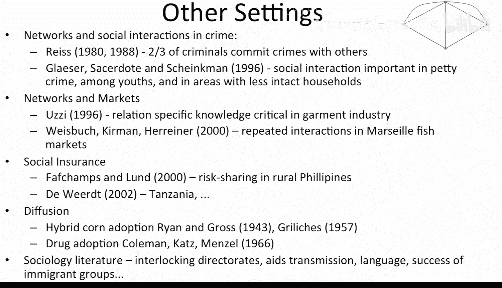