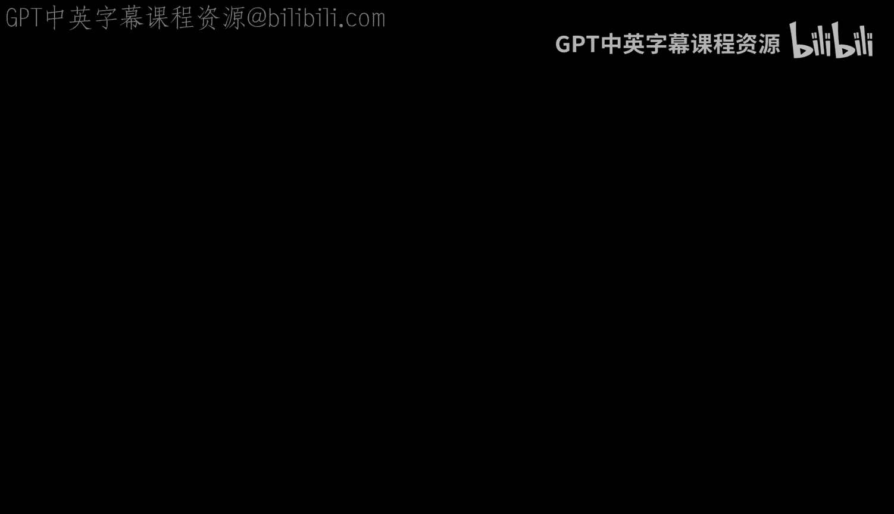
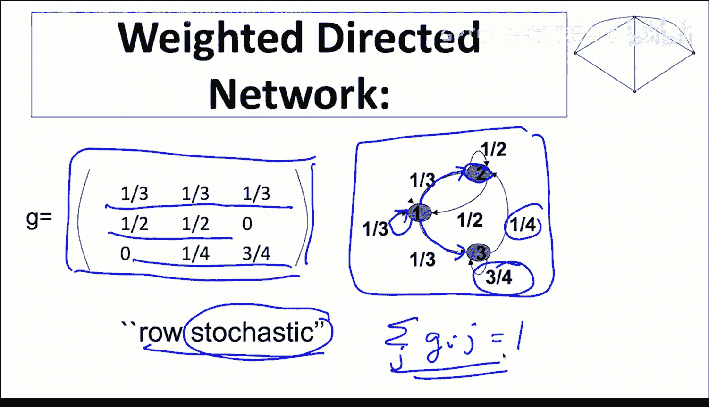
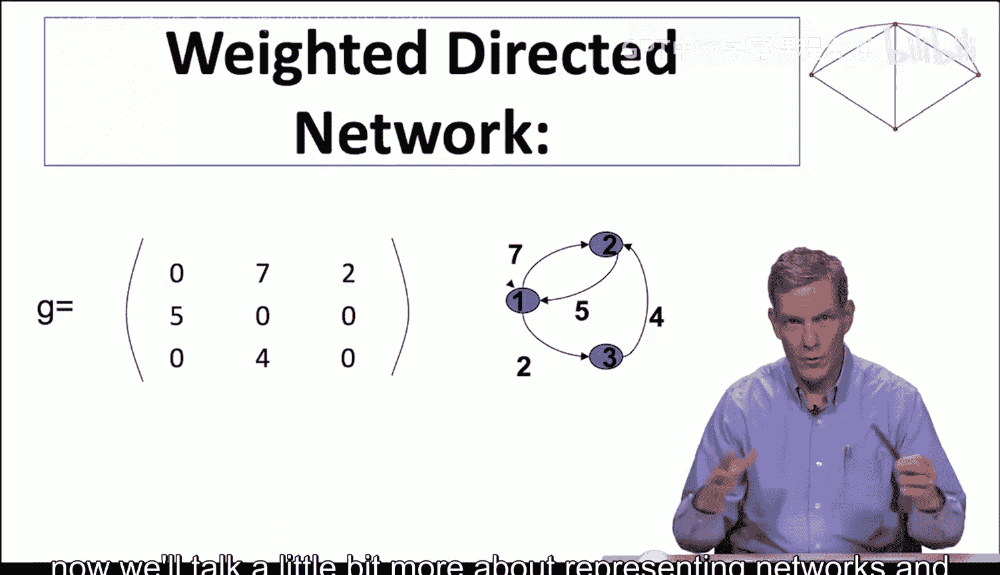

# 斯坦福大学《社会和经济网络：建模与分析｜Social and Economic Networks： Models and Analysis》中英字幕 p04 04_01_05_1-2-5-背景定义与符号基础（熟悉者可跳过-8-23）.zh_en -BV1v1421U7Nk_p4-

Hi folks， so this is a lecture which is designed for people who haven't had much background in social networks or working with representations。

 so if you have had a course， say lot ofomics course or Michael Kern's course。

 if you've seen a course before， then and if you feel comfortable then you can skip this one。

 but this is for people who really just want to get the real basics down of how we represent these things。

And so what I'm going to start with is just basic different types of networks。

 so generally we have some set of nodes， vertices， agents， actors， players。

 so those are the objects that will be connecting via links and ties and between those individuals we have edges。

 links， ties， you see many different terminologies in the literatures depending on whether you're coming from graph theory or sociology or economics。

And they come in different flavors， so it might be that they have intensity， they could be weighted。

 so it might be， for instance， that we're keeping track of how many hours two people spend together in a week and then wait it could go anywhere from  zero to whatever 7 times 24 is 148。

And then we could also keep track of things like how much of one country's GDP is traded with another。

 it could also be something where instead of having intensity。

 we're just keeping track of whether there's a relationship or not and we could think of those as unweighted so we have two people written an article together if they're researchers our two people friends on some social platform that's either something that's true or not true and they come in flavors that could be directed or undirected so it could be that we're looking at mutual relationships like coauorships being relatives being married or it could be something where there's a one wave relationship So one web page can link to another without being linked back to it could also be one article cite another or you could follow somebody on the social media platform without having them follow you so there's different situations and we'll represent these depending on exactly what we're looking at in different ways so if we're。

Think of say a simple undirected network， then we can keep track of this either as what's known as the adjacency matrix。

 so that's the G here， which is G for graph generally where what we're going to do is we'll put in a1 if the two individuals are connected if I and J are linked then that entry will be 1 and it's undirected so it'ssymmetric so here1 and2 are linked together and we have that G12。

RightG12 is a1 and G21 is a1 and that's indicating that these two individuals are linked together。

 so sometimes we'll represent these things graphically。

 sometimes we'll represent them in terms of an adjacency matrix。

 it can also be quite handy to just list the links so for instance just keep track of a list of which。

Pairs are linked together and in terms of notation。

 it'll be a little easier not to carry around the set note bracket notation all the time。

 but just say one， two or linked，  one，4 are linked，2，4，3。

4 and why would we want to represent things in this way？

Well when we start working with really large data sets。

 so something that has millions or tens of millions or more nodes。

 then keeping track of a matrix becomes cumbersome。

 so it's going to be hard to put that into memory and a computer。

 whereas if we just keep track of the list of links that economizes quite a bit on what you have to keep track of and also in terms of our representation。

 sometimes it'll be easier just to think of sets of links rather than thinking of matrices。

 but other times the linear algebra associated with matrices willll be quite handy。

 so we'll flip back and forth between these different representations and G sometimes will represent a set of links。

 sometimes it represent a matrix， sometimes we'll represent things graphically。

 well be flipping back and forth between all three in this course。Now in terms of directed networks。

 it's a similar situation， but now we don't have the symmetry so it's possible that one is connected to two right so there's a directed link from one to two but the link from two to one is not present so we don't have the reverse relationship and so we still have an adjacency matrix we can still keep track of things but now when we keep track of this G the order of things makes a difference so before if it was undirected one4 meant one and four work link together now we have to keep track of there's a link between one and4 and one direction and also back in the other direction but between one and two it only goes in one direction so now there can be asymmetries and the order of the actual nodes in a link makes a difference and there's different conventions but basically we'll be thinking of this as say the out degree。

An arrow out from one， so one is following two， one is connected to two。

 but two is not connected to one， so there's not something going back in to node one。

 and that'll be the terminology we'll use in terms of a node link going out from a node or a link coming into a node。

Okay we can also have weighted directed networks and when we get to talking about learning especially then we'll be looking at this sort of network and in particular what is this look at what does this represents so if we look at the picture here on our right what we have is a series of different nodes that have weights between them so in particular。

 for instance node one is putting a third of its weight on two a third of its weight on three and a third back so it weights everything everybody equally and we can think of this is if I'm paying attention to opinions and I'm trying to form my own opinion I might be paying attention to the information that comes into each person here one is very democratic and is weighting everybody equally two is slightly different there two weights one half and two a half so two is not paying attention to three at all but it's putting equal weight on one and two when we look at three。

In this case。Then we see that three is putting most of the weight on him or herself and only a quarter on two and there's again going to be an adjacency matrix in this case and here this is what we would call row stochastic and the situation where we're thinking really of weights that sum up to1 so they're all non- negativegative so somewhere between zero and1 and when we look at the weights in this case。

 they're summing up across each row so sometimes we'll have weighted directed networks。

 well we might be interested in stochastic ones so stochastic here。

 the sum of sum of the GIJs across J is equal to1。So we have that row stochastic matrix。

It might also be that the weighted directed network doesn't sum to one so for instance here if we're thinking of the number of hours that different nodes spend with each other。

 one is spending seven hours with two a week， two is spending five hours with one or five hours say a week of following one one is spending two hours following three and so forth so we could have hours here or we could think of this as say numbers of emails that are sent in one direction or another and they don't have to be reciprocal it could be that two is sending emails to one and one sends more emails back to two and here three is sending them to two but two doesn't send them back so these are all different representations depending on which applications we'll be looking at we'll be switching back and forth and of course one limitation here is all of these are static pictures so they're fixed matrices。

 they're fixed graphs theyre static in time dynamics we'll talk about a little bit in the course。

Be using these over time， they might be changing， and so we might keep track of these with time subs as well。

Okay， so this just just sort of basic background of how we represent things。

 and now we'll talk a little bit more about representing networks and what we can do with these kinds of representations。

