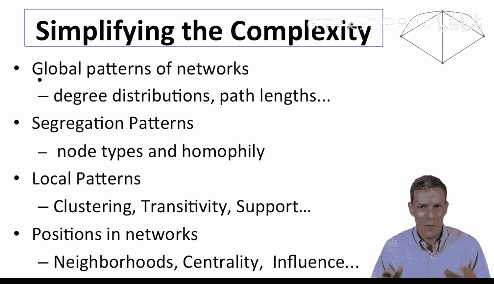
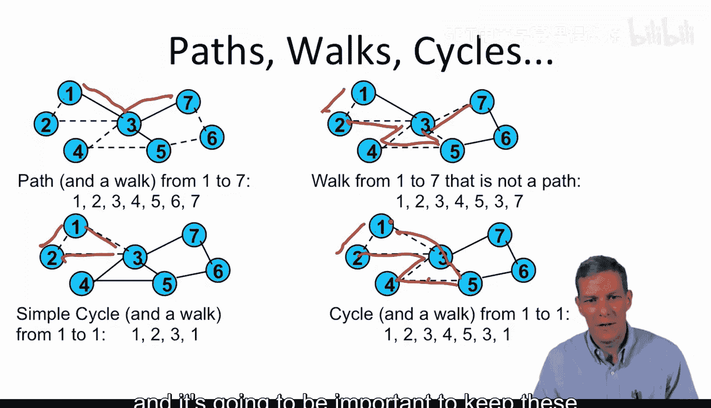
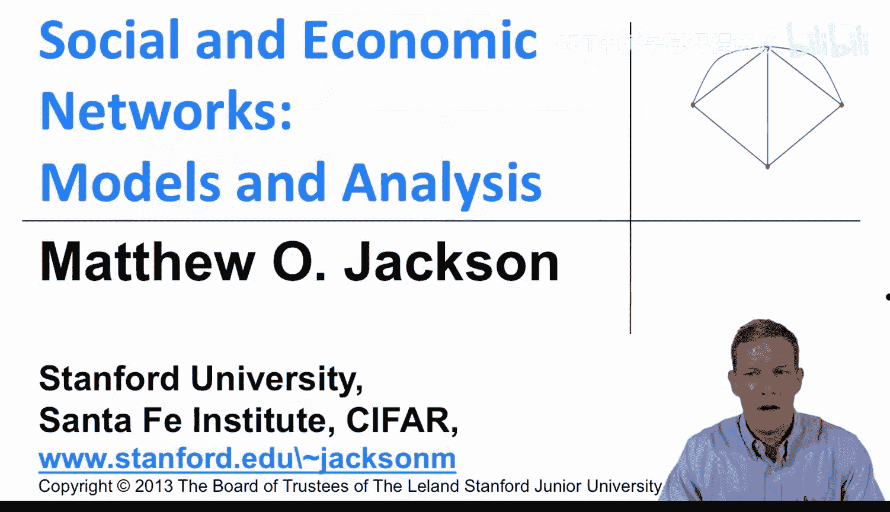
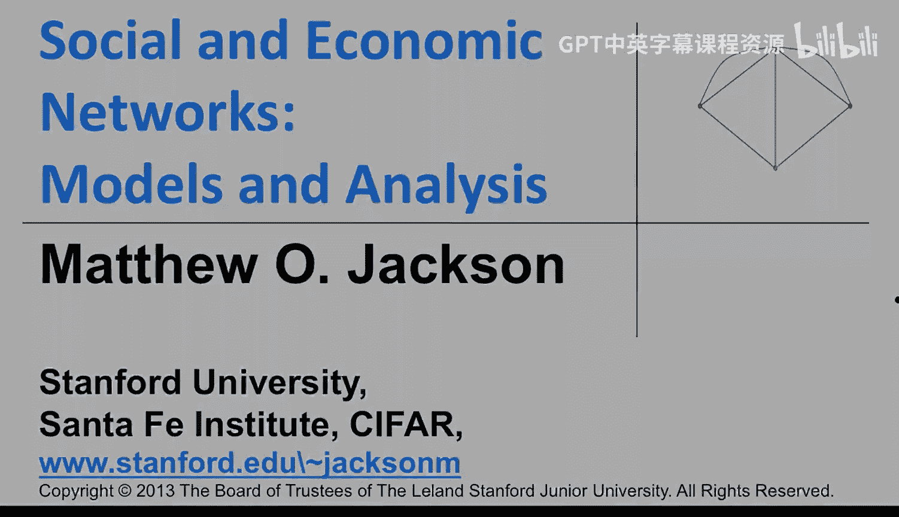

# 斯坦福大学《社会和经济网络：建模与分析｜Social and Economic Networks： Models and Analysis》中英字幕 p05 05_01_06_1-3-定义与符号.zh_en -BV1v1421U7Nk_p5-

Hi， this is Matt again。 And now we're ready to start talking about how we can represent networks and talk about their properties。

 And in terms of simplifying the complexity that we're facing in describing networks。

 We're going to think about different kinds of patterns that there might be。

 So one is going to be that there's global patterns of networks。 So overall， big picture items。

 So how are the different connectedness of individuals distributed through the society。

 Are there's some people who are really well connected and service hubs and other people who are not so well connected or is everything very evenly distributed。

 So that's something path lengths， How far is it to take to get on average from one node to another。

 there's going to be segregation patterns。 So if we begin to think of nodes as having characteristics。

 say people's ages， their genders and so forth， do we see separations between nodes of different types or are things fairly well integrated。

Local patterns， do we see tight clusters of nodes that are all tightly connected to each other cliques。

 do we see that if I'm connected to somebody else and they're connected to a third person that I also tend to be connected to that third person transitivity。

Do relationships often have friends in common， are they supported？So we'll look at local patterns。

 little know zooming in on particular parts we'll also talk about nodes。

 positions and networks so how central is somebody how influential are there what is their neighborhood structure look like so there'll be different ways that we'll be talking about networks overall and we'll also be looking at nodes and positions and networks and other kinds of things so there's going to be a series of definitions that we have to go through to keep track of these things So the basics in terms of representing networks and there's going to be some set of nodes。

 vertices， players depending on what literature you're looking at these they'll have different names I might go back and forth between the names in the course so sometimes I'll call them nodes sometimes I'll call them agents sometimes I'll call them players。

 vertices etc but there's tend to be some finite number little end will be our typical characterization of how many there are。

And one basic wave representing a network is just by what's called the adjacency matrix。

 so it's going to be a matrix of zeros and ones， so an n by N matrix and what it indicates is are two nodes connected to each other so GIJ equals one indicates a link or a tie or an edge between two nodes I and J。

Now， generally， unless otherwise statedd in a course we'll be dealing with ones which are not directed。

 so if I is connected to J， then J is connected to I so for' friends with each other we're both friends it's a mutual relationship or if we're allies with each other we're both allied to each other it can't be that one country's ally to another and not vice versa。

 so we'll tend to look at it that way， and we'll tend to work generically with zeros and ones as the structure of it so there's either a relationship or not。

 but we could allow for directed networks， we could allow for weighted networks so when we looked at the financial relationships or the amount of debt that was held inside one country of the sovereign debt of another country。

 that's going to tend to be a directed network and it's going to be weighted networks。

 so it's going to have different intensities on things。

When we think about an alternative notation it's going to be very useful for representing networks。

 sometimes we'll just use instead of thinking of an adjacency matrix。

 we'll think of representing a graph or a network by just listing all the relationships that are present so a notation will have as it will say that I andJ is in G if that means that there's a link between nodes I andJ so a very simple succinct notation we'll just keep track of the sets of links that are present and depending on whether these are ordered or not ordered。

 they'll be directed or not directed， so a network is going to be a pair of a set of nodes and either an adjacency matrix or a list of all the links that are present depending on the particular context which way it's easiest to represent the network。

Okay。So basic definitions， one thing we're going to want to keep track of is sort of ways of navigating through a network。

 what are known as walks or paths， a walk in a network from say， node I1 to node IK。

Is going to be a sequence of nodes I1 I2 blah， bla through IK and a sequence of links I1 is connected to I2 I2 to I3 and so forth。

 ending up at K such that each one of those links is in the network G okay so a walk in a network from one node to another is a sequence of links that take you from that first node to the last node So often in this kind of setting。

 it's just going to be convenient to represent just as the corresponding sequence of nodes such that we know that each subsequent pair are connected in the network G。

 So in terms of a picture well before I go to a picture that's also talk about path cycles and geodess。

So a walk is going to be some set of links each connecting to another node。

 but they can possibly cycle back on each other。 A path is going to be a walk where each node is distinct so we start I1 we go to a new node I2 then we go to some node I3 which is not in the previous sequence and so forth until eventually we reach IK。

A cycle is going to be a walk where we end up back at the node that we started at。

 so the end node is the same as the starting node。One other term that's going to be very useful geodesic a geodesic is a shortest path between two nodes and shortest means we just count how many links there are in that path and we want to find what's the fewest number of links we need to go from nodes say one to node7 how many links do we need to get from one to another so in terms of pictures here's a set of。

Networks on seven nodes and the first one represents a path and a walk from node one to node7 right so we go from one to two。

 two to three so we start one to two， two to three， three to four， four to five， five to six。

 six to seven。Okay， so that's going to be a path， which is also in this case， a walk。

If we look at a walk that's not a path， we could have gone from one to two，2 to three，3 to 4。

4 to five， five back to three， and so now we've hit three twice and then gone to seven。

 so that's a walk that's not a path。And if we wanted the geodesic in this case from one to seven。

 then the shortest path would actually have gone just one。

 three to seven right so this is a path which is longer than a geodesic。

When we look at cycles one to two two to three， three to one。

 that's a cycle it's also known as a simple cycle because it just the only node that repeats itself is the first and last node and a cycle and a walk which is a more complicated one is we could go from one to two two to three。

 three to four four to five five back to three back to one we've cycled but we actually cycled through three and one in that case so it's a more complicated cycle so these are different terms we'll talk about cycles as we go through they're going to be important paths are going to be important walks are going to be important so these are distinct items in networks and it's going to be important to keep this definitions and these terminology。

In our heads as we go through。So if we want to count how many walks through our in a network。

 let's look at a simple example here on four nodes， so this is the network we're looking at。

 so one is connected to two and four， three is connected just to four。

 four is connected to everybody， so that is represented here in this particular adjacency matrix。

Gener we're not going to have nodes connected to each other， so when we look at the diagonal。

 we'll have diagonal being zeros， there'll be some applications where it's going to be useful to have nodes connected to each other to themselves。

 for instance if we're doing learning， I might be able to learn from myself。

 that'll be one application where we'll have nonzero entries on the diagonal。

 but generally we're going to have situations where this will be this kind of matrix we're looking at Now if we square this matrix。

So we raise it to the second power so what we're looking at here is so there's a relationship between one and two captured by this entry right here of a1 and so that indicates that one's connected to two and so if we ask how many ways there are how many walks of length2 there are from I to J then when we square the matrix that actually gives us the answer of exactly how many walks there are of length2 from node whatever to whatever so this is the number of walks of length1。

 this is the number of walks of length2， if you take it to the third power you'll get the number of walks of length3。

And here it says that there's two different walks of going from node1 to node1。

 I could go up to2 and then back。 I could go to4 and back。

 and you get that by looking so why is the two coming out in this part of the matrix when you multiply the matrix it says I could go from one to two and then two back to one So that gives us one entry if I could go from one to4 and then4 back to one。

 and when you multiply the matrix， it'll pick up the one times the one plus the one times the one it gives us a two in this particular entry So when you multiply the matrix it gives you how many walks of different path times So now we've got you know paths of length two from each node to each other node So it's impossible to get from node3 to node4 in a walk of length2 all the other ones you can get actually except and also from four to3 but all the other ones are possible and if we keep。

raaising these to powers， then we end up with how many walks of length three from node I to node J and so forth。

 and so this is a very useful thing to keep track of because it's going to help us in defining centrality。

 it's going to help us in keeping track of diffusion processes and other kinds of things where we look at information moving subsequently from node to node in a network。

Okay， so another thing that's going to be very important to keep track of in a network is its component structure。

 What are the components， These are the connected subgraphs that make up a network。

 So we'll say that a network NG is connected if there's a path between every two nodes and a component of a network's going to be a maximally connected subgraph。

 what do we mean by a maximally connected subgraph。

 we're going to mean that the we look at a subgraph that's a subset of nodes and a subset of the links in the network so that we have those being a corresponding subsets of the original nodes and original set of links。

 We want this to be path connected So from every。Noode I in N prime and every node J and J in N prime。

 there exists a path in G prime connecting those two。 So this is a connected subgraph。

 And if we look at somebody， some node who's in N prime。And any link in the original network。Then。

Any link that？We find in the original network if there's some node J at the end of it。

 then IJ has to be in G prime as well so what does that mean in terms of a picture when we look at components。

 then this part of the network is a component。But。This part of the network is not a component Why is it not a component。

 it doesn't satisfy that last part of the definition because we've got five in there。

 fives connected to one and yet we didn't include one in our little picture here。

 so we have to include that and so it's a maximally connected subgraph that would you have to include one。

4，3 and five and it would have to include all the links there so a component is going to be a maximally connected subgraph。

 another component here would be two， another component 6 and 10 together with their link and then7。

8 and nine together with air links so this is a network with four different components and we can keep track of those so simple concept that's going to be useful in understanding how again diffusion works。

 learning etc ce in understanding how separate the network is in terms of different component structures。

Okay， so that does it for this lecture， our next lecture is going to start looking at path lengths and diameters。

