# 斯坦福大学《社会和经济网络：建模与分析｜Social and Economic Networks： Models and Analysis》中英字幕 p06 06_01_07_1-4-网络直径.zh_en -BV1v1421U7Nk_p6-

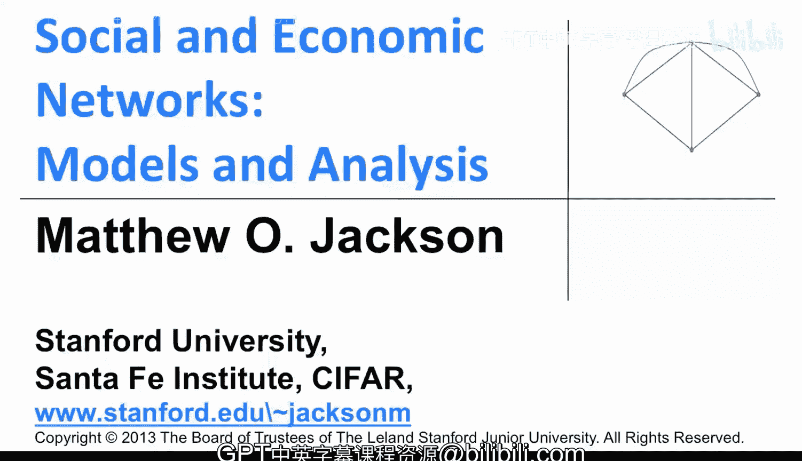

I Matt again， and now we're going to be talking a little bit about the diameter of a network。

 So again we're still in our basic definitions trying to understand how we represent networks。

 things we can talk about in terms of their characteristics and diameters are very important one diameter and average path length refer to how close nodes are to each other So how long will it take to get from one node to another in some sense how fast will information spread how quickly can we get from one part of a graph to another。

 these are going to be questions that are going to be answered by things like diameter and average path length。

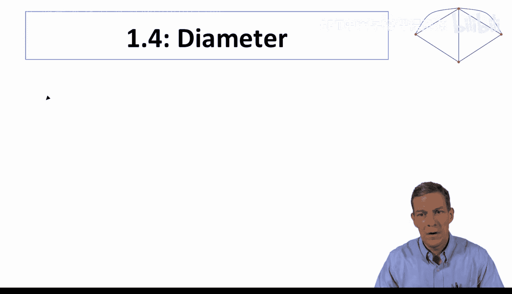

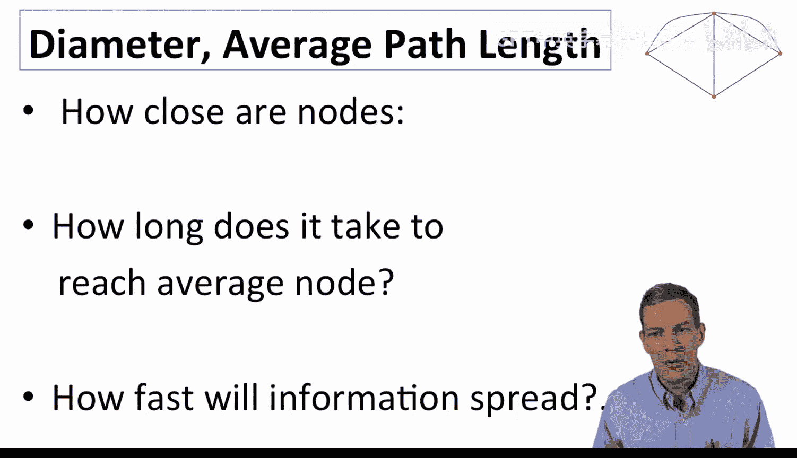

So when we look at the diameter， the definition here is the largest geodesic in the network。

 so the largest shortest path， so if we have a network which is not connected。

 often when people talk about the diameter they'll talk about the diameter of the largest component。

 it gets a little iffy but a lot of times you're going to be stuck with a few isolated nodes in a network and so diameter often will then just refer to the component largest component。

One thing about diameter is it can be prone to outliers。

 it could be that there happen to be one pair of nodes which are very far from each other。

 but a lot of the other ones are relatively well connected to each other。

 so average path length is going to be a different measure than the diameter instead of the maximum geodesic it's going to be the average geodesic in the network。

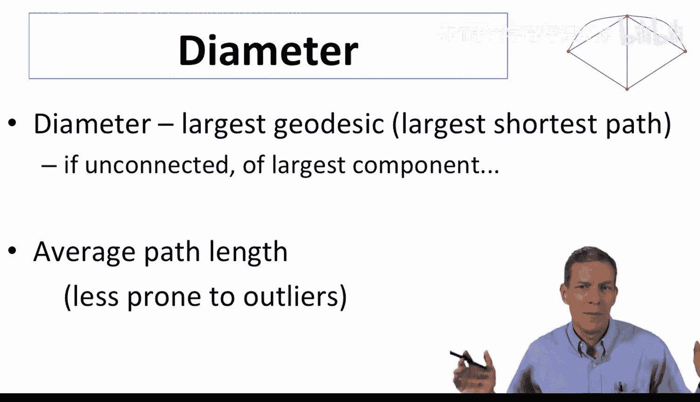

And if we look at different network structures， diameter begins to tell us things about it。

 so for instance， if we look here at the network on the left。

 we've got a ring or a circle of different nodes connected to each other and in that situation when we look at these nodes。

 we end up seeing that they are some of them can be quite far from each other and the diameter in this case is on the order of half the number of nodes。

 so either n over two or n minus1 over two depending whether we've got even or odd number of nodes。

Whereas if we look at a tree， the situation on the right here in this picture。

 what we have is a much more efficient way of getting from one node to another and so if we think about the number of levels that this tree has so in this case it has three different sets of links so one to three depth so in this case we are going to end up or。

We're going to end up covering a number of nodes where n is equal to 2 to the K plus 1 minus-1。

 so you can just go through and keep track of that yourself。

 when you look at the relationship between how many levels you have and how many nodes you have you end up in this case having K is equal to log base2 of n plus1 minus-1。

 So a fairly simple formula。 And what in this case， the diameter is 6。 it's twice what this K was。

 So getting from node 25 here to node 30， it takes a path length of 6。

 you go up 3 and then down3 So it's twice times k is going to be the longest shortest path in this network。

 And what this tells us is that the order of the diameter is going to be roughly two times this log of n plus1。

 So that's giving us sort of。How quickly we reach out and the idea here is a tree is a much more efficient way of connecting nodes in terms of short paths than we saw in terms of this circle。

Because now we end up connecting nodes to each other in a manner which is quite efficient in terms of the branching process。

 and so even with a small number of links， we're able to more efficiently connect things and so instead of scaling linearly with the number of nodes。

 this is going to scale with the log of the number of nodes。

 which is going to tend to be a much smaller number。

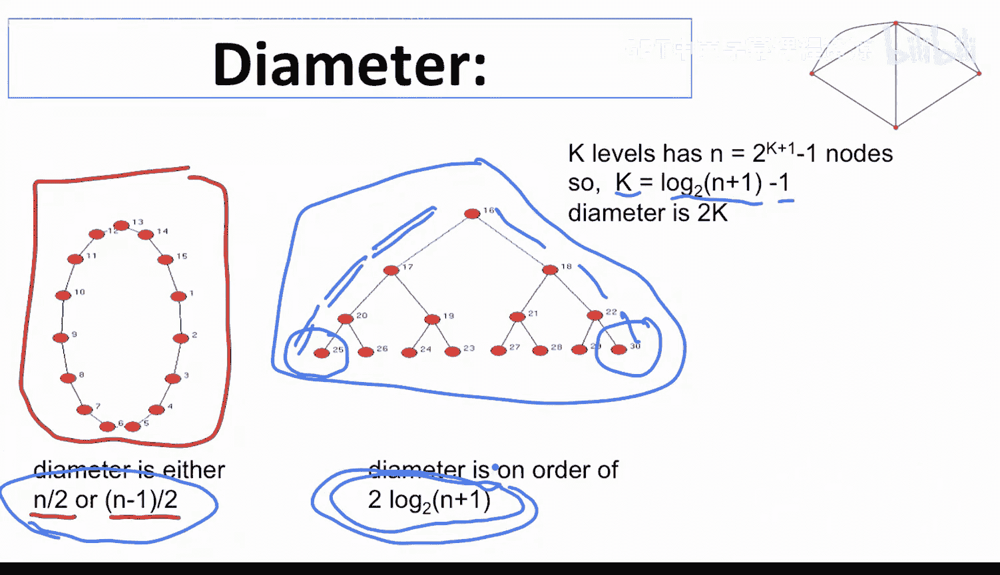

Now， in terms of small average path lengths and diameters。

 one thing that's been found quite extensively in terms of looking at social networks in the real world is that they tend to have short average path lengths and short diameter。

 and what do we mean by short， it means intuitively that we connect a large number of nodes with a fairly small number of connections。

The famous most famous example of this was Stanley Milgramom's experiment where he had people sending letters from one part of the US to another。

 I believe it was part of the Midwest， say Kansas and Nebraska and you were trying to get a letter to somebody on the East Coast。

 say in Massachusetts， he would give them say a person's name and the rough location of where this person was and maybe some the basic background information about the person。

 so I'm supposed to get something to John Smith who lives in Massachusetts and who's a lawyer in Amherst。

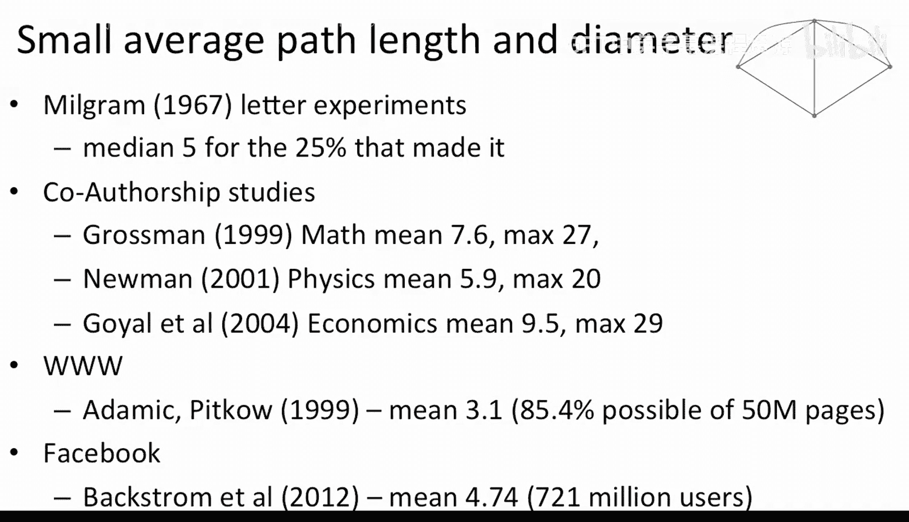

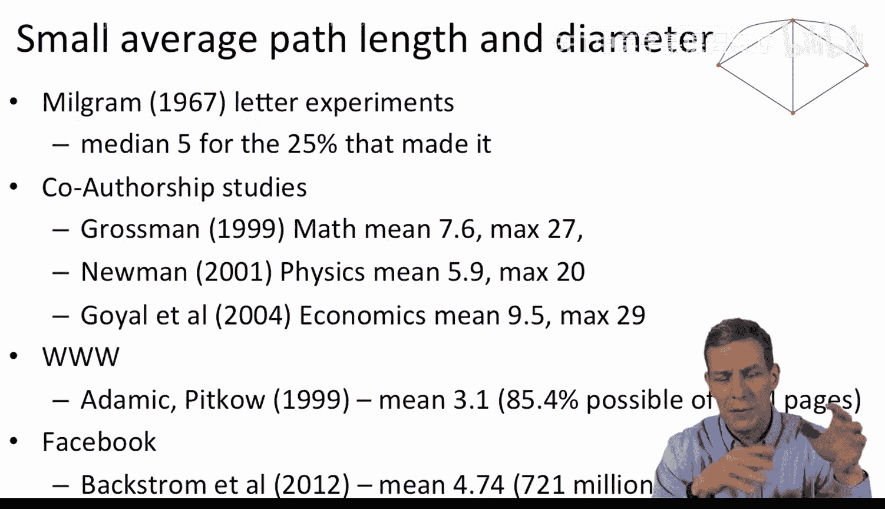

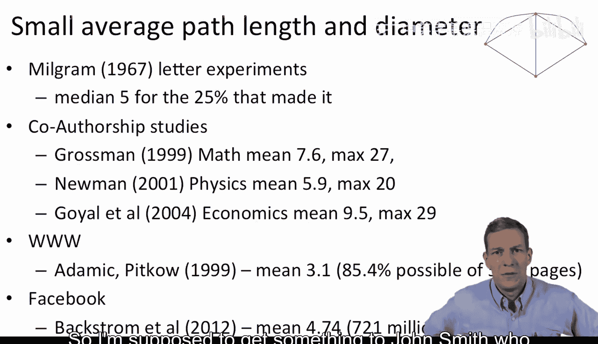

And I live in Lincoln， Nebraska， and the idea was that I could should send a letter to somebody I know。

 and then the instructions and the letters tell them to send it to somebody they know and so forth with the intent of eventually getting to the letter to the person that was named and the amazing thing that Milgramm found was that out of the letters that were originally mailed from the initial points the median number of。

Hops that it took to get to the end point was 5。 And in fact，25% of the letters made it。

 So that that's， first of all， fairly high in terms of response rate for this kind of participation in an experiment。

 And secondly， the median of five seemed to be quite small。

 Given that you were starting with somebody in one part of the country who had no knowledge of the other individual in another part of the country。

 And it took them only five steps to get to that individual。

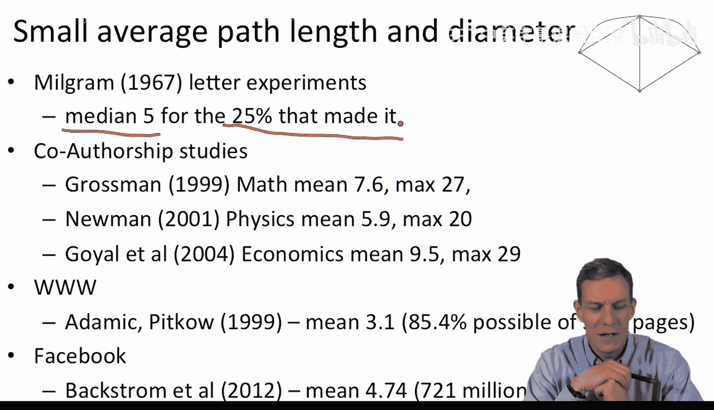

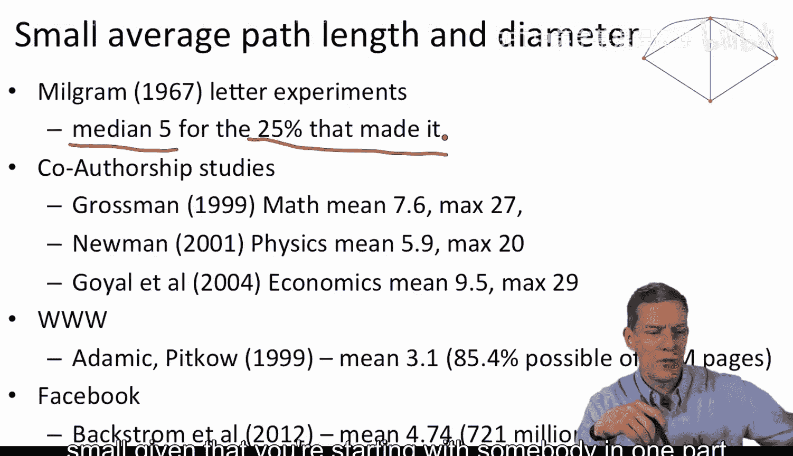

This kind of experiment has been replicated in more advanced settings。

 working with email and other kinds of things， one thing that's sort of interesting about this experiment is that when you if we think about the median of five。

 we have to be a little bit careful about how we interpret that result， why well。

 out of the 75% that didn't make it，The longer a path is that it would actually take to go from one person to another if we think that there's some probability that people won't send it on。

 the longer the path the more likely it becomes that it won't appear as having made it in the experiment so the letter will never reach the final point where Stanley Mom could then collect it and get all the names so the ones that actually reach are going to tend to be shorter than the others。

 so in experiments that have follow it up on this you can begin to try and estimate how many didn't make it and those are going to be biased upwards but it's still sort of an important number because people were getting it in only five steps and they didn't get to see the network。

 it's not as if they saw the network of all the connections in the US and were able to figure out what the most efficient path was they were just trying to send it to somebody they thought might know somebody if this person's a lawyer if I know a lawyer and I know a lawyer in Massachusetts。

 maybe I send it to them or if I know a lawyer in Chicago who might have a friend in Massachusetts。

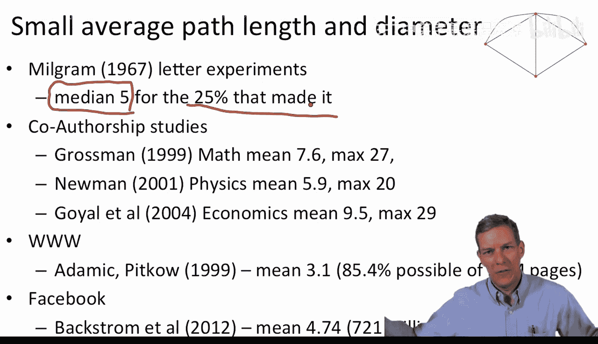

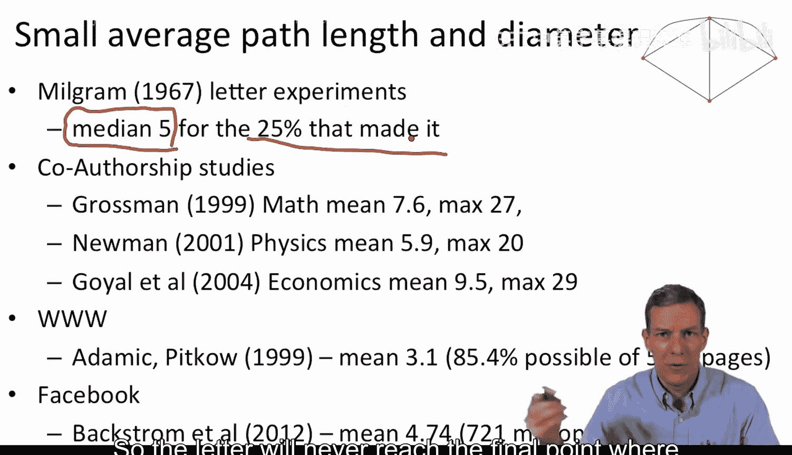

I'm trying to navigate the network without actually knowing the explicit structure of the network。

There's a number of other studies that have found small path lengths in different settings。

 so Grosman's study of co-authorships among mathematicians， average path length 7。6。

 maximum and giant componentent 27， Newman's study of physicsy co-authorships， average 5。

9 Max 20 Goyle of Van delay and Morocco Gonzalez of economics 9。5 is an average Max 29。

 so here you're seeing things again， know the averages somewhere on the order of 5 to 10。

 max closer to 30 in this case，There's a study by Ladac and PiC on World Web there they found an amazing number mean 3。

1 on a giant component reaching 85% of about 50 million pages， Facebook mean of about 4。

74 recently found by backsstrom and a set of co-authors， Nis is a 721 million users。

 So actually there know when you start working with with networks of that size even。

Trying to calculate the average path length is going to be something which is going to take some doing。

 You're going to have to work carefully to find algorithms to calculate these things。

 So there's some very interesting findings there and in terms of the average path length。

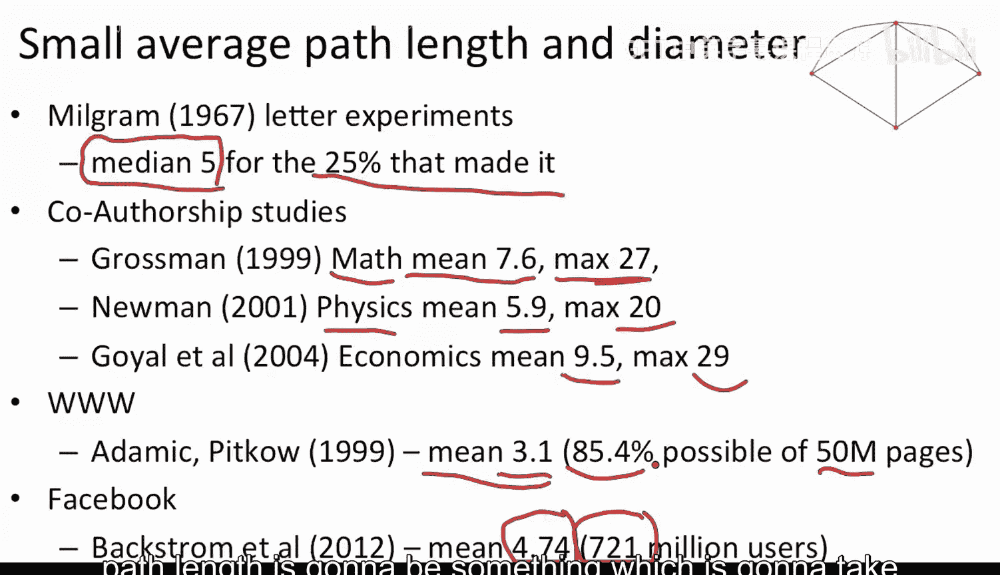

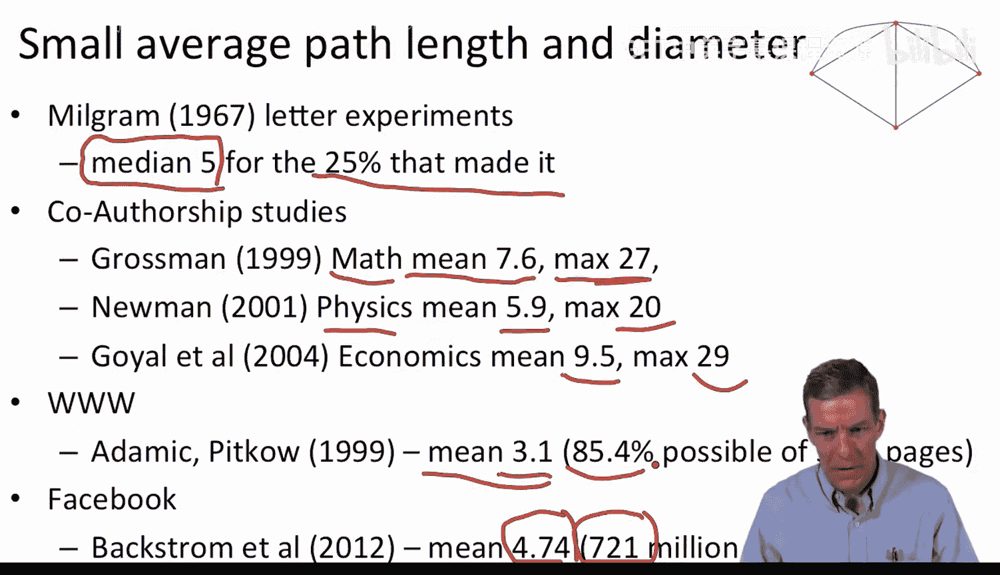

So in order to say a little bit more about diameters and understand why we see these short average path lengths。

 first it's going to be useful to have a couple more definitions in hand。

 the neighborhood of a node I in a network G and sub I of G is going to be the set of other nodes that I is linked to in G。

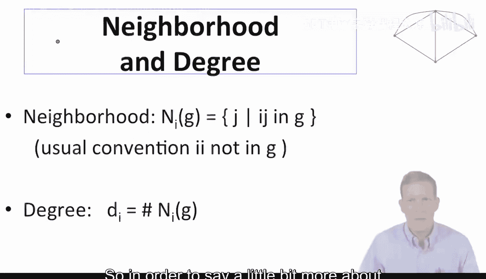

And again， our usual convention is we won't allow for I to be linked to I and then the degree of a node。

 which is a very important concept， a degree of node to I is just simply counting up how many neighbors。

 a' given node I has in the network G， so degree is a basic idea。

 which is going to be very important in keeping track of things in networks。

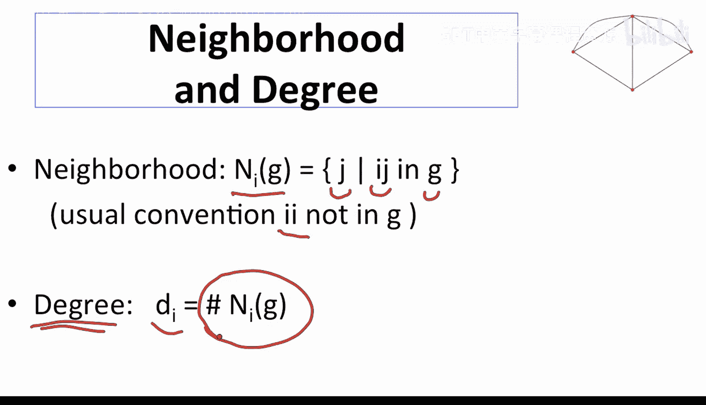

And in understanding why we have short average path lengths。

 one thing that's going to be very useful is understanding the most basic form of random graph。

 which is due to Erdaash and Reni in a set of papers in the 1950s also there was independent work by Rapaur around the same time。

 and the model is the simplest possible network you could imagine in terms of。Random graph。

 we start with n nodes and each link is just formed independently with some probability P。

 So what do we do， We have a coin， say it has a three quarters chance of coming up heads and for every link we look okay。

 should one be linked to two flip a coin three quarters possibility yes。

 one quarter possibility of no， if it comes up heads， we color the link if not。

 we don't and we do that for every link we just keep repeatedly flipping the coin Okay and the coin comes up heads with some probability P This is known as G and P graph on n nodes with a probability P it's a very important benchmark and understanding things。

 why is it an important benchmark because if we see some network out there in the real world。

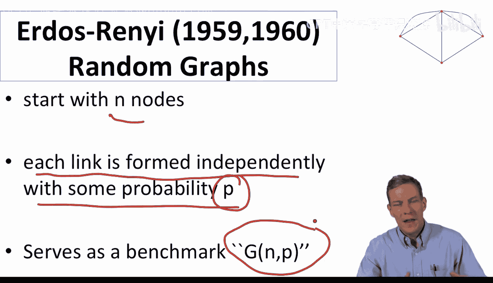

If we know what the properties of a random network on N nodes with some probability P was。

 then we can compare the real world network that we see to this benchmark network and say does it look like something systematic is going on。

 does this network look systematically different than if nature had just picked nodes sorry links at random。

 or does it look like something is systematically different so that's going to be an important benchmark？

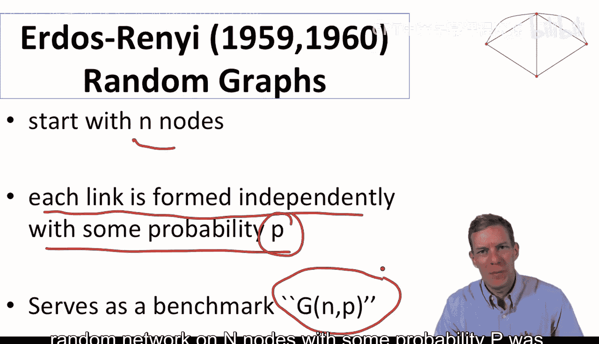

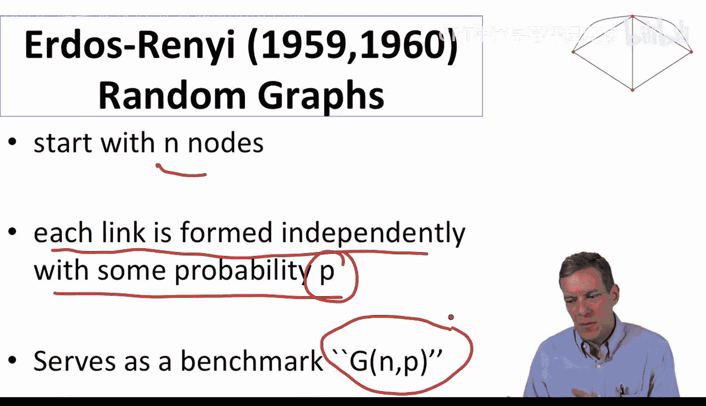

And in order to talk about properties of these kinds of networks。

 it's going to be useful to talk about large networks。 why large networks， well。

 because if we're dealing with very small networks。

 every single network has some possibility of arising if we're just flipping coins and so making statements about what's going to happen on a small network is going to be a very complicated probabilistic statement。

 but when we get to large numbers， laws of large numbers are going to allow us to say things like with a probability close to one。

 then we should observe that the networks should be connected， something like that。

 so we can talk about you know the average path length ought to be six with a probability very close to one on a network of such and such a size So by looking at sequences of networks on larger and larger sets of nodes。

 we can begin to make statements like that。 So in particular。

 let's look at Udashrenni networks and I'm going to talk about。

large networks and in particular we're going to look at networks that have two different properties so one is we're going to be thinking about the degree now is a function of we have to talk about you know if it has a million nodes。

 what's the average degree if it has two million nodes and so forth。

We want that to be something which is at least as large as the log of the number of nodes and we'll talk about that later。

 but what this is going to make sure is that there's actually paths from any two two nodes to each other with a high probability so with a high probability you can get from any node to any other node then we can actually calculate the diameter so so we'll take d of to be at least log n and well also we're going to make sure that the network isn't too complete so DN ought to be a small number relative to the overall size N so that it's not as if every node just reaches every other node and a path of length1。

We'll want to have something interesting going on， so it's not as if I have I'm connected to everybody in the world。

 I'm connected to some fraction of people in the world and we'll make sure that that's at least log and in terms of size。

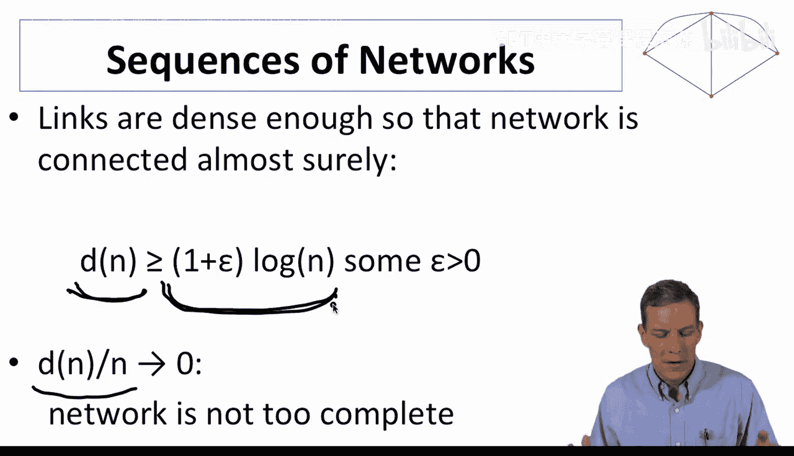

Okay， so what's a theorem， a basic theorem on network structure is that if we have these two conditions and then we start looking at large enough n。

 the average path length and the diameter of this random graph。

 these G graphs are going to be approximately proportional to log of the number of nodes over log of the degree So a very simple formula should give you a very accurate approximation with a high probability to what the average path length and diameter are in these kinds of networks。

 So these kinds of theorems have been proven for the original Udashreni random graphs that was studied through the 50s and 60s paper by moon and Moser。

 there's a set of calculations by Baabboch a series of papers which look at these kinds of calculations。

 It's been looked at in richer and richer models Chong and Louu have a paper in 2001 looking at a different set of models。

 I have a paper in 2008 that allows for node。

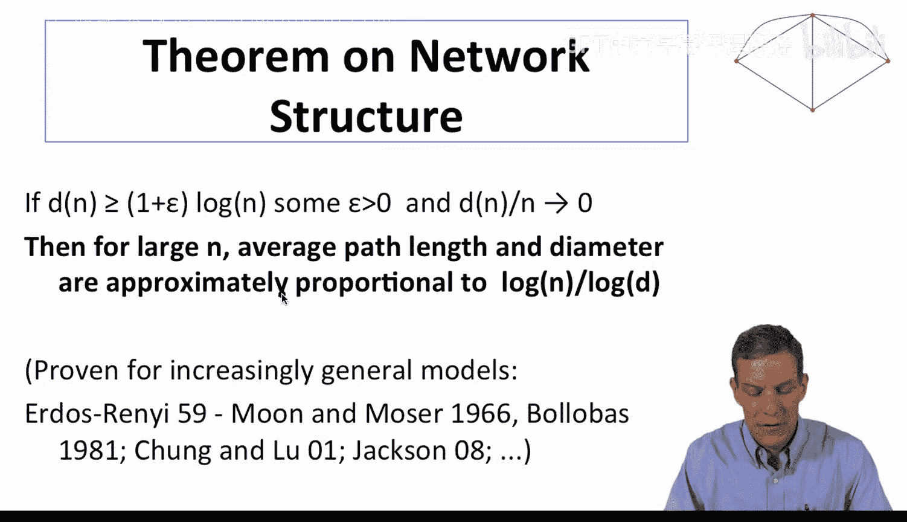

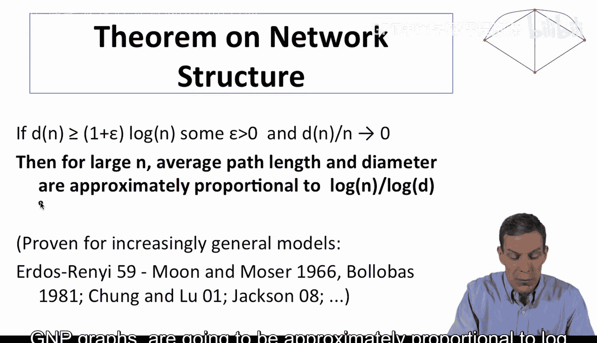

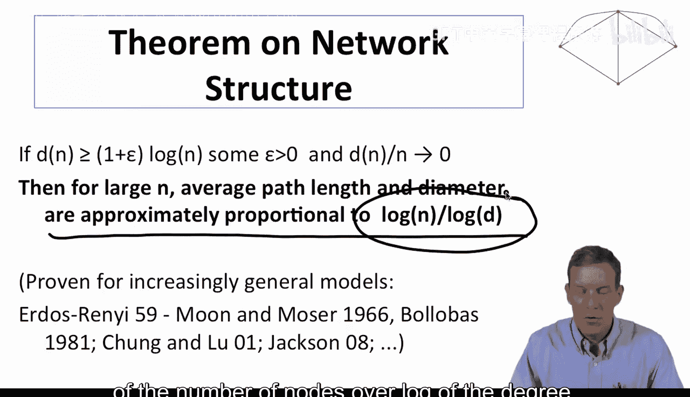

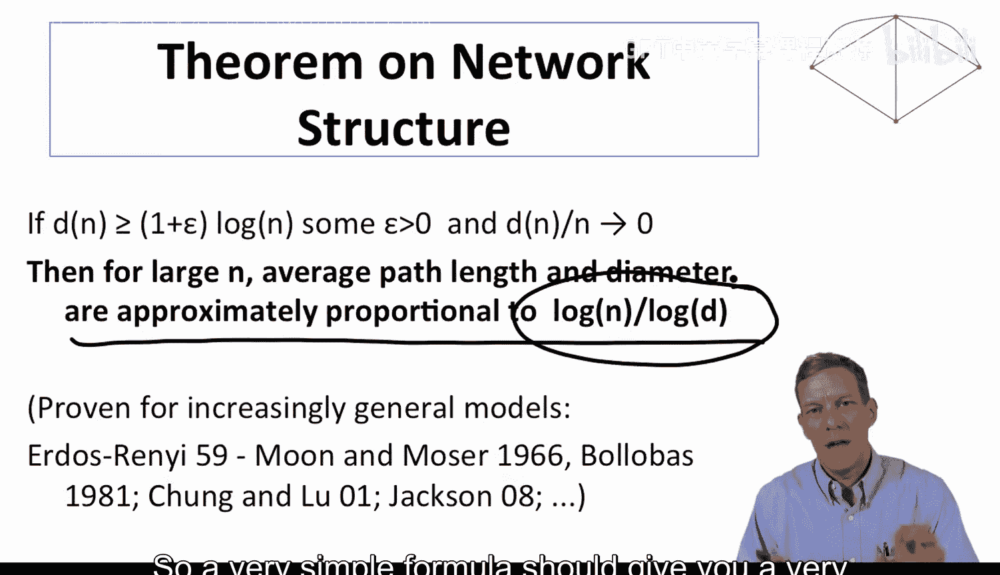

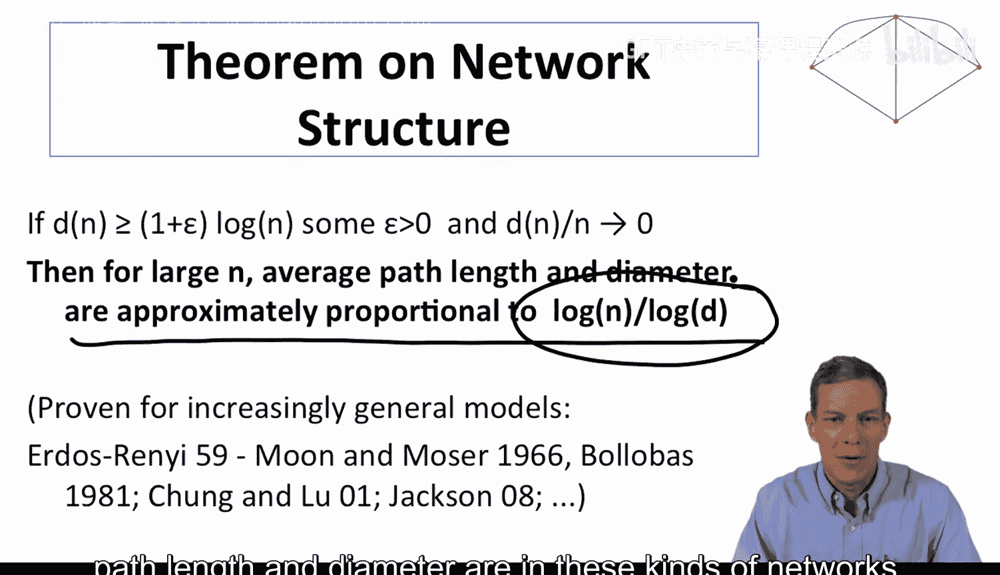

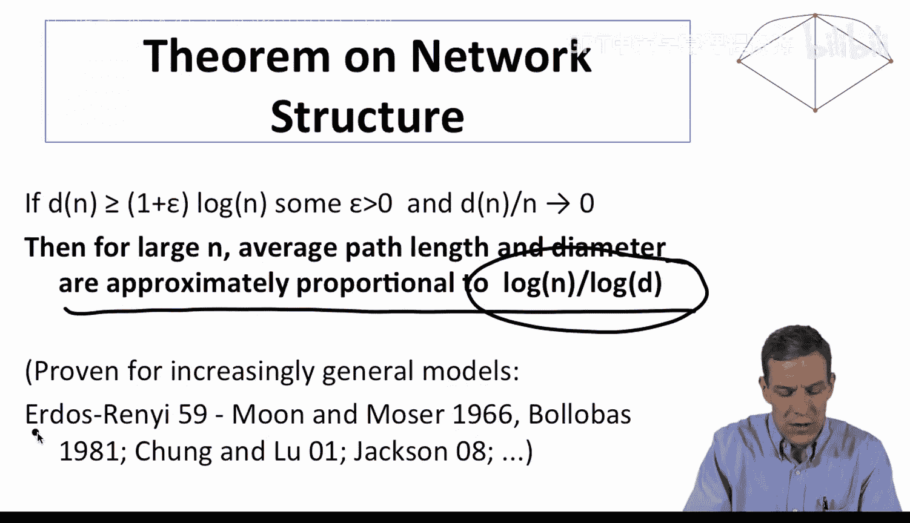

Types and other kinds of complications to this model。

 you still get the same formula in this kind of setting。

So what does this tell us this gives us an idea of why we end up with very short average path lengths and short diameters。

 if we had something in a random graph and that'll tell us something about real world networks to the extent that random graphs are going to be part of those or embedded in those kinds of things so when we look at this know we can state the theorem more succinctly in terms of mathematical notation of fuller statement of the theorem is that under these conditions。

 if we're looking at this GNP， then the average distance compared to the log n over log D is converging in probability to one so basically average distance is going to be proportional to log n over log D the same for the diameter。

 so the next thing we're going to do is just try and understand the logic behind this and then I'll also have a separate lecture。

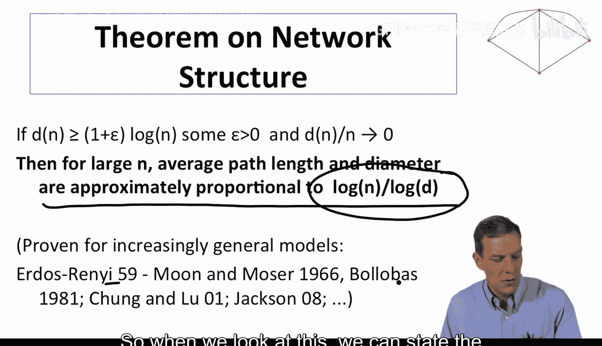

or sort of a more advanced lecture that'll give part of the proof of this for people who really want to dig into the mathematics。

 but the intuition behind this is fairly simple， we'll go through that intuition and then people who want the more advanced part can actually go through pieces of the proof as well。

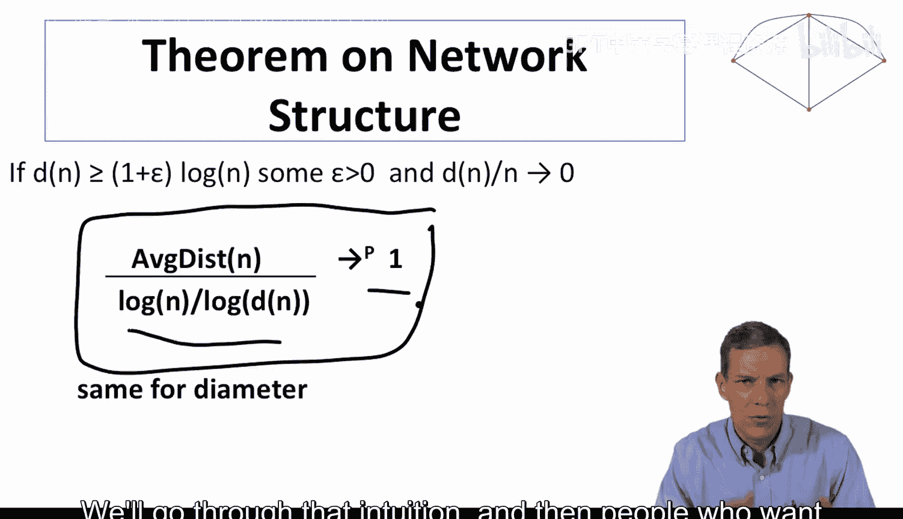

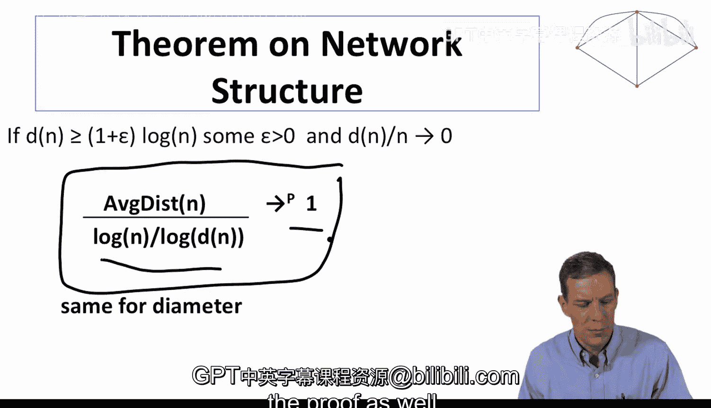