# 斯坦福大学《社会和经济网络：建模与分析｜Social and Economic Networks： Models and Analysis》中英字幕 p07 07_01_08_1-5-直径与树结构.zh_en -BV1v1421U7Nk_p7-

Okay so let's talk a little bit about understanding these diameter and why we see these short average path lengths in a bit of detail So when we looked at this last one。

 the theorem we just talked about in terms of the average distance being proportional to log n over log D for a certain class of random graphs when we do these kinds of calculations you know the ideas are fairly simple。

 even though some of the details behind the theorems can be complicated and so what we can start with is a very easy calculation。

 let's suppose that we had something which is a very regular tree， what might be known as a cae tree。

 so each node besides the very end nodes in the tree are going to have degree D so it's start with some degree D say you say four and each node then reaches four others and then the end nodes will just have one connection so the idea here would be for instance。

 we start with one node。

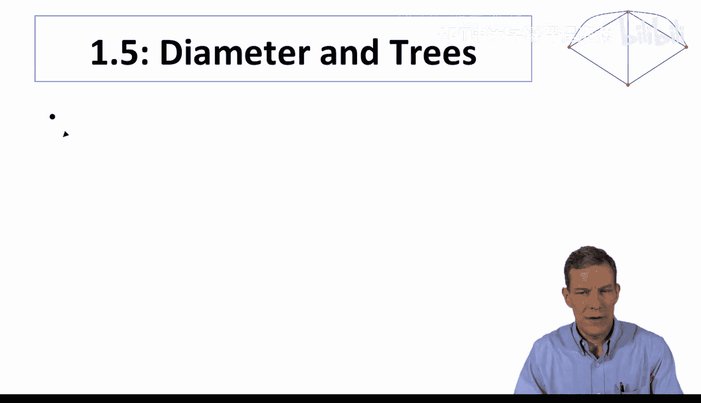

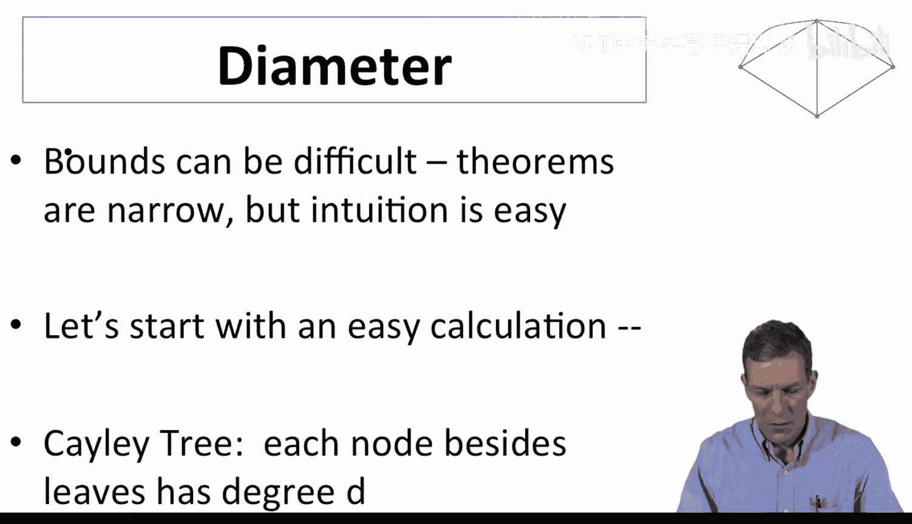

Has four neighbors， so we reach you say D nodes at the first step and then we can keep track of how far we're reaching out。

 how many nodes we're going to reach out to and what we'll do is just keep track of in order to do a rough calculation of say the path length from this node to other nodes。

 we'll keep track of how long it takes to reach the furthest out node to make sure that we've reached everybody。

So on step one， we reached D other nodes。The next step we reach another d minus1 right so now each one of these has four neighbors。

 so we get three more neighbors out here and so forth， so we reach D on the first step。

 we reach another D times d minus1 on the second step then D times d minus1 squared D times d minus1 cubed and so forth。

 so after L steps after we've gone out L steps， we've reached roughly D to the L nodes in total。

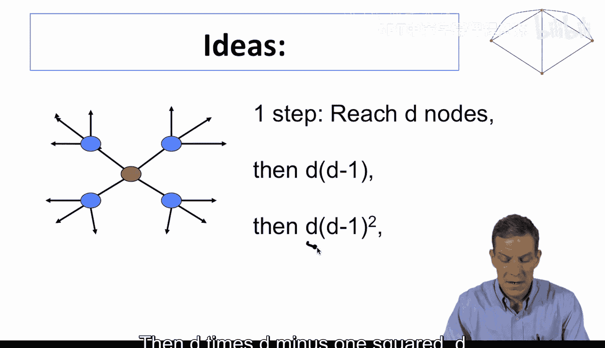

So in particular if you sort of move out L links from the root in each direction。

 we're hitting D plus d times d minus1 and so forth， you total all this up。

 you can go through this looks like D times d minus1 to the L minus1 over d minus2。

 you can sort of sum up what that series is， but roughly for reasonably large D。

 this is going to begin to look like d minus1 to the L okay so this captures sort of how much you're reaching out and you're reaching out exponentially。

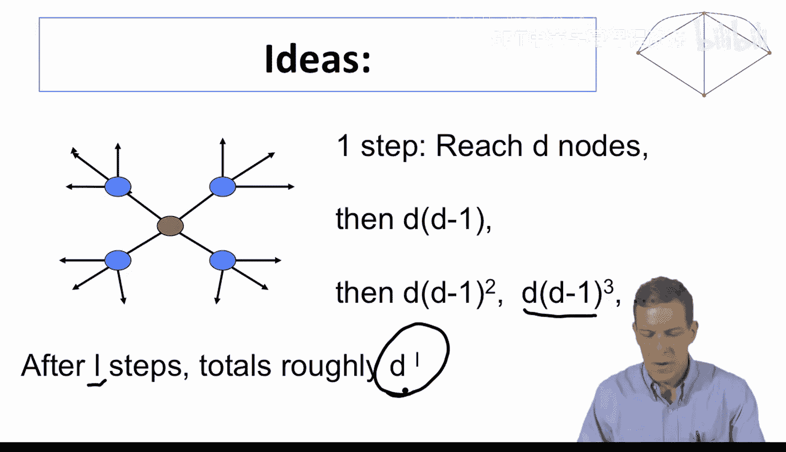

So in order to reach， if we want to reach n minus1， the rest of all the nodes。

 how many steps do we have to go out until we've reached that many， well。

 we need d minus1 to the L to be equal to n。

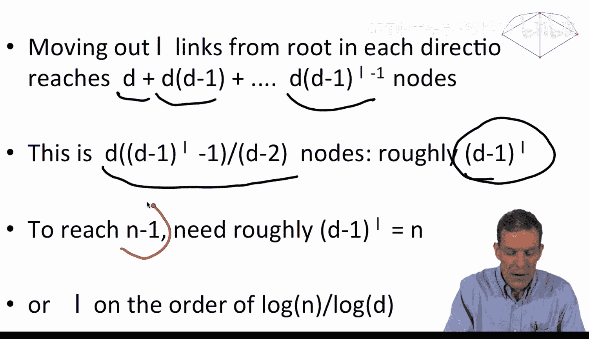

Right roughly or n minus-1， I mean， either way。 So these are approximate calculations。

 So what is if we solve this for L， we can take a log of both sides of this equation to solve it for L。

 what we get is that the L that solves this equation。

 has to be on the order of log N log of d minus-1， which is basically that's going to be similar to log of D if D is reasonably large。

 So we end up with L on the order of log n over log D。 Well， not by accident。

 this is exactly the number we saw in that theorem about the orrenni random graph。

 So if you just put out a random graph， we were getting something like that。

 So if we had a really regular tree， we would end up having this kind of calculation for how long it took to reach somebody at the center to reach the other ones。

 Now there's going to be calculations， this is just one node reaching the other ones。

 the overall diameter is going to be on the order of。Twice this， but roughly proportional to that。

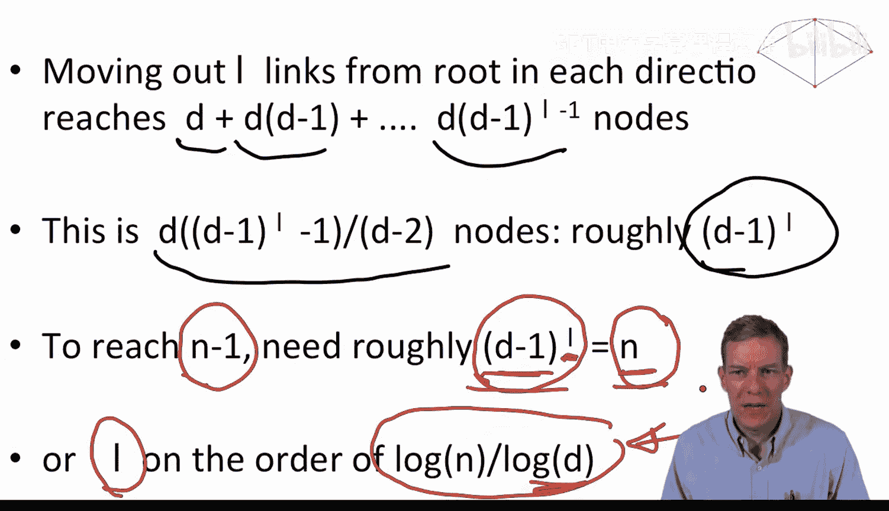

And in terms of details， you know what if this was not a tree， but actually an Erdareni random graph。

 why is it going to come out to be similar number here So here。

 what we have is all have the same degree really in reality they're random right and so part of the difficulty is that not everybodys going to have the same degree Well part of the proof that the Erdareni random graph has the same diameter is what we just went through is going to be that the fraction of nodes that have nearly the average degree is going to be close to one in a large network and nearly I mean you know within some factor of the degree What's another problem here we're assuming that things branch out really nicely from a given node and we keep reaching new nodes at every point in time part of the difficulty is that when you actually do this calculation explicitly some of the links might be by branching back right so we started a given node we reach。

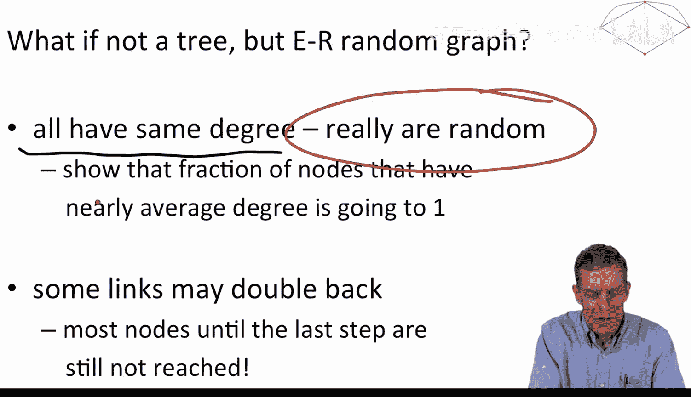

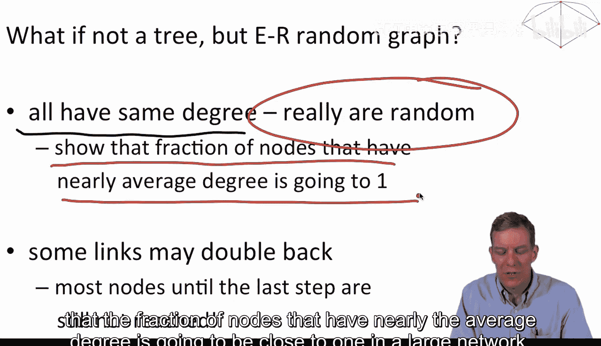

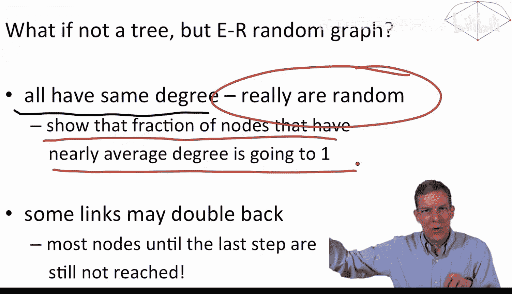

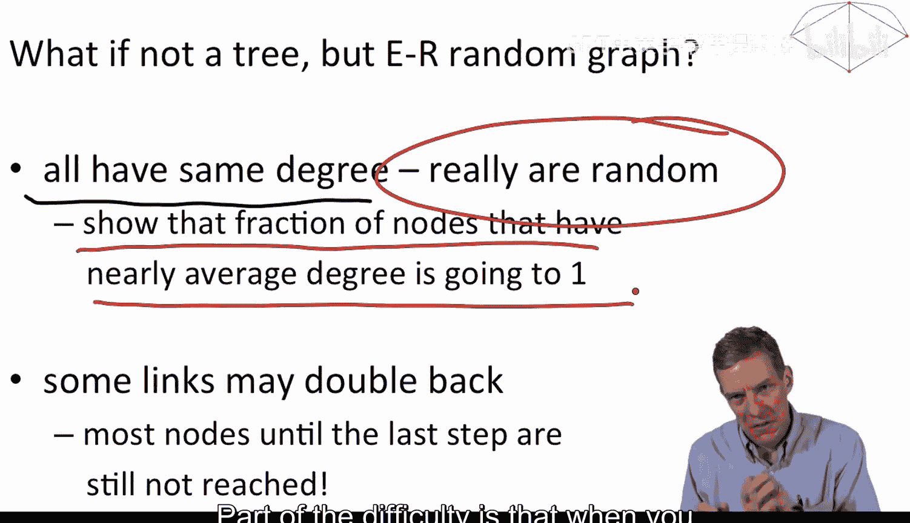

other nodes， we reach further ones， but maybe at some point some of the links actually come back to earlier parts of the graph。

What's going to be important is that most of the links until you get to the sort of the last step in this process are still reaching new nodes that haven't been reached。

 that's another part of the proof So when you go through and do these calculations in detail。

 then you can find that roughly random graph still has a lot of the same properties that a tree has and those properties mean that you keep branching out fairly well and with roughly the average growth pattern until you get until you've reached almost all the nodes and so you get a calculation that looks a lot like log n over log D。

For those who are interested， I'll have a lecture that goes through in a little bit more detail into how those calculations work and how you can actually balance some of these probabilities for those who aren don't really want to deal with the math。

 next we'll take a look at some numbers to check whether this log n over log D looks reasonable in terms of a calculation or not。

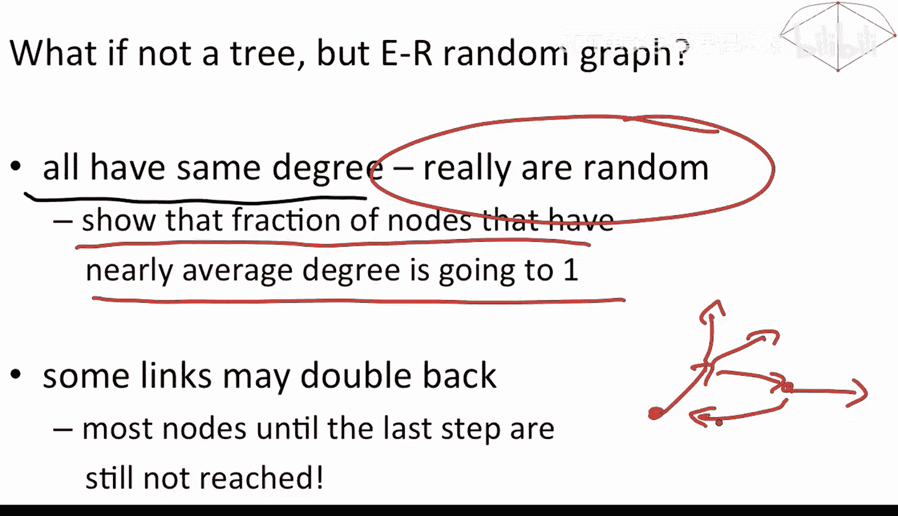