# 斯坦福大学《社会和经济网络：建模与分析｜Social and Economic Networks： Models and Analysis》中英字幕 p08 08_01_09_1-6-随机图的直径（可选-进阶-11-12）.zh_en -BV1v1421U7Nk_p8-

Hi folks so let's take a look at the diameter of random graphs and in particular。

 I remember we just had a theorem that we stated about the structure of random graph in particular these Udaash Reni G graphs and these are also known as Bernoulli random graphs plus random graphs we'll talk about some of the definitions in a bit。

 but if you recall the basic statement of the theorem。

 it was that if the degree was growing at least with the log of n， so1 plus epsilon times log n。

 and if the degree wasn't becoming too large so that the degree relative to n is vanishing then when we look at the average distance with the probability going to1。

 the ratio of the average distance compared to log n over log D is going to one and the same actually holds for the。

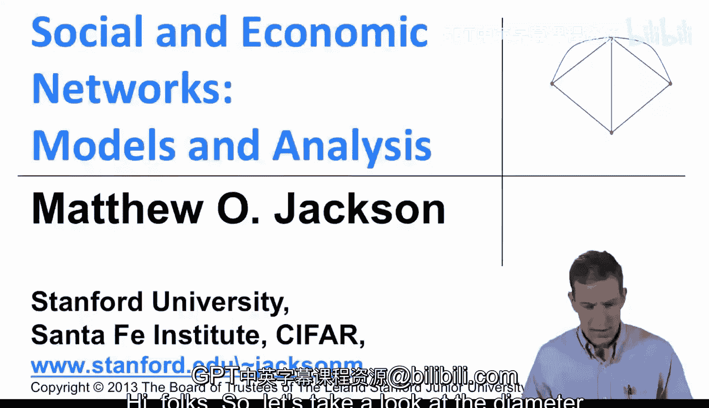

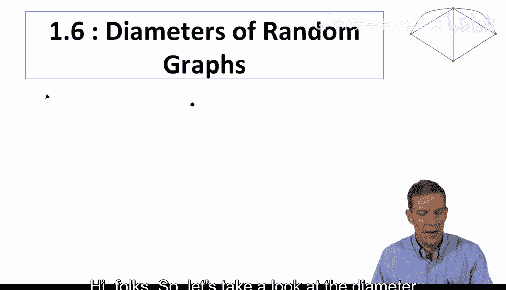

Ameter。And if you recall what we just went through in terms of the basic ideas of how this worked。

 we went through some calculations that， you know， first of all looked at a tree calculations so that if everybody had exactly this degree D starting and you were moving out in a tree like form then you know from a root node to get to the others。

 you would need roughly d minus1 to the L powers to the L power to reach n minus1 L would have to be roughly on the order of log n over log D and the difficulty with this was well not everybody would have the same degree so let's suppose now we had instead of a tree we had a tree where the degree was randomly varying and not everybody had exactly the same degree so what we can show first of all what we'll show is that the fraction of nodes that have nearly the average degree is going to1。

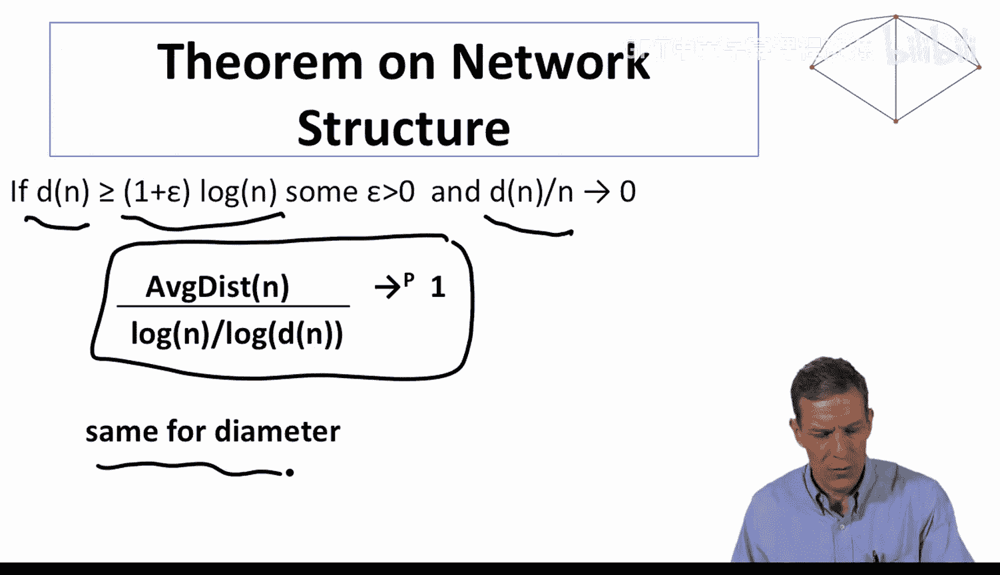

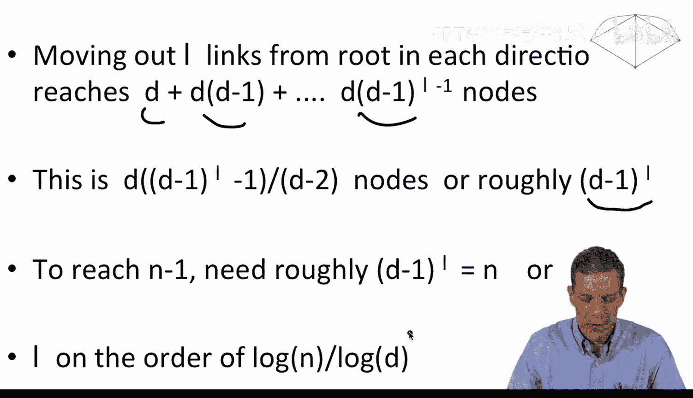

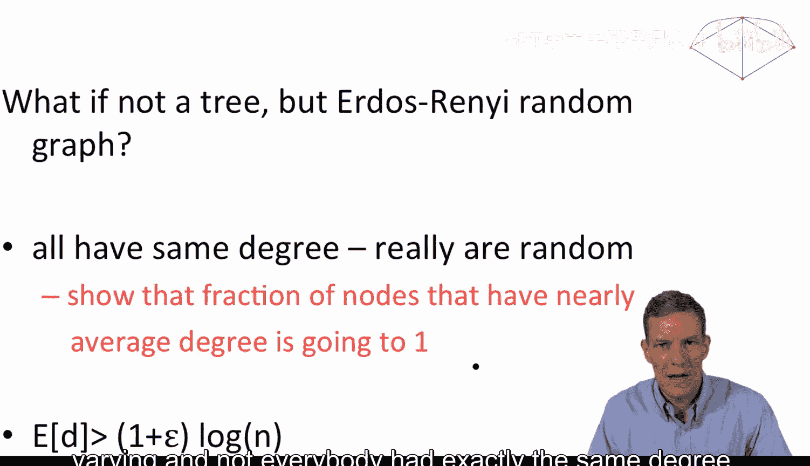

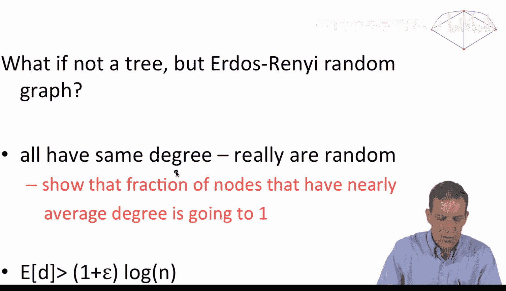

And。This is going to be true as long as this expected degree is at least on the order of log N and in particular。

 what we're going to use is to prove this or what are known as turn off balance。

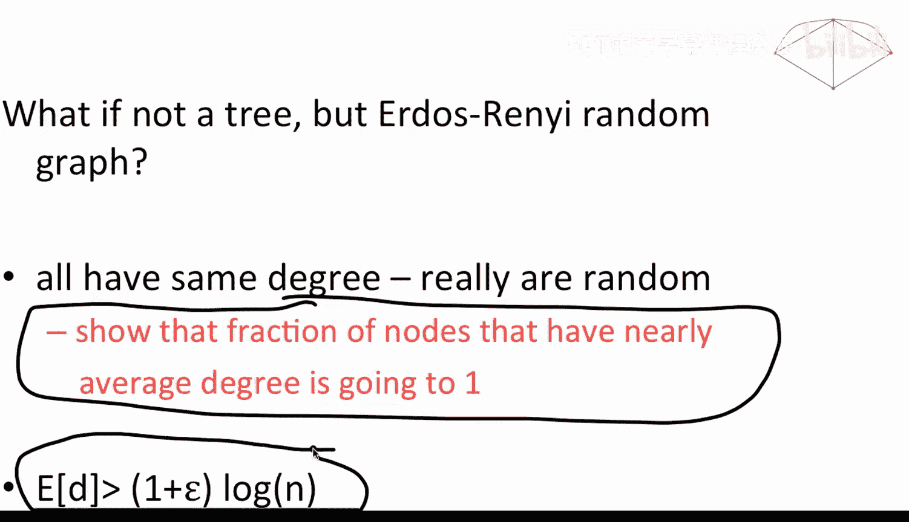

And let me just sort of state what turn off bounds are。

 I'm not going to try and prove turn off bounds here。 You can find proofs in many different places。

 In fact， know you can go to Wikipedia nowadays has a lot of nice statements of different math theorems you can find backgrounds on this but the important thing here is that if we're looking at a binomial random variable So if you were just flipping coins with some probability P and then counting how many come up So how many come up as a given so imagine I'm looking at a particular node and it's forming all of its links and we ask how many links does it end up with Well。

 the probability that the number of links it ends up with is between three times the expected number and a third of the expected number is at least one minus E to the raised to the minus expected number So if I'm expected to have 100 friends then。

Chance that I'll have somewhere between 100 over 3 and 300 is 1 minus e to the minus 100 Well this is getting very close to one right so as if you expect me to have 100 friends then very close to one is the probability that I'm going to be have at least 33 and smaller than 300 so turn off bound begin to say okay there's a very high probability that you're going to be within a factor of three of what the expectation is so that's very useful how is that useful。

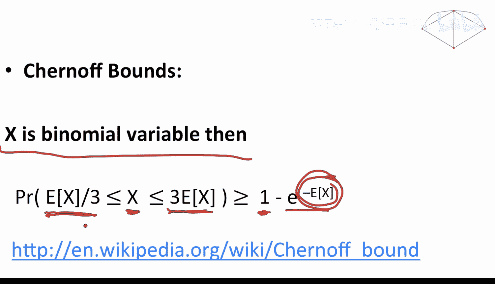

Well the probability that a node is going to have a degree that's very close to the average。

 the node I is going to be within d over the expected degree over 3 times 3D is1 minus e to the minus d。

 If we want to then ask that everybody has something which is within a third to a factor of three what we're going to end up with is we can just raise this to the n power so we've got n different nodes。

 This is the probability that any one of them is within a factor of3。

 This is an approximation for the probability that we end up within a factor of three for all the nodes Why is it an approximation Well the degree of different nodes is not quite independent It's approximately independent So if you actually want to prove this theorem very rigorously。

 there's a lot of detail that I'm going to admit omit and here what we're going to do is go through the basic ideas and why is this true and you can check baabash'。

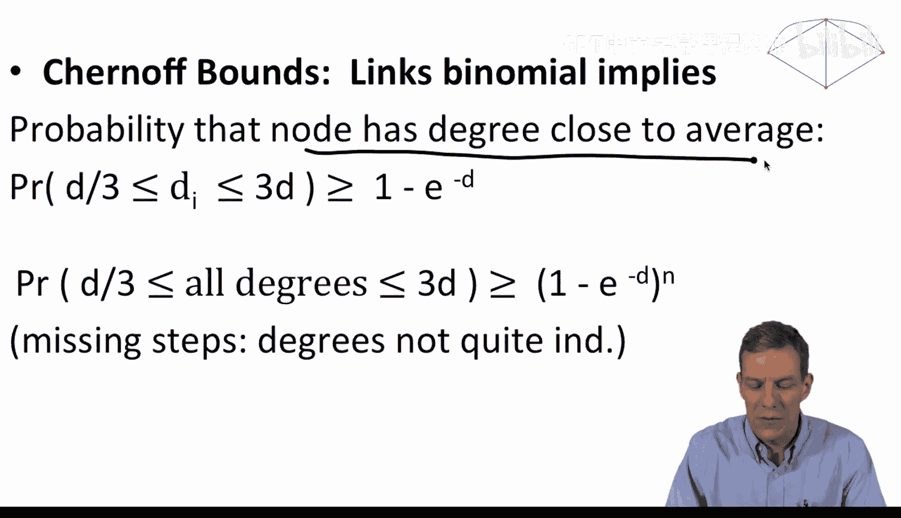

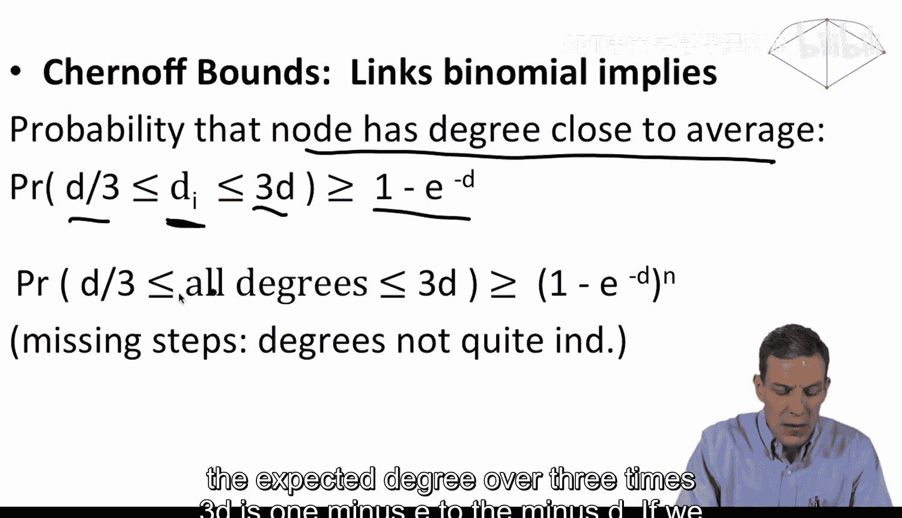

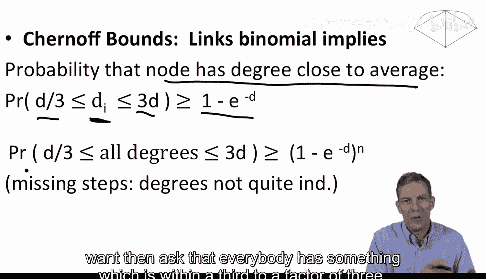

If you want gory details on the proof or you can go through chunk and lose proof。

 so there's different proofs that will give you more detail here。

 I'm going to go through just the basic points okay so we get that a probability of the degrees based on these turn off bounds gives us a high probability that everybody's going to be within a factor of three of the degrees。

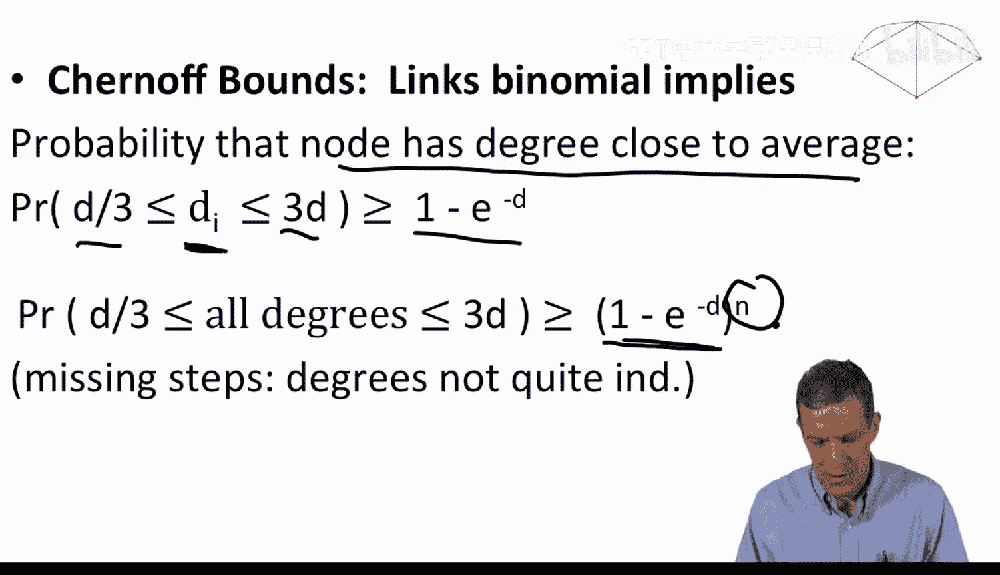

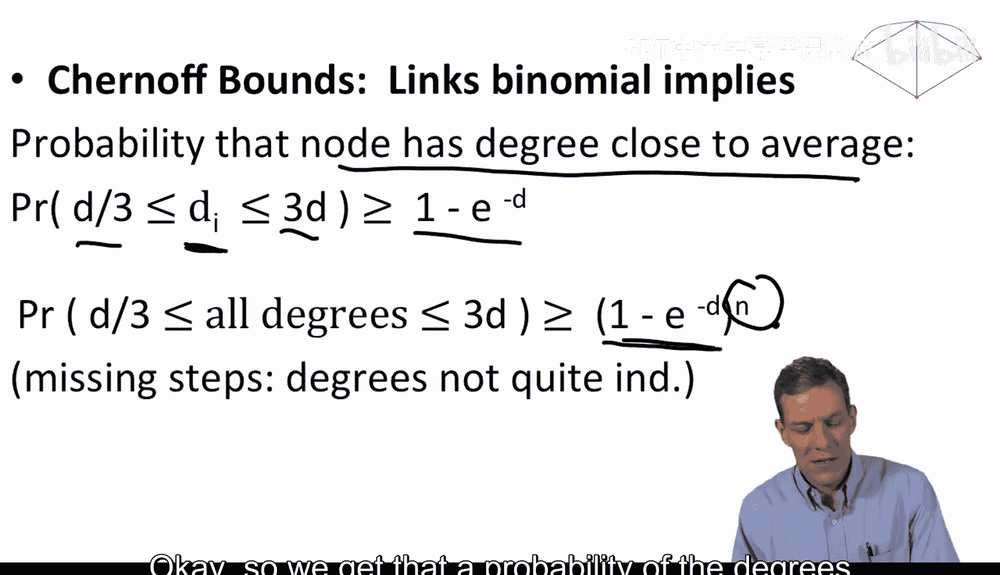

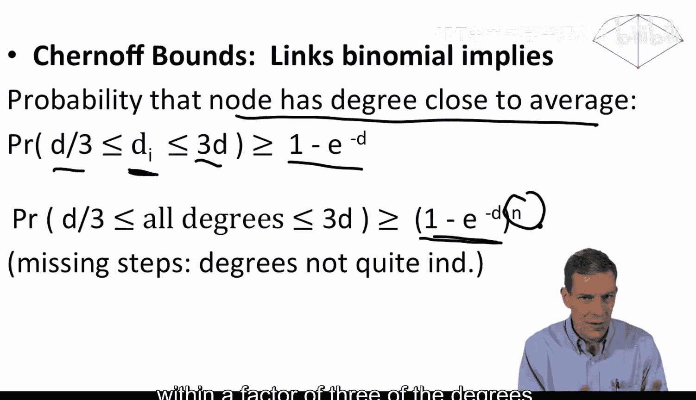

So what we've done is we've shown that the probability that all degrees are within a factor of three of the expectation。

Is at least。This expression 1 E to the minus D raised to the end power。

And then given that D is at least。One plus epsilon times log in， if we plug that in。

For the expression up here， then we end up with this。

 the probability that all degrees being within a factor of three is at least。

1 minus1 over n to the 1 plus epsilon raised to the n and then using our approximation for this。

 we know that this is converging to1 as n goes off to infinity right so we know that the probability that all degrees are within a factor of3 as n's getting large。

 is getting closer and closer to1。So what we've done then is shown that if we have the degree being at least the order of log n。

 then the probability that all the degrees are within a of three is going to one and that allows us then to。

Conclude that with probability one。We are going to end up having the so basically what we've shown is that the probability that all degrees are within a factor of three is going to one。

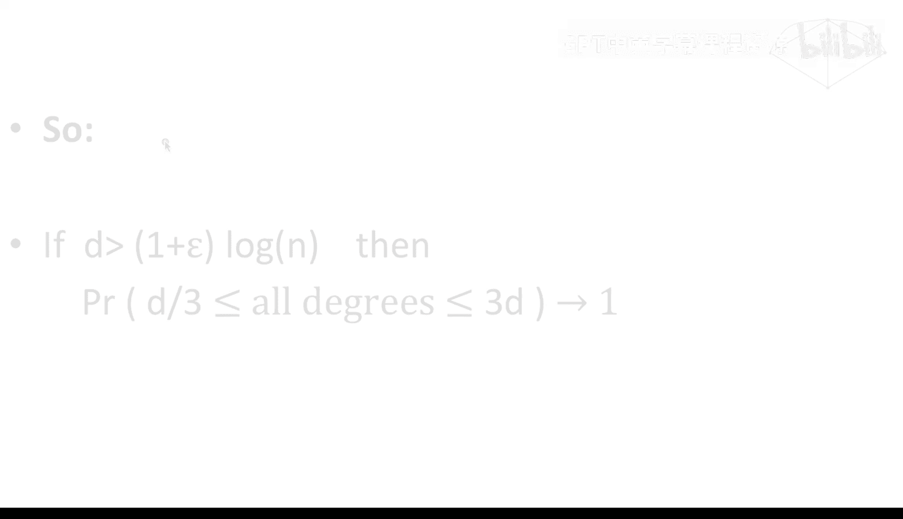

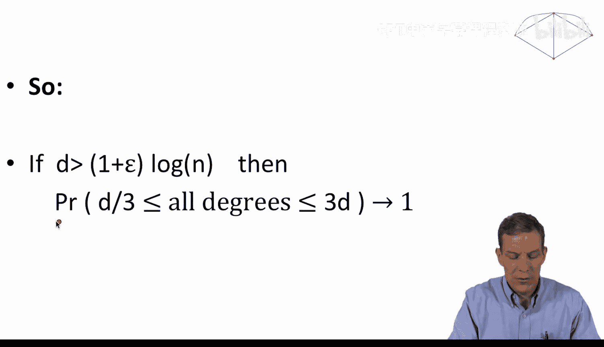

And so the distance that it takes to get from one node to all the others。

 if we had a tree expanding with these degrees being randomly distributed。

 but having the properties that they're within factor of three with probability one。

 then we could bound the distances by saying that the shortest it could be is if we ended up with three times the degree as the average degree。

 the longest it could be is if we ended up only with a third of the degree。

 and so that gives us bounds on what this could be。

And in particular for D that's growing so that d isn't too small。

 the log of 3D and the log of d over 3 are both basically proportional to the log of D for large D so this is the log of D plus log of 3。

 this is log of D minus log of 3 and for large D the three part is washing out and so this tells us that basically as it grows。

 this distance is going to be proportional to log of n over log of D。

 so whether it turns out to be off by a factor of 3 really doesn't matter much in the average distance calculation because that's proportional to logarithms and logarithms wash out these factors。

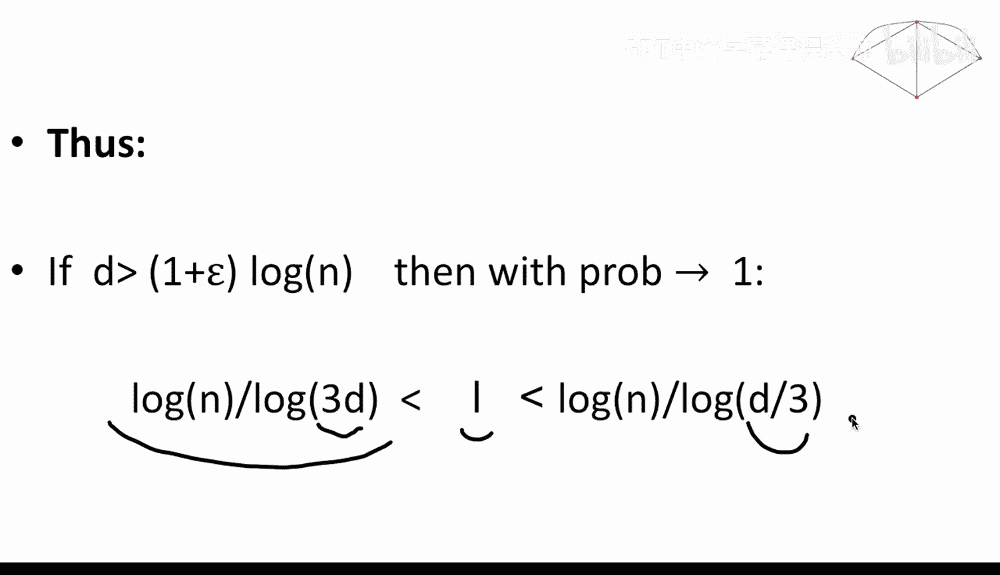

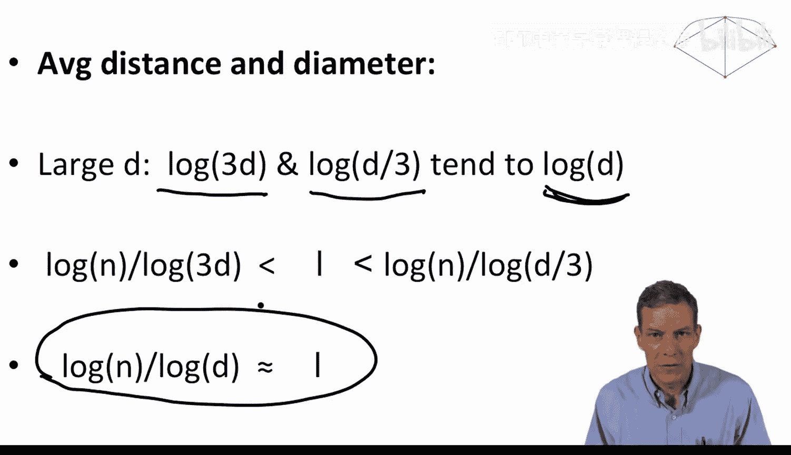

Okay so that's a very nice point and you know we have this other part that some links may be doubling back and when the part of it's going to help with the expansion is that you know these links are being put down at random and most of the nodes aren't really reached until the last step of this expansion process and so after K steps we've reached about D to the K nodes and there's still n minus d to the K to be unreached and if K is still not we haven't expanded all the way outwards。

Then there's still many more nodes out there compared to the nodes which are already have been reached and so if we think about a given node and we ask where are its links going to most of its links are going to given that they're independently at random are going to be reaching new nodes rather than nodes that have already been reached and so it's not until you get very close to having reached all the nodes that you have to start worrying about the fact that things are going to be really doubling back with any high order of magnitude and so you know just to get a feeling for this。

 let's suppose that each person had 100 friends， then you know at the first stage you would reach 100。

 the second stage at 10，000 then we get to a million then we get to 100 million and so forth so things are actually expanding outwards and there's always more and more nodes that haven't been reached than ones that have already been reached and so the average。

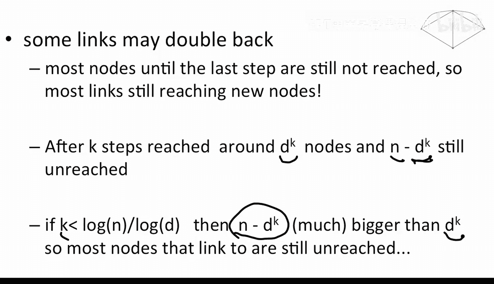

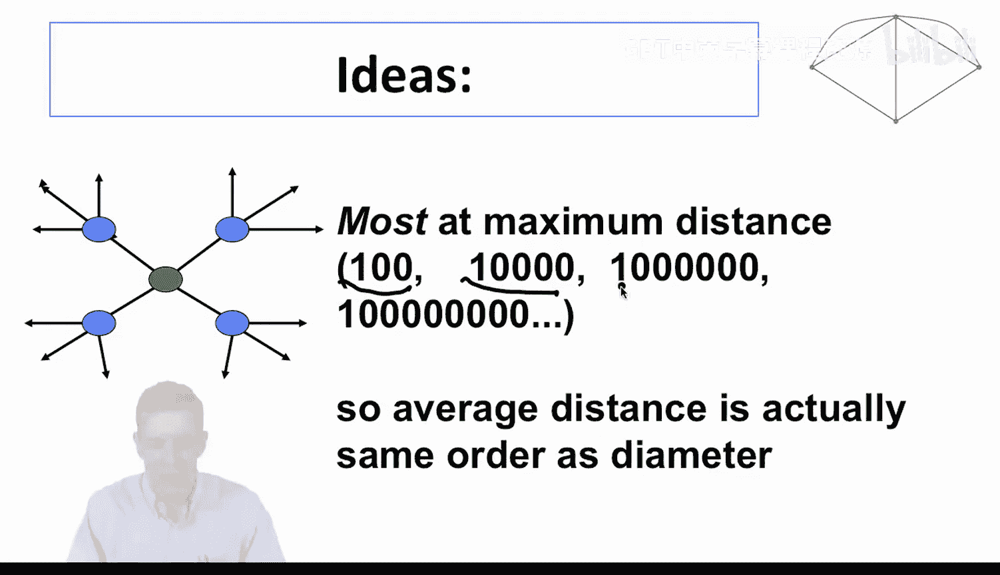

istance is actually going to turn out to be very close to the diameter because most of the ones are being reached at the last step。

 and that is also going to be a part of the proof in making sure that these things aren't doubling back at to higher rate。

So this is sort of a heuristic treatment of why these things are true。

 but what it does is it gives you an idea of how the turnoff bounds can be used in these kinds of proofs。

 basically the proofs of properties of random graphs work by understanding different structures that underlie these things and then proving that things happen with high probabilities using variations on laws of large numbers showing that as things become very。

 very large， then properties are going to be true with probabilities going to one。

 that's a basic structure that underlies a lot of proofs in random graph theory and gives us an idea of why we're seeing the kind of theorem that we saw in terms of diameter and average path length being proportional to log n over log D so now let's take a look at some actual average path lengths and distances and see whether we see that this seems to be accurate。

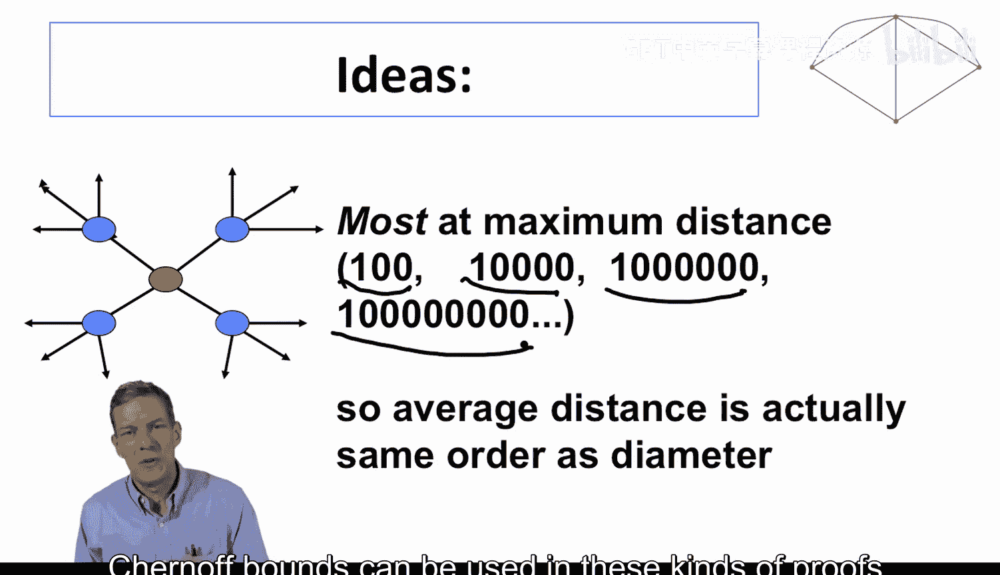

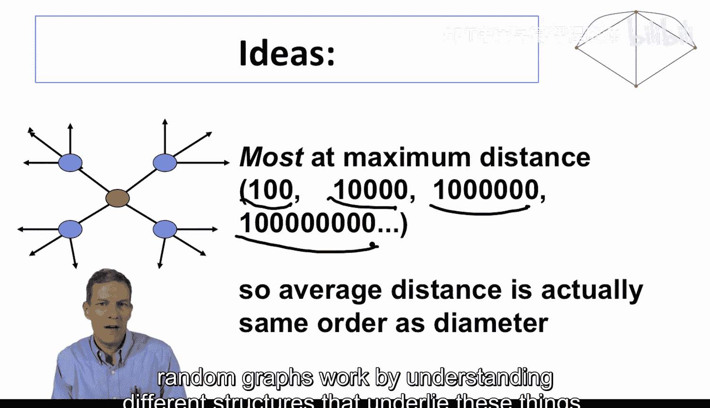

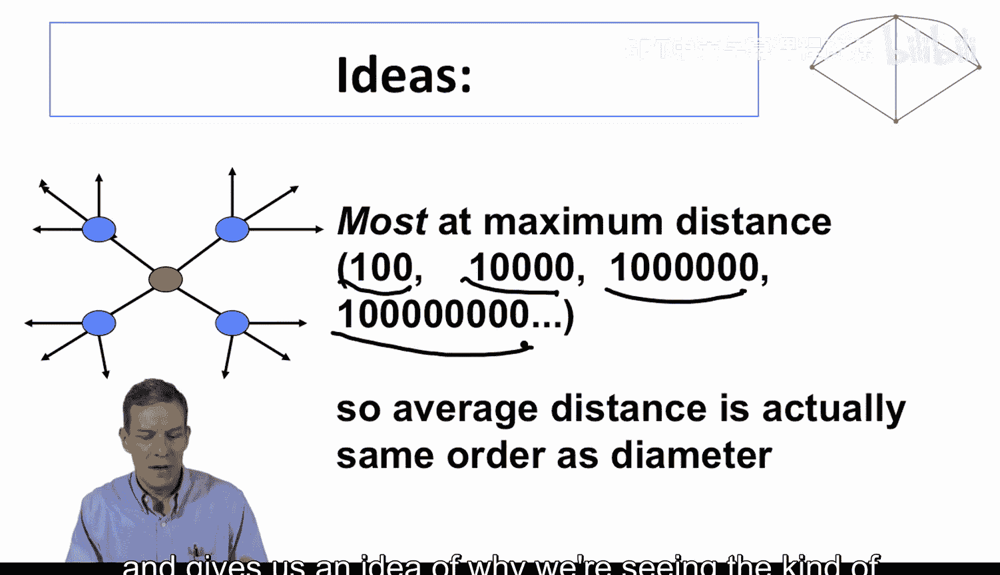

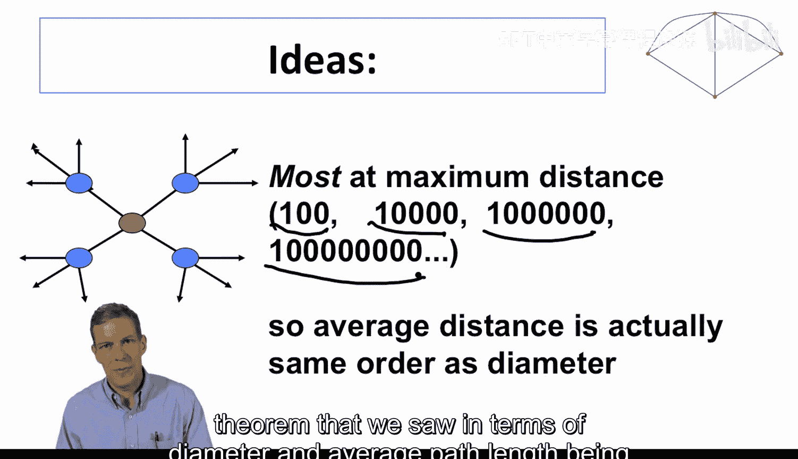

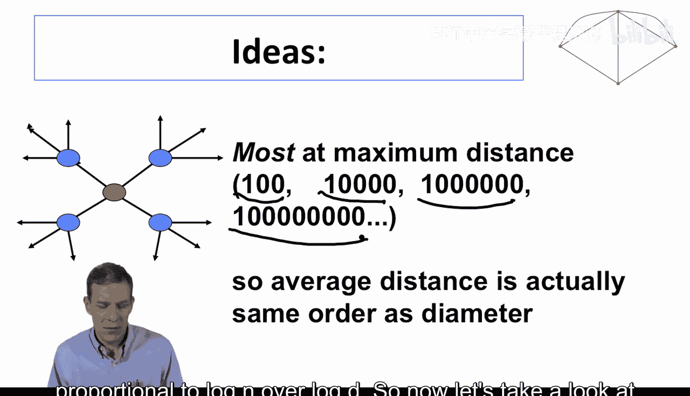

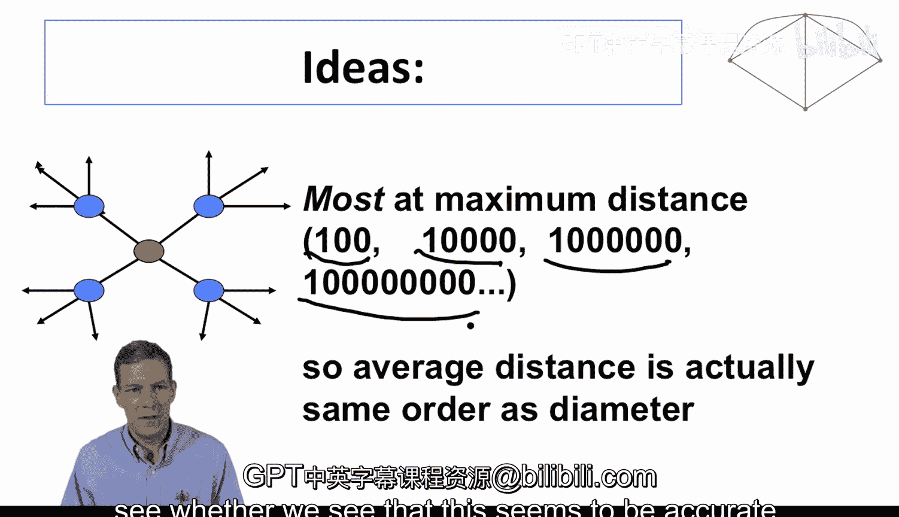