# 斯坦福大学《社会和经济网络：建模与分析｜Social and Economic Networks： Models and Analysis》中英字幕 p09 09_01_10_1-7-现实世界中的直径.zh_en -BV1v1421U7Nk_p9-

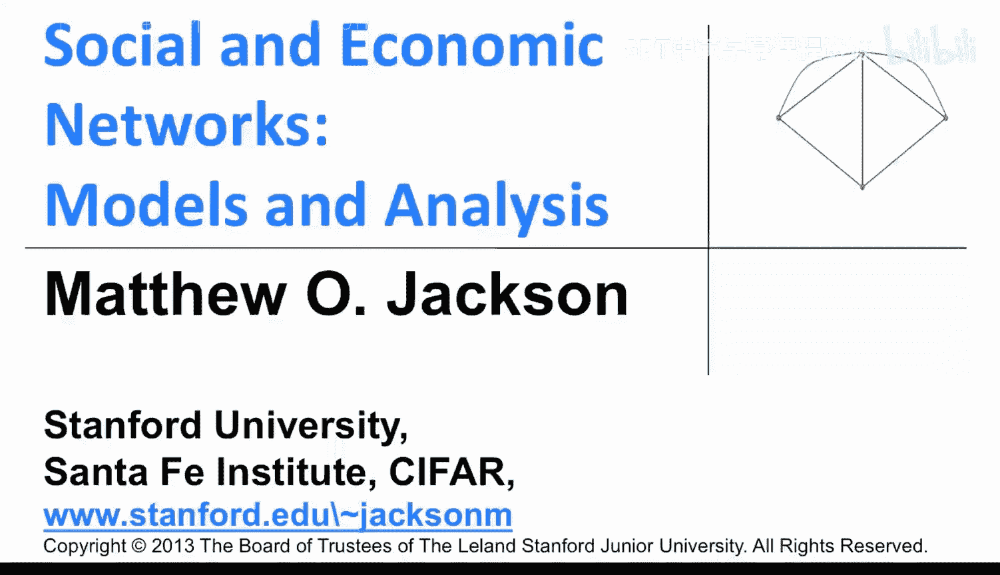

Hi folks， it's time to talk a little bit now about some observations of actual diameters in the world。

 and if you recall we had we talked about diameters in random graphs of a particular form and we were finding that for large enough graphs and degrees that weren't too large or too small。

 log n over log D was an approximation of the average path length and diameter。

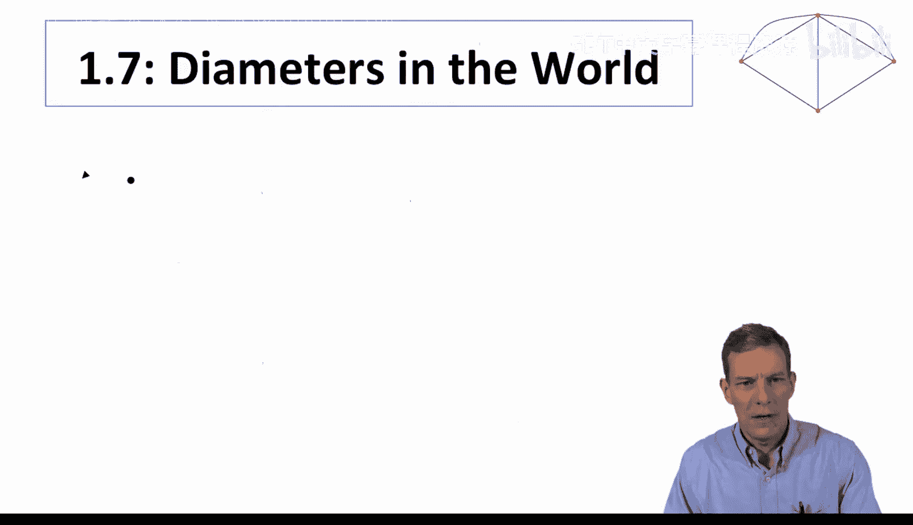

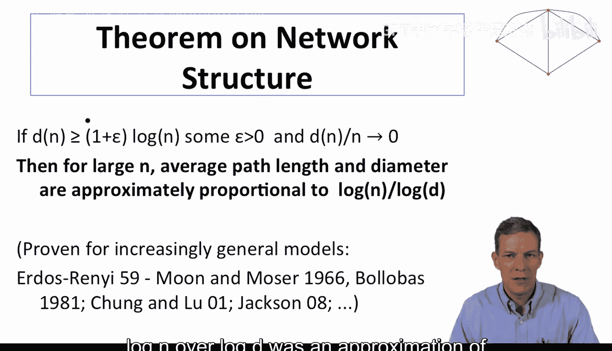

And let's do a rough back the envelope calculation so you can pull out your calculators。

 say that the world population these days is somewhere between  six and 7 billion， let's take 6。

7 billion as an estimate。

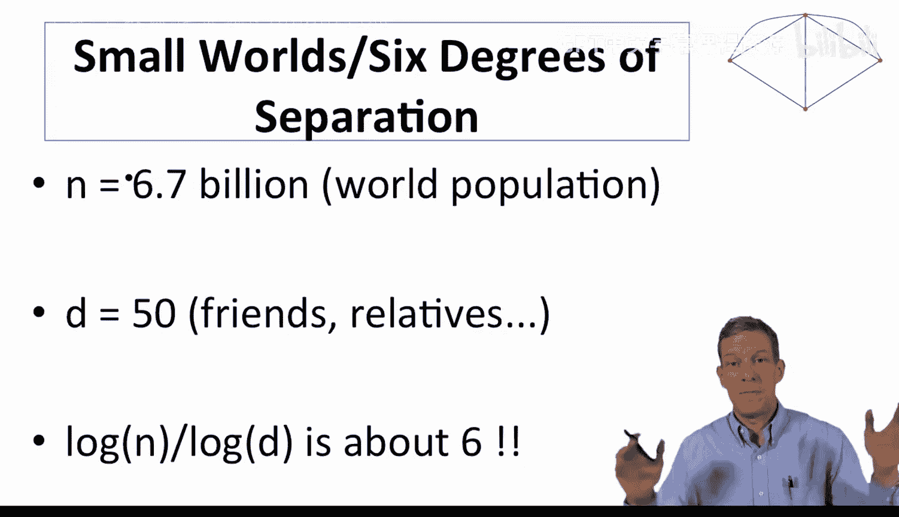

And let's suppose that you just count friends that you talk to on a reasonably regular basis。

 so friends， relatives。Take 50 for an average number of people that somebody might talk to on a regular basis now do log of 6。

7 billion over log of5 sorry log of 50， what do you end up with six so this is the six degrees of separation that is often talked about the idea that you to get from any individual to any other individual in the world。

 you actually don't need a lot of hops you can get there fairly efficiently。

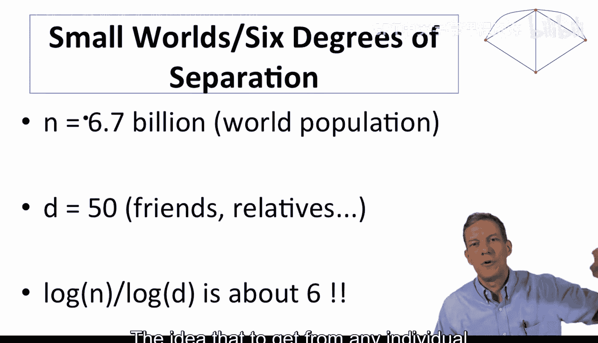

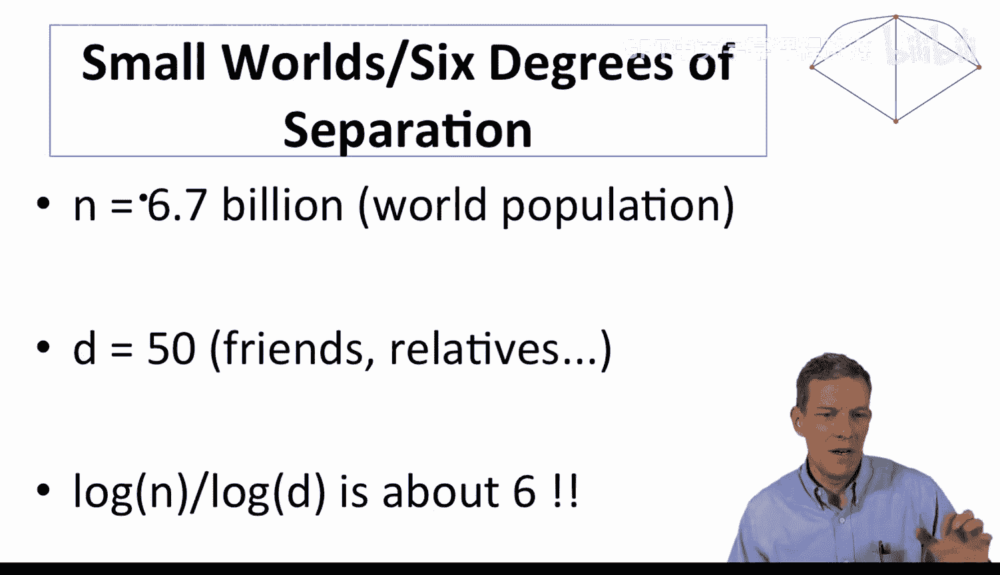

So let's take a look at some data and see if those kinds of numbers actually are observed and so what I want to look at is what's known as the Ad health data。

 the adolescent health data set is collected in the 1990s interviews of a bunch of high schools in the United States and there's network data for a lot of these high schools so people were asked to name friends。

 their friends and kept track of their friends， and the schools actually vary quite a bit in the racial composition。

 the size of the school， how many students are in it in a bunch of other things。

 so the networks have some variation and we can see whether the diameter in these networks look like they log n over log D that we found in the estimate。

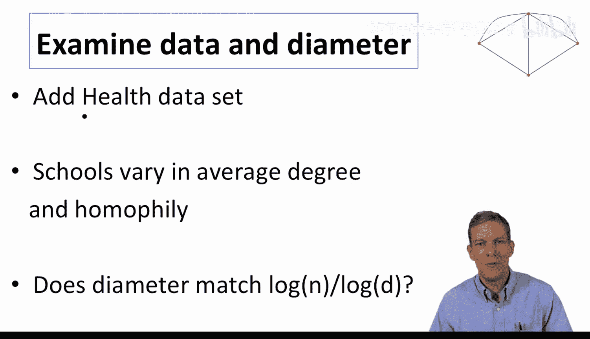

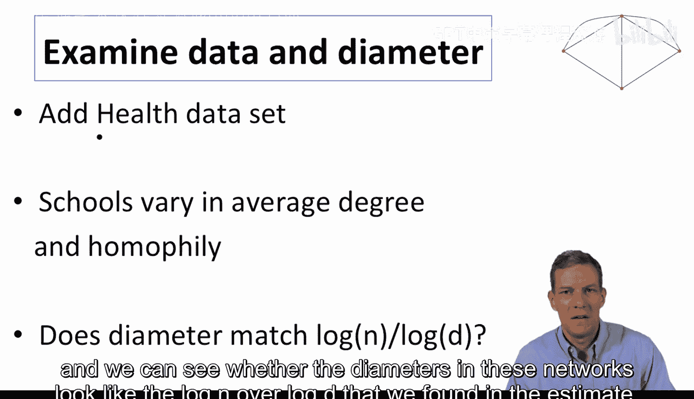

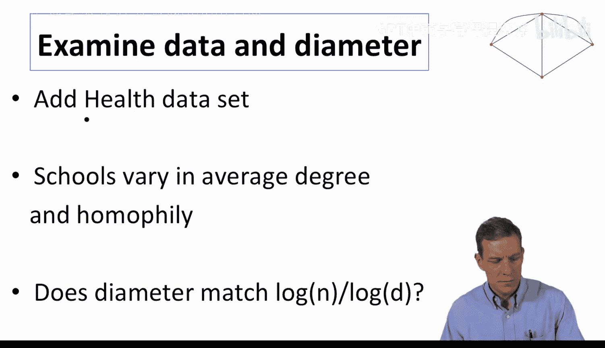

And so let's have a quick peek at some data， so this is the average shortest path and it's plotted for the giant component versus log n over log D and this is from 84 high schools for which there's a fairly complete network data and this is from work I did with Ben Goab and when you look at this graph so what do we have on the X axis we have this is the log N。

 so look at the number of people in the high school divide by log of the average number of friends that they had in the network and then here's the actual average shortest path。

And if the theorem is true， then there should be all of these points should lie on the 45 degree line and actually remarkably close in terms of looking at real data。

 the spread here that we get in terms of log n over log D and average shortest path fits fairly well and indeed for the smaller schools you have fairly short average path lengths and for the larger schools。

 you have larger ones， but they're matching up very much with log N over log D seems to be fairly accurate。

Now some of the curious numbers that are out there in the world。

 Udoash had a large number of co-authors and 509 co-authors and he wrote more than 1400 papers in his life and so people mathematicians like to count their Udash number so you count how many co-authors does it take you to reach how many links。

 does it take you to reach Udoash so Udash had a co-author。

 they co-auor with somebody else and so forth you can find what your own Udash number is interestingly enough there was an auction in 2004 of a co-authorship with a person named William Toziier this was on eBay his Udash number was for and if you won the auction then he would put your name on a paper with him and so that would make your Udash number five the winner paid more than $1。

000 actually to have have their name on a paper with Toier。

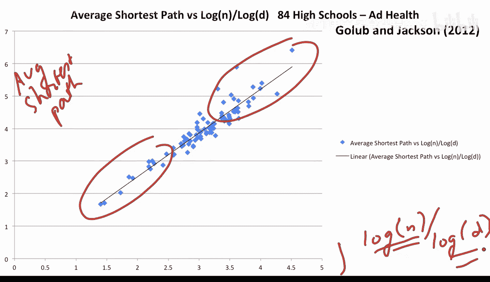

And end up with an Udash number of five， so that's just sort of an interesting curiosity。

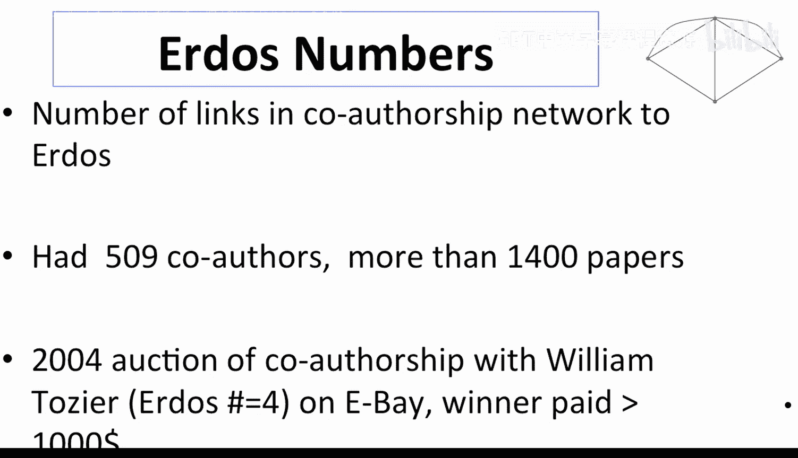

When we look at average degree， one thing that's going to be important is you know this says that as the density of the network changes。

 we're going to end up changing average path length and interestingly enough。

 networks do come in very different。Vieities of sizes， so for instance。

 these high school friendship networks on average 6。5 connections per individual the degree。

 there's a paper by Berman Moody and Sovval， looking at romantic relationships in some of these high schools there。

 people had on average during a time period， about 0。8 of a relationship。

 you can look at at this is data from work I did with Abijib Banerji Irunchanra Siar and E to do F on borrowing money borrowing kerosene and Rice from other individuals in small rural villages in India。

 average of other households that you given household borrows from 3。2。

 various co-authorship studies depending on what you're looking at economics biology， math， physics。

 you see different numbers of co-authors that people typically have。

 say in a decade or some time period。

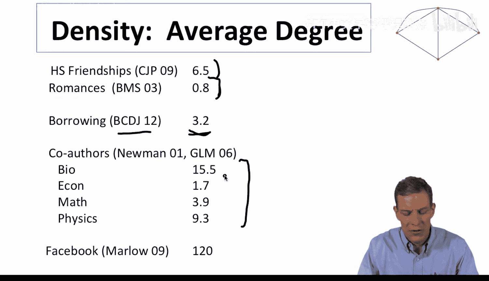

just under two over 15。5 of people work in larger teams。

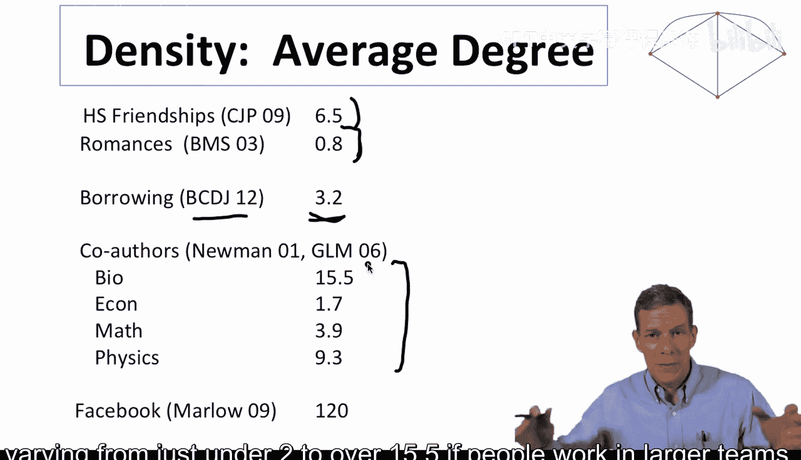

So you see different numbers of co-authors， people always ask about Facebook Facebook number about 120。

 so you see different connectivities in these graphs and that's going to lead to different properties So some of them are going to have different shorter average pathlinks。

 other ones are going to have larger ones and so whenever we're looking at a given problem or a given context。

 it's important to define a network carefully because these are going to have different properties depending on whether we're looking at a borrowing network collaboration network something like Facebook where you just have a friendship means you have a link to somebody else's page well in various other kinds of things or friendships。

 romances， there's a whole series of different kinds of ties we might。Define。

 and they're going to have different。Network properties。

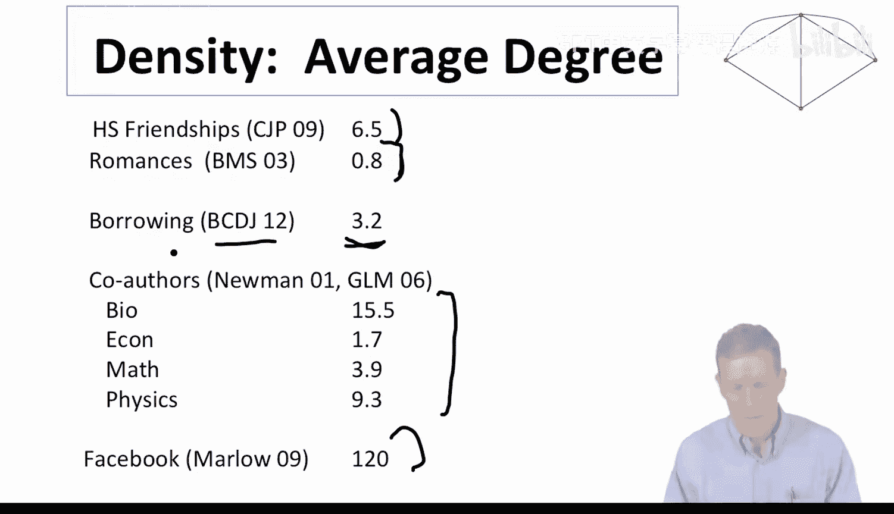