# 斯坦福大学《社会和经济网络：建模与分析｜Social and Economic Networks： Models and Analysis》中英字幕 p10 10_01_11_1-8-度分布.zh_en -BV1v1421U7Nk_p10-

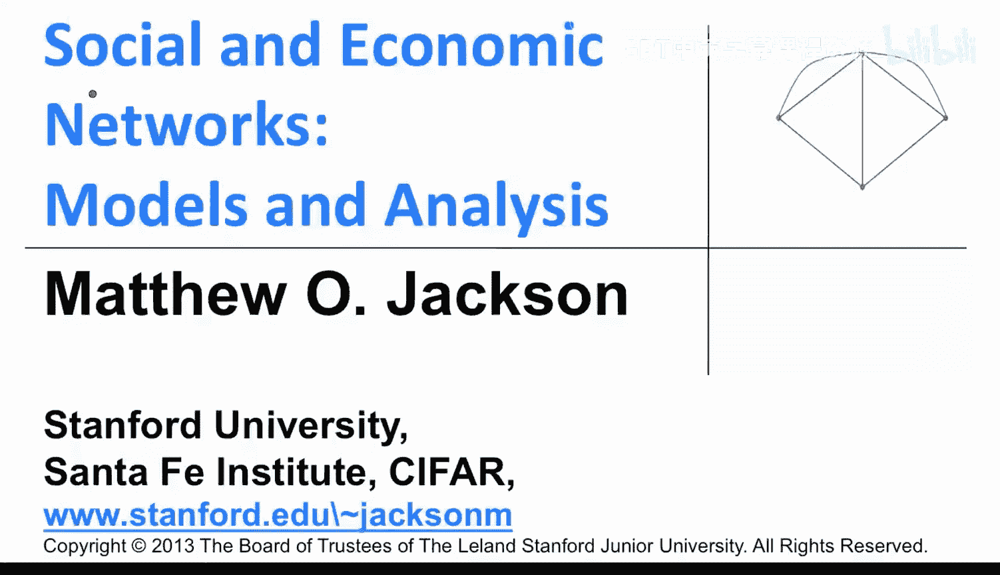

Okay， so let's talk a little bit about the distributions of degrees in a network and why do we care about this。

 Well， obviously when we are trying to characterize networks in terms of basic properties that they have knowing whether the most nodes have very similar degrees or very different degrees can give us a lot of information。

 So for instance， you know whether everybody has one or two links or some of the nodes have eight and others have one。

 that's going to give us a very different kind of network and that different kind of networkss going to have different properties in terms of its diffusion properties。

 It's paths， other kinds of things。 So you know what we looked at in terms of the G graph had most nodes had。

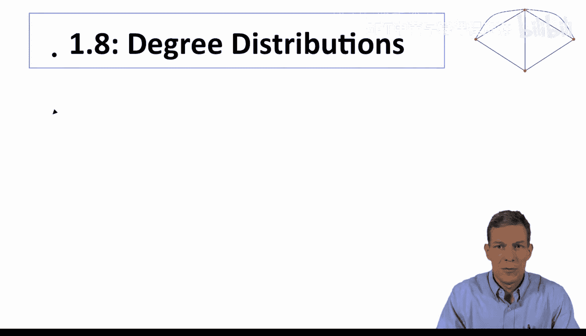

Order of magnitude similar degrees to each other， let's look at this in a little bit more detail。

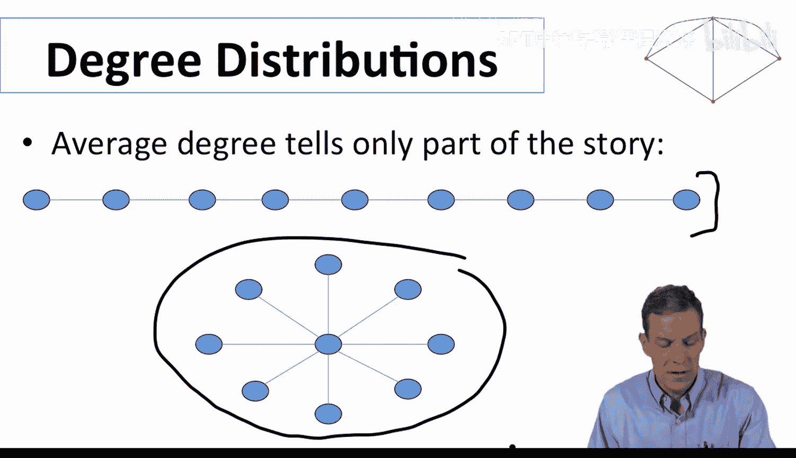

So when we look at say these Erdarenni GNP random graphs， well。

 the chance that a given node has exactly d links is just follows what's known as a binomial distribution right so the chance that they have exactly D links present and D the rest of them not present。

 well I have a chance p of a given link being present raised to the D power。

 then one minus P raised to the n minus1 minus D power。

And how many different ways could I have actually picked the other d nodes that I'm connected to。

 well there's n minus1 factorial over d factorial times n minus1 minus d factorial。

 so basically this is what's known as n minus1 choose D that's the combators of how many different ways I could have exactly d neighbors out of a population of n minus1 possible other neighbors。

Okay， so that's a binomial distribution and these networks are also known sometimes as Bernoulli because know you're flipping coins。

 binomial or Poisson random graphs， y Poisson， well if you want to approximate this。

If you want to approximate this formula for large N and relatively small P。

The when you look at1 minus p raised to the n minus1 minus d power。

 this looks roughly like e to the minus n minus1p and this combinatoric choose expression looks roughly like n minus1 to the D over d factorial。

 so when you when you bring these two factors together that's roughly n minus1 to the D that you're left with。

 and this is well approximated by e to the minus n minus1 to the p。

 so you know the binomial approximation here by a poisin distribution means that we can represent approximately the probability that a given node has exactly d neighbors by。

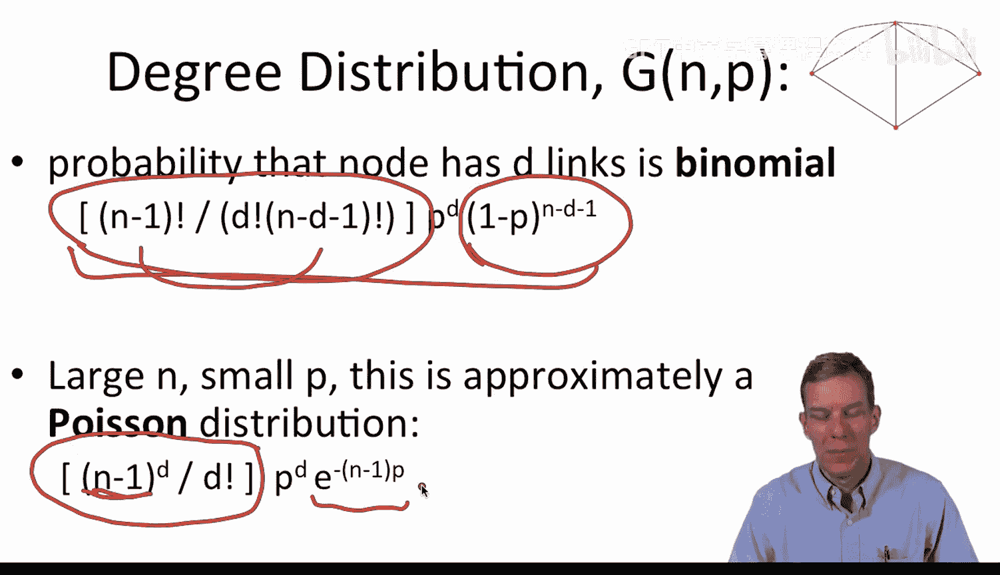

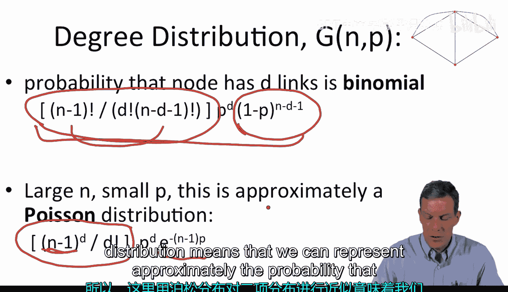

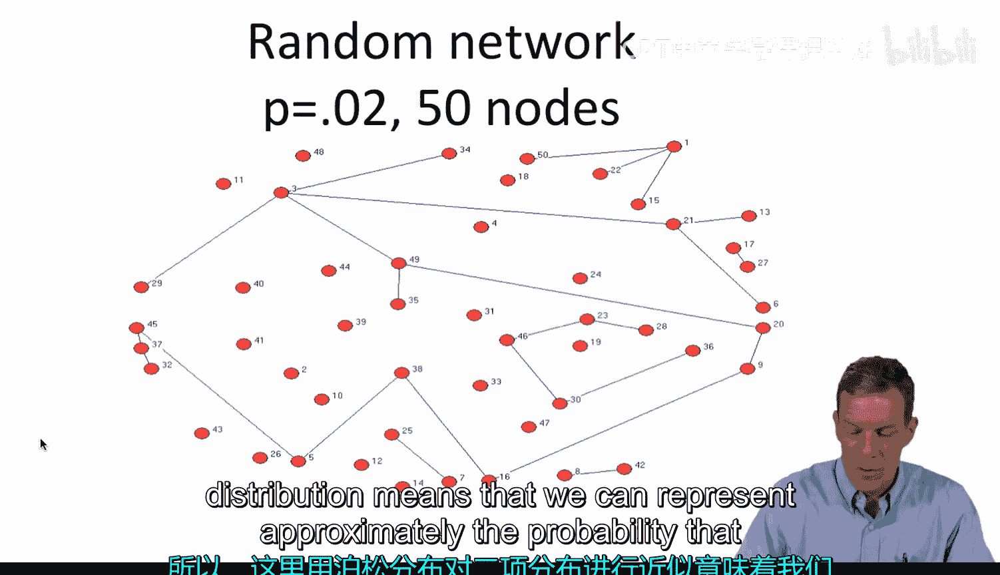

This formula here， which is known as a plus distribution。

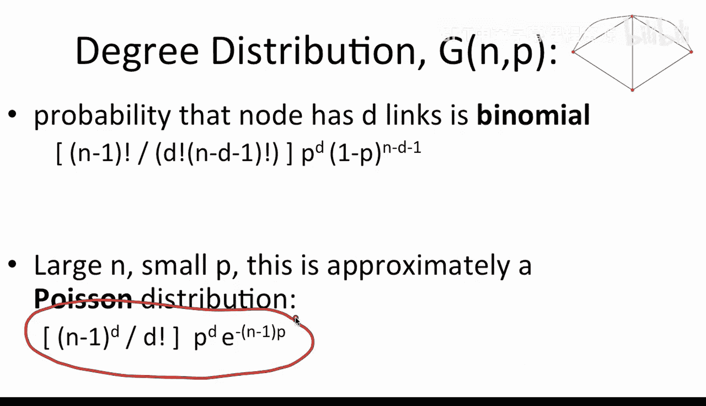

Okay， so let's have a look at some of these random networkss this is actually a random network I drew on 50 nodes with the probability 0。

02 of having any given pair of nodes connected， and this is one realization that was drawn in what's known as UCINe。

SoYou can find that on the web if you want a network package。

 it's one of several that we'll talk about in the course。

 so I drew this using UCInet random graph 50 nodes 0。

02 so let's have a look at the actual degree distribution compared to a Poal approximation so if we have a Poal approximation where you had an expected probability of links of 0。

02 then you would get the square dots here， the realized frequency is by the diamonds and actually these two are very difficult to tell apart so the frequency distribution of how many nodes to have degree1 degree 2 degree 3 and so forth there's a couple of to few nodes that had degree2 but everywhere else were pretty much right on the graph。

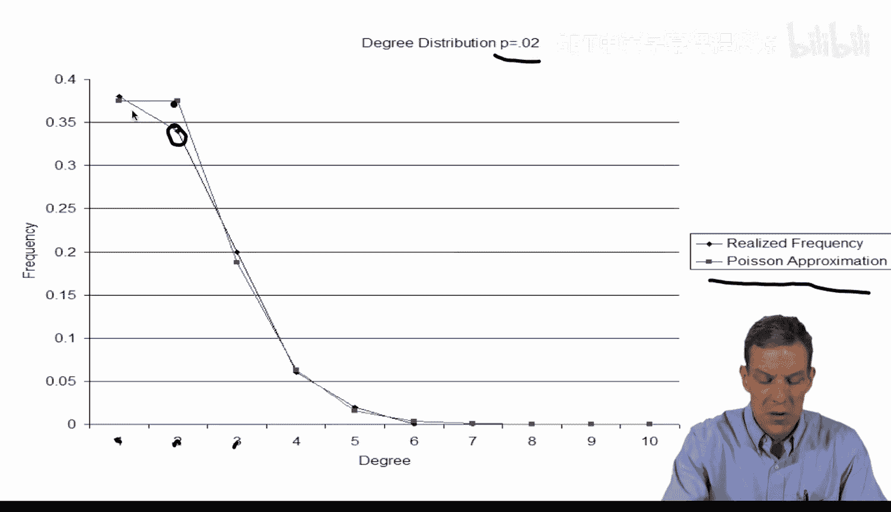

You know， a couple of things to note out of our picture that we had when we go back here。

 there's a bunch of isolated nodes， it looks pretty much the rest looks sort of tree light there's no cycles in it so we see several components。

 no component more has more than a small fraction we're just starting to see one large component emerge if we go and instead bump this probability up to 。

08 on 50 nodes then we get a much more connected graph。

 we still have one isolated node and we end up with you know more nodes having many more connections。

 what's the actual distribution look like well now when we look at the actual the Poal approximation we have a curve here and then when we look at the actual realized frequency。

 we end up with something which is not。

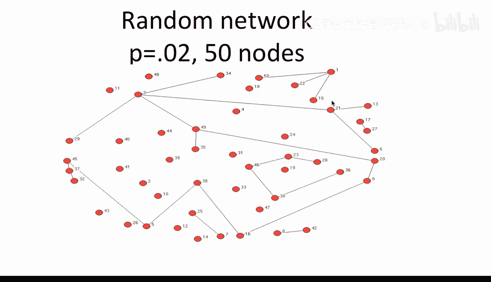

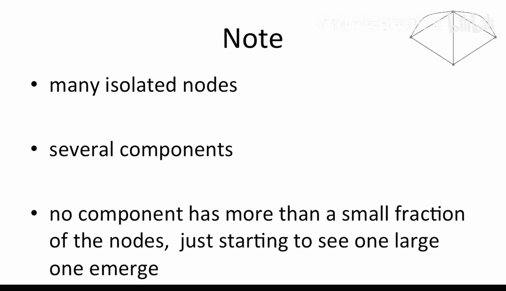

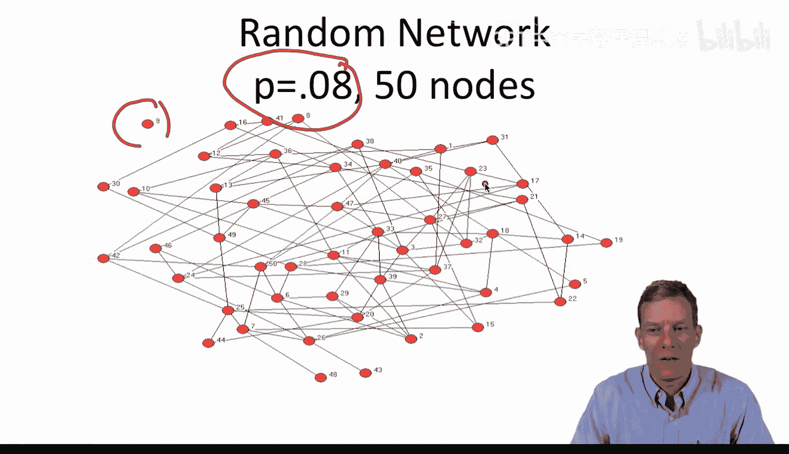

Exactly on target， the P' is a little larger， so the approximation is not quite as great but it's still fairly close and if you had more nodes and looked at a random graph on a larger set。

 then these things would start to coincide even more。

 but again the Poisson gives us a reasonable approximation of what we would have expected to be realized。

U。So this is a Poiscein distribution， what we'd see if we saw links formed independently at random。

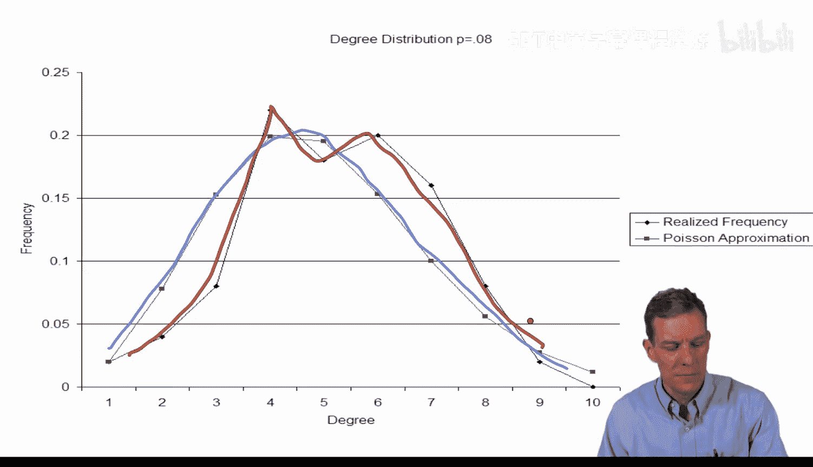

What thing what's sort of interesting is that when you look at some networks。

 they tend to have what are known as fat tails and one of the early。

Looks at this in a network context was by Price in 1969 and he was looking at citation networks and so looking at papers that cited other papers and articles that cited other scientific articles and then looking at how many sites given articles have and then you could just put down sites at random or you could see what you actually saw in the data and he saw what were known as fat tales and。

What that means is effectively you saw too many articles that had lots of citations and too many that had very few citations so if you look at the extremes。

 you saw those being overrepresented， and then numbers that were close to the average you saw fewer having sort of a middle amount of citations you either got very highly cited or very low citations this is related to a lot of other things。

 there's a lot of things that have fat tails， these distributions go back to Pareto in the 1890s。

 so things like wealth distributions， distributions of cities populations around the world word usage。

 there's a whole series of different things that have these kinds of fat tales and in particular there's a wellknown paper by Albert Jg and Barbasi in the late 1990s where what they looked at was a web pages and connections to web pages in the Notre Dame part of the World Web at that point in time。

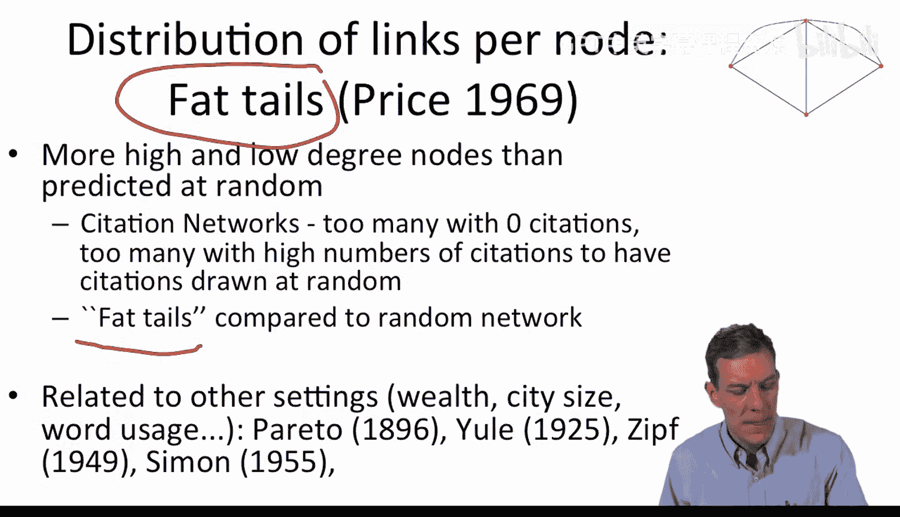

What is plotted here is a comparison between in the blue or the actual data of the World web connectedness。

 and in pink color here is what we would see if the links had been formed uniformly at random。

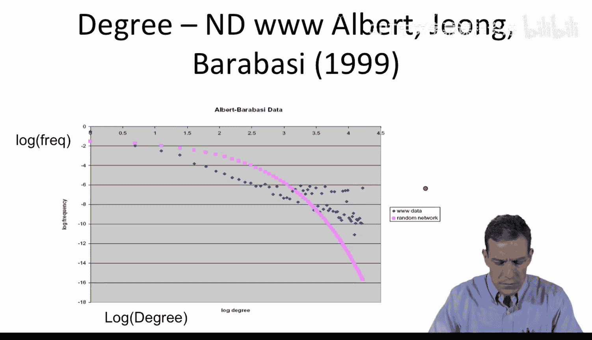

And the idea， of a fat tails here are the idea that。

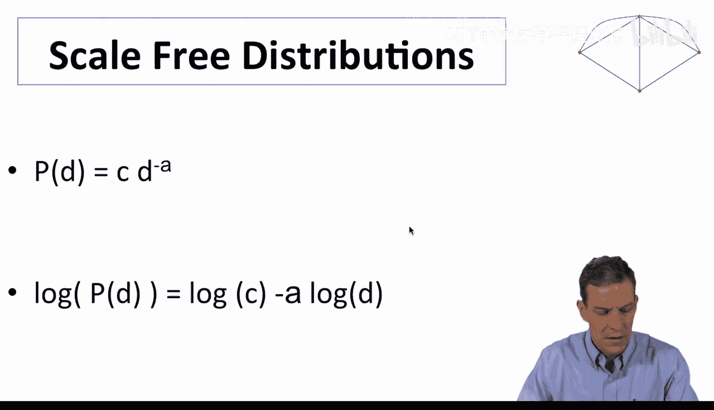

When we look at the actual representation we've got so this is log of frequency， log of degree。

 we have a higher frequency of really high degreeeg nodes and a higher frequency of really low degree nodes and then the middle degree nodes are underrepresented relative to think so we have this fat tails and in fact the distribution in this log log plot is almost linear so you know a line is a reasonably good match for what's going on in these data we'll talk about that in more detail as the course goes along。

 but the important thing here is that there the distribution is a little bit different than what we have gotten if we had just thrown down the links uniformly at random。

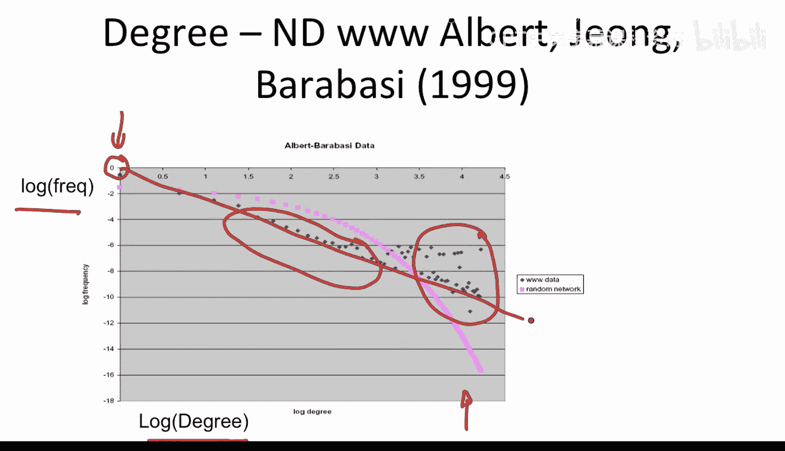

So this is known roughly was what's known as a scale free distribution。

 the probability that a given link has degree D can be thought of as proportional to the degree raised to some power and part of the reason that this is known as scale free is if we double the degree then we scale up。

 the relative probabilities scale up so that we will still get the likelihoods will be proportional to each other as we are increasing degrees。

 and in particular if you take log of each side of this， what do we end up with。

 we end up with the log of the probability the frequency of having a given degree is going to be proportional to some factor times the log of the degree and so if it was fitting this distribution exactly we should have a line and indeed when。

We look at what we saw here， and we get a reasonable approximation by a line in those data。

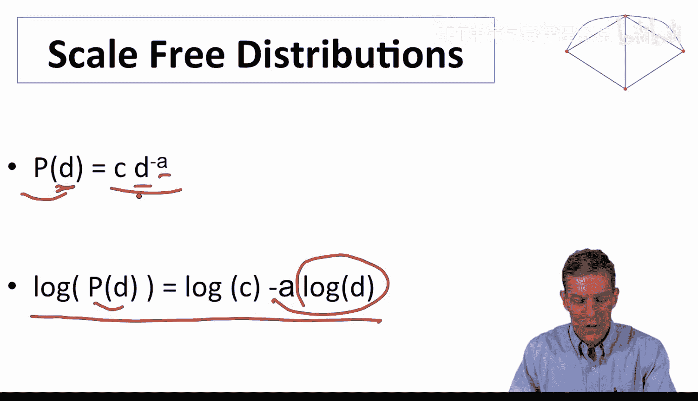

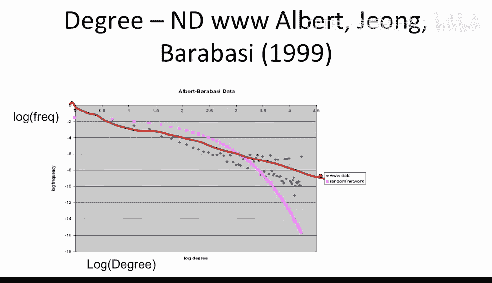

Okay， let's have a look at a completely different kind of network and see whether we also see fat Tas or not。

 so this is Berman Moody and Stovl's data， the high school romance data that we talked about just a few moments ago。

And here we're looking at one high school， nodes are colored by gender， male， female。

 and a link between two nodes means that they had a romantic relationship during a time period that was captured in the surveys in this high school。

 and in particular， you know here we see different kind structure。

 we've got a bunch of 63 different dad， so just two people connected to each other。

 we see one fairly large component， which has a couple of cycles in it， but looks almost like a tree。

 you see some other different shapes here， a number of different configurations。

 so a bunch of small components， one larger component and actually there's some isolated nodes that are omitted from the picture。

Let's look at the degree distribution of this one and compare it to the uniformly at random。

 so here again log of degree log of the frequency and in this case when we look at the actual data compared to the uniform at random。

 the fit of if we actually try and match these up the fit in terms of matching up the data。

 it's a very close match from just having the uniform at random。

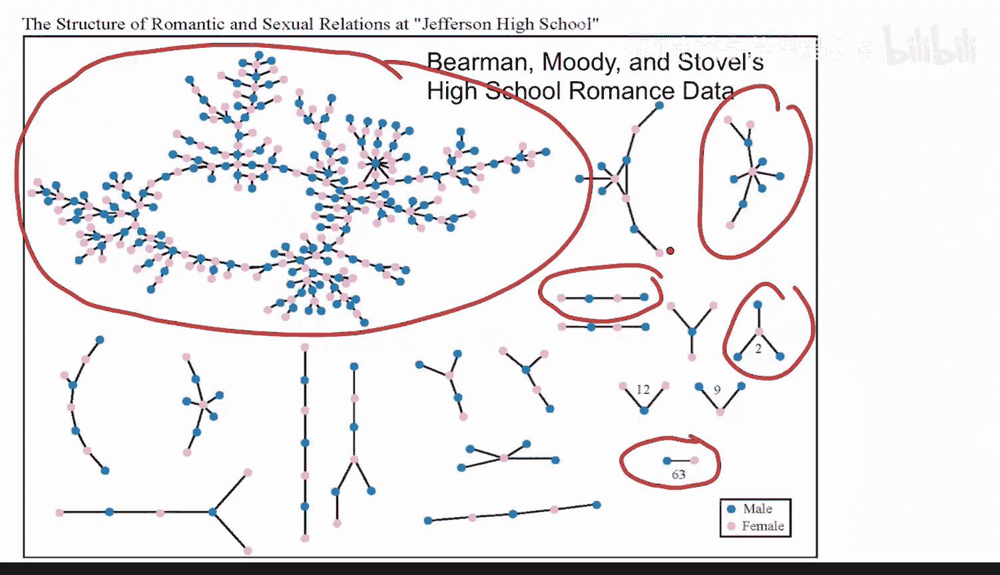

Compared to a power distribution doesn't fit this as well so this doesn't seem to have the fat tails that the other one did what does that tell us that tells us that a degree distribution of different networks can have different properties and if we're looking at some。

 they might have something which looks much more uniformly random what this tells us about romances in high schools。

 but it's saying that this is looking much more like a purely at random graph whereas the other one looked like it had something else going on in terms of its degree distribution looking more like a power distribution。

So that gives us a brief look at degree distributions。

 we're going to be visiting those a lot more in the course。

 they're in a very important way of characterizing a network and understanding how dense the network is and also what the sort of variation is in degrees across the population。

 so let's have a look at some other definitions that are going to be important in networks。

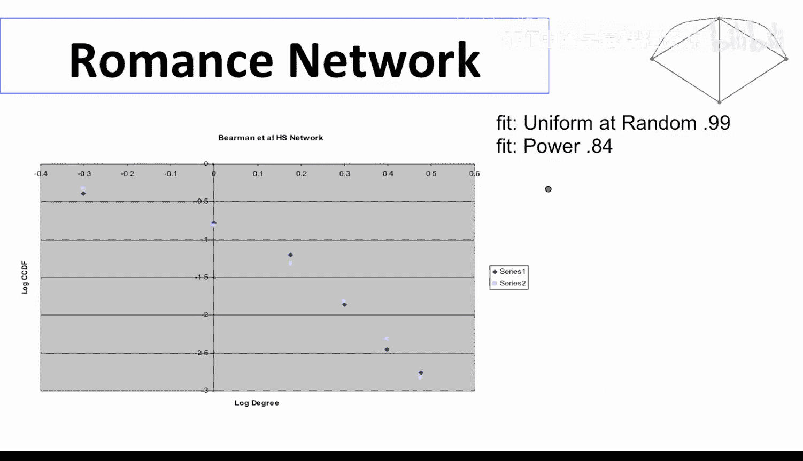