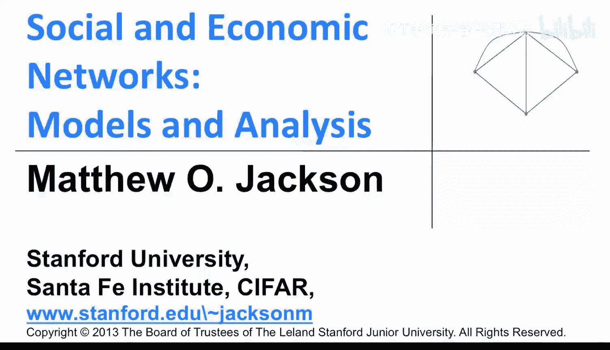
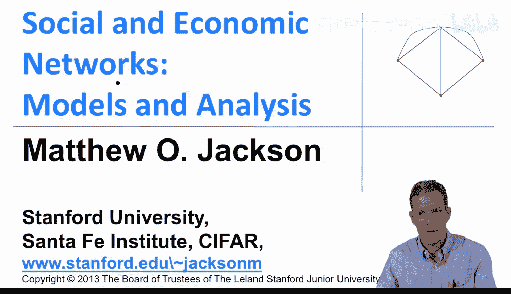
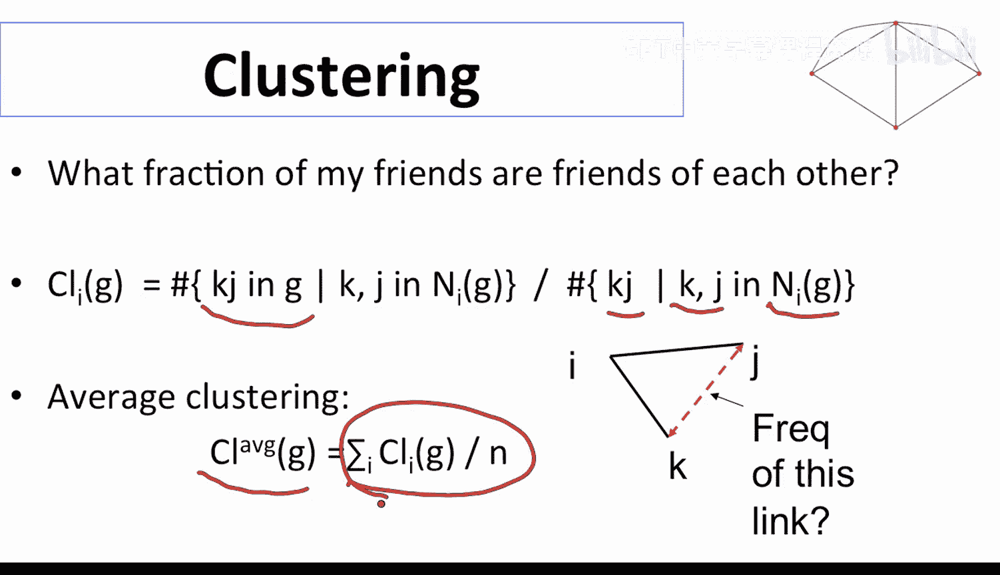
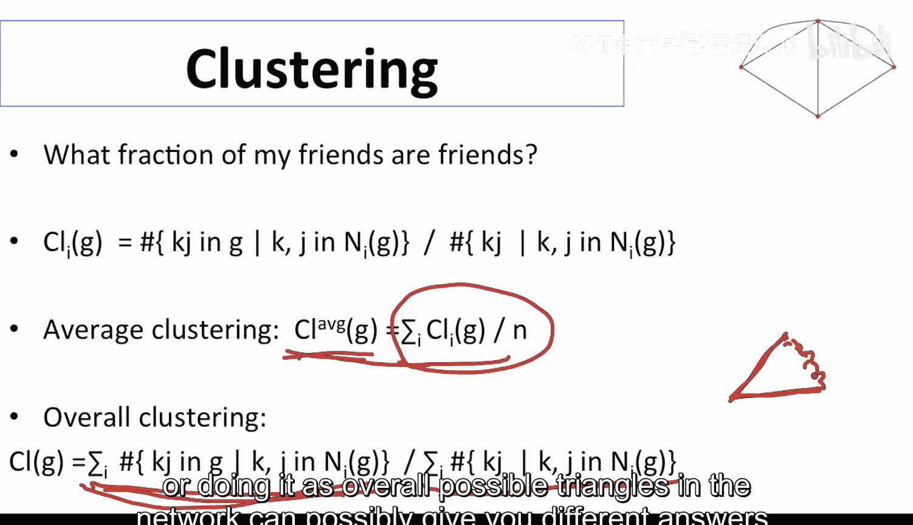
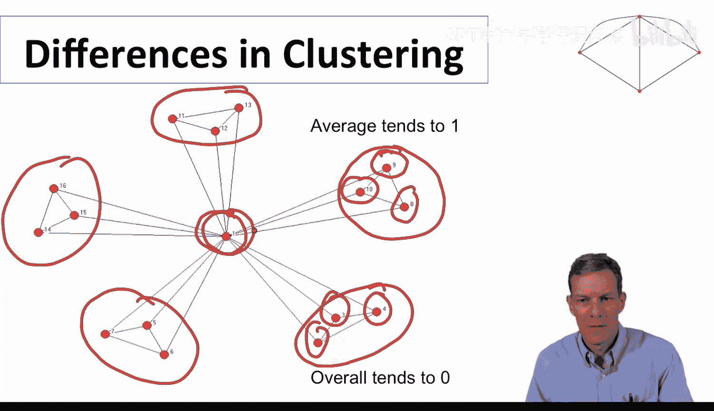
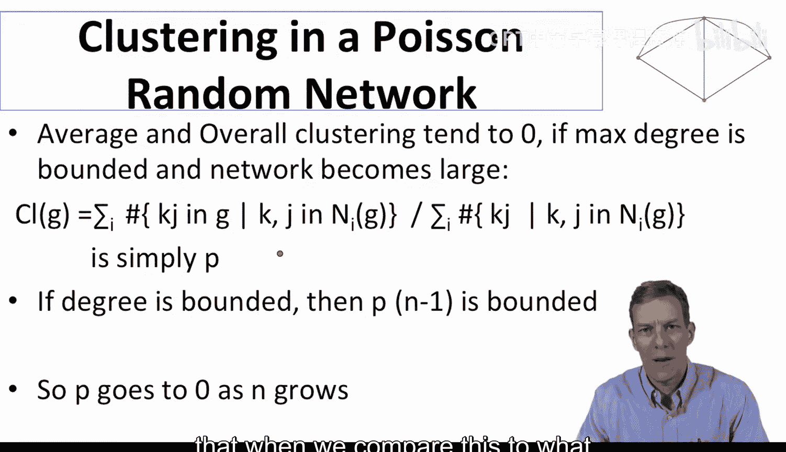
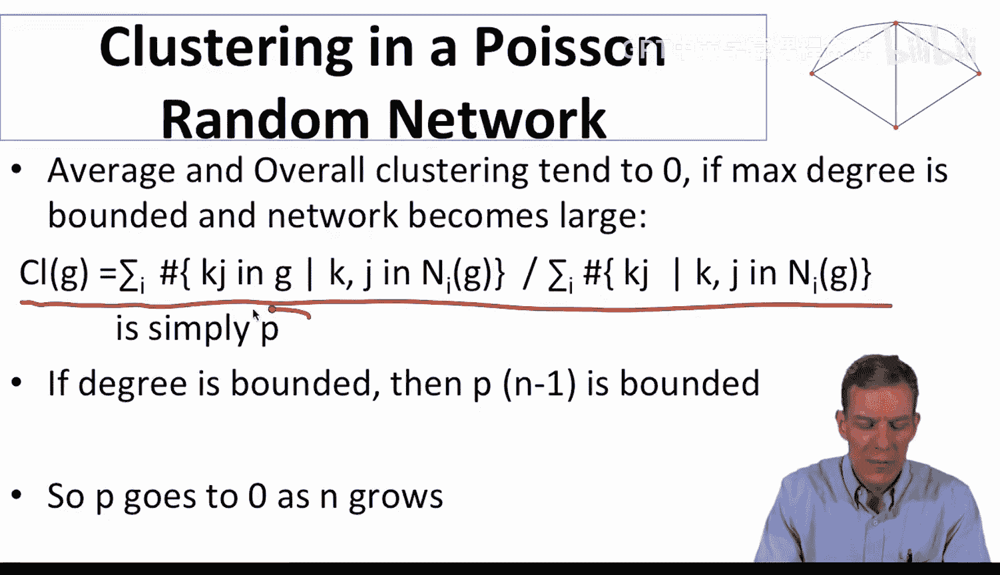
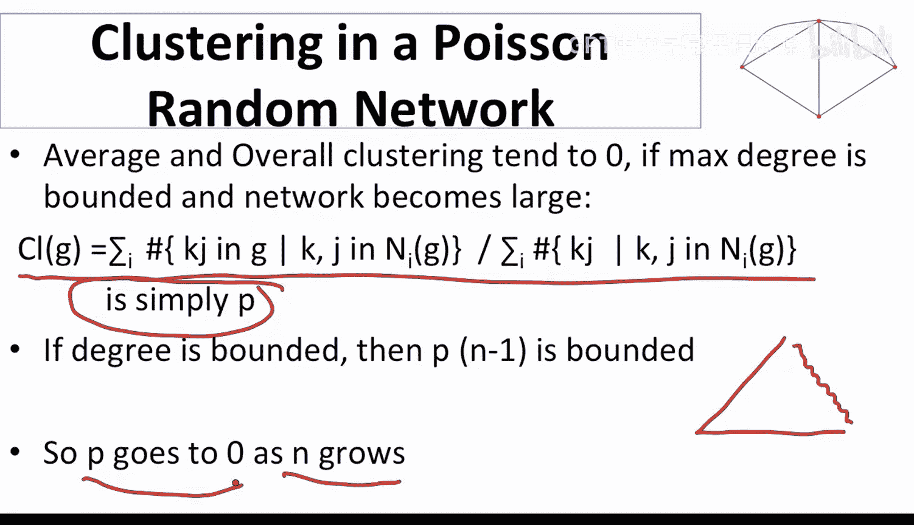
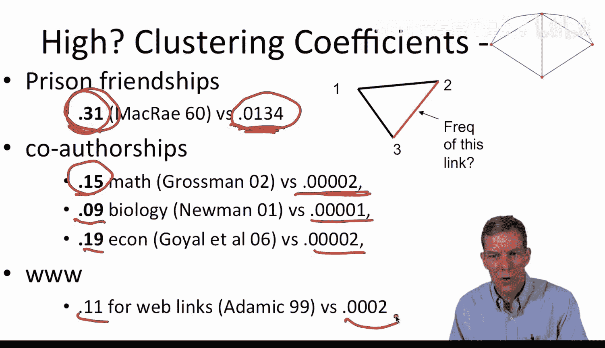
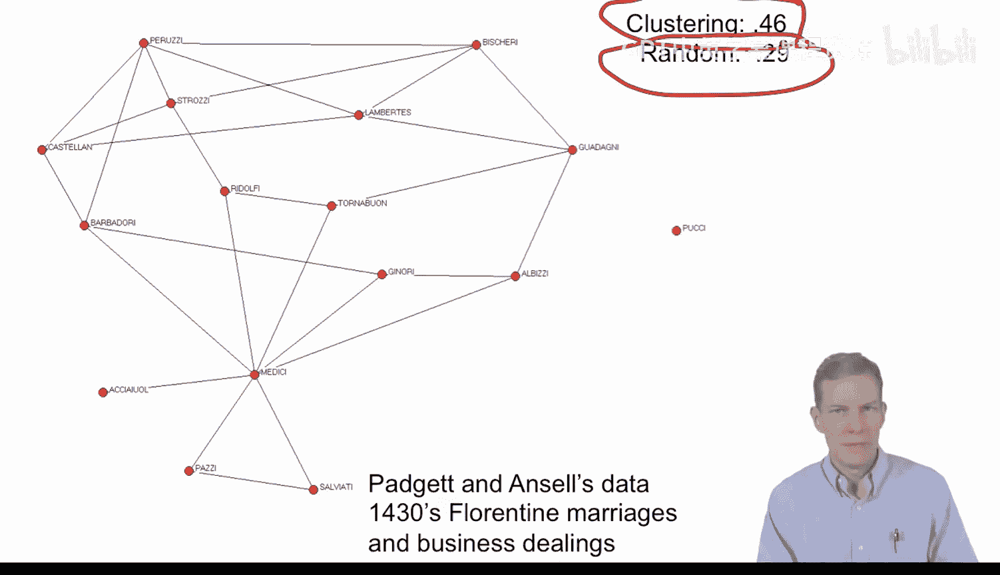

# 斯坦福大学《社会和经济网络：建模与分析｜Social and Economic Networks： Models and Analysis》中英字幕 p11 11_01_12_1-9-聚类系数.zh_en -BV1v1421U7Nk_p11-

Hey， folks。So now we're going to talk about another property which is important in capturing networks and in particular is one which is looking at a local property of the networks。

 so in particular what's going on when we zoom in on given nodes and begin to understand the relationship between different ties in the network。

 this is known as clustering and in particular， when we begin to think about asking how dense is a network at a local level。

 we could ask a question of what fraction of the people who I'm friends with are friends with each other。

And so clustering looks at if we have a given node to I and we look at two of I's friends J and K。

 what's the chance that those two are related to each other so what's the frequency of links among the friends of I so if we want to look at a given node I and ask what the clustering is for that node I and a given network。

 then we can say okay， let's look at I's neighborhood。

And look at all the pairs of friends that I has， two different ks and Js in that neighborhood。

And keep track of for those possible pairs， how many of them are actually connected to each other compared to the overall number of them。

 and so that gives just a fraction of how many of your friends are friends with each other。

 and then average clustering， we can just take that number and average it across all the different nodes in the network okay。

So that's a particular measure of clustering。

And there are different ways to measure clustering。 And so what we did was just do the average。

 so first calculate it for a given node I and then average across all different nodes and what that does is it waits this clustering node by node and another way to do this would be instead to look at overall clustering So look at all possible nodes and pairs of friends that they have and ask overall in the whole network every time we've got a particular situation which looks like this what's the chance that it's connected and those others are connected and so instead of first doing this node by node and an averaging the。

This is done overall and we're comparing out of all the possible triples in the network where we see them connected in a situation like this。

 what's the frequency with which they're connected over so this is overall clustering and these numbers can be different so which way you measure it whether you're weight it by node or doing it as overall possible triangles in the network is can possibly give you a different answers。

So just as an example， let's suppose we had a situation which looked like this where we have in particular you know a given node here at the center and we keep forming this node has groups of friends in threes that are all friends with each other but aren't friends across these different groups of three so we keep looking at these different groups of three and what do we find in terms of average clustering。

 this is going to go 10 to one so for instance out of nine node9s friends。

 every pair of friends that nine has know each other and that's true for10 as well and eight so as we look at most of these nodes。

They're actually clustered at 100%， all of their pairs of friends are friends with each other。

But when we look at one， very few of one's friends are going to actually be friends with each other。

 and interestingly enough， if you began to keep adding more and more groups like this。

 the number of triangles that you form in a network。

 a lot of the triangles are actually going to be triangles which go through one and so the overall clustering can be much。

 much smaller than the average clustering in a network like this。

 And so you know what you're measuring whether you're doing at node by node or whether you're doing it overall by looking at possible triangles and then asking whether they're completed。

 you can get different answers， and so they measure different things and it's important to sort of keep that keep that straight。

Now， one thing that's going to be important in this setting is that when we compare this to what happens in a network uniformly at random。

 if we ask， what's the clustering number in a uniformly at random network， well。

 this is simply going to be P。

So any time we actually look at a connection like this and we ask what's the possibility of this link being present。

 the possibility of this link being present ignores all the rest of the information it was just formed with some probability P so the clustering is going to be P regardless of whether we look at average or overall we're always going to get an answer of P for what that number is and so if we're looking at very。

 very large networks and people have a relatively small number of friends compared to the overall network。

 then P is going to be going to zero and so clustering in a Poisson random network or an Udash or any random network。

 this GNP kind of network is going to go to zero as N grows if P is actually getting small which will often be the case in a lot of settings we're going to be interested in。

So what that tells us is that random networks we're going to tend have very low clustering if we're looking at uniform at random。

 and then we can look at actually what we see in data。

And when we look in data across a variety of different kinds of data sets。

 we tend to see numbers which are much higher than would have occurred at random。

 so a study of prison relationships by McRe in 1960 clustering is about 0。31， it's about 0。01。

 if you do the following calculation， look at the same。

Expected degree but instead look at a GNP model so then there's basically about 1。

3% of the links are present and so your clustering should be 1。

3 if it was uniformly random and yet it's 31% in the data so that tells us that the network looks dramatically different than what would have happened if you put these links down uniformly random co-authorships 15% in math coauthorships here you see that the P is extremely tiny。

 these are large graphs with with a lot of mathematicians never having collaborated together 0。

09 in biology again， so here you see much higher numbers than you would have seen at random World wide web if you look at it without paying attention to direction you're going to get about 11% again much smaller number if you don't。

If you look back to our data from the Florentine marriages and in this case here I've included the business dealings as well。

 so this is pageant Nsel's data from the 1430s， here you get a clustering of about 0。 46 at random。

 it would be at about 0。29， so that's another situation where we've got substantially higher clustering than at random。

So this is another property of networks， this has been a more local property of networks looking at how the links relate to each other。

 not just how they're distributed over the network and so forth。

 so we've taken a look at a variety of different measures we're going to now begin to look at putting nodes and context and other kinds of things so additional definitions that will help us go forward in managing to keep track of networks and talk about their properties and talk about their characteristics in a meaningful way。

