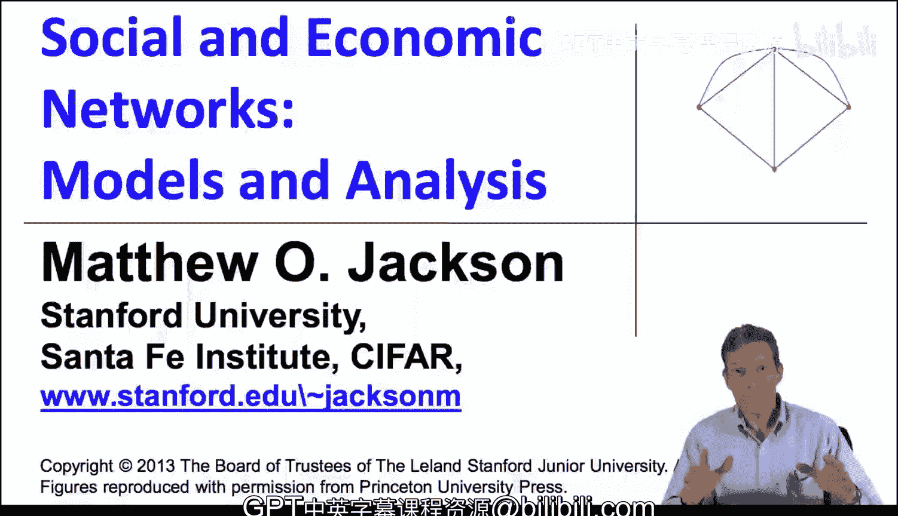
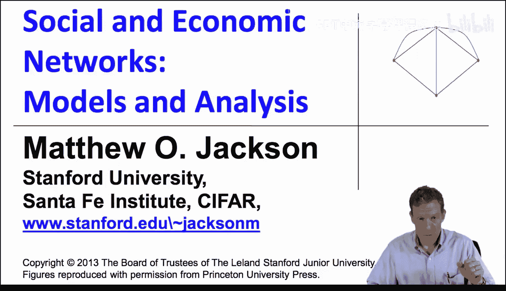
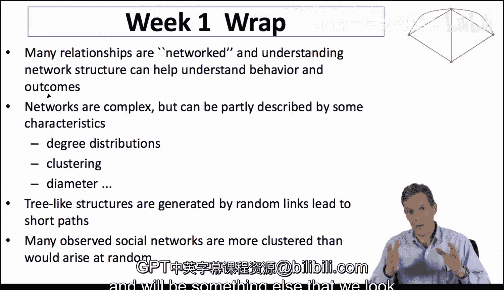

# 斯坦福大学《社会和经济网络：建模与分析｜Social and Economic Networks： Models and Analysis》中英字幕 p12 12_01_13_1-10-第一周总结.zh_en -BV1v1421U7Nk_p12-

Hi， folks。 So let's just go through a quick summary of some of the things we've covered in week 1。

So one of the most important things we started with was the fact that many relationships of all types。

 social， political， economic are networked， so when people are interacting when firms are interacting when countries are interacting。

 when different kinds of organizations are interacting。

 often they're embedded in a network structure and most importantly understanding those network structures is very important understanding and predicting outcomes and behavior and that's part of where the course is going and we'll get there eventually so the latter part of the course will be looking at this in detail。

Second important point， networks are very complex。 There's many different networks and the same set of nodes。

 And so it's going to be difficult to describe networks without。Looking at some sort of simple。

 sufficient statistics or summary statistics and things like degree distributions actually capture a lot of what's going on。

 clustering， how well connectedned are things on a local level do we see lots of triangles do we see few triangles diameter is this a network where it's very hard to go from one nodes to another are all nodes relatively close together There's a number of different things which can be used to describe networks and we'll keep track of those and we'll be looking at those and those kinds of things are eventually going to tie to properties of networks and how they influence behavior。

 what kinds of things emerge from the network。Another important point that we covered was that treelike structures tend to be generated by random links and those lead to very short paths。

 so if you've got simple tree structures underlying things than the branching process leads to diameters。

 paths that are logarithmic in nature so much shorter than looking marching linearly in terms of the number of nodes and so just by putting simple tree structures which are going to arise under a number of different kinds of formation processes so many different ways in which we could form networks are actually going to lead to some sort of underlying tree structure that's going to lead naturally to short kinds of paths。

Last point， many observed social networks have simple kinds of properties to them and in particular we tend to see very dense connections。

 things like triads or cliques on local levels when we look at friendships。

 when we look at different kinds of interactions in social settings。

 many people that I know will know each other and vice versa。

 and so that's going to turn out to be important in information transmission and how people end up looking to each other to choose behaviors and will be something else that we look at quite a bit going down the road。

