# 斯坦福大学《社会和经济网络：建模与分析｜Social and Economic Networks： Models and Analysis》中英字幕 p13 13_02_01_2-1-同质性.zh_en -BV1v1421U7Nk_p13-

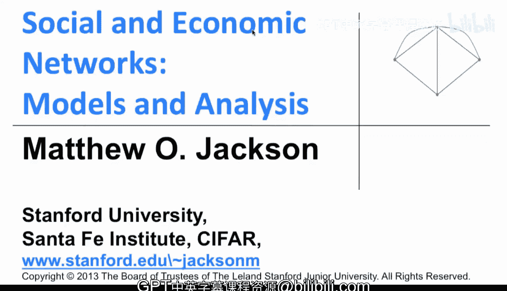

Hi folks again， so we're back again and now we're talking still about network structure and so forth。

 we're going to talk a bit about what's known as homophily。

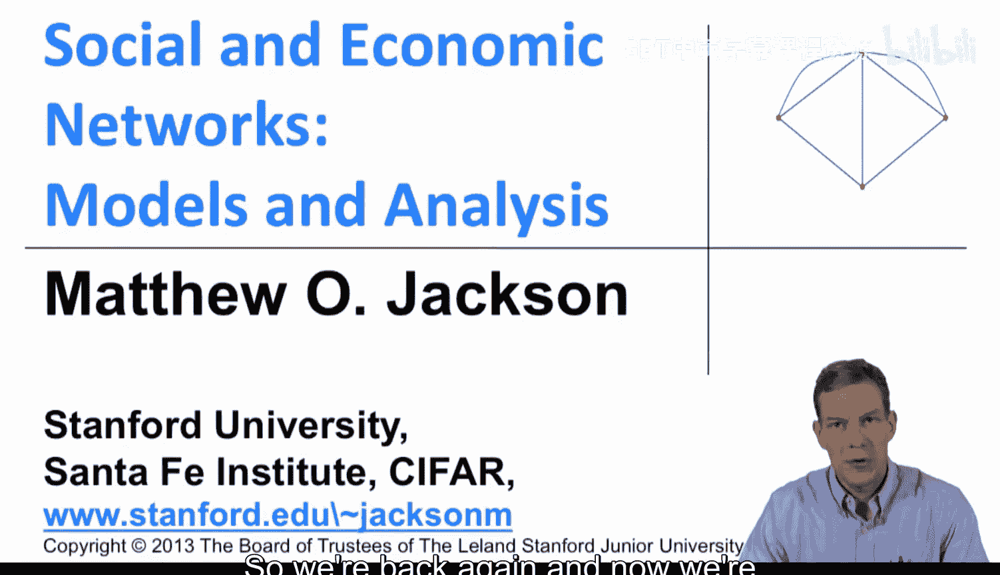

And in terms of the overall outline of the course， we're still in the first part where we're talking about background and basic definitions and characteristics of networks。

 ways of representing networks， and tying this in with some empirical background which gives us some feeling for what kinds of things are observed and not。

And in particular， today's subject is homophily， and what this refers to is the fact that when we instead of just looking at the network without node attributes。

 we actually。

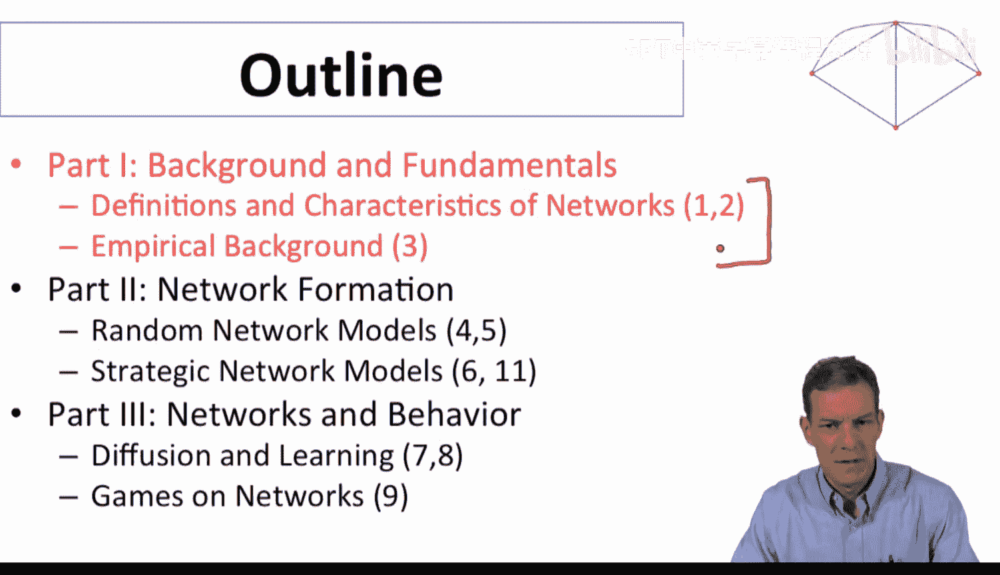

Keep track of characteristics of nodes， we tend to find that linked nodes are similar to each other。

 so you know this is something that's been recognized in human interactions for millennia and in particular here's a quote by Phillamon Holland from 1600 birdsd of a feather flock together。

 depending on your translation or as commonly birds of a feather will fly together。

 so similar types interacting with similar types。It's been looked at across a variety of different dimensions。

 so age， race， gender， religion， profession， and the term homophily itself。

wa coined by Lazaarfeldden Merton in a 1954 paper and it's really been documented across many different studies。

 so you know studies of gender and ethnicity， profession and you know grade and race and schools。

 a whole series of different attributes， and to give you just some feelings for this。

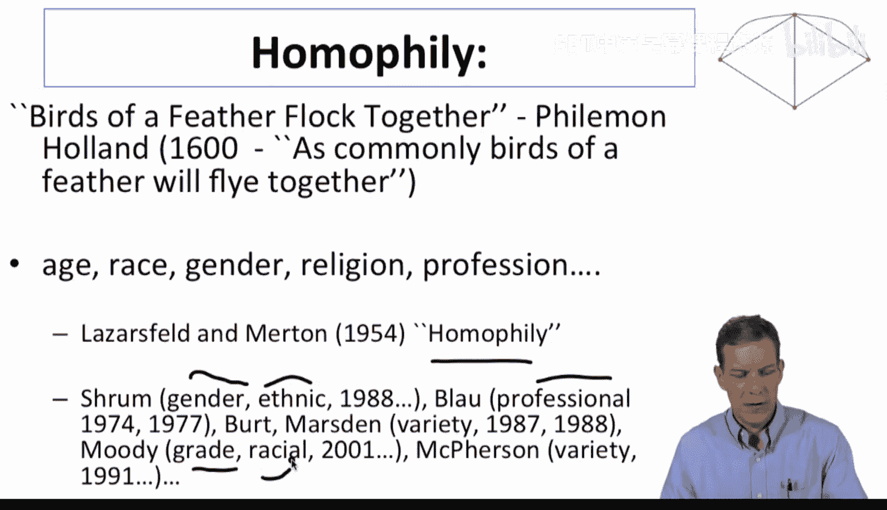

Peter Marsden' study， I'm looking at a national survey in the US。

 only 8% of people actually named anybody of another race with whom they would discuss important matters。

 and that's much lower than you would expect if people were just naming people without regards to race if it was balanced in terms of what the population is。

 in racialial marriages in the US a study by Roland Far，1% of whites marry outside of white。

 5% of blacks， 14% of Asians， the numbers are going to differ based on the size of the subpopulations。

 but basically what you're seeing is less than what should be expected if these things were happening uniformly at random。

 high or middle school friendships， less than 10% expected cross- racece friendships。

There's always an interesting one when you look at closest friends， 10% of men name a woman。

 32% of women name a man， so you've got some asymmetries there， but also again。

 well below what you should see at roughly 50% if there was not any bias in that。

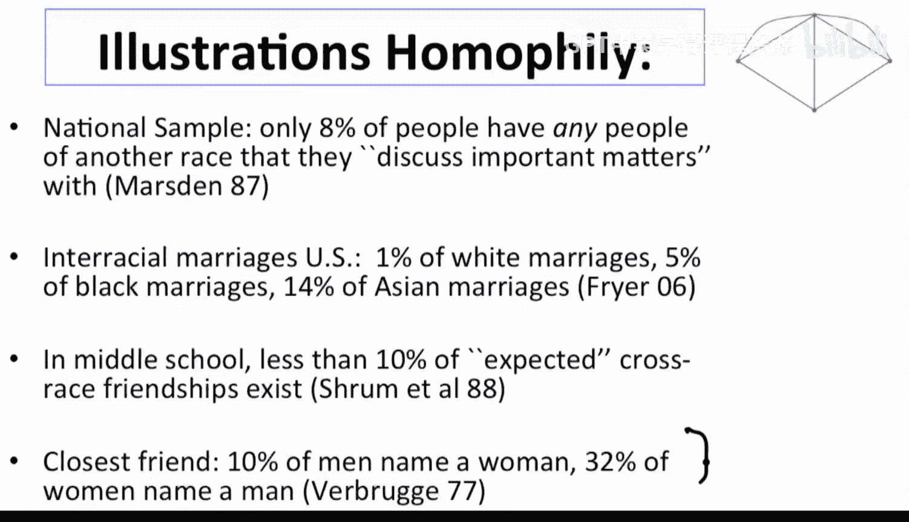

Here's a picture from a high school in the Ed Health data set again。

 this is from work I did with Sergio Quari and Pao P and what we're looking at here is a given high school。

 and nodes are colored now by their selfreed ethnicity， so the blue nodes are blacks。

 the you can see there's a few red nodes， which are Hispanics， the yellow nodes are whites。

And what you begin to notice here， this was actually drawn by what's known as a spring algorithm。

 and the idea of a spring algorithm is you could think of links like springs。

And imagine these springs trying to pull nodes together that are linked So if I'm linked to a bunch of other things。

 then those nodes try and collapse it。 So a spring algorithm tries to relocate the nodes on the page in a way where nodes that are connected to each other are pulled closer to each other and without just collapsing everything to a giant small ball so you have to keep a certain spread of the nodes on the page and then when nodes are connected to each other。

 you try and move them closer together and so what that does is it begins to show you that there is a separation where most of the blacks are in one group。

 most of the whites or in another group here the Hispanics tend to be a little more integrated but you see a strong segregation pattern you can see that visually if you begin to look at the number。

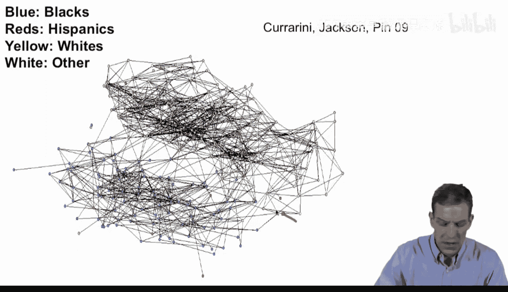

You also see that in terms of， for instance， the whites make up 52% of the population and yet 86% of their friendships are with other whites。

 blacks make up 38% of the population， yet 85% of their friendships are with other blacks。

 so this is where you begin to see the differences between what would be happening at random and what's actually happening in the data。

 and here interestingly Hispanics are somewhat outbred in the sense that they're 5% of the population。

 only 2% of their friendships are with other Hispanics。

 smaller groups will tend to have different characteristics in larger groups。

 but we're seeing a strong segregation pattern。

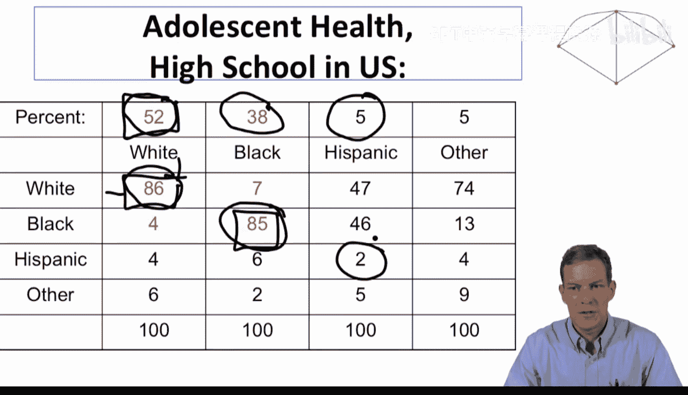

Now if we what I did here is instead of just looking at people's nominations of others as friends so in the survey you could ask you were asked to name up to five male and five female friends and that what was pictured before instead we can look at what people do in terms of activities and here these are what are known as I put in quotestr friendships so these are situations where people spent did at least three activities with another individual in a given week so you for instance studied together or had lunch together or know we're in a class together or something so now friendships are going to be stronger relationships because there's more of of a hurdle to be crossed and the network ends up being sparser and in particular here when you look at this one now you see even a stronger separation so I think there's only a few。

Between blacks and whites， I think you can see one here， there's one here， one here。

 there's basically something like three relationships across。

 so depending on how you define friendships， here when we put in a stronger definition。

 we see even more segregation and fewer cross group relationships than before。

Now this is not something that's unique to American high schools。

 this is a study by Bearvelt and all looking at a Dutch high school and here you see again。

 know the Dutch make up 65% of the population， 79% of their friendships are with other Dutch。

 5% for Moroccans， 27% of their friendships are with other Moroccans so again when you look at what's on this diagonal。

 the diagonals are basically larger than the fractions of the population so you're seeing people have a higher tendency to be linked to their own type than different types now when we begin to think about thiss there's many explanations and we can talk more about this as the course goes along。

 but it's not just one possible explanation it could be that there's opportunities that somehow but the way in which the classes are structured and the possibility。

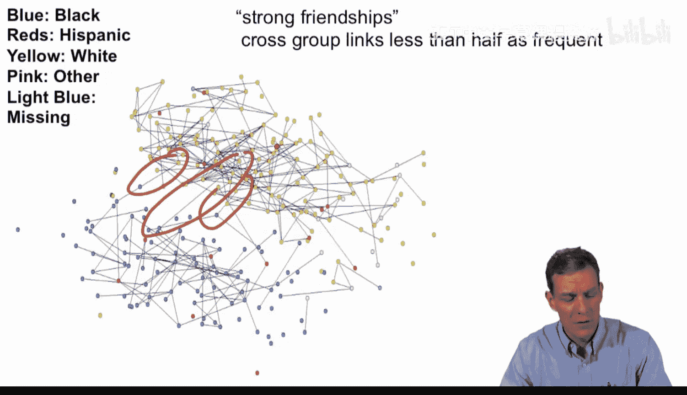

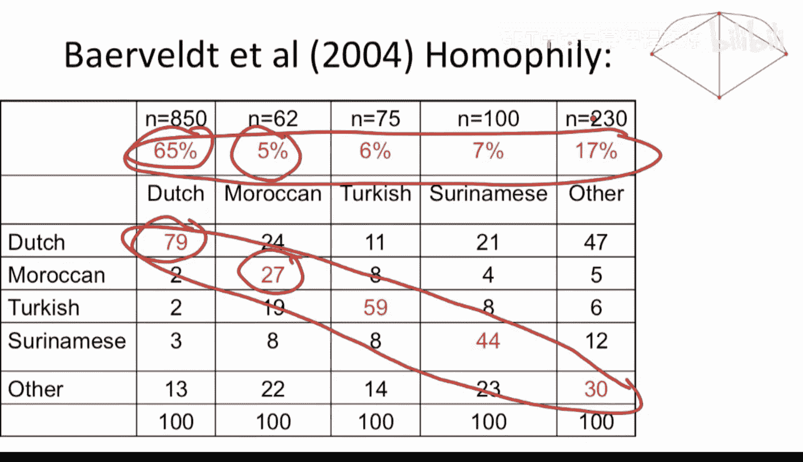

that you meet people could be biased by race and so it might be that who you contact is race dependent so there's just more of a chance of meeting your own type it could be that there's benefits and costs so having common set of understandings or common culture。

 common language in terms of the way that you think about things could make it different in terms of how people deal with things there could be social pressures that are involved。

 there could be social competition， there's a whole series of different theories for why you might see homophily but what's going to be important here is understanding that sometimes looking at a network if we begin to put in characteristics we begin to see that the structure of the network is characteristic dependent and the structure of things like homophily are going to be important and understanding for instance。

 why。Learning might have might have impediments in terms of the segregated network or why communication might result in an idea of circulating among one group and not another group or understanding when it is the contagions will end up hitting a whole population as opposed to parts of the population so understanding homophily structures going to be important in understanding a whole series of things once we begin to understand what the structure of networks has to do with behavior and it's interesting to understand homophily in its own right。

 you know why are we seeing these patterns what's really going on why why do we see these kind of separations and segregations so we'll get to that more of that as we go through the course。

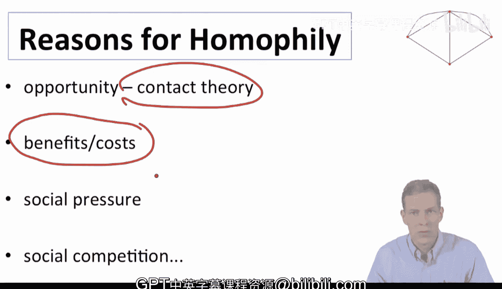

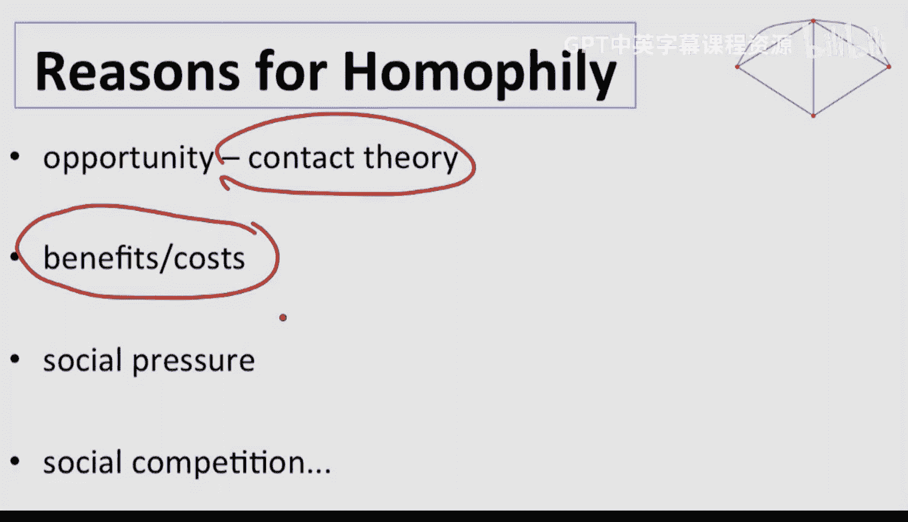