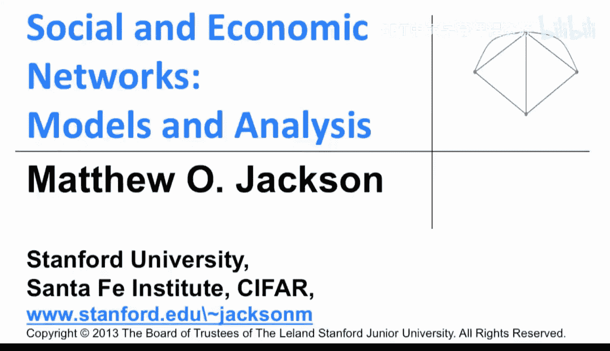
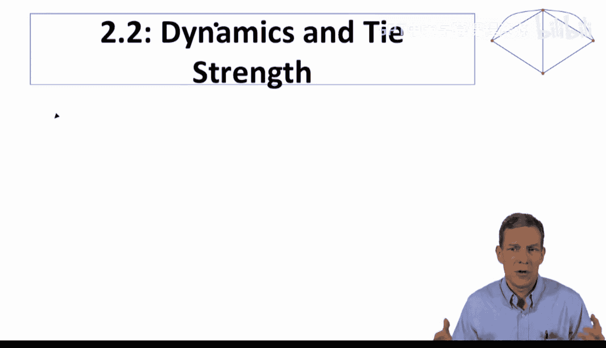
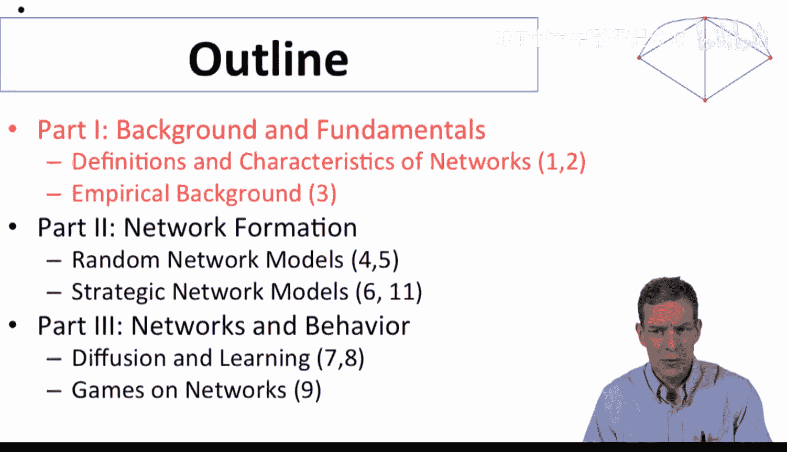
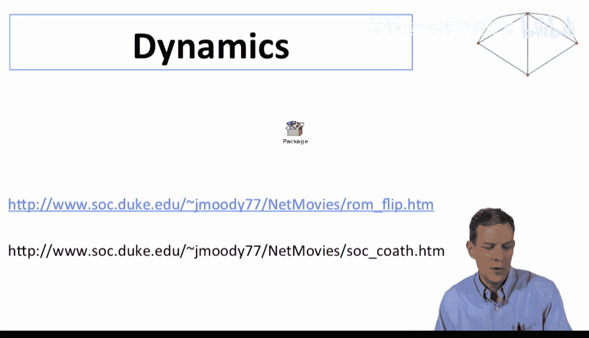
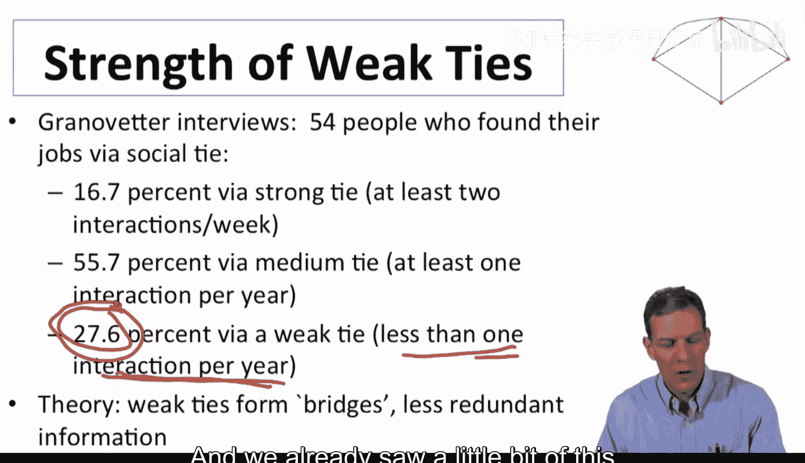
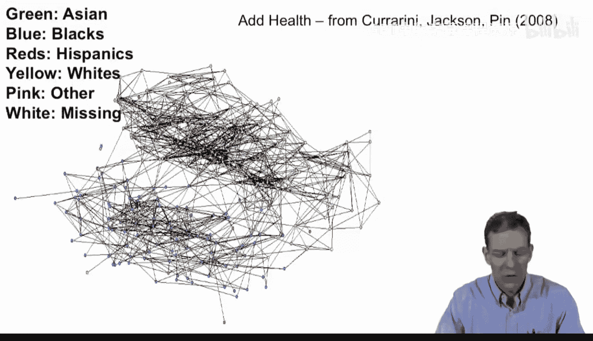
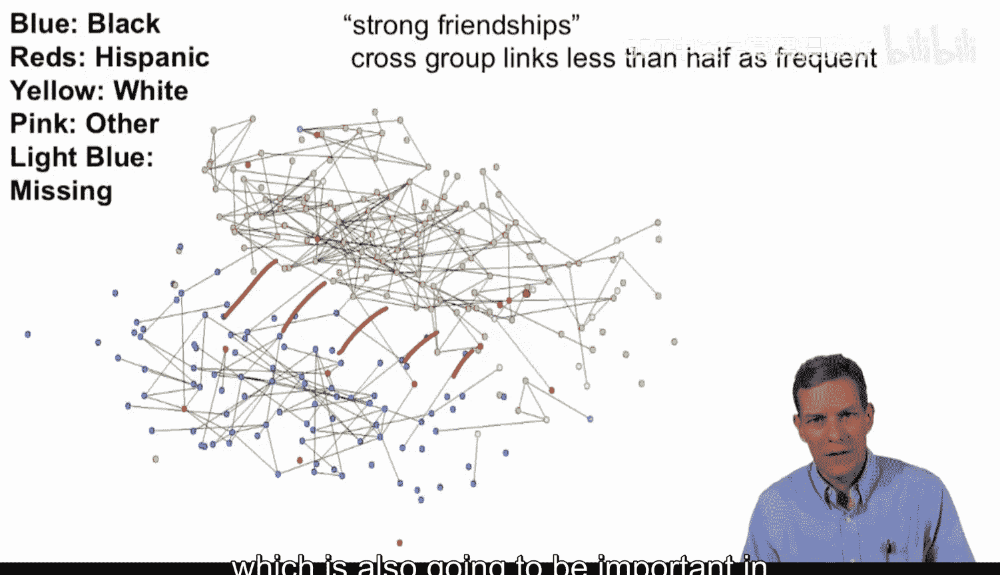

# 斯坦福大学《社会和经济网络：建模与分析｜Social and Economic Networks： Models and Analysis》中英字幕 p14 14_02_02_2-2-动态性与关系强度.zh_en -BV1v1421U7Nk_p14-

Okay so we're still talking about our structure of networks and so forth and now I want to say a little bit about dynamics and things like tie strength so we've been looking pretty much at networks that static objects with zero1 kinds of relationships so I want to just mention that obviously in looking at real data networks are going to be changing over time there's going to be relationships which come and go relationships can be stronger or weaker and so let's just say a few things about that and in particular we're still sort of in the part of our course which has to deal with background and fundamentals and know talking a little bit about the characteristics of networks and so forth and what I'll do here is just give you a couple of links these are links to James Moody's website where he has some pictures and in particular the first one that's highlighted as pictures of this romance。

That we looked at in high school data before。What's important about that is it will show you these changing over time。

 so it's not as if all these relationships were present at one point in time。

 people were having relationships with different people at different points in time and understanding the dynamics of this。

 the frequency with which things happen and so forth this is sort of an ongoing of area of research where there's increasingly rich data becoming available people are struggling with ways to actually code it and take care of it because it has real consequences for things like contagion so the frequency of interactions of individuals will have important implications for flus what kinds of travel patterns exist。

 communication patterns when we talk about diffusion of products and things like that dynamics will play an important role so I just want to sort of point that out at this point I don't have much more to say about it yet。

 we'll see a little bit more of it as we look at different examples in the course。

Now the other thing that we have touched on briefly is the fact that ties aren't all 01。

 it's not as if I have the same strength of friendship with all of my friends。

 some of them I talk to on a very regular basis， some I don't talk to very frequently。

 some can be very strong， emotionally even though they're less frequent and so forth and sort of a very important study of this and one that sort of made clear the strength of weak ties was a study by Gran a vettter。

And the early 1970s， and what Grannovetter did was interviewed a series of people and asked about how they found their jobs and the interesting thing that Grannovetter found was that out of the 54 people that he interviewed16 or a little more than 16% had found their jobs through strong ties。

 and what is a strong tie mean and Granenave's definition that they had at least two interactions per week。

In contrast， there were  roughly 56% of the people had found their job through a contact with which whom they had medium tie。

 at least one interaction per year， but not two interactions per week。

 so not a strong tie and then weak ties still accounted for 27。

6% of the job context and they were less than one interaction per year。

 and so what Grenato was pointing out was that even though these are very weak ties in the sense that you don't have much interaction with these individuals at all。

 they still accounted for of a fairly large more than a quarter of the information about jobs that people were getting in terms of how they managed to find their jobs。

Now， you know this has led to a lot of follow up research and so forth and understanding weak ties and understanding when they're important and when they're not and how important they are is a large subject。

 let me say a couple of things here， one is if you begin to think about the number of people with whom you have strong ties and you interact with very regularly。

 it's maybe dozens， maybe even fewer。If you think about the number of people that you've known in your life and that you could actually talk to if you saw them。

 that might be on the order of thousands so you have many。

 many weak ties and only a few strong ties and so even though weak ties are people that you might not see very frequently or interact with very frequently it could also be that there's just many more of them and so we have to put these things in context。

But one part of Granavetter's discussion was about the role of weak ties and one point that he was making was that people with whom you have less frequent interaction or less strong interaction tend to be people that might connect you to another part of the network and we already saw a little bit of this when we looked at our a health data。

 when we look at weak ties in the sense that people just had to name each other as friends。

 we saw some connectedness between different groups， and then if we put in strong ties。

 the ties that tended to go across the different groups had now disappeared largely。

 and so there's different patterns and so that more of the ties across the races tend to be ones that disappeared once we put in a stronger notion and the idea is that bridging meaning connecting different components of a graph。

 might be more frequently done by weak。

So even though somebody is somebody you don't interact with much and you might have less in common with。

 they might connect you to a part of the world that you don't normally have access to and so they can still be very important and accessing information that might not be redundant with people that you often interact with。

 and so weak ties can still play a very important role。Okay。

 so what we've talked about is a series of different ways of representing networks and characterizing them。

 we've talked a little teeny bit about dynamics and strength of ties。

 and the next thing we're going to look at is now beginning to zoom in on particular nodes and to sort of talk about what their position in a network is。

 which is also going to be important in understanding things like diffusion contagion and how people behave。

