# 斯坦福大学《社会和经济网络：建模与分析｜Social and Economic Networks： Models and Analysis》中英字幕 p15 15_02_03_2-3-中心性度量.zh_en -BV1v1421U7Nk_p15-

Okay， hello。

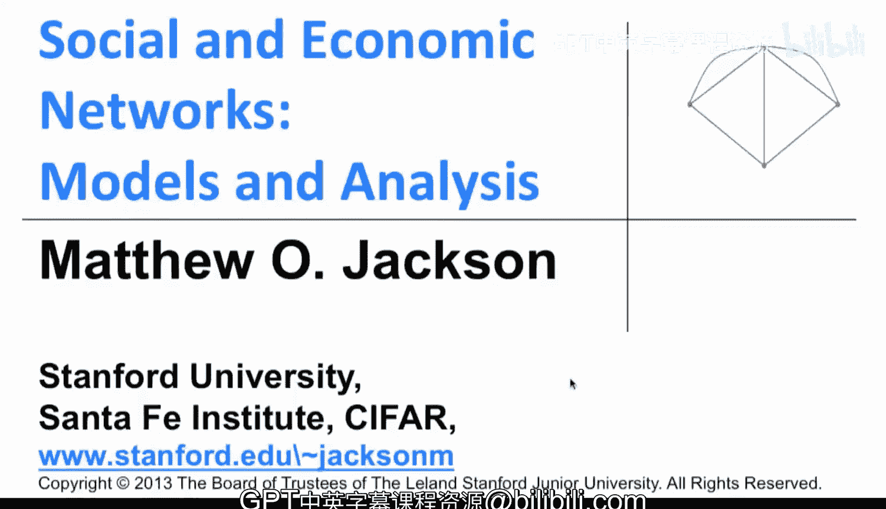

So now we're looking at centrality measures， we're going to talk about positioning nodes inside a network and understanding how they're positioned and in terms of the way we've been going through our definitions and trying to understand structure of networks and so forth。

 what we've done so far as we talked about basic patterns and networks， degree distributions。

 path lengths， things like that to characterize networks。

 we talked a little bit about homophily and the fact that there can be segregation among nodes。

 we talked a little bit about local patterns， things like clustering and related concept of transitivity。

 we'll talk a little bit about how many of links are actually supported so they have friends in common and so forth as we go forward in the course。

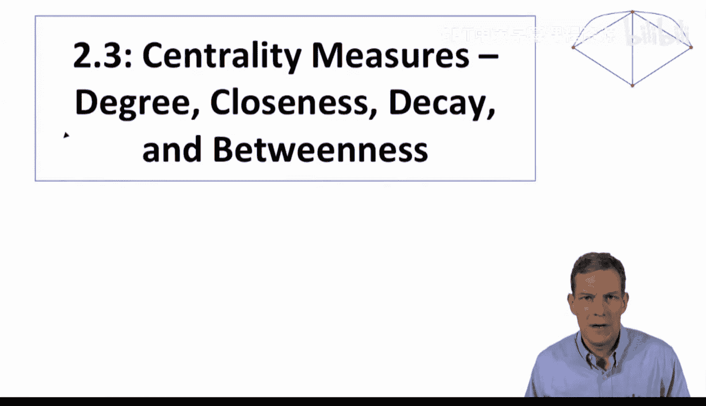

So these are things which characterize the network itself and we'll also be very interested in understanding how different nodes are positioned in the network and so how we can talk about whether a node is important or not or influential or central powerful etc。

 and so the idea of how to describe a position in a network。

 you know there's different aspects of individual characteristics some of which we've already talked about just how connected it is。

 how clustered its friends are distance to other nodes but more generally trying to capture centrality。

 influence and power are going to build on specific definitions which keep track of node's position so in terms of looking at nodes centrality。

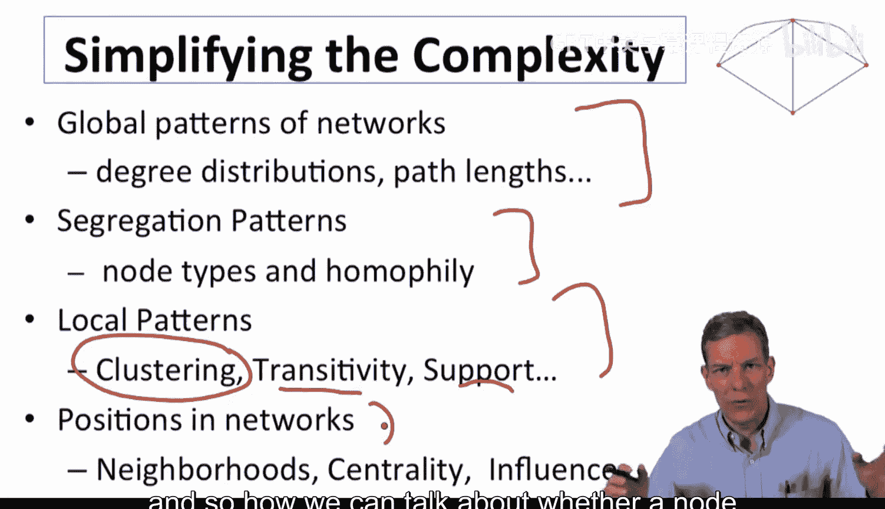

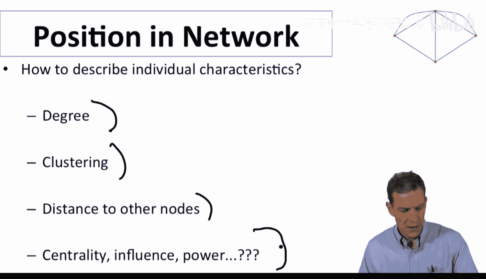

The most basic measure in just trying to figure out how important a node is or how influential it is and so forth is just how connected it is and that's captured directly by degree。

 so degree capture some notion of connectedness of of a node and know in order to make it a measure between zero and1 we can just keep track of dividing through by n minus1。

 the most possible links I could have and then what fraction of people am I connected to compared to how many I could be connected to。

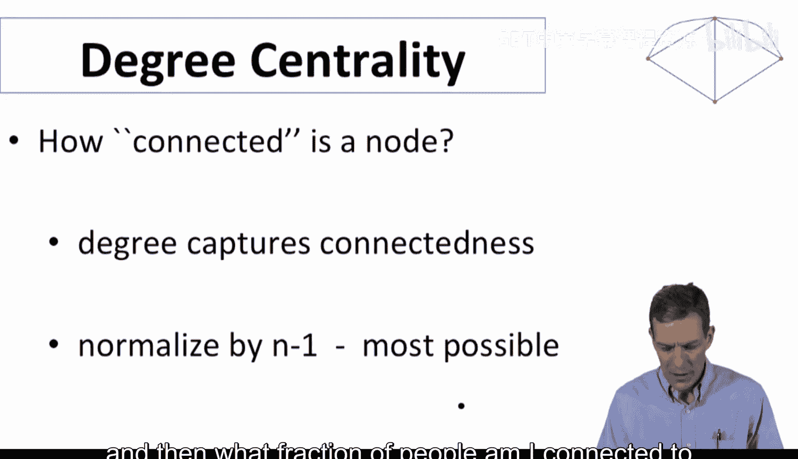

So if we look you know， for instance， at the Medidici， the Florrantine data we had before， here。

 what do we see from the different families， we see that the Medidici here have a degree of six。

 the Stri degree of four， Guaddani degree of four， Albecis degree of three。

 so some of the most important families， the Medidici were better connected in terms of having higher degree。

 it's not an enormous difference， but there's some difference there。

 so degrees capturing some of what goes on。But degree is actually going to miss a lot of what's going on in terms of a network and you know for instance here。

 degree know node3 has the same degree as node one or node2 and in some sense we might just looking at the network think of three as being less central than some of the other nodes and how do we capture the fact that degree isn't really gathering all of position。

 it's just saying how big is your local neighborhood。

 it's not saying where you are positioned in a network or how central you are in a deeper sense。

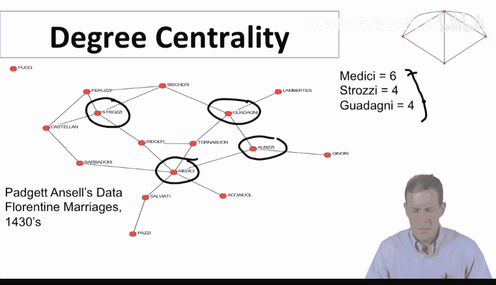

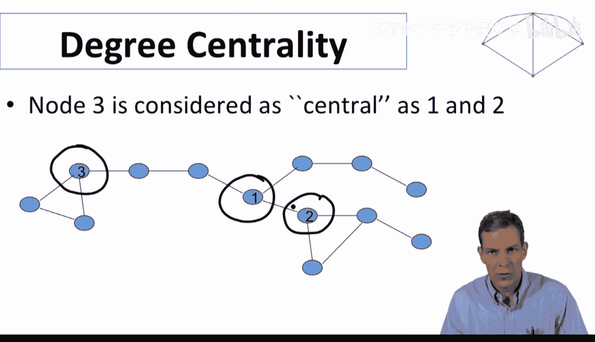

So in order to get at， things like centrality。We'll have different types of things that we can think about capturing so what I've done here is sort of break things down into four different categories and so degree is really just capturing basic connectedness Another thing we might worry about is how close you are to other nodes so closeness centrality measures and what we look at in terms of decay is sort of an ease of reaching other nodes so how far am I on average from other nodes。

Between this we talked about very briefly， we'll look at that in a little more detail the role as an intermediary or a connector so do other pairs of nodes have to go through me in order to reach themselves that's a very different concept than thinking how close I am to somebody else this is saying is am I important as a connector of other individuals then there'll be a whole series of influence or prestige or eigenvector kinds of notions which will try and capture the idea that your important if your friends are important so being well connected is something which depends on the connectedness of one's friends and so you know this is the old it's not what you know but who you know it's not necessarily important to have more friends but to have well- positioned friends and we'll take a look at definitions which capture that so we'll have sort of four different concepts of centrality or power and we'll try and incorporate these into different definitions and see know the differences between these things。

And one thing to emphasize here， there's lots of different measures and there's not one which is best in a sense that it dominates these things are capturing different ideas。

 different aspects of a position， and some of them are going to be more important in making predictions in one setting than another。

 and so what we really do in terms of using one of these things。

 it's going to depend very much on the context as to which one was important most important。

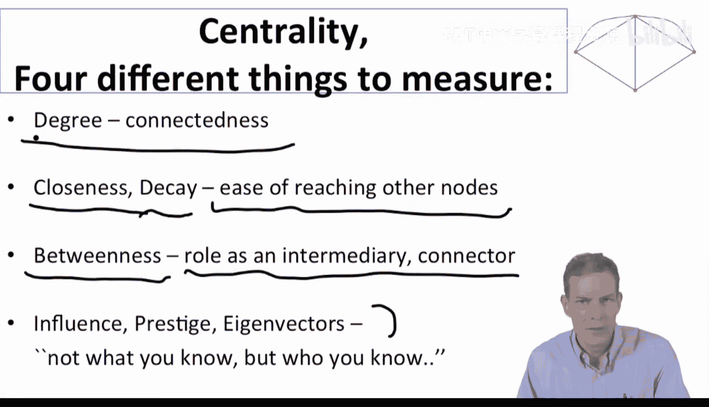

Okay so let's have a look at closeness centrality， so closeness centrality one basic definition of it here is just to look here this is the length of the shortest path between two nodes I and J and we can sum across all J so how far am I away from all the other nodes and then look at n minus1 over this and it keeps track of sort of relative distances to other nodes and so the idea here is that if these are very large numbers then my closeness centrality is going to be a very small number so I'm dividing by larger numbers it makes this small so how close I am to other people the closer I am if I'm a distance one from everybody then this thing normalizes to1 and otherwise it's going to become further and further。

This scales directly with distance， so twice as far from everybody makes me half essential right so if I double all these things I'm going to get half。

 if I quadruple them then I'll get a quarter and so forth so it's scaling with the distance。

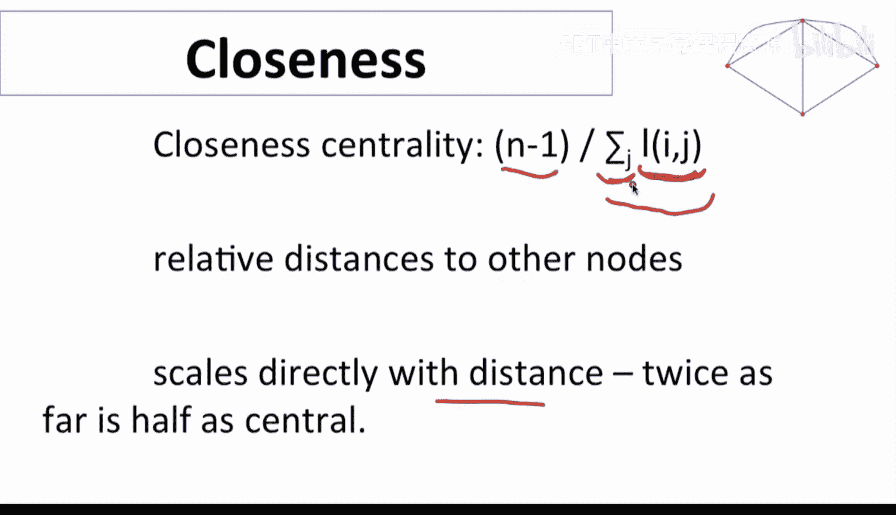

When we look at the closeness centrality back in our Medidici data again。

 ignoring Naucci now because if we add them to everybody and we think of everybody as being infinitely distant from them then everybody would have closeness centrality of zero so if we ignore them and just look at the remaining network then the Medidici or 14 out of 25 strokei 14 out of 32 Gudani 14 out of 26 and so forth。

 so here you know closeness centrality gives us some differentiation between different families。

 it's not it doesn't sort things enormously， it gives us some feeling for who's further and who's closer。

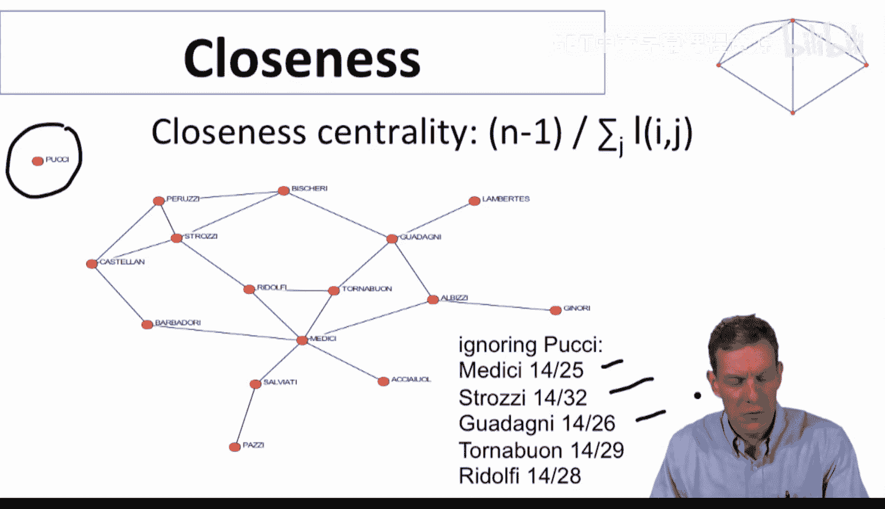

Another measure that we could use instead is what is known as decay centrality and this is designed to capture the idea that what I might get is value from being connected or indirectly connected to other nodes so I might have some value from a friend。

 a different value from a friend of a friend and so forth and so the idea is that there's going to be some delta factor which is generally less than one and bigger than zero and the centrality then of a node to I under this decay notion is going to be look at the distances to other nodes and raise delta to that power so if I'm a direct friend I get a delta if I'm an indirect friend a distance2 from somebody I get delta squared distance 3 delta cubed so if this were 0。

5 then we're going to get 0。25 here and so forth 0。125 if this were0。

Then these numbers would be much closer to each other if this was 0。05 then this would be 0。

0025 and so forth and so it would scale more dramatically so as deelta becomes near one。

 then this just sort of counts all the people that I can reach indirectly as delta goes close to zero。

 then this is just going to become degree centrality all it's going to do is really emphasize the direct connections and all the other ones are going to be much smaller。

And then somewhere in between， it's going to weight indirect connections compared to direct connections。

 so you can think of varying as delta as sort of how much do I think of it being important to be close to many people or how much do I get from indirect connections of different varying lengths？

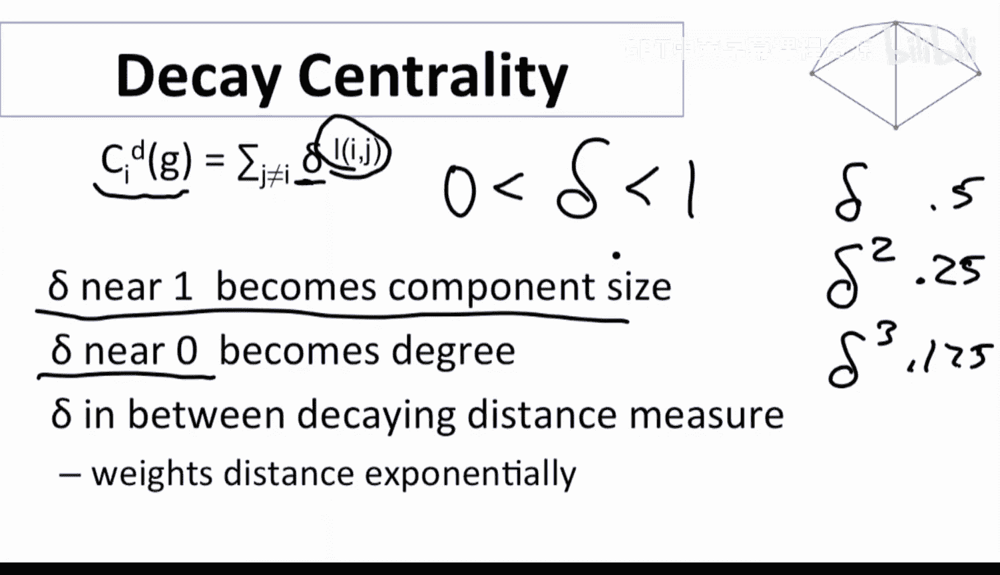

Okay so you know here's a network with you know sort of like bow tie kind of network here。

 we've got you know node4 in the middle， node3 over here， node1 over here。

 basically there's three different types of nodes so nodes two， six and7 all' look like node1。

 node 5 looks like node3 so we can just keep track of these three nodes and their centralities。

If we look at the degree centrality， then node3 is the most important in some sense。

 it's got three connections as opposed to two for the others。Closeness centrality。

 node 4 is actually the closest， so here it wins out in terms of being able to reach all the other ones in shorter paths。

 decay centrality depends if we do 0。5， then these two are basically equal to each other。

 if we raise it to 0。75 then node 4 ends up doing a little better if we drop it to 0。

25 so that more immediate connections matter then node 3 starts to do better。

 so you can begin to see that these different definitions are going to give different positions in terms of importance to different nodes。

 depending on which kind of centrality definition you're looking at。

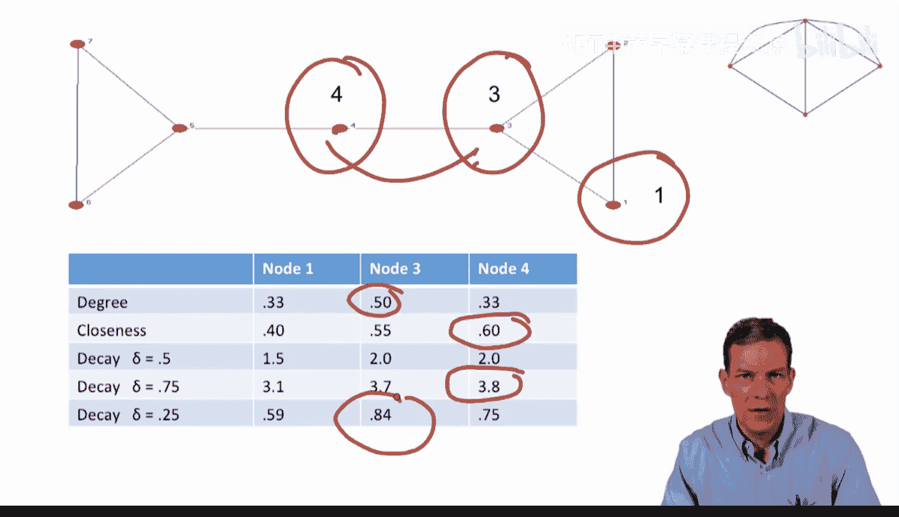

You can normalize decay centrality by dividing through by the lowest possible decay you could have to each one of each node。

 so it's n minus1 times delta as the lowest possible and you that gives you sort of the numbers we looked at before。

 so normalizing you can get different numbers here in terms of what these numbers would be so thats just readjusted by a normalization。

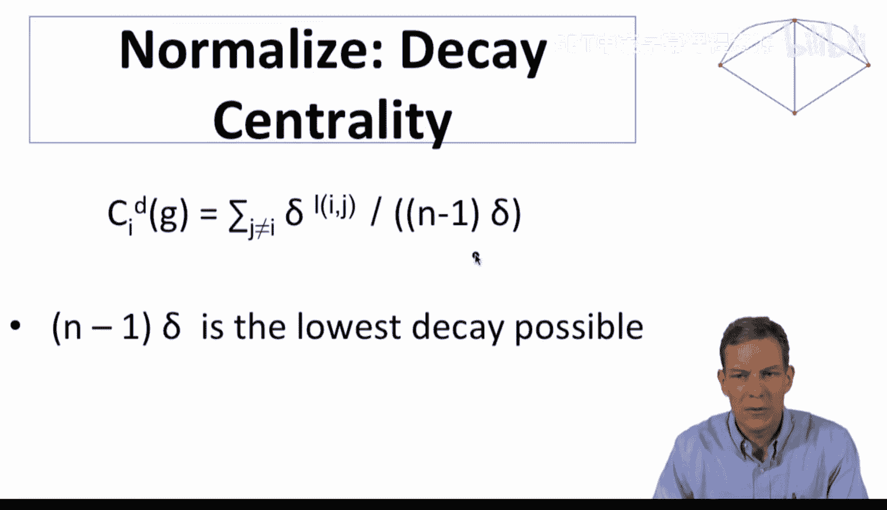

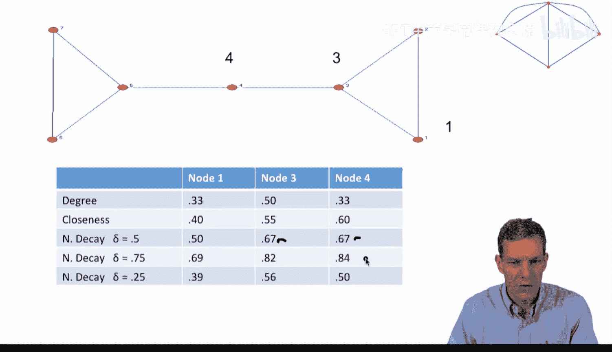

Okay， so looking back at between the centrality that we looked at before。

 so now the formal definition of between the centrality due to Lynnne Freeman。

 so the idea here is that when we look at two nodes I and J。

 we can keep track of the full number of shortest paths， the number of geodesics between I and J。

And then for any K that's not equal to I and J， we can ask what's the number of those shortest paths that k lies on between I and J right so if we're looking then for between the centrality of a node K we can look at all pairs I and J that aren't equal to K and look at what's the number of shortest paths between I andJ that K lies on compared to the number of shortest paths that exists between I and J。

And then we can normalize that by the number of。Alternative pairs of nodes that we could be considering and how you the most you could be is to have be on the shortest path of all of those。

 so we're going to normalize by there's n minus1 times n minus2 over two or this is n minus1 choose two。

 other pairs of nodes that are out there。

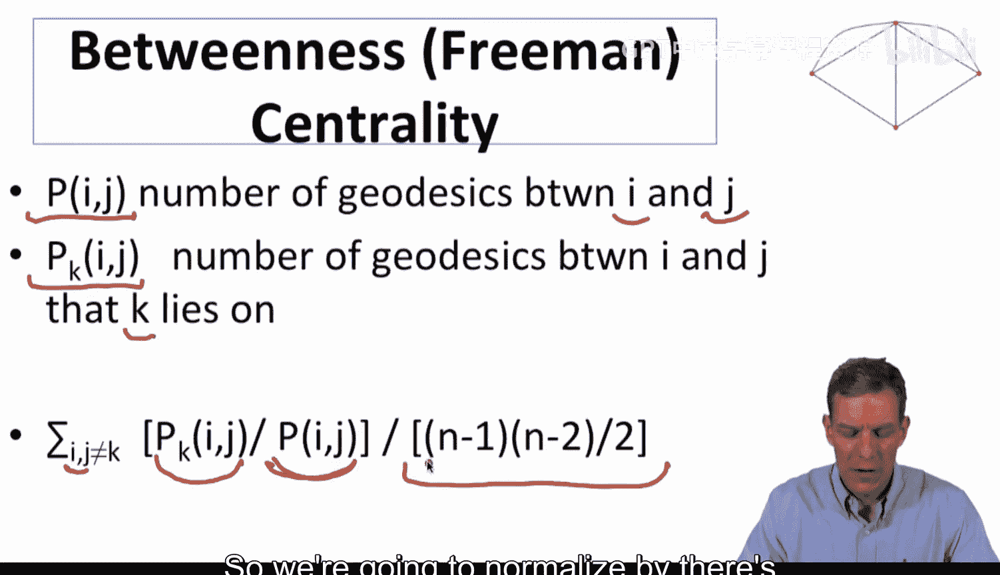

Okay so when we look at that calculation we're basically saying what's the fraction of shortest paths that K lies on between other nodes and then when we look at that again what we saw was that the Medidici now have a much higher number then the others other families in terms of their centrality and between the centrality captures this idea that you at this point in time if other families wanted to deal with each other。

 they might have to go through somebody that they were connected with so if it's difficult to enforce contracts。

 then maybe you have to go through somebody you know in order to deal with somebody who don't know and then the Medidici could be powerful intermediaries connecting other families on paths between them。

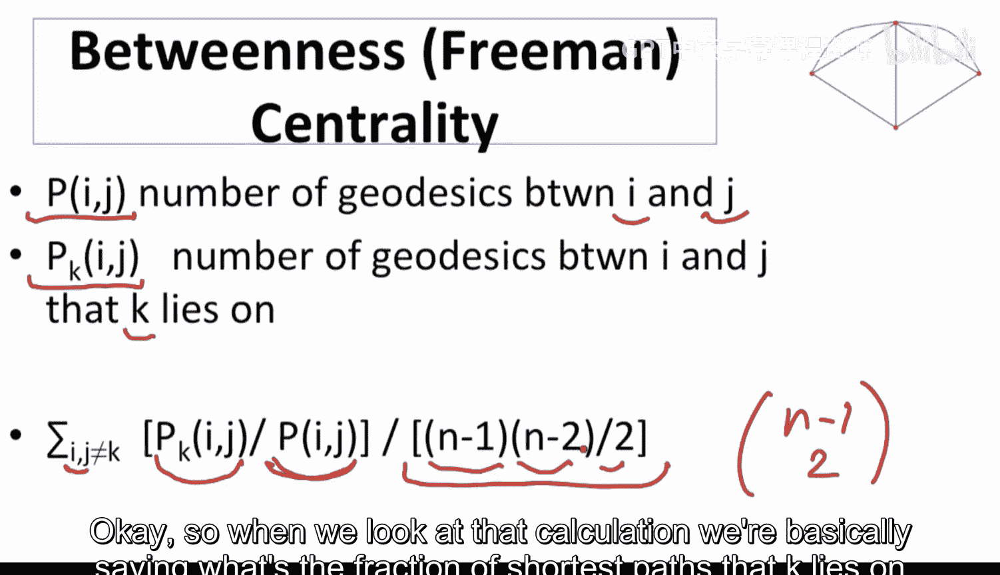

So that's a different measure， captures different things and if we go back and look at our bow tie again。

 what do we see now， well you know now between this these nodes out here they're not connected connecting anybody in terms of being intermediaries so they get a between this of zero and here node4 now becomes more prominent it's really an important path connector between all of the nodes on this side and all of the nodes on this side and so it ends up on 60% of the shortest paths in this network whereas node3 for instance only ends up on 50% of the paths so know depending on how you're counting these things。

 different centrality measures give you different notions and different measures of what's going on different ideas will the next topic we'll be looking at is looking at eigenvectorbased centrality measures。

 other kinds of measures that are going。

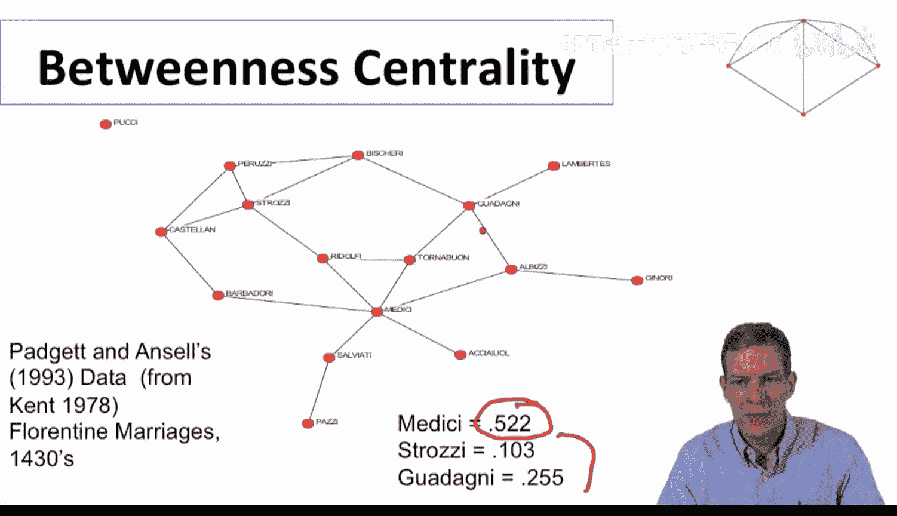

Cture importance of nodes and how well they're connected to other nodes。

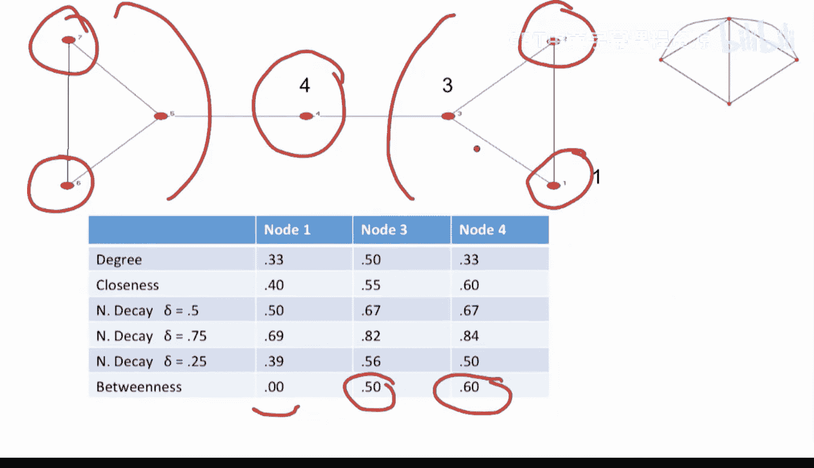