# 斯坦福大学《社会和经济网络：建模与分析｜Social and Economic Networks： Models and Analysis》中英字幕 p17 17_02_05_2-5a-应用-中心性度量.zh_en -BV1v1421U7Nk_p17-

Okay， so we've seen a bunch of different centrality measures。

 so let's take a look at an application which can begin to distinguish between them。

And let me emphasize just from the start that when we're doing this application。

 it's not designed to show that one in centrality measure is always better than another。

 but just to show that in particular contexts， we can actually say something systematically about which ones seem to be working better than others and making some predictions。

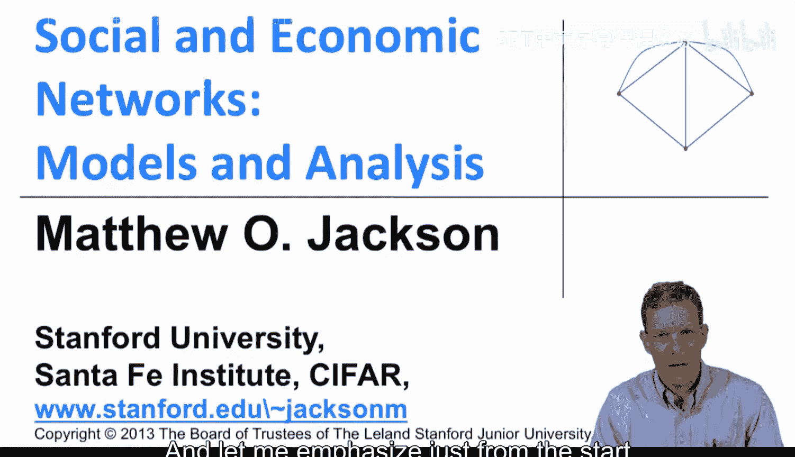

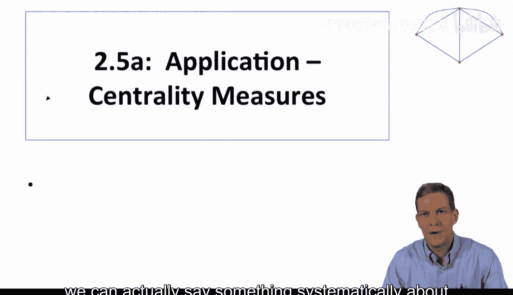

And the question that we're going to be looking at is diffusion and we're going to be looking at the first contact points in a process so there was in this case diffusion process that was started and we have some idea of which points in the network were first contacted and then we see what the diffusion looks like and we have a bunch of different networks going on and we can try and compare across the different networks and say how does the centrality of the nodes predict how successful the diffusion would be。

 the eventual diffusion， so let me put this in context and this is part of a joint project that I've been involved with for a number of years with Abijit Banerji Arunchanra Siar and Esther DuF and what we were looking at in particular was diffusion of microcrofinance in 75 rural villages in Knaoticka which is southern India。

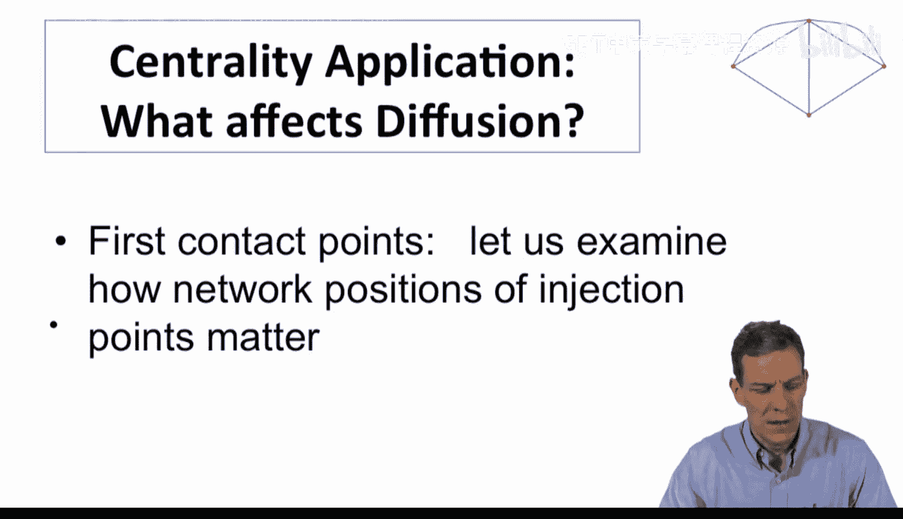

These were villages that were fairly remote and isolated from outside a loan availability initially and a particular bank。

 BSS entered 43 of these villages and offered microfinance to them and we went in and surveyed the villages and mapped out social networks before the lending agency went into these villages and then we tracked the microfinance participation over time so we've got diffusion over time and we can look at we know the initial points that they touched。

 who they first told about microfinance so the bank would come into a town and say look。

 here's a group of people that we want to so what they did in each village was identify a particular set of people that they should talk to first shopkeepers。

 teachers， self-help group leaders， people that they thought might be well connected in a village。

And then they told those people look we're going to come in and we're going to offer loans。

 we'll be back in a couple weeks， tell your friends about it and have them spread news and then in a couple weeks we'll come back and then tell you more about it and then over time they kept coming back every two weeks and then people could join the loan program and so forth and across these different villages in some villages they would get an eventual participation rate in the loan program of you know say mid 40s。

 about 44% was the highest of any villages the lowest of any villages was about 7%。

And one thing we can ask is did it matter which points which people they talk to in a village first。

 so it might be that in village number one， the teacher is a very central individual。

 but it happens that in village number 12 the teacher is not a very central individual so if you talk to the teacher in both villages。

 then in one village you're talking to a very central individual another village you're talking to a non- veryry central individual。

 then does that make a difference in terms of what the eventual microfinance participation rate was。

 does it make a difference in how much news got out。Now。

 so we have 43 different villages and we can look at how central those nodes are。

 and we can use different notions of centrality that we've looked at and see which ones work well and which ones don't。

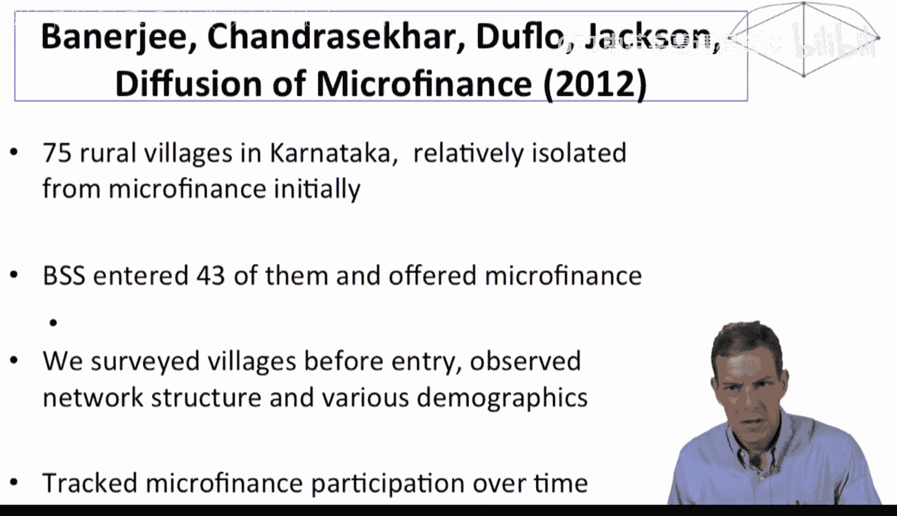

So just to picture Carnaica here， so actually in this slide got a little distorted。

 but this is the area of Carnatica here， it's all within a couple of hundred kilometers of Bangalore in southwestern India。

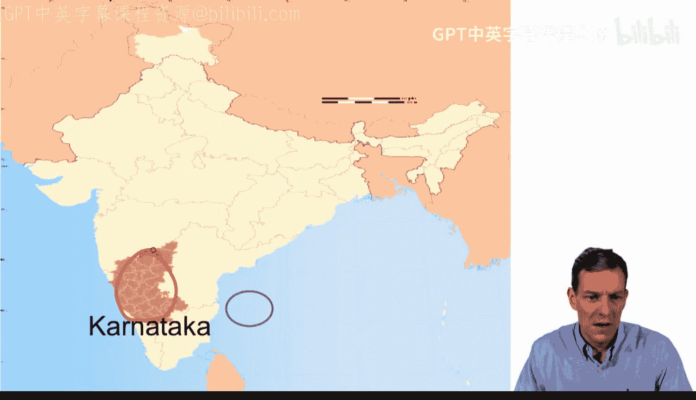

And when we look at the different villages in each village。

 we mapped out a whole series of different networks。 So this is， if you had to borrow。

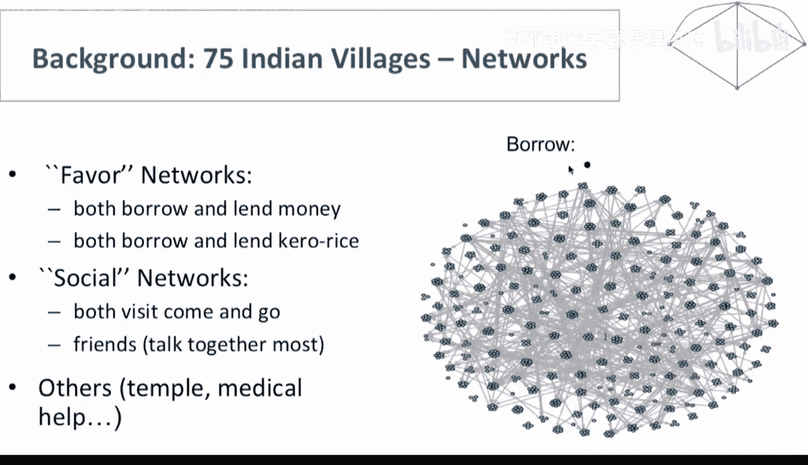

50 rupees for a day who would you borrow them from so we've got a borrowing question and if we blow this up a little bit so you get a better picture then what we've got is each little collection of dots here as a household and the arrows indicate who they said they would borrow from so somebody in this household said they would borrow from somebody in this household and so forth so we end up with a borrowing network we asked a series of different questions so we have actually 13 different networks in total。

 who do you go to temple with who would you go to for advice who comes to you to borrow kerosene who would you go to an emergency for medical help so we have a whole series of different questions and we can then aggregate these up and say that two households are connected。

 they could talk to each other if they answered yes to any of these questions and we can work with the networks in different ways but let's take an undirected version of this where we aggregate things at the house。

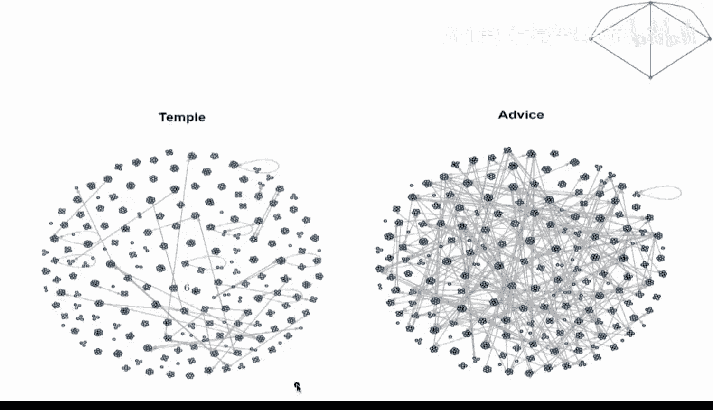

And say that two households are connected if they either borrow a kerosene or would go to each other for medical help or would borrow rupees from each other。

 et ce。Okay， so we've got networks， we've got a lot of other information， demographics。

 we've got the microfinance participation over time， number of households in their composition， age。

 gender subcast， religion， profession education levels， a bunch of other things we can control for。

 caste information， wealth variables， participation rates in self-help groups and ration cards。

 voting behavior in a whole series of other things so now we want to see whether centrality makes a difference in the diffusion of this loan program。

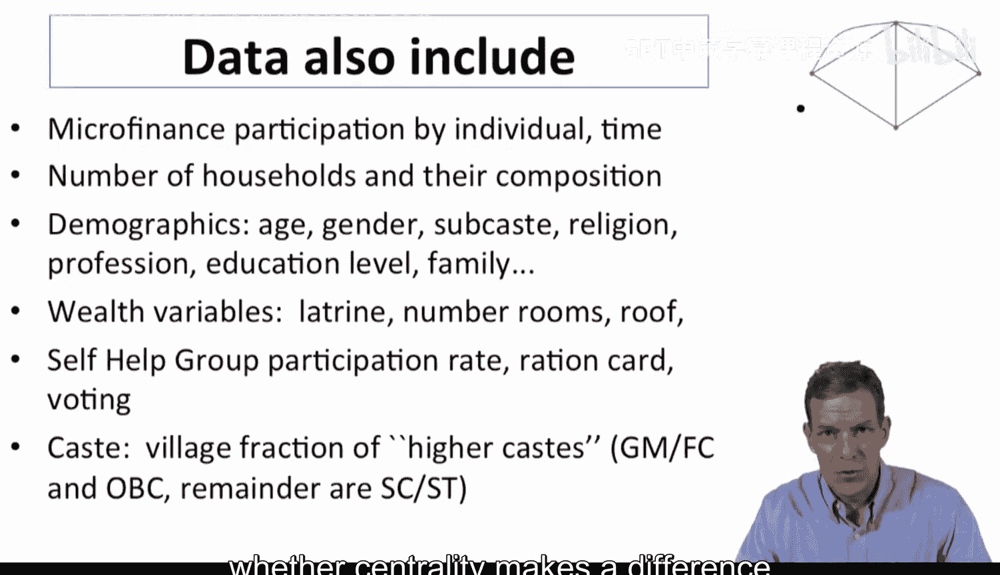

And so what we can begin to do is start with say degree centrality right so so you know here。

 if this were what we saw in a village， then you know。

Picking you know this individual and this individual would be the most central individuals in the village and if you hit those individuals you would expect to reach more just because they have higher degree so one hypothesis is that if we look at in villages where the first contacted individuals have more connections。

 so higher degree centrality then there should be a better spread of information about microfinance and more people knowing should lead to higher participation so basically。

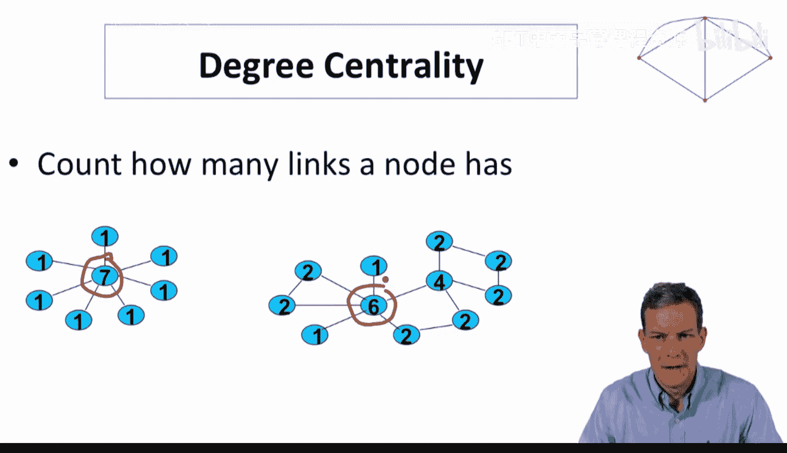

High degree centrality of the first nodes should equal high microfinance participation。

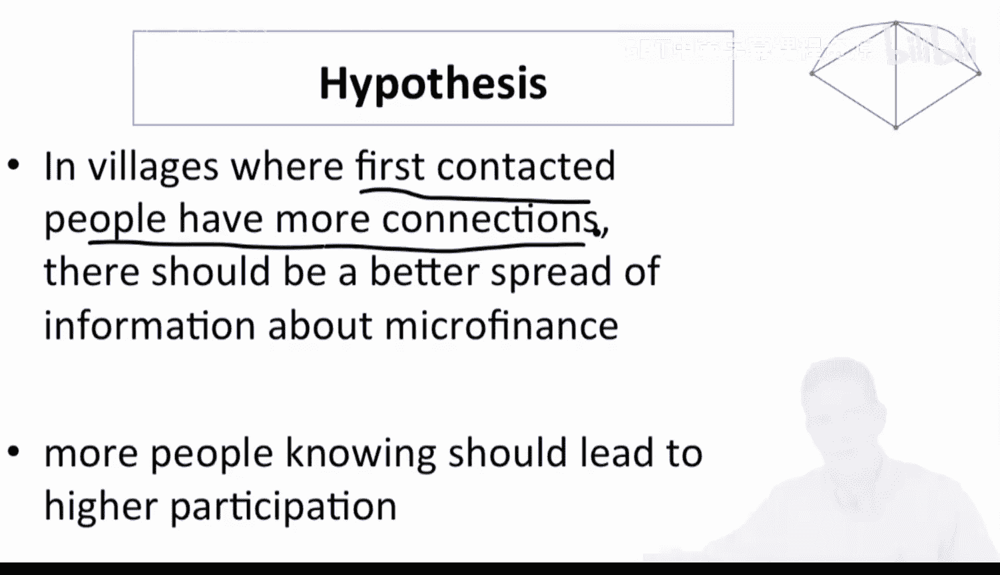

Okay so what do we see in the data here is the average degree of the first contacted individuals which we call leaders here。

 so these are the degree of the first contacted teachers self-help group leaders and shopkeepers in the village and here on this axis is the eventual participation rate of the village so each one of these dots is a village so for instance this village had 7% participation rate so fairly low participation and the average degree of the leaders was about 17 this village over here had average degree of leaders about 21 and a participation rate of 44% and so we've got a bunch of things if you fit a best fit line through this actually it doesn't look like there's any relationship and if anything the slope is actually negative so it doesn't appear as if degree centrality really captures what's going on。

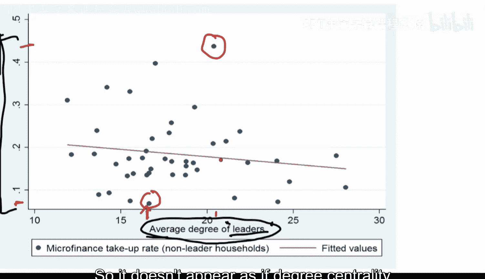

Okay， so maybe we need another centrality measure， let's have a look at you know， again。

 when we talked about eigenvector centrality， we realized that you know looking at degree doesn't tell a lot of the story because it doesn't capture how well you're positioned in a network。

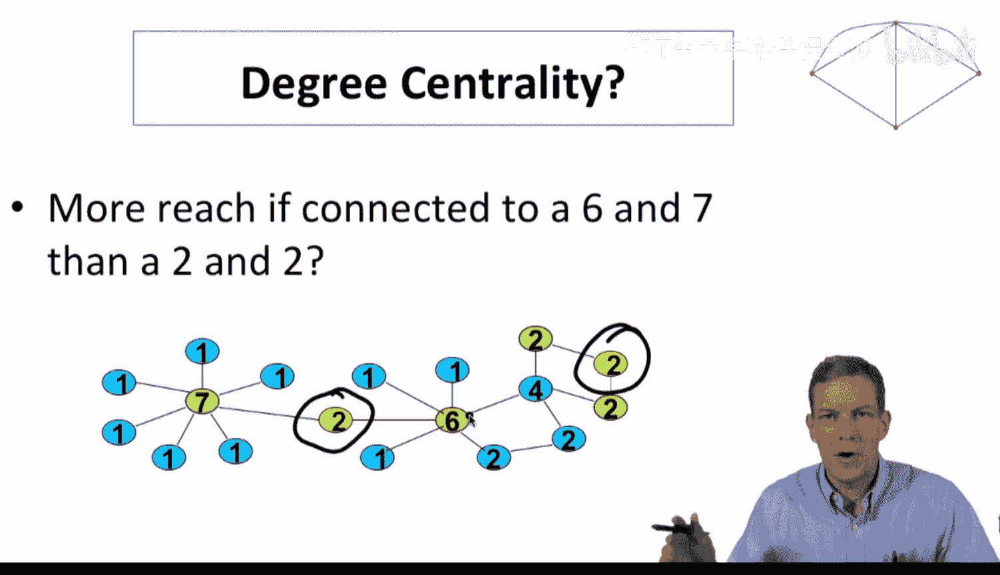

And so if we look at eigenvector centrality where we have the centrality being proportional to some of the centralities of your neighbors。

 then we're getting something which reflects this better connectedness as we talked about in the last lecture okay so let's have a look and see if eigenvector centrality does a better job so revisit our hypothesis in villages where the first connected people have higher eigenvector centrality there should be a better spread of information about microfinance and more people knowing should lead to higher participation。

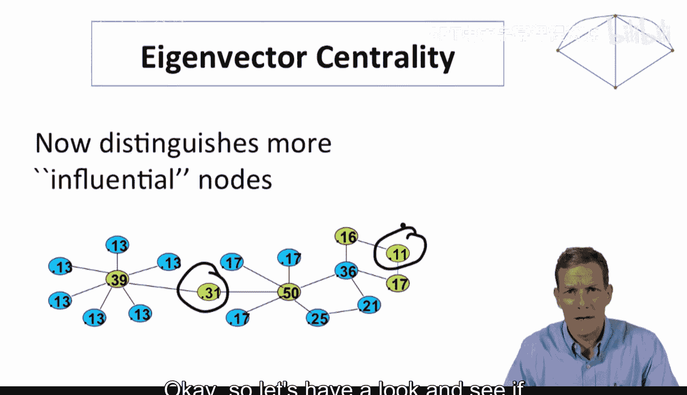

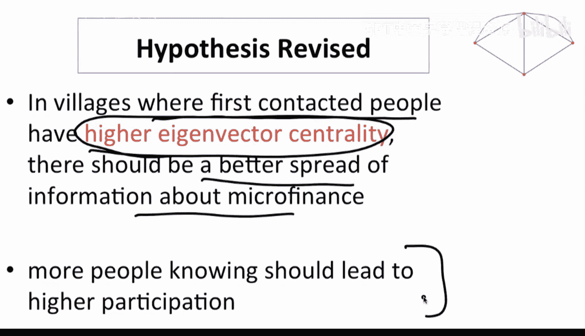

So let's have a look and indeed， when we put now the eigenvector centrality。

 the average eigenvector centrality of the leaders and plot that against the participation rate on this other axis。

 now we get a significantly positive and strong relationship so having better place leaders in terms of eigenvector centrality does a reasonably good job of predicting the eventual microfinance participation。

 whereas the degree centrality didn't seem to pick things up And the idea here is that ways eigenvector centrality is working better because you this communications a repeated process。

 you tell your friends they have to tell their friends and so forth。

 So if you have well positioned friends and they have well positioned friends and they have well positioned friends that。

Is good for diffusion， and eigenvector centrality is measuring that whereas degree centrality is not。

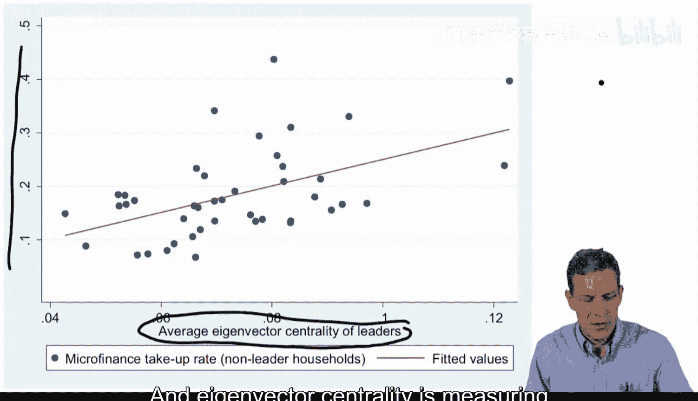

If you begin to you know you can do a regression， regress microfinance participation on a series of variables if we look at the eigenvectors of the leaders compared to the degree of the leaders and regress microfinance participation on these variables。

 we get a positive and significant relationship between eigenvectors of the leaders and microfinance participation。

 slightly negative and insignificant relationship of the degree centrality。

 so indeed eigenvector centrality seems to be doing a better job。

You know we can look at a bunch of different notions。

 so here we look at regressing microfinance on different notions of centrality。

 so the eigenvector centrality， degree closeness， boage in between this here what I've done also is we're also correcting not only for the centrality but also let's keep track of you know some villages are going to be larger。

 so they might have larger numbers of people， some might have more people who participate in self-help groups which means that they're already more prone to be borrowing and lending from each other we have variables on savings。

 we have caste variables， we can look at a whole series of different variables and control for those and see know that takes some of things out and again eigenvector centrality so now degree turns out to be positive when we control for these variables but still insignificant compared to its standard error。

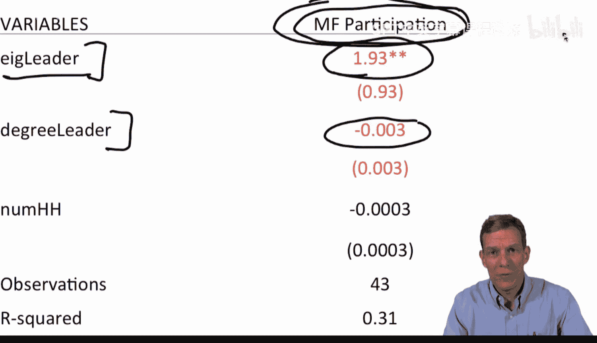

Eigenvector centrality is the one which turns out to be positive and significant。

 the other ones turn out not to be significant So you know this is just one application。

 but it's one application where now if we have a very particular question in mind and we look at which of these centrality measures correlates with the eventual outcome eigenvector centrality is one that's correlating in a positive way and the other ones are not correlating significantly once we've controlled for a bunch of other variables so this just gives us an idea that these things are measuring different aspects of the network and sometimes one can be a better predictor than another now exactly what the causation here is we can tell stories that can explain that is probably has to do with communication and better connected friends leads a better communication and so forth eigenvector centrality is picking that up but you know this is observational data so we're not sure what the causation is but we do see that different。

Measures are picking up different things in the data。 that's going to be important。 Now， again。

 I want to emphasize here that this does not mean that eigenvector centrality should be your only centrality measure。

 It just means in this particular application where we were looking at a very specific type of diffusion。

 It seemed to be a better correlator than these other standard measures of。

of centrality and depending on which application you're looking at。

 you know between this seemed to do a little better at explaining what was going on possibly in the Florentine marriage data。

 so depending on which application you're looking at it might demand a different centrality measure。

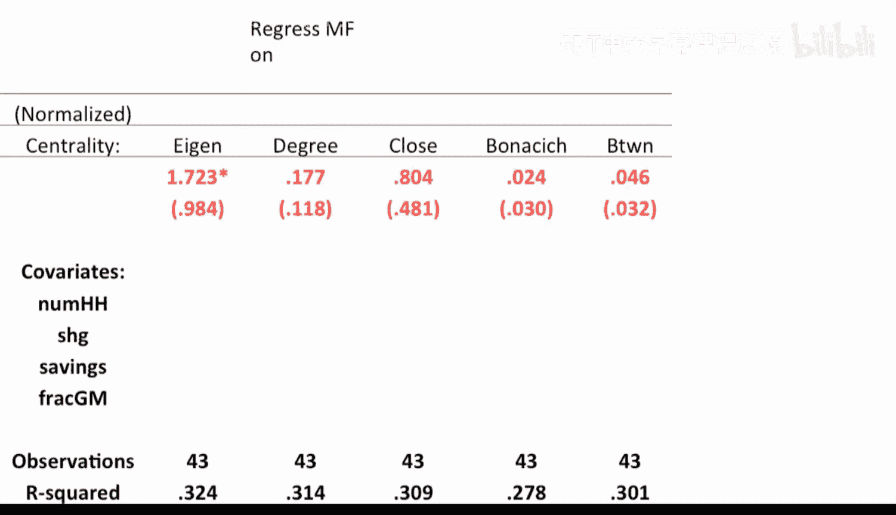