# 斯坦福大学《社会和经济网络：建模与分析｜Social and Economic Networks： Models and Analysis》中英字幕 p19 19_02_07_2-6-随机网络.zh_en -BV1v1421U7Nk_p19-

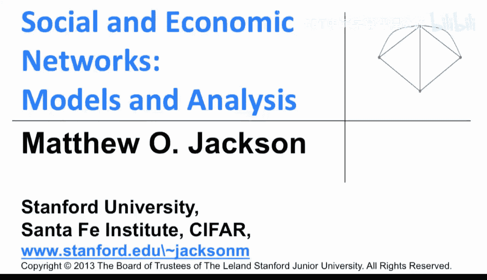

H again， so we're back and now we're going to start talking about network formation in more detail。

 and we'll start by talking about random network formation。

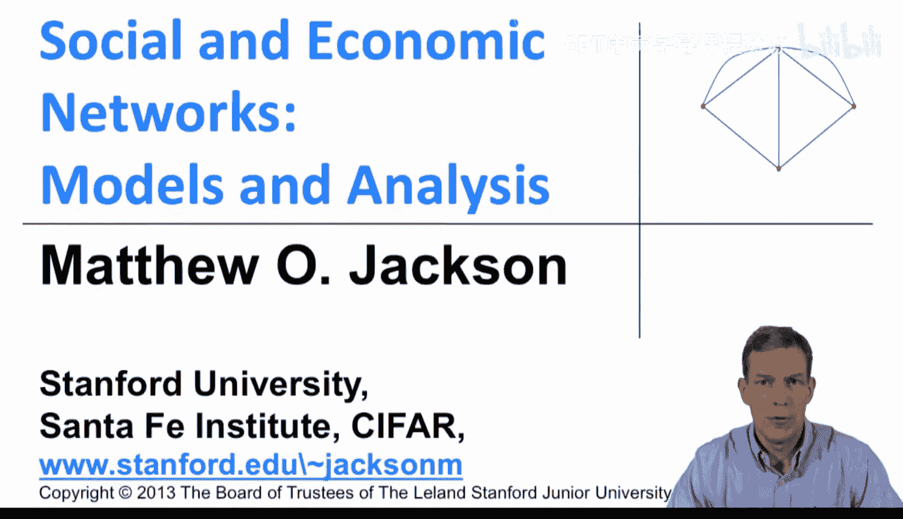

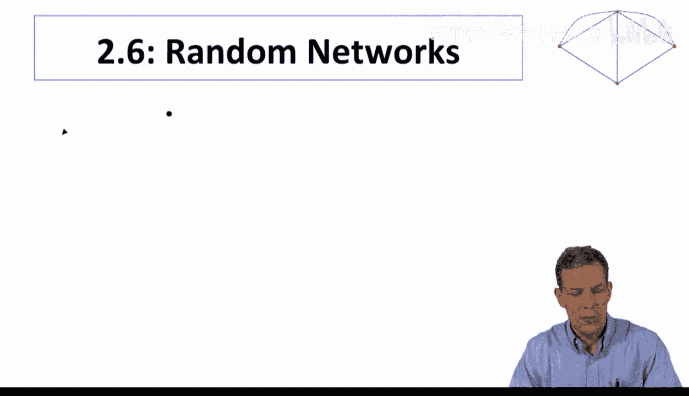

And just to sort of summarize where we've been and where we're going to put this in all in a little bit of perspective。

 we've talked a bit about the prevalence of networks， they're important in many contexts。

 but even though they're very complex， they have particular characteristics that we can measure and talk about small average path length。

 high clustering， degree distributions they have different shapes， things like homoopphily。

 talked we haven't really talked about assortitivity。

 but that's something which will come up at some points which actually means that higher degree nodes tend to be connected to other high- degree nodes we'll see that in some of the models that we come up with。

 we've talked about a variety of centrality， influence prestige measures。

 there's always a room for study of methods which are the right methods， which are the wrong methods。

 how should we be really measuring and keeping track of networks。

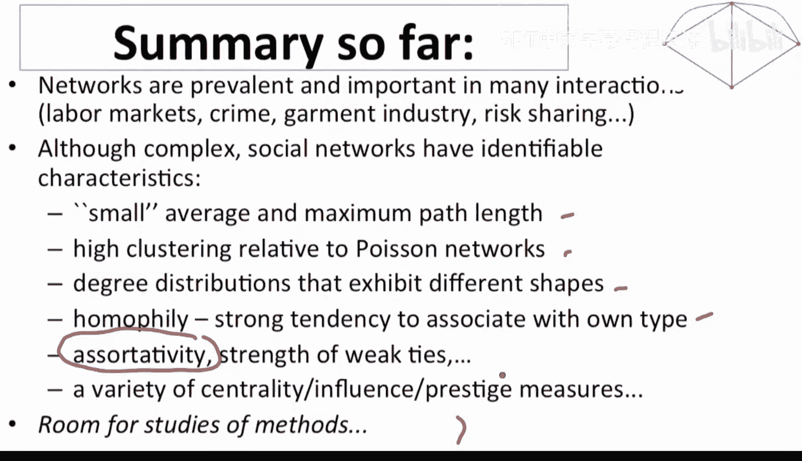

So that more or less took us through the first part of the course so gave us some idea of backgrounds and fundamentals definitions and so forth to work with and now what we're doing is starting to look in more detail at network formation and we started by asking some of these questions in the context before measuring path length and so forth we've looked at the Uashrini random networks and here what we're going to do is break things into two different approaches。

 one is sort of random network models that will be akinin and enrichments of Erdaranni kinds of models and then the other will be strategic network models where instead of links happening at random what will happen is we'll have nodes actually choosing the links that they're going to form and they'll choose them to benefit themselves so these will be game theoreticaloretic kinds of models of self-interested in forming relationships and seeing how that impacts network formation。

So that's the main part of the course that we're transitioning into now and when we start to think about the kinds of things that we want to be asking。

 when we're asking which networks form， we'll get two different kinds of answers here。

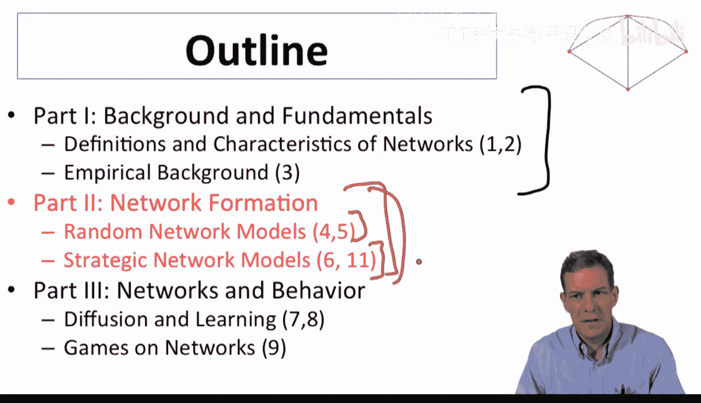

OkaySo we've got the random graph models are going to tell us a little bit about how and the idea here is that they give us a process and if we want to understand know why random networks have short average path length then we understand that there's a tree structure underneath them and that tree structure helps explain how it's easy to reach from any other node to any other node in a relatively short number of hops the economic or game theoretic kind of strategic models will answer why they might tell us why would we see a a tree structure。

 not the fact that a tree structure does give you this property。

 but why would we end up having these kinds of shorter paths and more generally we're going to want to keep track of how these things depend on context and so what we're going to do is we're going to take these things in turn we'll start with looking at random graph models in more detail then we'll come back to some economic and game theoretic models and we'll also talk about some hybrid models。

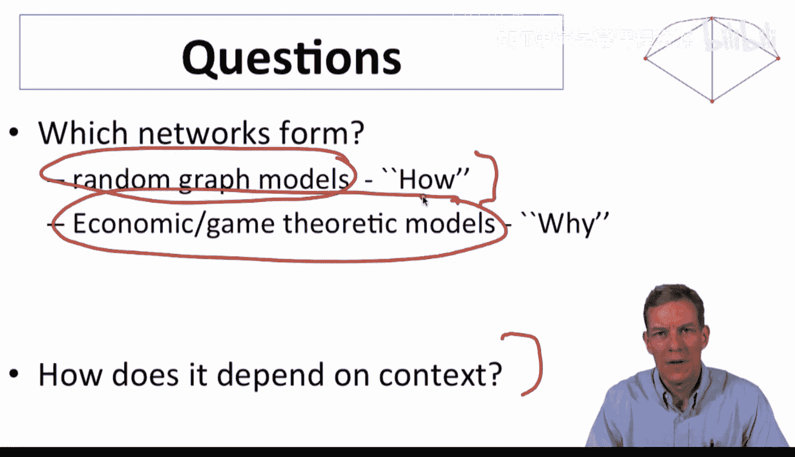

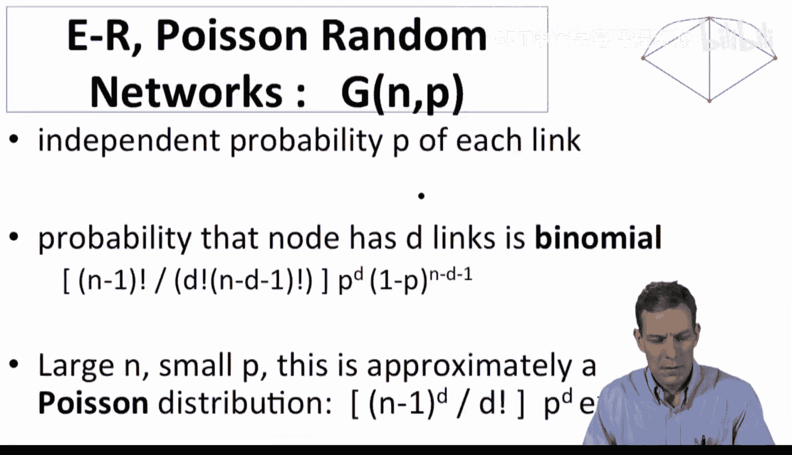

Okay so in terms of the static random network models why do we want to start with those for two reasons one is that they're going to be a very useful benchmark and again I've sort of emphasized this a little bit before but I want to repeat it by looking at what would happen if things were just happening purely at random then we can look at what we do observe and differentiate that from what happens at random or get some understanding of way it has similar features to what happens at random so these benchmarks will tell us know what component structures do we expect to see at random what kind of diameters do we see at random what kind of degree distributions do we see at random what kind of clustering when we see at random and so comparing things back to those uniform at random models will allow us to do some comparisons also this will give us some basic ideas of tools and properties and how these kinds of things are worked with and how we might be able to。

Work with them more generally。Okay so what we're going to start with is the Erdaenni random networks and look at their properties in a little more detail and again。

 if you remember these networks， these were the GMNP model where basically we've got N knowss and each link has a probability P of forming and the degree distribution in that kind of network was a binomial which is well approximated by a Poisson distribution for large N and relatively small P so again when we're dealing with these kinds of networks。

 part of the challenge is that every network actually has some probability of forming。

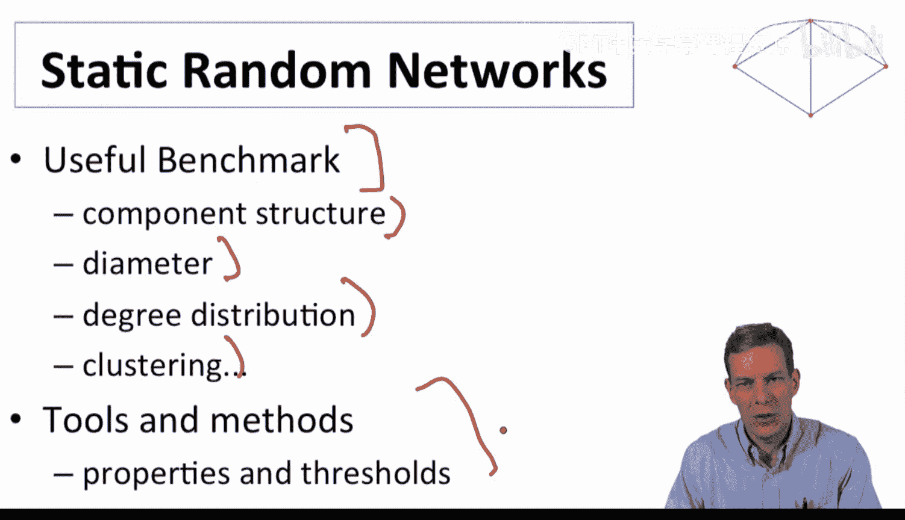

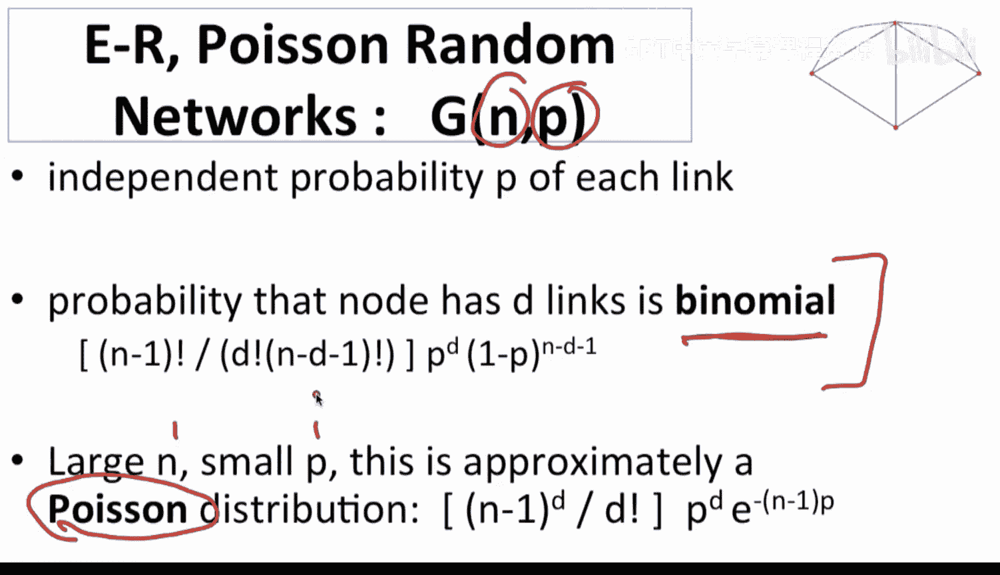

And so how do you make sense of that， what we do is begin to prove theorems for large networks。

 so if n is large， then with a probability close to one。

 certain kinds of things are going to be true。Now， in the way in which people begin to specify what might be true or what might not be true is by specifying what are known as properties。

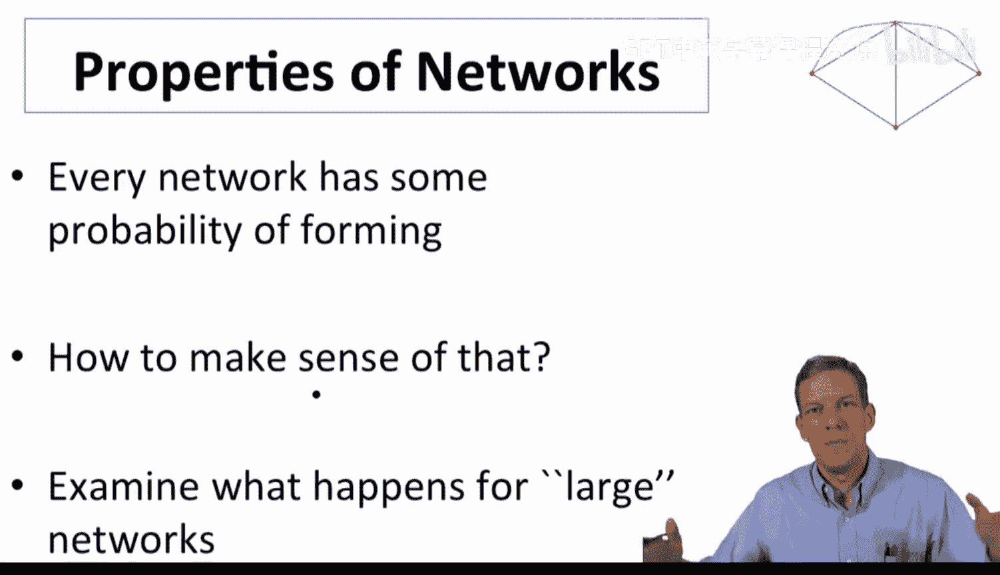

So in order to make this precise， let me just bring in a little bit of notnotation。

 so let's let G of n denote all the possible networks that could be put on a set end of nodes okay。

 all undirected so we'll just have these B01 relationships either there or not。

And no direction to it， no weights。 And then a property is just going to be a subset。Of。Of networks。

So AN is a subset of GN， it just specifies， here's the networks that have the property。

 the ones not an anN don't have the property， so it's just a list of here the networks that have a particular feature that we might be interested in so just in terms of examples if you want to have the property that a network has no isolated nodes then the property is just represented by saying it's all the networks such that the neighborhood of every node is not- emptyty so every node has a nonempty neighborhood that's a property。

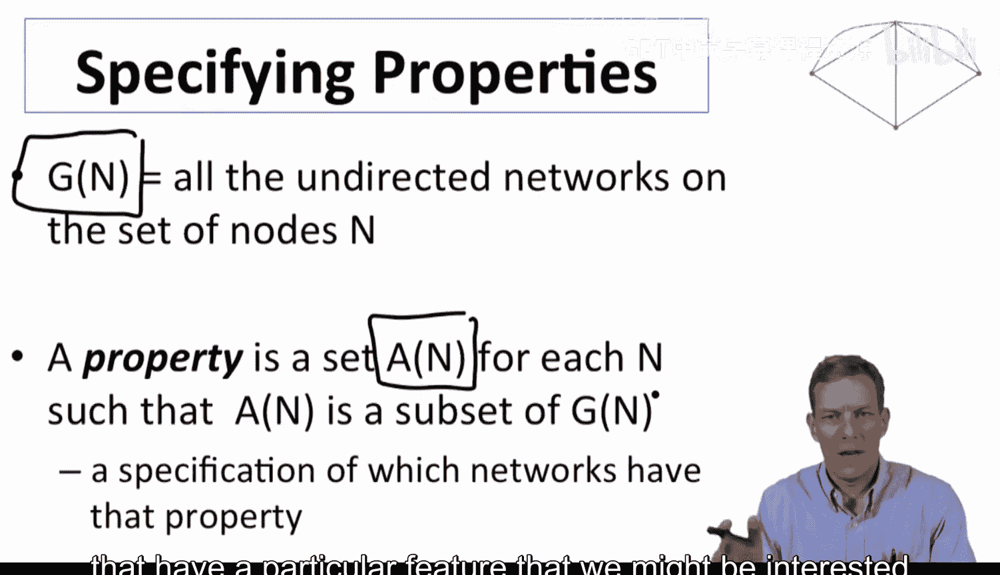

Another property would be that the network is connected。So for instance。

 that the path length between I andJ is finite for all pairs of nodes。

 we could also have a property that the average path length is less than log n the diameter is less than log n。

 so that would be another property okay so each one of these is just specified in terms of here the networks that have this here the networks that don't that's a mathematical way of representing a property of a network。

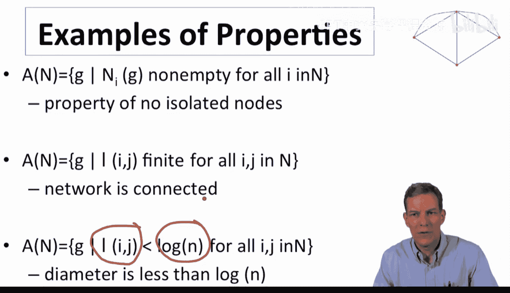

Now an important class of properties are what is known as monotone properties。

 and so what is a monotone property， a monotone property is one such that if some network satisfies that property and we add extra links so we just increase the links in the network so that G is a subset of the links in G prime。

 then G prime also satisfies the property。Okay so it just means adding extra things satisfies keeps us satisfying the property you can go back and check every one of the properties we just talked about is a monotone property okay now something that wouldn't be a monotone property would be something like saying that there's an even number of links so if I add an extra link now it turns odd it's no longer satisfying the property so there could be some things that aren't going to be monotone but a lot of the properties we might be interested in so you know it being connected or if I add more links it's still connected so you know not having isolated nodes。

 if I add more links it doesn't have isolated nodes so that's a monotone property the path length is shorter than a certain amount。

 if I add extra links， it still has a short path length。

So these are nice properties that will be easier to work with。

 they don't sort of blink on and off as we change the link pattern。

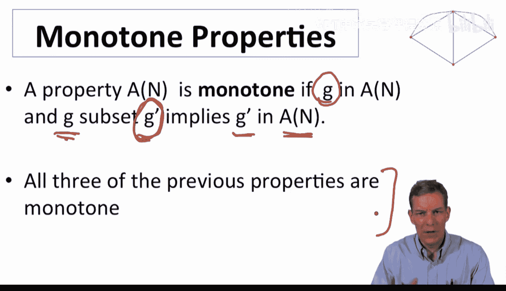

Okay so what we'll be interested in then is limiting properties so one way to keep track of these things is then to talk about large n and then so we can for instance look at a sequence of Erda Rei personal or GM random graphs and then have some probability and then talk about what happens as a function of the size of the graph so this is one way of representing properties and now we can take a look at some of those properties and understand what it might be true or not true of those so when do we have these things and when don't we and just to preview ideas。

One of the really nice things about the Erdash Rei setting and the GNP graphs and part of the reason I think their work was so well known is that there are very sharp thresholds for which property do or don't aren't satisfied So if we talk about how much does the average degree have to be the average degree is above some level than a property will be sure almost surely true as you get to large end and if the degree is smaller than a certain level it might not be true。

 And so the idea here is that that will have nice threshold which will sharply distinguish when a property is true and when a property is not true so we'll take a look at that next。

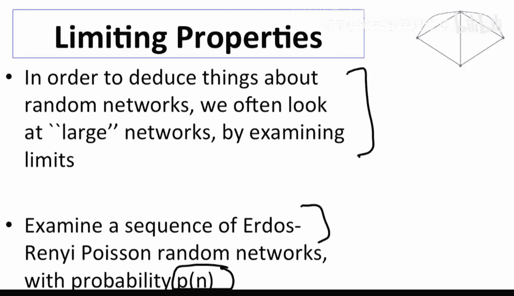