# 斯坦福大学《社会和经济网络：建模与分析｜Social and Economic Networks： Models and Analysis》中英字幕 p21 21_02_09_2-8-阈值定理（可选-进阶-13-00）.zh_en -BV1v1421U7Nk_p21-

Okay， so I'm going to take you through a threshold theorem for those people who are interested in seeing a little more detail exactly how these thresholds work and how some of these things are proven just to give you a feel for the type of proof that works in this setting。

And so the one that we're looking at is going to be one of the more interesting theorems。

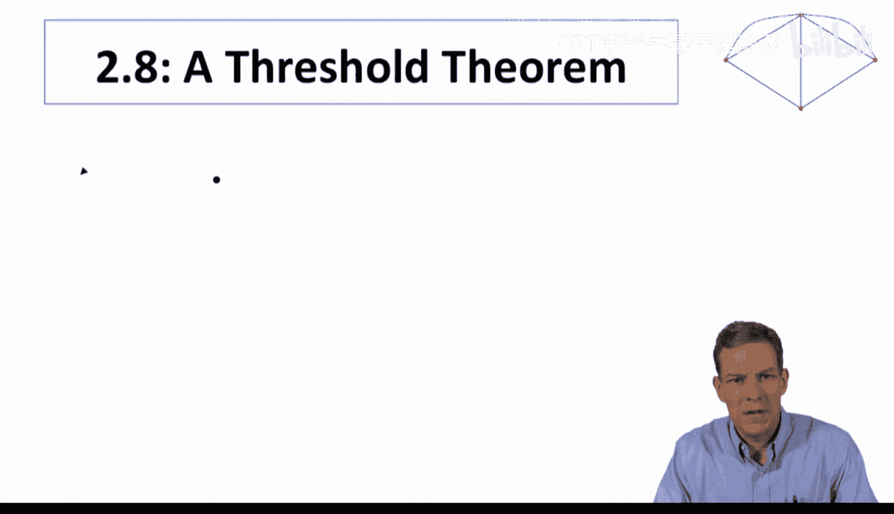

Coming out of Verash and Reni， so what we're looking at is that a threshold function for the connectedness of one of these Poisson or GNP random networks is the point at which the probability of forming a link is proportional to log n over N。

 so if this then tells us that if PN is much larger than this。

 then so if PN is much larger than log n over N， then we're going to have a connected network and if it's much smaller than this。

 then the network is not going to be connected and we're going to have different components in it。

Okay， so that's the theorem and what we're going to do is just sort of work through part of the proof。

 which basically carries the main intuitions of the proof and there's some details you have to work out and I'm not going to go through all the details。

 but this will give the essential bits of the proof。

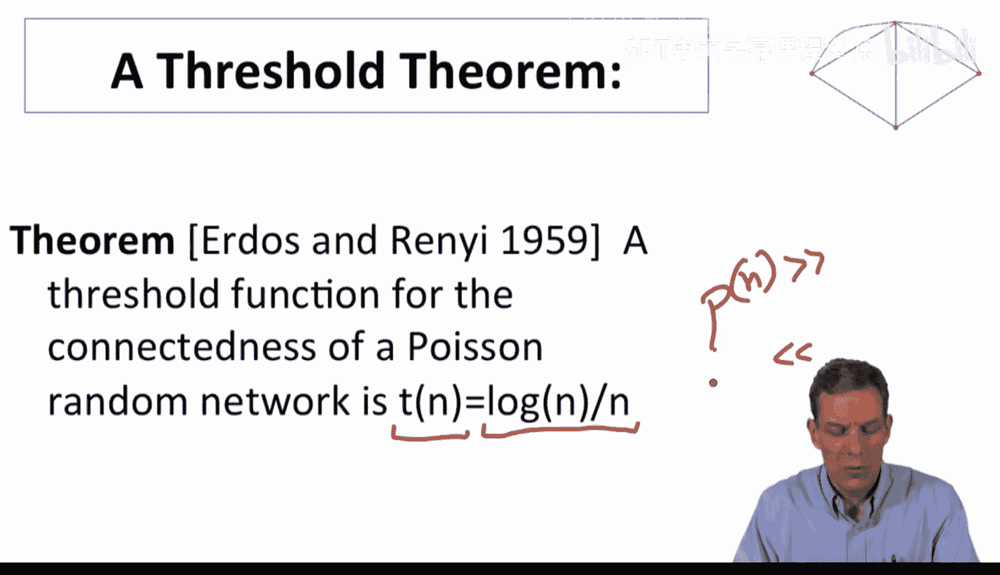

And so one thing we can do is show that if PN compared to this threshold goes to zero。

 so if the P is much smaller than this threshold， then there's going to be isolated nodes with probability 1。

And if PN， so if there's isolated nodes， then certainly the network can't be connected。

Whereas if PN compared to TN goes to infinity， then there can't be any components with less than half the nodes。

 so all components have to have more than half the nodes and basically that means there has to be one giant component。

So the idea here is going to be to show that you know if you're much smaller than this。

 you're going to get some isolated nodes and if you're much bigger than this。

 you're not even going to get any isolated components and what I'll do is really concentrate on the fact that showing that there are isolated nodes or there aren't isolated nodes is at this threshold and the idea that showing that a component。

 a small component can exist or not exist is more or less just。

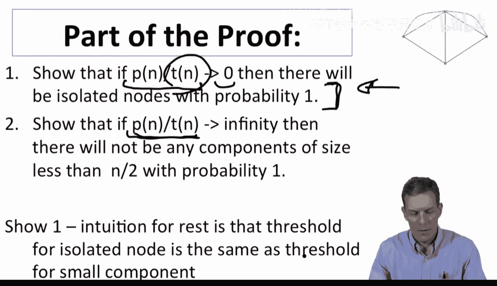

Of small variation on this proof。Okay， so first of all。

 just to remind you of some useful approximations of the exponential function。

 so in case your calculus or your precalculus is a little bit rusty。

 So definitions of the exponential function， two forms of that will be very useful in this course in terms of understanding properties。

 it's going to be one is that if we look at e of the x。

 we can also think of that as just looking at the limit of a process where we do1 plus x over n raised to the n of power so think of this as continuous compounding of interest looks like e to the x。

 so the limit as n becomes quite large of1 plus x to the n over n equals the exponent。

 Another is the Taylor series approximation for exponential function。

 we can write the exponential function as the sum of x to the n over n factorial so that's another way of getting that and you can go through your Taylor series approximation if。

Like， but that'll be a useful approximation and here what we're going to do is approximate。

Probabilities of these events happening and then using these approximations willll be able to get things back in terms of exponentials and then log log functions so what we're going to show now is that right at the point where your expected number of connections looks like log n。

 so this is going to be the point where P is proportional to log n over n right so the expected degree is just multiplying up by n minus1 or roughly n this is the threshold above which we expect each node to have some links and below which we expect nodes to be isolated。

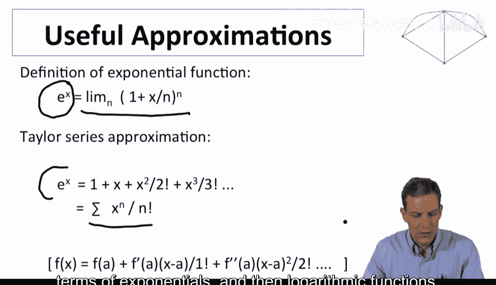

And in fact， this is the threshold above which we expect node to have many links and once each node has many links the chance of having disconnected component Spanishes so so basically the logic is we're going to show that you know。

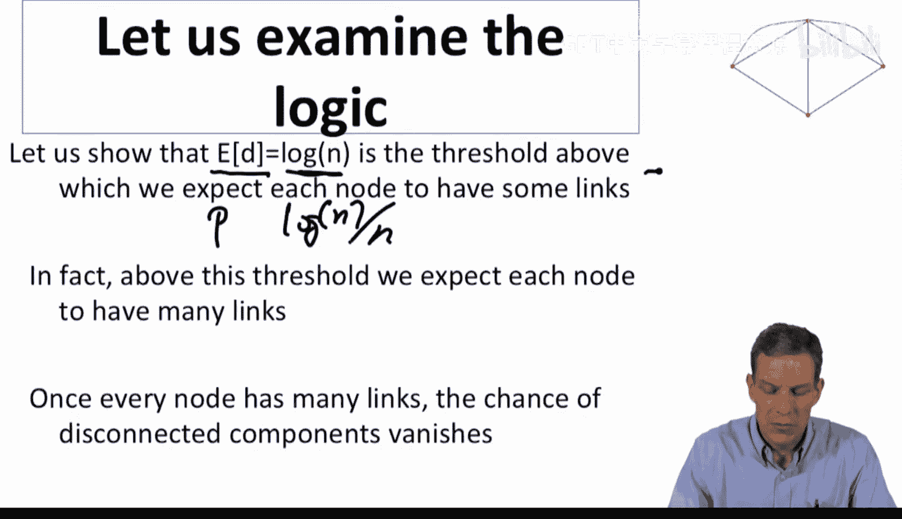

This part of it and the rest is a fairly simple variation。Okay。

 so first thing we're going to do is we're going to write the expected degree as some function R plus log of n okay so the expected degree is actually some R plus log of n。

And what what we're going to then do is now let's do a calculation of the probability that some node is isolated。

 Okay， so how is that going to depend on this expected degree。

 So the probability that some link is not present。 So I look at a given node and I ask。

 what's the probability that it's isolated？ Well， it's the probability that it has no links。

What's the probability that it doesn't have one of its links Well that's one minus p。

 What's the probability that it has none of its links Well。

 that's the probability that none of them formed。 So1 minus p times 1 minus p times 1 minus p times raised to the n minus1 power So this is the probability that some node is isolated and so what we want to do is then show that the probability if p is small enough。

 then you're going to have a high probability of these nodes being isolated and if p is large enough then you're not going to have any probability of this happening Okay so the probability that you're isolated is1 minus p to the n minus1 power。

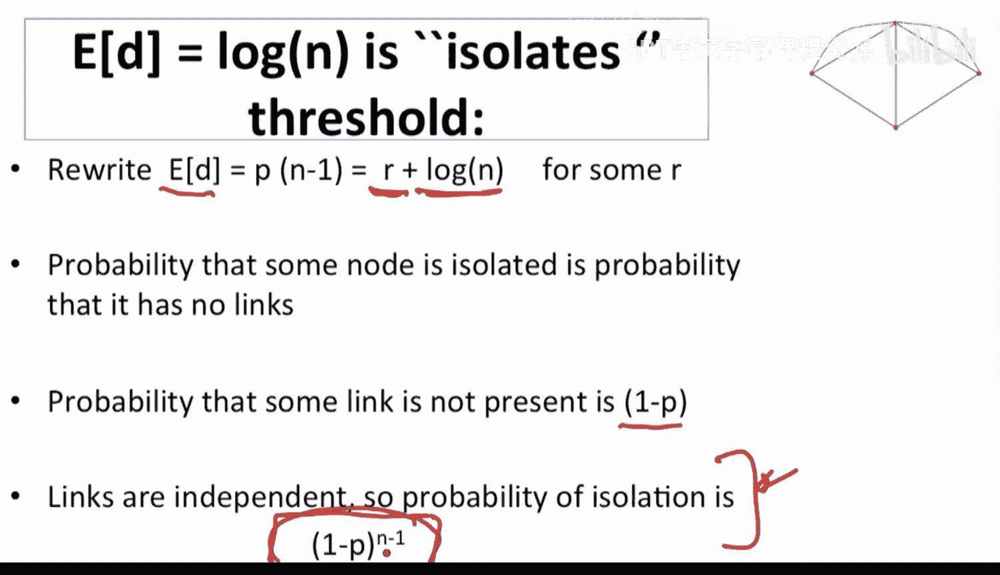

So probability that some node is isolated is this。And now from the way we wrote the P。

 remember we wrote that the expected degree was r plus log n。

 the expected P is just that divided by n minus1， so this is the P。

So 1 minus P to the n minus1 is just one minus r plus log n over n minus1 raised to the n minus1。

 Okay， so now we've got an expression for this。And now we're going to use our approximation that we went through before。

 I just told you the approximation for an exponential function。

 so recall that if we have some x running n off to infinity 1 minus x to the n over n to the n approximates E to the minus x。

Okay， so and that's true if x over n is small， so vanishing and in particular。

 what we're going to need is r plus log n to be small relative to n minus1。

 Now what I'm going to do is just assume that that's going to be true and the completion of the proof here for people who are really interested if。

R plus log n is large relative to N。 then this is a monotone property。

 If it holds when it's small relative to N， it's even going to hold more easily when it's large。

 right， we're just adding more links。 So that part of the proof is quite easy。

 So the case that's really going to be tough is when it's small relative to N。

 And so what we're going to do now is look at this。 So so now we've got an approximation。

 We're approximating this by E to the minus。Right so we get E to the minus R plus log of n as an approximation for this。

 So the probability that some node is isolated begins to look like。This right。

 and now we've approximated that using our exponential function。

 so it looks like e to the minus R minus log n， bring the log n out and we end up with the probability that some node is isolated looks like E to the minus R over n Well remember R was our how much our P or expected degree differed from log n。

Okay， so now we've got a simple formula for the probability that some note is isolated for large n。

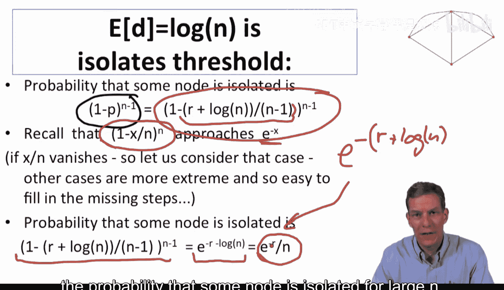

So if each one is isolated with a probably e to the minus r over n。

 then the expected number of isolated nodes is just n times this since nodes are identical in this world。

 and so the ends cancel out and we get the expected number of isolated nodes is e to the minus R。

Okay， now we're pretty much all the way there。If r is going to infinity， if r is getting quite large。

 then the expected number of isolated nodes goes to zero。If r goes to minus infinity。

Then it tells us that the expected number of isolated nodes becomes infinite。

So basically what we're getting here is a function of R。

 if it's either getting very largely positive， meaning that the threshold is exceeded by P or if it's getting very negative。

 so that P is much smaller than a threshold， then we're either seeing the expected isolated number of isolated nodes going to zero or going to infinity。

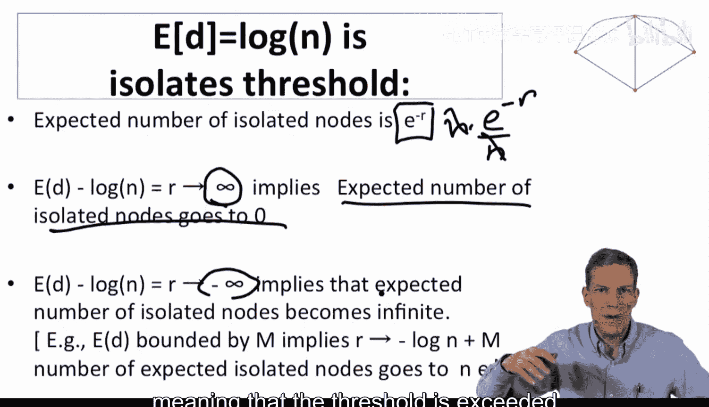

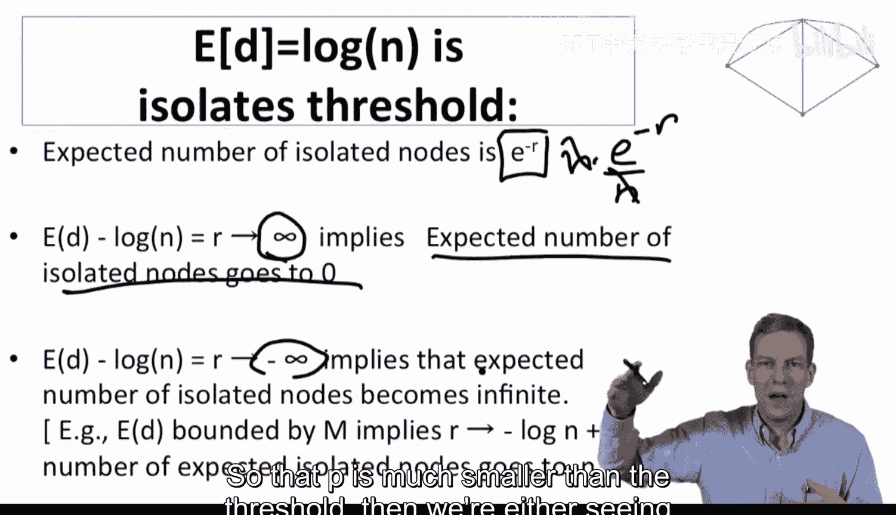

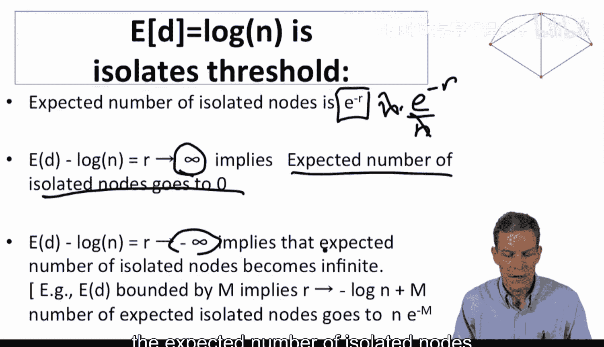

And so basically the expected number of nodes goes to isolated nodes goes to0 if Rn tends to infinity and to infinity。

 if Rn tends to minus infinity So the expected number of isolated nodes tends to0 if that's tending to0。

 then the probability of having one has to 10 to0 you can't have the expected number be0 and have the probability of having one be positive or significantly higher than0 So the probability of having one is going to have to 10 to0 and so this tells us now that basically if we're sitting in a situation where Rn goes to minus infinity。

 then or sorry if Rn goes to plus infinity， then the expected number tends to0。

 the probability of having one tends to0， so basically if p is much bigger than this T of n being。

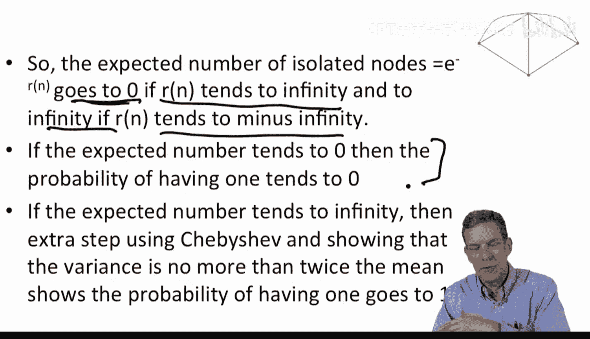

Log and。Over n。Then we've got a situation where the expected number of isolated nodes goes to zero and the probability of having an isolated nodes goes to zero Vi versa。

 if it's going to infinity， then an extra step play with the variance。

 you can't get the expected number going to infinity without having the probability of having at least one go to one。

 so it's impossible to have the expected number go to infinity and not have probability going to one。

 of actually having one so that's an extra step that I'm not going to go through but it's a fairly easy one to do in terms of Chevy Cheev's inequality。

Okay so this was just one example， I don't expect you to digest all of this on the first pass。

 you can go through， you can go through Baabbash's book in much more detail if you want to see one of these proofs worked out in full detail but what I wanted to communicate to you through derivation is just the type of reasoning that goes through so what you do is you want a certain probability you can get that probability in terms of approximations based on exponential functions often that approximation then now we know for large n it becomes fairly accurate。

 and that gives us bounds on probability so we can say that the probability of something either has to be tending to one or has to be tending to zero based on what these functions have to be converging to as and becomes very large and that those threshold functions come from identifying where is it that these expressions either go to1 or to zero and whether we're talking about。

Isolated nodes or we're talking about the first link appearing， etc。

 it's going to be a different threshold and so the proofs tend to have the same kind of structure to them。

 they're just going to differ in a particular expressions depending on whether we're talking about one type of threshold in one property or a different property in a different threshold。

 but this type of analysis is what underlies a lot of random graph theory and a lot of the proofs behind the scenes in terms of establishing properties of random graphs in large settings。

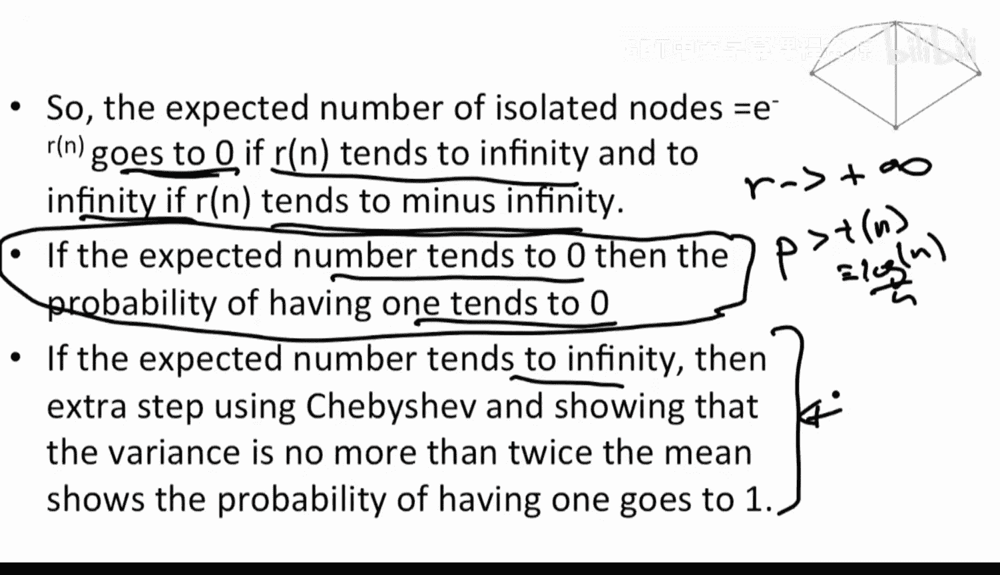

Okay， so that's just one example now we're going to take a look at some other types of random network models and other kinds of things that we might be able to establish when using them。

