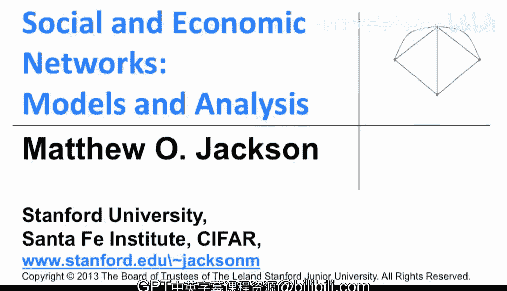
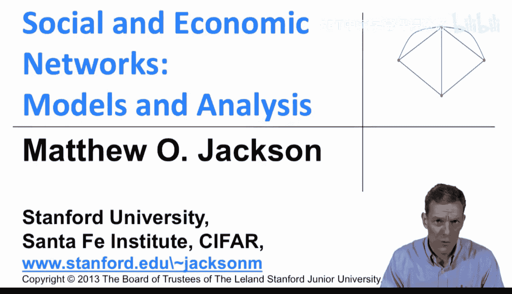
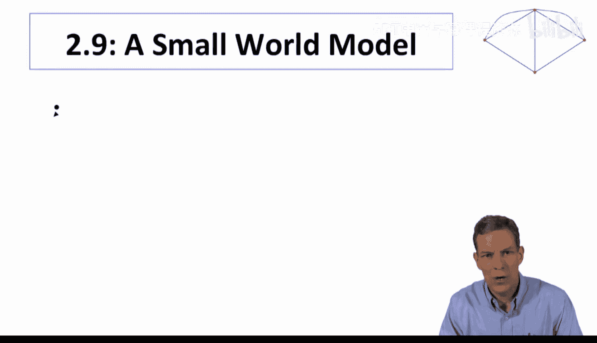
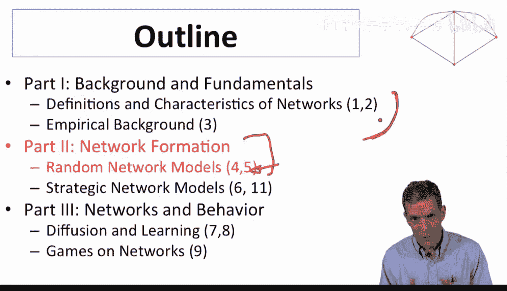
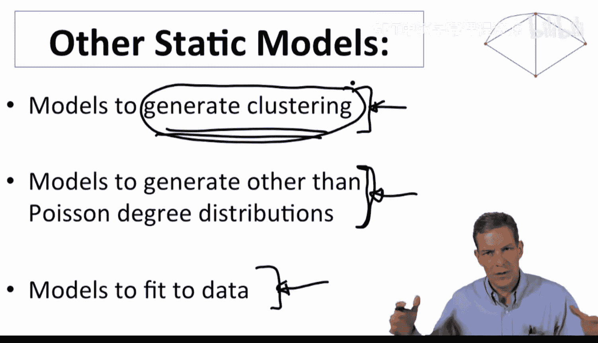
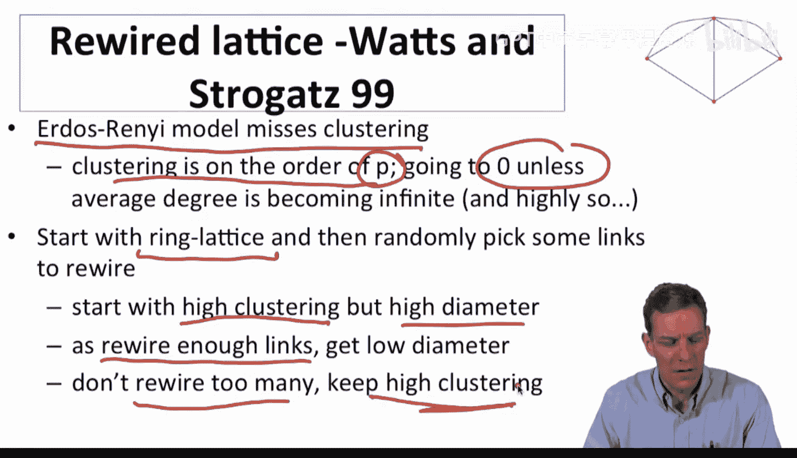
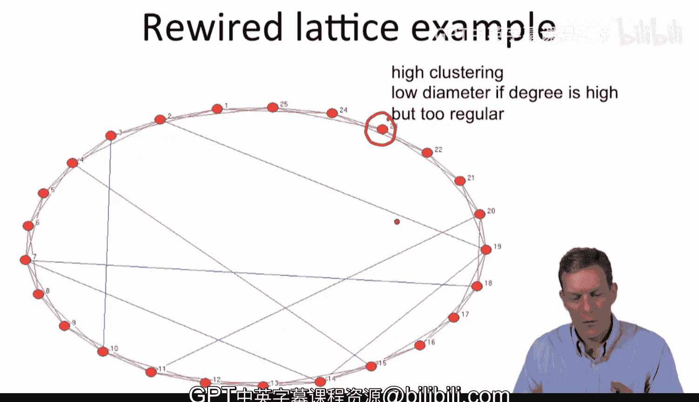

# 斯坦福大学《社会和经济网络：建模与分析｜Social and Economic Networks： Models and Analysis》中英字幕 p22 22_02_10_2-9-小世界模型.zh_en -BV1v1421U7Nk_p22-

Okay， so now we're going to talk a little bit about random networks and enriching them to start to capture some properties that we actually observe in real networks and we'll talk about small worlds and before I get into that。

 let me just sort of put it in context where we are in terms of the course。 So again。

 we're talking about network formation now random networks models and we had a whole series of properties that we observed in real networks that are sort of stylized facts that sometimes emerge in different context。

 and we might begin to start thinking about well， what kinds of models would we need to match that。

 And so simple Erdaashrini networks gave us some insight into why average path lengths might be small But one thing that they didn't do very well was give an idea of clustering。

 So we saw that a lot of social networks that one observe actually have clustering coefficients which look significantly different that what would have happened。

If we were just working with a Ndash Rei random network。

 so somehow those networks are missing features that are actually going on so when we look at enriching models。

 what we might want to do is is start to generate some clustering so how can it be that we get clustering which is non-trivial and know that's going be one thing that we might be interested in the other thing we saw we saw that the distributions didn't necessarily match the Iddaash Rei random grass。

 we saw these fat tails can we generate models that have different tails can we generate more flexible classes。

 general classes of models to fit data so that's where we're going and in particular we're going to start by just asking something about clustering and then we'll move on to sort of enriching the models to become richer and richer and try to fit more things as we go along。

嗯。Okay so an early paper Watch and Stroga's paper in '99 was basically asking the question。

 how do we match these two different features of networks。

 small average path length together with high clustering in one model and one important observation is that the Udash Reni model misses clustering because the clusterings on the order of P。

 which is going to have to go to zero unless the average degree is becoming very。

 very large and if billions of people in the world。

 it's not as if we each have billions of neighbors， we have hundreds or thousands of neighbors。

 so the idea is that we need to have something which captures high clustering and yet has small P。

And so their idea was what they were going to do is had the following observation。

 those started with what's known as a ring lattice， a very particular structure of a network。

And then randomly picked some links and rewired them。 Okay。

 And the idea is by starting with this lattice structure。

 you start with a network which had very high clustering。But also has high diameter。

And then you just change a few links in it。 and the idea is that as you begin to change these links。

That actually you don't need to change many links in order to get a very low diameter。

 so a few randomly placed links will actually shrink the diameter of a graph very quickly。

 any average path length as well， and if you don't rewire too many。

 you sort of keep this high clustering。And so let's have a peek at that and then we can talk a little bit more about some of the conclusions of it。

So here's just a picture I drew here of a set of nodes， so 25 nodes in a ring lattice。

 and so initially they're connected， each node is connected to its two immediate neighbors so if we look here we have node one and it's connected to node2 and3 and also connected to 25 and 24 so it's got these connections going here and here and then each one of the nodes is in terms of these in terms of the red have connections to the different neighbors。

Okay， so we're connected to your two neighbors。 What that does is in terms of this original lattice is give you very high clustering。

 So one is connected to both2 and3 and two and 3 are connected to each other。

 One is connected to2 and 25 and 2 and 25 are connected to each other and so forth。

 So the clustering is is high when you start。And then what you can do is actually what I've done in this picture is not rewire the links。

 but just add a few random links， so let's just stick a few random links in the network And so what happens is initially if you wanted to get without these initial without these random links here if you wanted to get from node1 to node 15。

 your path length would be quite far you'd have to go sort of marching around the circle。

 your path length especially if you expanded this thing to be a much larger graph。

 your path length would be quite far。By putting in these few connections。

 these extra ones now to get from one to 15 you just go。

 you know you've got a fairly short path right you're connected at a distance four to get from one to 14 you know you're connected at a distance three so a few of these extra things allow you to get so one can get to 10 now in just two hops and so forth。

 so a few extra links actually dramatically shortens the average path length。

But it doesn't change the clustering too much right and so if you just you know deleted some links puts of these new ones in as long as you're keeping it in this sort of sweet spot。

 what Watson Strogras noticed was that you could just do a little bit of rewiring that shrinks the diameter dramatically and yet you keep reasonably high clustering okay now of course。

 if you look at this network and you look at the shape of it。

It's still not going to match a lot of real worldorl networks why not well because you know a lot of these nodes basically have degree4 still or you know fairly regular so it's not going to match the fat tails and other kinds of things that we actually observe but what it does do is it begins to sort of answer some of the questions so that if for some reason we had high clustering to start with in terms of some local level and then we just add a few random links on top of that。

 we can get at least two features in common right so it gives us some explanation of how these things can begin to arise in common you don't need many random links to actually shorten average path length dramatically。

Now， this model is far from when we would want to take to data。

 but it begins to put some different things together and what we're going to begin to do now is start to enrich the models so that they're at a level where we can begin to look at different things。

 put them in， take them to data and then ask things about are we reproducing a lot of the features that we actually observe in real world networks。

 so we'll take a more detailed look at random networks。

