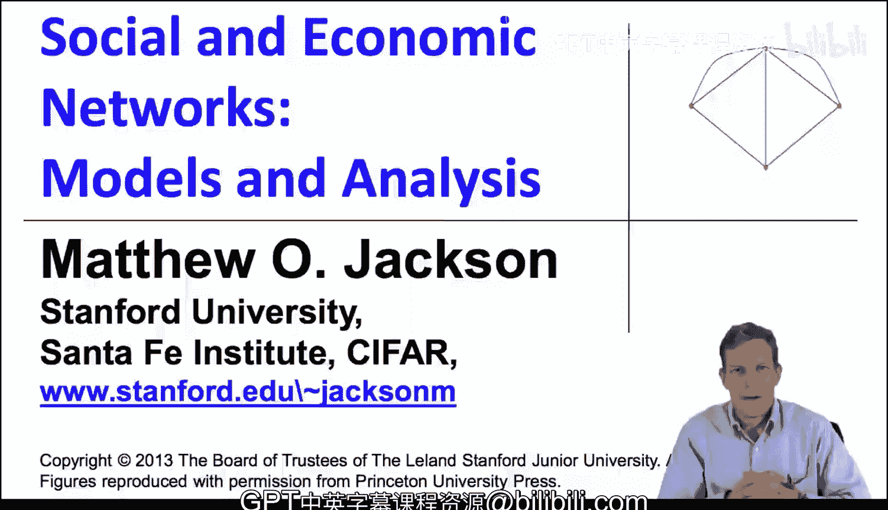
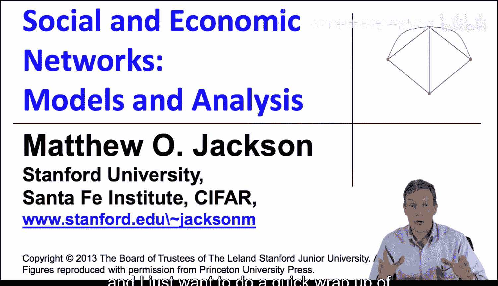
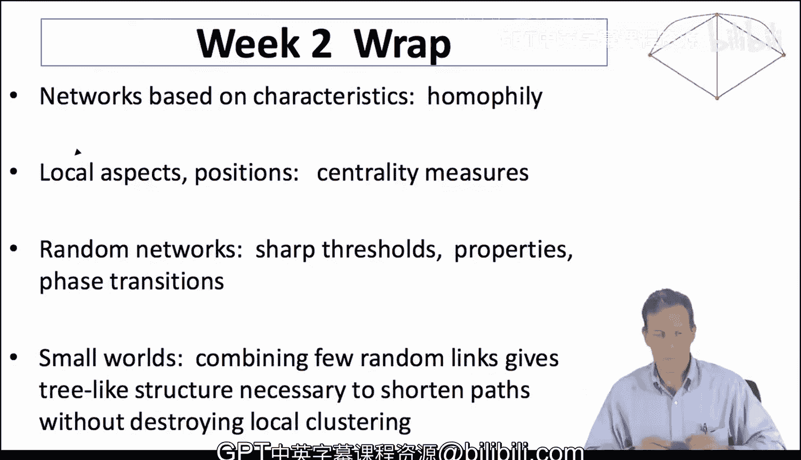

# 斯坦福大学《社会和经济网络：建模与分析｜Social and Economic Networks： Models and Analysis》中英字幕 p23 23_02_11_2-10-第二周总结.zh_en -BV1v1421U7Nk_p23-

Hello again， so we've finished our second week of lectures and I just want to do a quick wrap up of some of the things we've talked about。

 So the first thing we looked at was homophily and what was important here is instead of just looking at the topological structure of networks just looking at the link structure we're also bringing in characteristics of nodes and noticing that the connection patterns are well predicted by those characteristics which is quite natural and social settings so people tend to associate。

 for instance with other people who have similar characteristics this could be due to a variety of different reasons but what iss going to tend to do is begin to segregate networks and when we get down further in the course talking about learning。

 talking about diffusion， talking about how people choose behaviors and looking to peers then the segregation patterns are going to become quite important So understanding homophily understanding is impact will be something that we'll look at quite a bit going forward。

Second， when we look locally and we try and figure out who in a network might be influential。

 were looking at centrality measures， there are many different ways in which we could keep track of networks' position how close they are to other individuals how well- connectedned they are to important to other individuals。

 how many connections they have， there's a whole series of different things that we went through and these all captured different aspects of networks and some of them are going to be very important lying between different sets of individuals might be important in brokering situations。

 being close to other individuals might be important and spreading information。

 being connected to other well-conned individuals could also be important in disseminating things so those are measures that have different aspects and keep those in our toolbox as we go forward and we're going to see a bunch of them popping up at different points in time when we're asking about behavior on network。

Then we started looking at random networks in a little more detail and when we look at things like Gerda Reni random networks and a series of other networks。

 there's going to tend to be sharp thresholds， very important idea here that if you change the link probability for instance。

 slightly you can go from one setting where networks are rather disconnected to situations where suddenly they start to coalesce and then they become path connecteded quite quickly so you can move relatively little in terms of the probability space and end up having very different features that emerge in terms of those networks so those properties and phase transitions or are something that we'll see going forward Last point we looked at small worlds so this brought back the idea that relatively little bit of a tree structure that you can get from putting down a few random links when put together here with something which has high clustering can give you two of the important features that we've seen in networks。

Strong local connectedness and easy to reach across the network kinds of properties。 So there are。

Some ideas here， simple explanations for what we might be observing。

 what we're going to be doing going forward is building richer models of network formation that try and capture a little more realistically some of the aspects of networks and lead us into the behavior and other features of networks that we'll really need to capture in the second part of the course。

