# 斯坦福大学《社会和经济网络：建模与分析｜Social and Economic Networks： Models and Analysis》中英字幕 p24 24_03_01_3-1-增长随机网络.zh_en -BV1v1421U7Nk_p24-

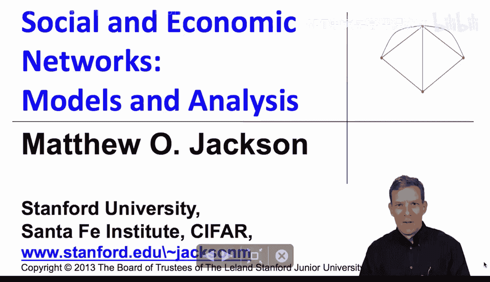

Okay hi folks， we're back again and we'll be talking a little bit more about random networks and in particular we're going to start looking at growing random networks so situations where there are new nodes entering over time and so this fits into our study of network formation so in terms of the course we are now in the second part of the course and we're looking at network formation models and again we've looked at static random network models and now we're going to be looking at dynamic random network models where there's growing numbers of nodes over time。

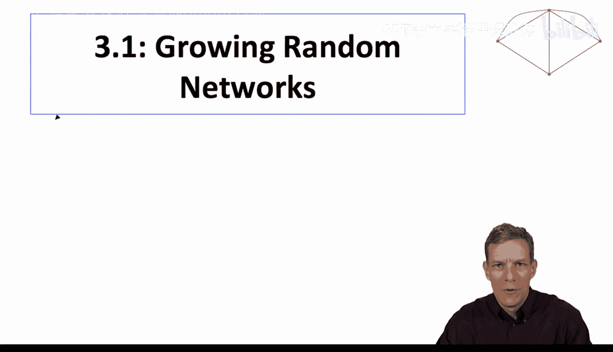

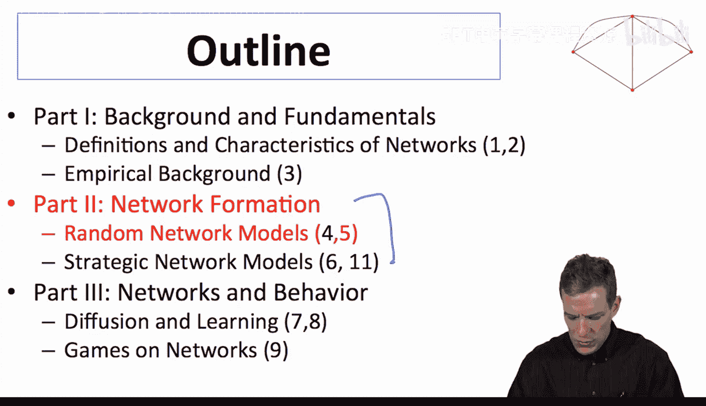

And there's lots of examples where this happens in the world。

 so a prime example is citation networks， new articles are worn and over time。

 new articles can form links by citing old articles， old articles can't cite new articles。

 so articles are going to accumulate links over time。

 newer articles are going to have fewer links than older ones so there's a natural form of heterogeneity that forms this way。

 same thing with the web in terms of web pages， collaboration networks in co authoratorships。

 you have older researchers， younger researchers， older researchers will have had more collaborations than younger ones。

 societies generally human situations you're going to have some older and some younger and they're going to have different characteristics based just simply solely on age。

 so there's a natural form of heterogeneity that comes in in form of age。

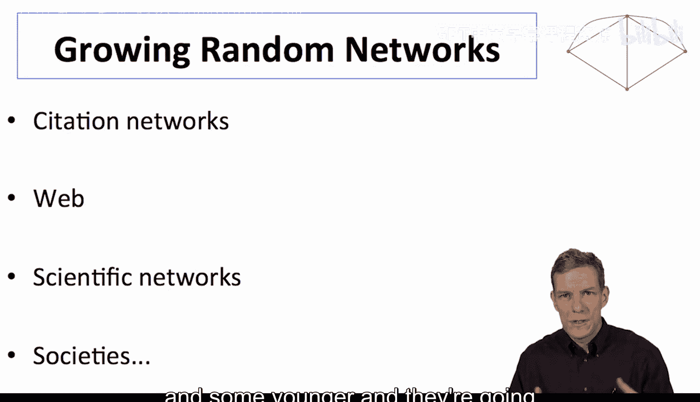

So let's think a little bit about what they add。 Why do we care about having growing random networks Well。

 one answer people say okay， what's more realistic and one thing I want to emphasize just from the start is when we build models we know that we're not going to try and capture everything in the world and so realism is not usually a good reason for building a model to try and match reality the reason that we build models is to try and use as few moving parts is possible in order to reproduce the world。

 So the only reason we want to add this feature of growing random networks is not because that's the way the world is but because this richer model might capture something in the real world that was not captured in aesthetic static models So again。

 you shouldn't judge models based on realism they're always wrong the question is are they capturing reasonable elements and so here the natural form of hetero。

versusus age is going to be useful in getting out more connected nodes and less connected nodes and starting to see power laws and fat tails so we're going to get a natural form of dynamics and in particular we're going to end up with a natural way of getting different degree distributions without just building them into the statistical distribution so we could just assume that there's a distribution which has the features of reality。

 but instead what we want to do is see if we can build a model thatll end up generating features that look like the real world and this sort of dynamics is going to help quite a bit。

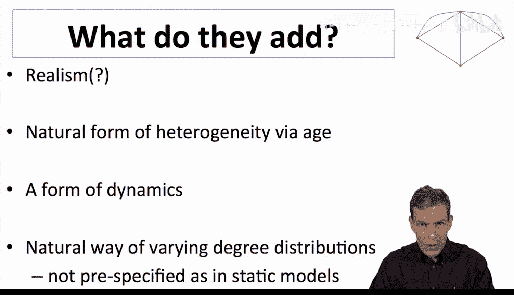

Okay， so in order to start this， what we're going to do is start by just taking yourda Rei random network situation。

 but instead just enriching it to have nodes being born over time。

 and so that'll be a simple benchmark that'll give us an idea of some of the techniques and then we can enrich it to have different kinds of formation processes besides the format at random。

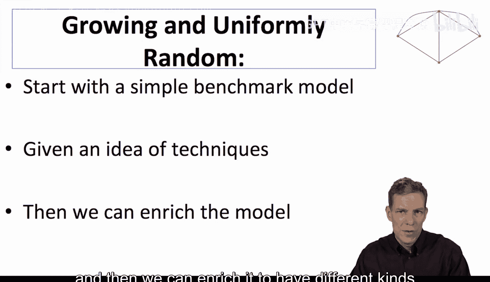

Okay， so this idea of growing and uniformly at random。

 what we're going to have is each day is going to be a new node's birthday。

 so nodes come in at time12 three4， etc ce， and when they are born they will form a number of links to existing nodes and to start in terms of this Erdaashrenni kind of setting what we're doing is we're going to assume that each node is going to form its links uniformly at random to the ones that are already existing out there in society so you're born。

 you decide who to link to， you form some number of links and you form them to already existing nodes to keep things simple。

 we're going to have the link formation process only occur when a node is born so you don't keep forming them over your lifetime you'll get new ones that's new nodes are born and they form their links。

 but a given node only forms its links it's outward links in。Some sense when it's born。

 but it can accumulate more links later on as new nodes are forming their links。

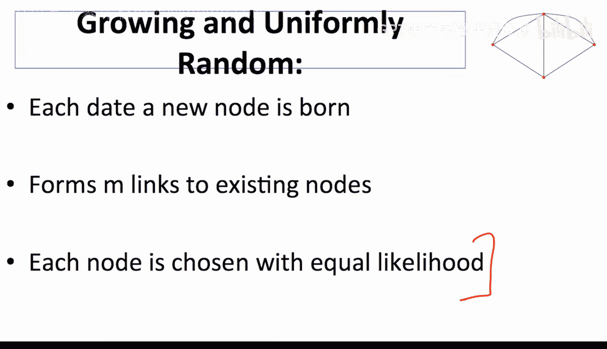

Okay。So in order to have some nodes that you can form links to when you're born。

 what we're going to do is each one is going to form M links at random。

 so we'll have M nodes that are already existing， which are fully connected so that when the first node is born it has somebody to connect to so the process is going to start out we'll start it with a very simple seed of already having some M nodes fully connected。

 you could start with a whole series of different situations that's not going to affect the asymptotic limit of it。

 it might affect what it looks like for the short periods of time until you get to a very large time。

Okay， new node is born， it forms M links to existing nodes， say two， three，4。

 whatever however menu we want， and what that means is if I'm already born and there's some time T then I'm going to have a probability that's roughly M the number of links being formed compared to T of the existing number of nodes that are already there of getting one of the new links right so。

M over T will give us the probability so the more nodes that are out there over time。

 the less chance that any particular node is going to get one of the new links right so very simple process。

 but it's going to have some dynamics to it。

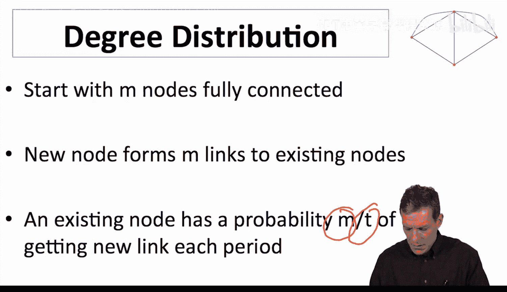

Okay， so now let's think about some node I that was born after the original M nodes that we started with that we fully connect。

And before some time T， okay， and now let's ask how many links it does it expect to have collected by time T？

Well， the first thing is that it forms some M links when it was born。

 So it's going to have M links for sure。Then in terms of expectations。The next day after it was born。

If it was born at time I， then the date now is I plus 1。And there's some new node， which is born。

 and it's forming its M links。 There's already existing i plus one links nodes out there。

 And so it has a chance M over I plus one of getting one of these new links Okay And then at time the next date。

 there's I plus2。 It's gonna a number of M new links are formed and so forth， right， So。

 so this is the overall sum of。What it's going to get over times right。

 So we had the first M that it got one at birth， the expected from the next node born and so on。

 So it has this sum。

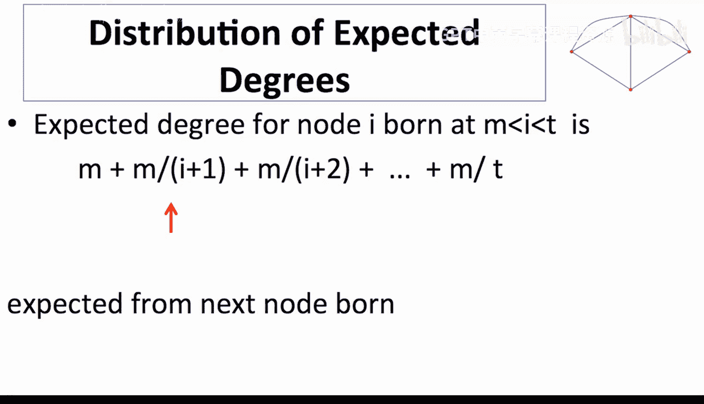

Now if you want to look at a sum like this， so you look at this kind of sum。

 is this what's an approximation for this sum， well these are harmonic numbers so if you remember your number theory these are what are known as harmonic numbers so they're growing proportionally to I plus some number so it's growing proportionally to the inverse of t and if you sum a series like this。

 an approximation for this is going to be m times1 plus log of t over I so depending on how far you go out and when you started this series you're going to end up with a sum that looks like this so we have an approximation for the expected degree is of any node after some time period T so very simple calculation and now what we can do is ask what does this generate in terms of the distribution of degrees in society or the distribution of expected degrees in society at any point。

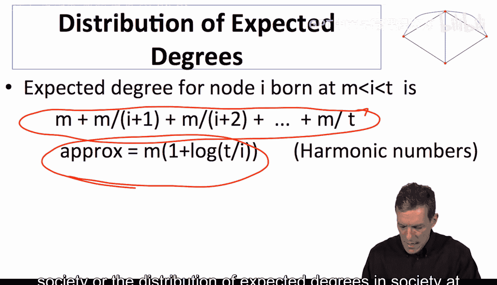

Time。Okay。So let's do a simple calculation how many nodes have an expected degree of less than d at some time T。

 Well it's those for whom their expected degrees at time T are less than some D so if you say okay。

 how many you're going to have degree less than 100。

 then we can ask that or how many you're going to have degree less than 35， we'll get some number。

 so at time T it's going to be the eyes for which this inequality holds。

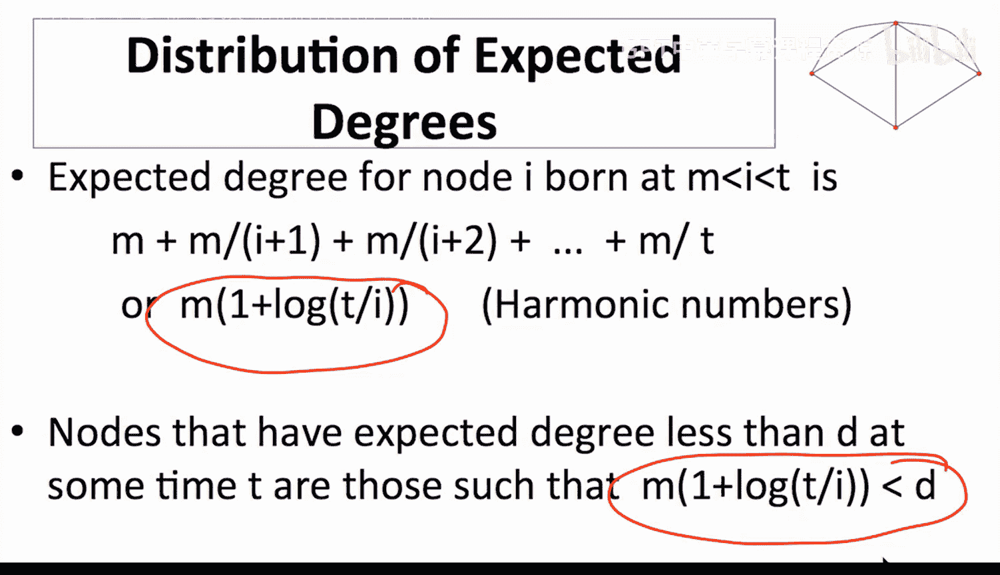

Okay， so let's have a look at that inequality in more detail。

 So let's suppose that we did this calculation at time 100。So we've got here our T。Is 100。

 and let's suppose that each node at each time is forming 20 new links。

So what does the degrees of different nodes look like at time 100？

So here we have the birth date of the node。 So here is birth date。Of the node。

 And this is then the equation that we had， so。So this is our equation that we had in terms of m times 1 plus log t over I right。

 so this equation right here is M times1 plus log。T over I。So that's plotted out here。

 And what that means is， as you can see， the older nodes。

Have gotten more links than the younger nodes。 So the youngest node has only formed its 20 and not gotten many more。

 Some of the slightly older nodes have gotten a little bit more than 20 because they've happened to get some of the new ones。

 These ones that have been around for a longer time。

 they've gained more links and the reason that you have curvature here is it was easier to get links early on。

 and as more and more nodes are born， it's harder and harder to get the new links。

 So ones that are born later and later are going to have a harder time gaining new links than the ones that were born earlier and could get one。

 So you get a natural curvature there just due to that fact。

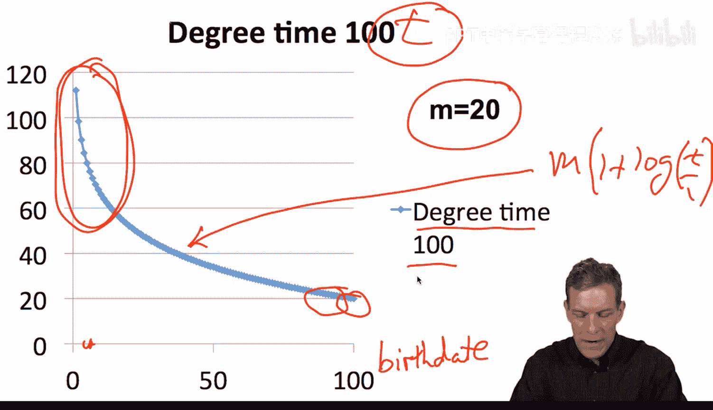

Okay， so。What do we get Well， we can do the same thing for degrees at time 200 and degrees at time 200 will have a slightly different curve and you know the ones that were born at 100 at time 100 now we' have had a chance to gain more links Everybody's gained more links how much they've gained more depends on what their birth date was and now we've got the 200th node born has just formed its initial 20 links and so forth。

 so we're gonna to get different degree distributions at different times will have a different this is expected degrees over time will have a different distribution as time evolves Okay so what is this distribution look like Well we can ask then what are the nodes for instance。

 that have degree less than 35 What's the fraction of nodes So let's go back to our time 100 and figure out what is a distribution function So what you know how many nodes What is F of D look like So how many nodes have degree less than some D So what is F。

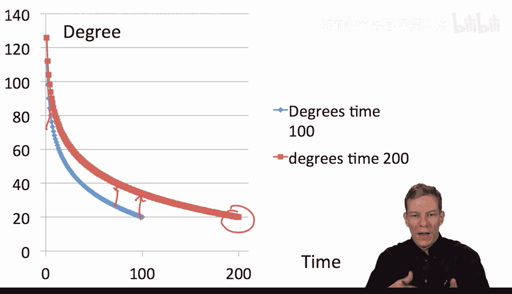

Of 35 look like。We can do that kind of calculation Okay。

 these are the nodes the degree less than 35 are the ones are expected degree less than 35 there's going to be some node which has expected degree right at 35 and basically the nodes with degree expected degree less than 35 are going to be the ones that were born afterwards。

So these ones， so if we want to figure out the fraction of nodes that were born that have degree less than 35。

 it's going to be the ones that were born after this compared to the overall 100 that exists in the society so far。

So let's go through that calculation。So what we want is the。Actual amount that they have。

 the expected degree they have。 Remember， this is M。1 plus log。T over I。So here we have T is 100。

M is 20。 So these are the nodes for which this equation is less than 35。

Okay we got that and so if we solve that equation， then what do we end up with。

 we end up with these are the eyes for which they're greater than you know just take exponentials of both sides of this solve out for I and what you'll get is these are the eyes for which they were born after time 47。

2 So basically the ones that were born 48 or later are going to have expected degrees less than 35。

 the ones that were born 47 and before are going to have expected degrees bigger than 35 so this is 47。

2 this point right here and now if you want to ask what's the fraction of nodes that have degree less than 35。

Well， that's going to be the 47。2， so we're going to have 100 minus47。2 over 100 right。

 so this is going to work out to be 0628。So the fraction of nodes roughly 63% are going to be the ones that have degree less than 35。

 so somewhere between 62 and 63% in this case have expected degrees less than 25 so given this process we can figure out how degrees grow。

 we can figure out a degree distribution。

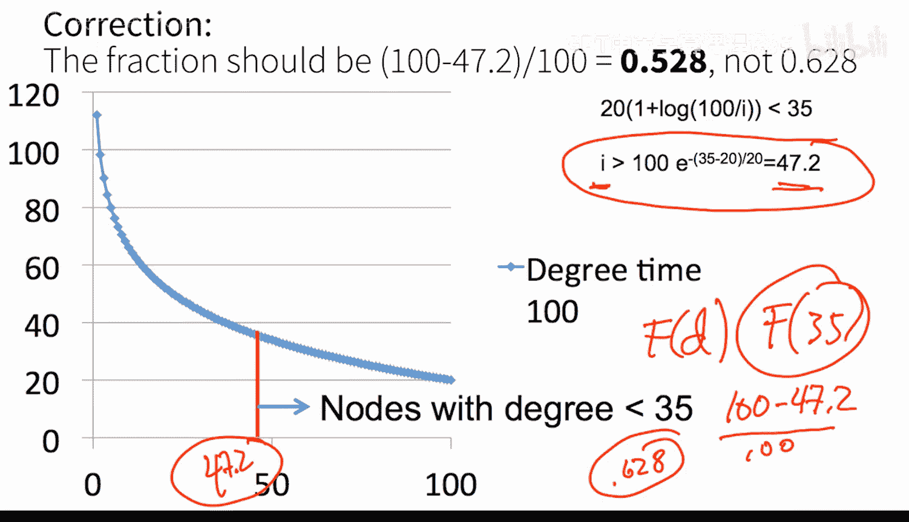

And more generally， for any degree， the ones that have expected degree less than d at some time are going to be the ones for which I is bigger than same solution as we just saw for the 35 T times E exponent of minus D minus m over m。

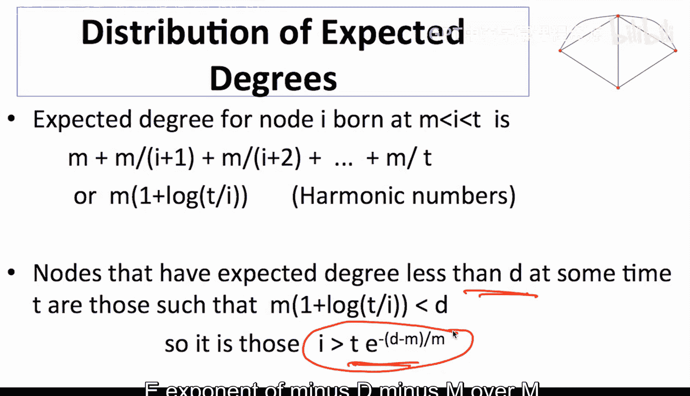

So if you go ahead and solve that out， what we'll end up with is a degree distribution at time T that says the fraction of nodes that have an expected degree of less than D is given by this formula 1 minus E to minus d minus m over M。

Okay， so very simple set of calculations， a little bit of algebra involved， some exponentiation。

 some summation of series， but basically what we're able to do is now calculate what the degree distribution looks like for this growing random network。

This is an exponential negative exponential distribution。

 so what we have is the distribution of expected degrees is such that D minus m is exponentially distributed with a mean of M。

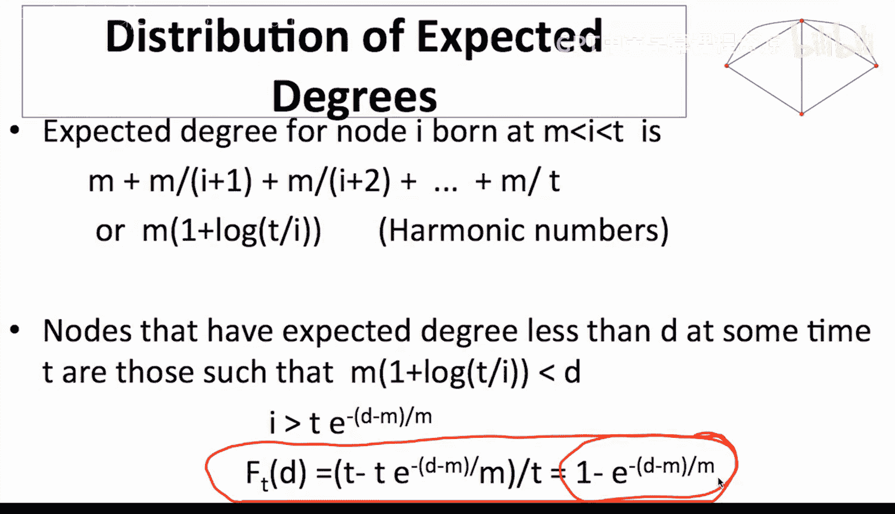

嗯。What about the actual degrees Well， a good approximation for large t we're going to have to know so here we did the calculations of expected degrees right so we can say how many each node expected and we got a nice curve。

 Well some nodes are going to happen to get more some are going to happen to get few So the actual degrees of the true nodes are not going to follow that really nice smooth curve。

 they're going to bounce around a bit and what that means is the distribution can be slightly different than this distribution of expected degrees It turns out that this distribution of expected degrees is a good approximation of what the actual distribution of degrees will look like。

 some will end up pushed above， some will end up pushed below but on average you'll still expect around 63% to have degrees less than 35 at time 100 and so forth so if you go through and actually calculate the true distribution function it's going to look as t becomes large it's going to be。

well approximated by this negative exponential function now actually doing that you need some careful law of large numbers arguments I'm not going to do that here in the book there's some discussion of how you go about doing that it's fairly straightforward again it's just making sure that the variation in the actual distribution isn't too large as you get to a large T the noise in the system is going to be well approximated by the mean。

So here we've got a distribution of a growing random network， things have worked out well。

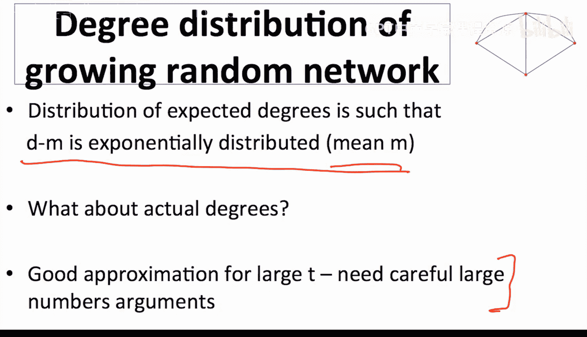

Okay， so in terms of where we're going next， we'll look at slightly richer growing models。

 we'll also talk about doing mean field approximations and other kinds of ways of calculating these things so we'll look at another set of growing random network models that will allow us to get richer and richer degree distributions out。

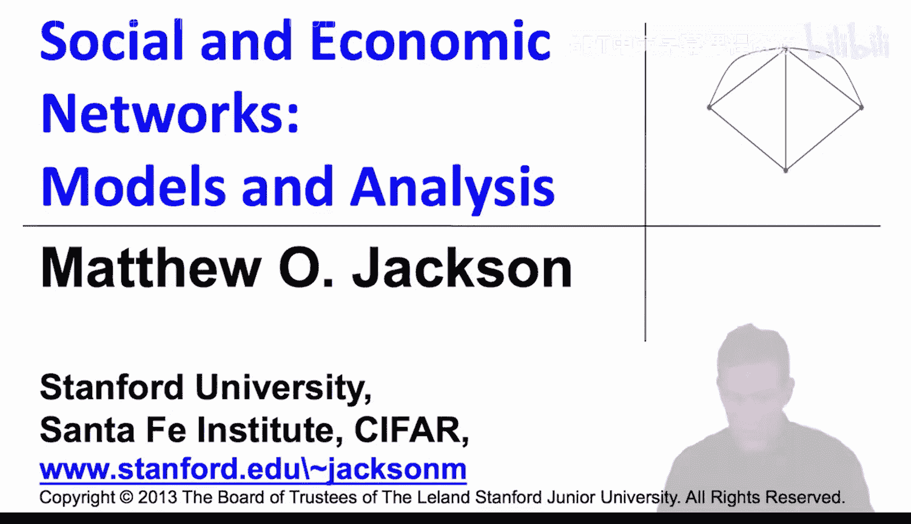