# 斯坦福大学《社会和经济网络：建模与分析｜Social and Economic Networks： Models and Analysis》中英字幕 p25 25_03_02_3-2-平均场近似.zh_en -BV1v1421U7Nk_p25-

i folks so let's have a deeper look now at these growing random network models and in particular we're going start talking just about meanfield approximations a useful technique for solving these kinds of models So one thing we can do is instead of actually working out the expected number of links that each node is going to gain over time we can use a continuous time approximation which will allow us to just solve a differential equation to figure out what the node's expected degrees should be over time So what we can do let's just go back and think again about our simple Erdarenni variation where now each node is born forms M links at random to the existing ones。

 but we'll just smooth this out and do a continuous time approximation So what do we end up with in terms of the basic structure here。

 well first of all starting condition， when a node I is born So it degree at time I is going to be M so when it first is born it forms its M new links。

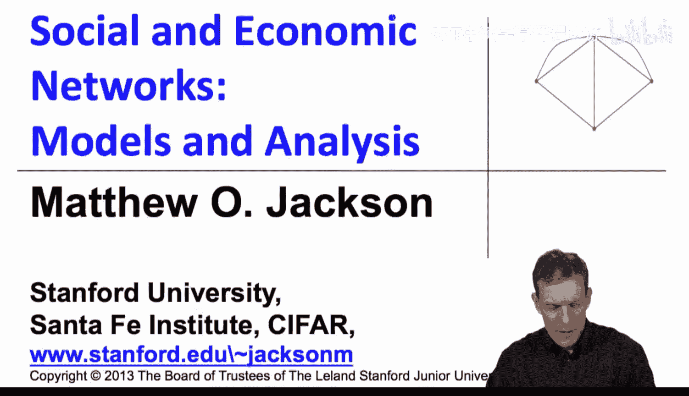

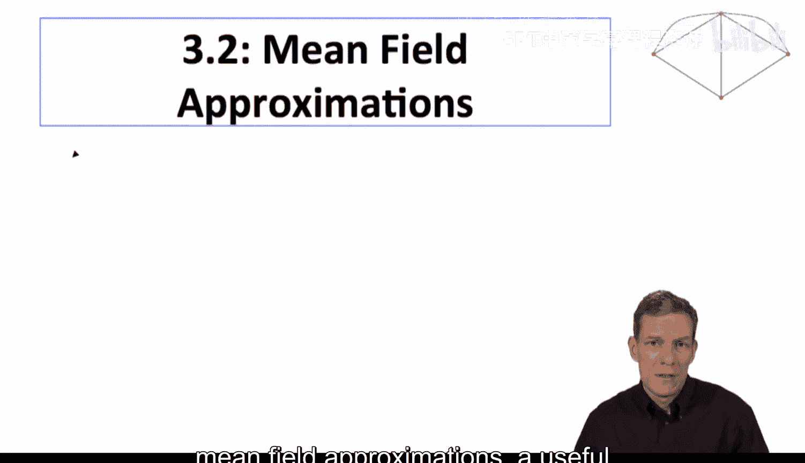

And then how does its degree change as we change time so what's the differential of the degree of I with respect to time T Well this differential is it's expecting to gain M links over the time period so there's T existing nodes M new links being formed so it's chance of getting one of those is M over T so it's gain per unit of time is going to be proportional to M over T and so now we have a differential equation which says that this is the change over time。

 this is the initial starting condition and that's something that's fairly easy to solve so if you solve a differential equation with this starting condition and this differential what you end up with you end up with D of T is equal to M plus M times log T over I It's exactly the same equation as before and then you can just do the same of the。

Where we' try and figure out well， how many nodes have degree less than 35 at some time t。

 well that's going to be the ones for which this equation is less than 35 and so figuring out the distribution function once we have this degree over time is quite simple。

Okay so this is just saying that we could have done this with a differential equation can be quite a bit easier。

 basically we set up starting conditions differential and then if you either remember your differential equations or you can go and look them up and find the solution for this kind of equation。

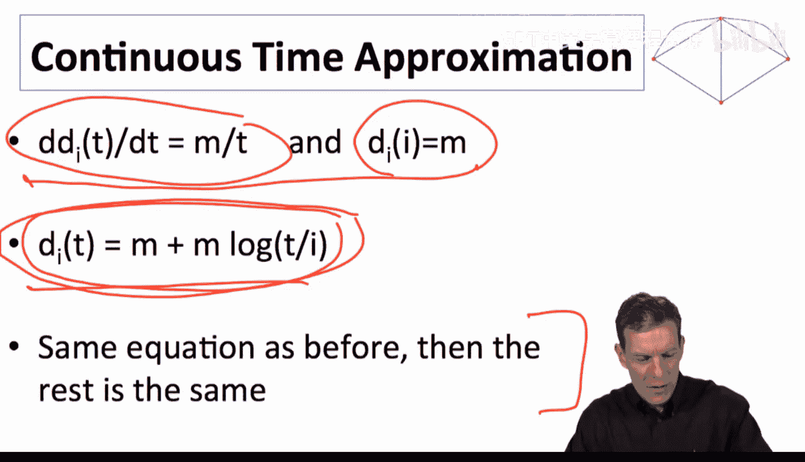

Okay again so what we've got now is we've talked about these growing distributions。

 let's get into them in a little more detail now so we said that this gives a natural form of heterogeneity via age and we saw that in the other distribution older nodes are going to have more links it gives us a form of dynamics and in particular this is going to give us a natural way of varying degree distributions by making different assumptions about the way that new nodes form their degrees so depending on how they form those we can end up with different degree distributions so let's have a closer look at that question。

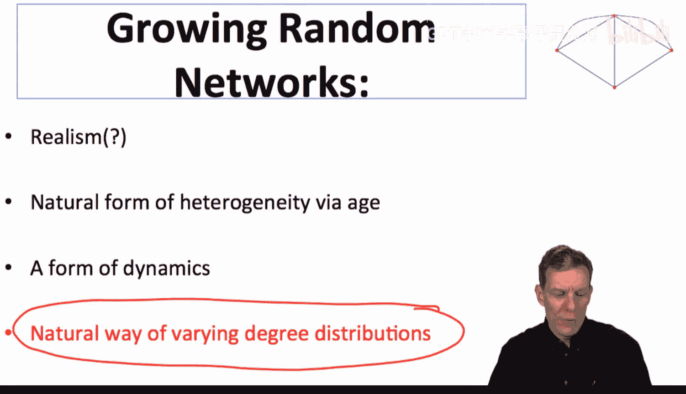

So preferential attachment is one of the most wellknow of these alternative methods of forming new links in one of these growing systems。

 and this is different than just forming links uniformly at random。

 and in particular it's going to help us get things like other degree distributions such as say a power law where we have these fat or tails。

 more degrees that have extremely high and extremely low numbers of links。

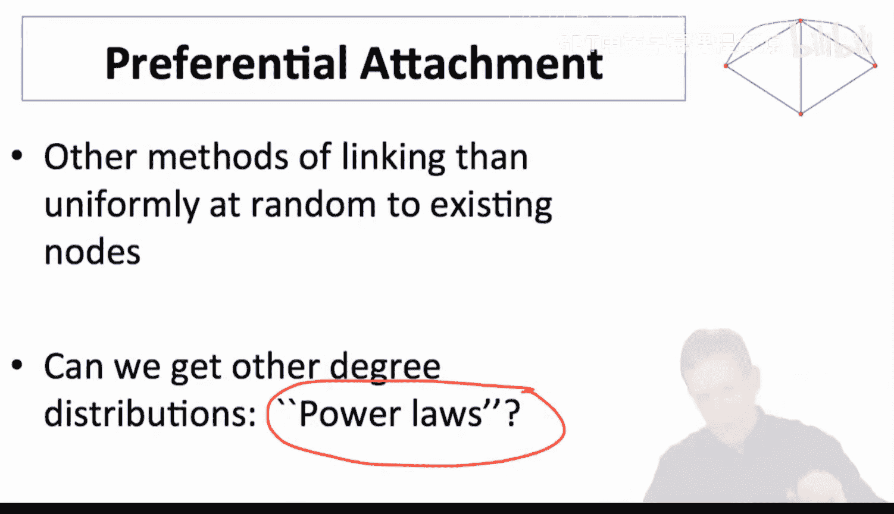

So again， just to remind you， prices finding in citation networks was one of the early sets of evidence on this where citation networks had too many that had no citations。

 too many with high numbers of citations for these things to becoming coming uniformly at random。

It exists in a lot of other settings， wealth， cityside word usage。

 a lot of things have these kinds of fat tails， and we saw this in terms of the Albert J and Barbassi analysis of the Notre Dame part of the worldwide web where we see that the number of nodes that have high degree and the number of ones that have very low degree exceed what would be coming up if it was uniformly at random and in fact just to let you know now this curve is the one that's actually coming from a growing random network。

 the exponential one that we just saw and in fact we're still seeing these things exceed that curve so when I talked about this being a random network uniformly random network earlier in a course。

 in fact， this distribution corresponds to uniformly at random but one with growing numbers of nodes over time and so that's not quite enough to capture these fat tails still。

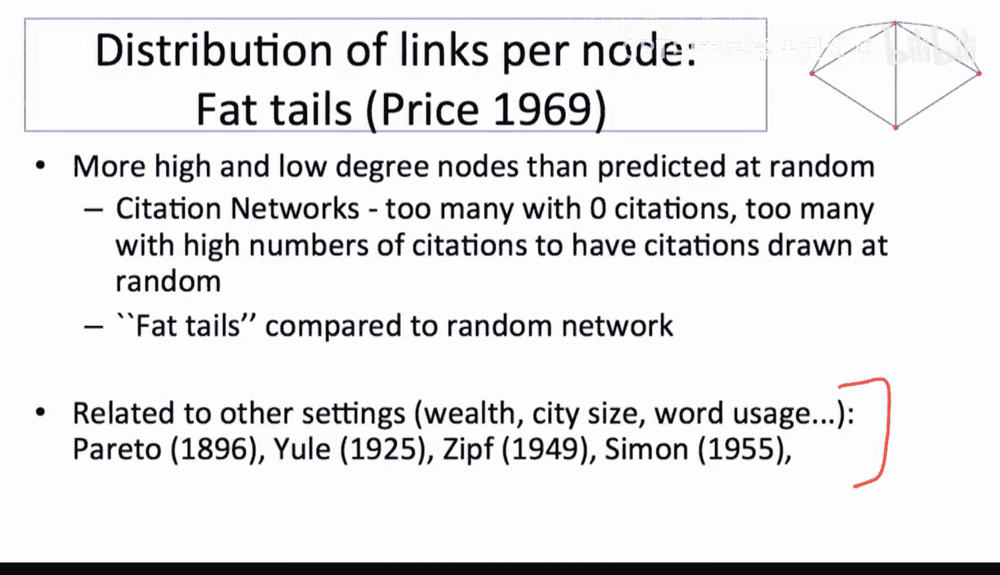

Got a fatter tail than that。

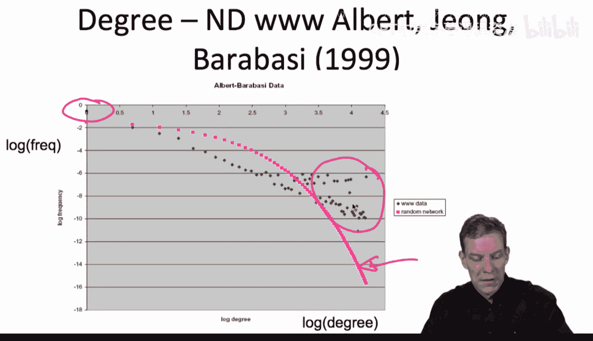

And power these kinds of power law explanations， worked by Simon in the 1950s。

Gave an explanation for how this might occur and there's sort of two different properties which are important in these kinds of systems。

 one is that new objects are growing coming in over time。

 so we've got our new nodes coming in over time and the other is a sort of rich get richer so the more links you have。

 the easier it is to get links， so more wealth you get， the easier it is to get more wealth。

 the bigger your city is， the easier it is to get more population。

 these kinds of things where you get a multiplicative growth。

 together with new objects being born over time， so new articles， new cities in this case new nodes。

 those things being born over time， are going to gain proportionally to how large they already are and will' end up with power laws。

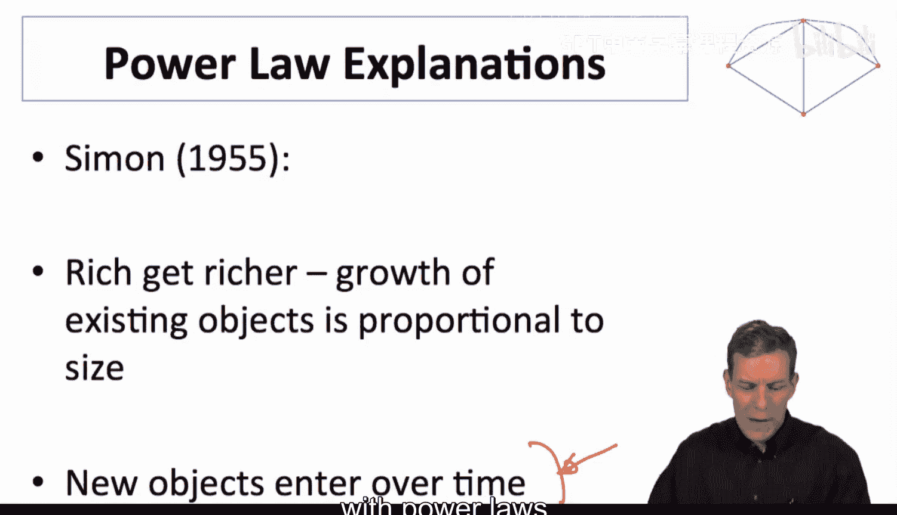

So the preferential attachment。Price had a paper which worked at a simple version of this through citation networks。

 Barbasi and Albert generalize this to a more general class of preferential attachment things and again the previous models aren't generating fat enough tails and so now what we're going to have is nodes are still going to be born over time just as we talked about before。

 but now instead of forming links at random with existing nodes uniformly at random the probability that links are going to form is going to be proportional to the number of links that a node already has。

 that's going to be the rich get richer part and that's the preferential attachment I prefer to attach to nodes that already have high numbers of links okay。

So that's the system that we're looking at。

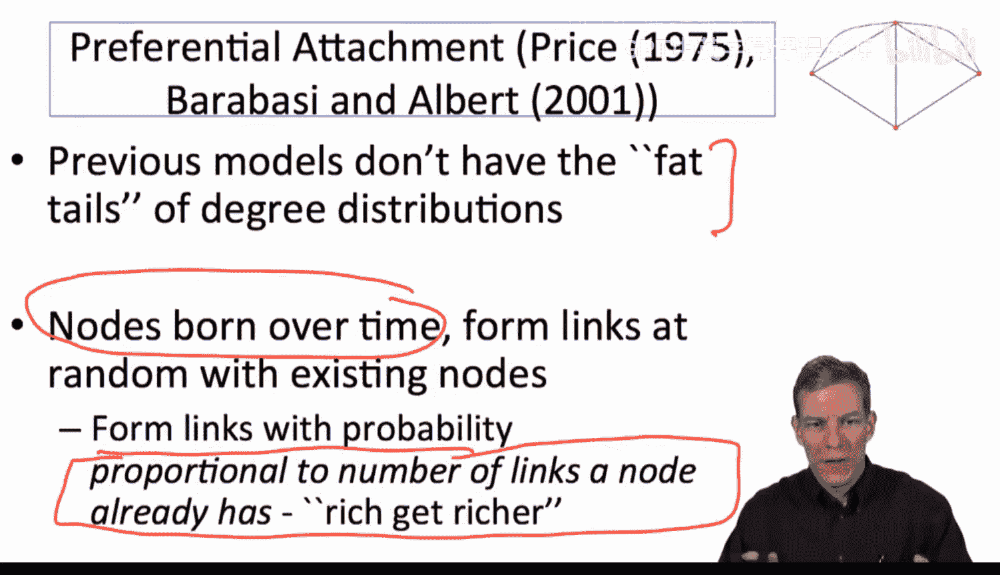

If you generate a network that looks like this so here's 25 links。

 preferential attachment simulation and what do we see well we begin to see if you look at some of the older nodes。

 the nodes born in early time periods2，34， they have many more links then the ones that were born at later time periods so in this case everybody was forming two links。

 the ones that were born later high number nodes， 23 15。

25 here 21 managed to get an extra link so there's a few that gained extra links that were born late。

 but most of the ones that gained extra links where ones that had links to begin with and then it was easier for them to get more links and the more you get the more you grow and in fact the largest degree node here is node 2 and so we see a system which has preferential attachment and we see a more skewed network than we see via Ndarini kind of system。

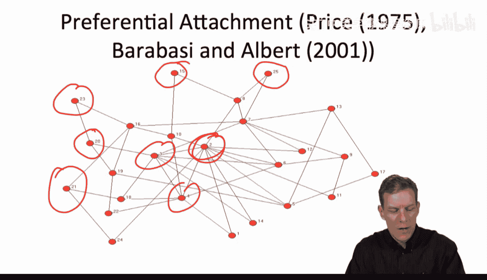

So what we're going to do next is take a deeper look at exactly what the distribution is。

 how we can solve that for preferential attachment。

 and then begin to look at the comparison between preferential attachment and other models of network formation。

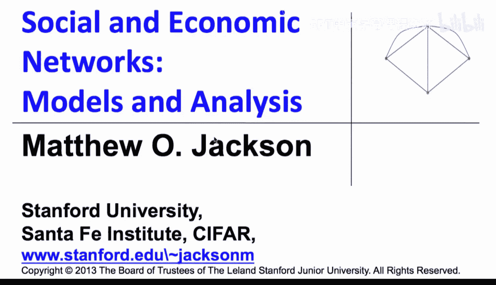