# 斯坦福大学《社会和经济网络：建模与分析｜Social and Economic Networks： Models and Analysis》中英字幕 p26 26_03_03_3-3-优先连接.zh_en -BV1v1421U7Nk_p26-

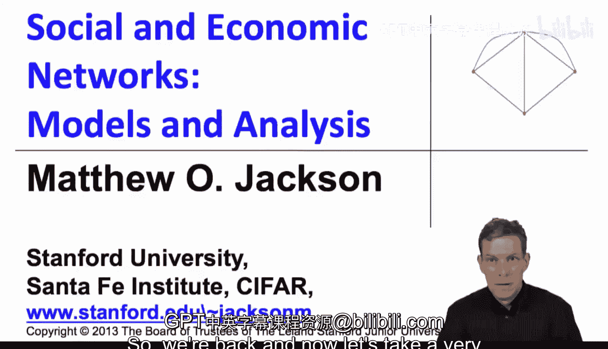

So we're back and now let's take a very close look at preferential attachment and begin to understand how it generates links and degree distributions。

 so preferential attachment So the idea now is newborns again are going to form M links to existing nodes born on each period so time just keeps track of birth dates and you could adjust it however you like。

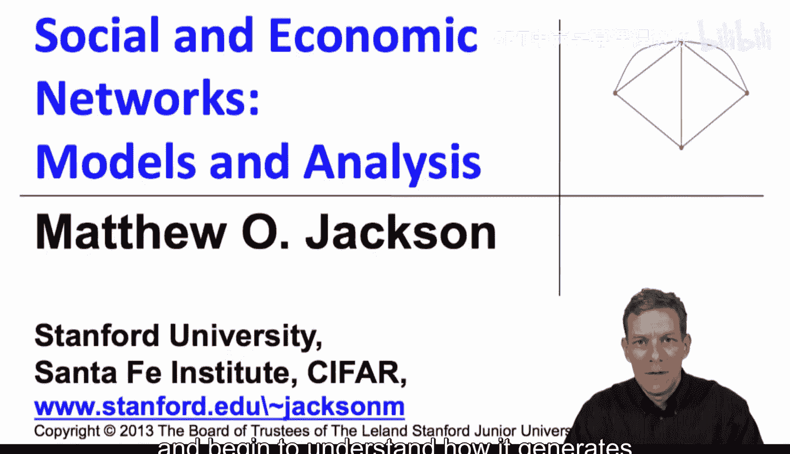

So the important thing now is the formation process is going to be different so at some time T the number of links that are going to be in the system are going to be TM links right there have been T nodes born they have each form M links so TM in total and the total degree is then two times TM right so each link has two different nodes that are going to get to count it as a link so we have two TM as a total number of degrees in the system at any point in time。

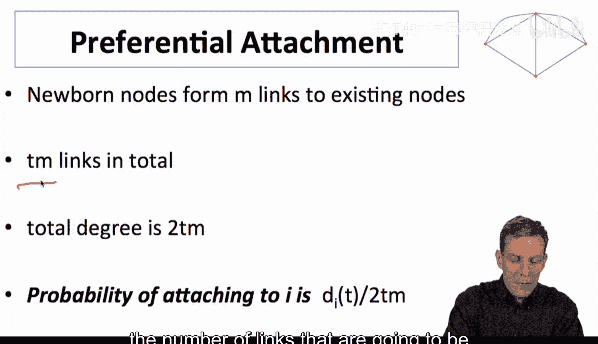

And the probability of attaching to a given node is proportional to its degree compared to the overall degree in the society。

 so nodes that have very high degree are going to have higher chances， and so in particular。

 the probability of attaching to a node I。

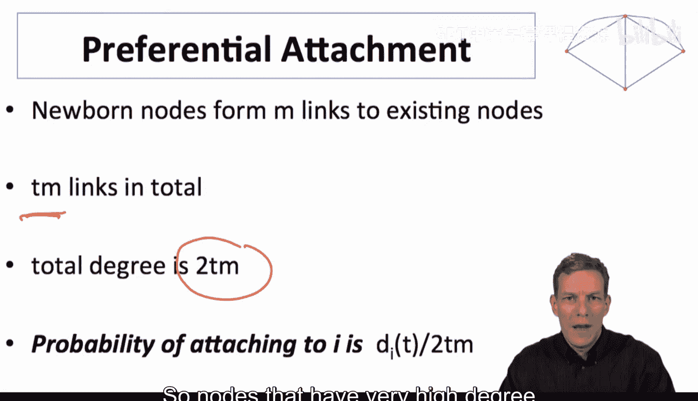

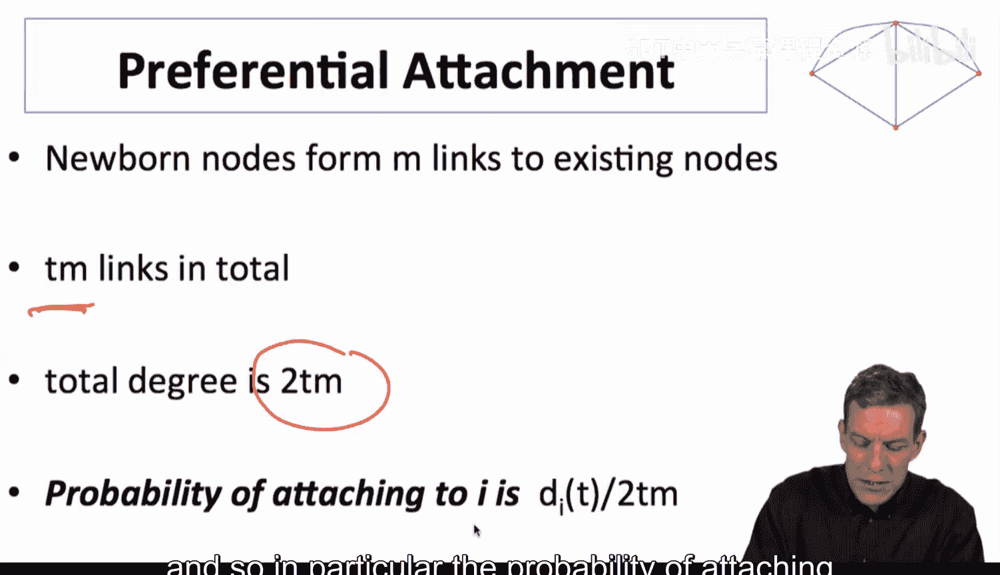

Is going to be its degree divided by 2 TM， which is very different than the M over T that we had before。

 So before every node that was out there had an equal chance of getting a new link。 Now。

 the chance of getting a new link is proportional to your degree。

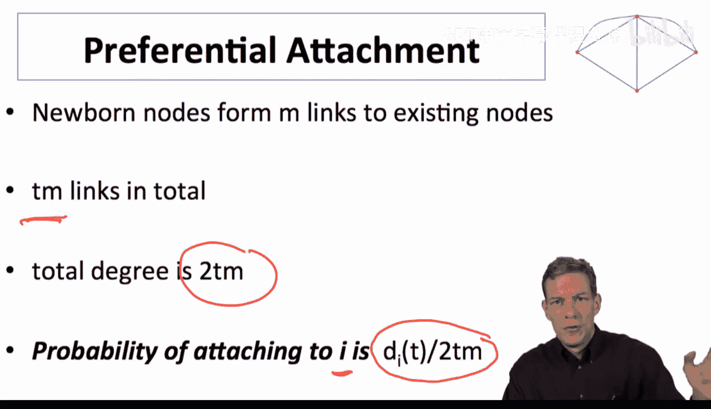

Compared to the overall degree in the society at that time period， okay。

 so this is the proportional attachment rule， the preferential attachment for which this model is known。

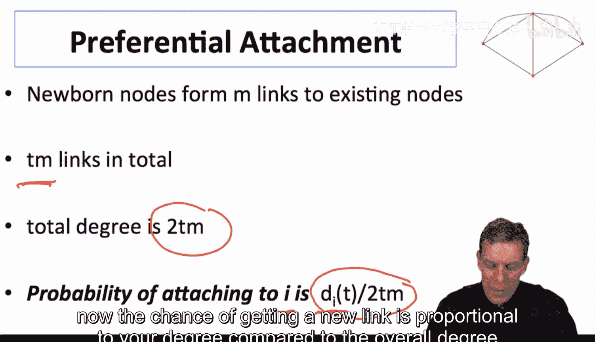

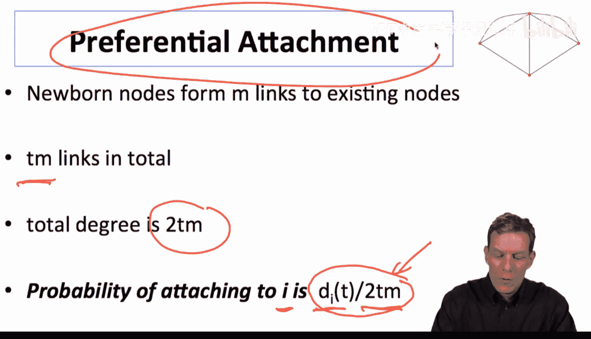

Okay so let's do a mean field approximation， so again we're going to do a continuous time of approximation。

 we're going to be really finding the degree of the distribution of expected degrees and then to check whether this actually matches the real degree distribution。

 we could simulate the model and see whether this is giving us a good approximation。

 there have been theorems now which show that the mean field approximation of this particular model works well。

 when we get to richer models that are different from preferential attachment and the exponential model。

 then we're not going to know whether or not that the actual degree distribution is wellmatched by this approximation。

 but we can always check and simulate the model and then make sure that what we're getting out as the closed form solution from this kind of system is not too different than what happens from the simulations。

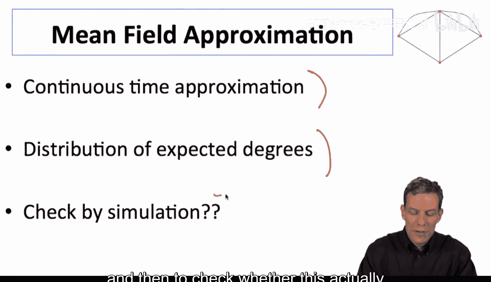

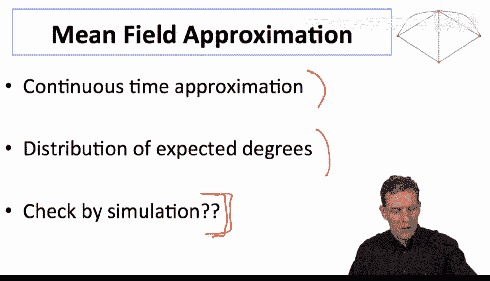

Okay， distribution of expected degrees so again when you're born you form M links so that's the initial starting condition how does your degree change well you're getting new links at a rate which is proportional to how your degree compares to 2t over M there's M new links being formed per unit of time therefore this differential has this equation and we can cross out the M's and the numerator and denominator and so what we'll end up with is a simple differential equation right so we end up with the derivative with of the degree with respect to time is just looking like the actual degree over 2t。

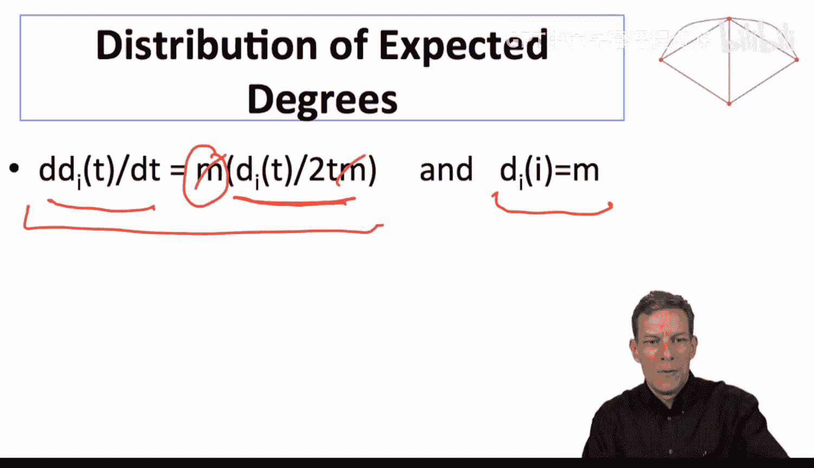

And we have a starting condition。Differential equation。

 This one's even easier than the last differential equation to solve。 in fact。

 so the degree looks like M times the time over the birth date raised to the one half power。

 So square root of T over I。 So a simple square root equation。

That gives what the degree should look like over time okay so we've got a very simple equation for the degrees and we can compare that so let's go back to the situation we looked at before where people were forming links uniformly at random let's again have everybody form M equals 20 links when they're born and let's compare what happens when they're forming the links uniformly at random compared to preferential attachment and what we see is that the preferential attachment is in some sense it's a steeper curve here and it ends up with more degree more high degree nodes。

 the older ones are higher degree than the uniform at random and then the younger ones are actually lower degree it's harder for them to get new links because they have lower degree and the older ones now have an added advantage not only of being older and they've gained things but they're also you're gained things proportional to how large you already are so the older ones are even easier to find。

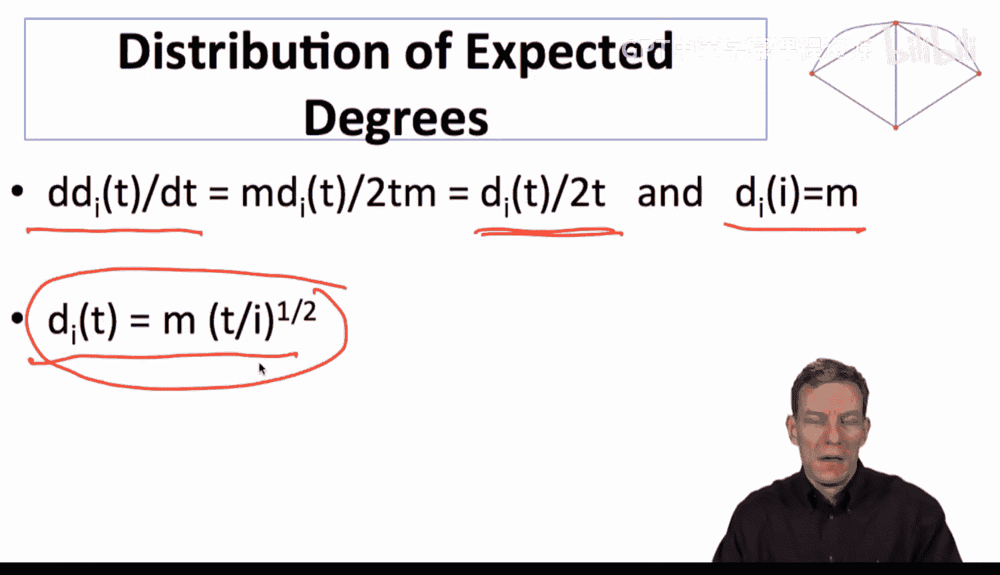

eaasier to attach to under preferential attachment。

 so they get this extra bump where we see the extra bump in the curve。

 so this is going to give us the fat tails， the fact that we've got this extra bit here and this bit lower means we're going to have more with high degree。

 more with low degree and that's going to generate the power law that we're looking for。

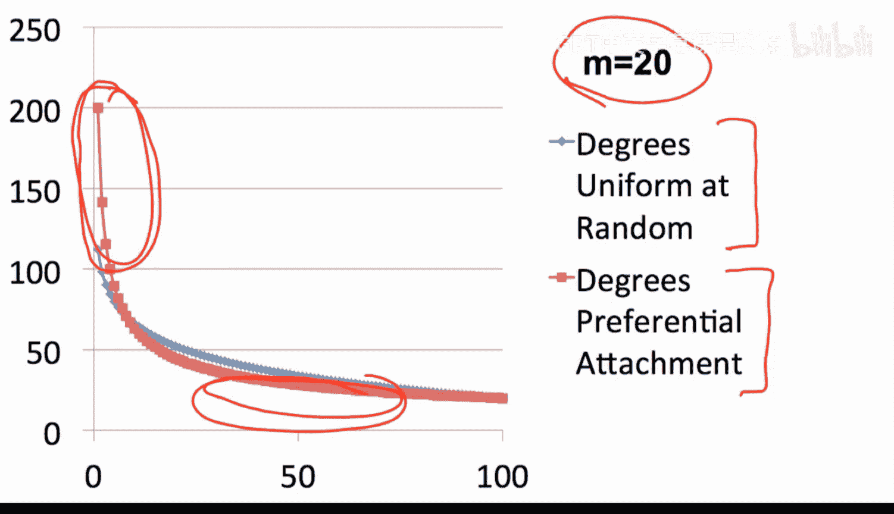

Okay so now degrees under preferential attachment， let's figure out the degree distribution。

 we can do the same kind of calculation we did before which are the nodes with degree less than 35 at some time well we just solve for this curve。

 which are the ones that have degree exactly 35 it's going to be all the ones that are younger than that so born after that time period。

 whatever that time was and then we can figure out what's the fraction that have that so we'll be able to figure out our distribution function F of D。

 the same technique that we used before but now just with a slightly different equation that we're using to solve that same system。

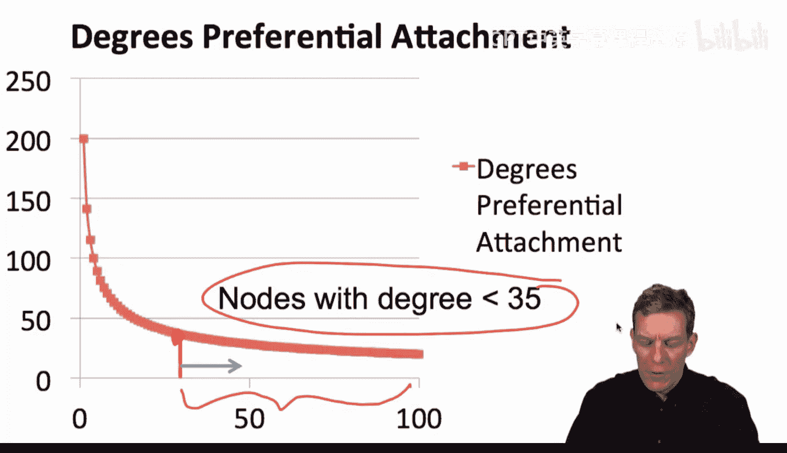

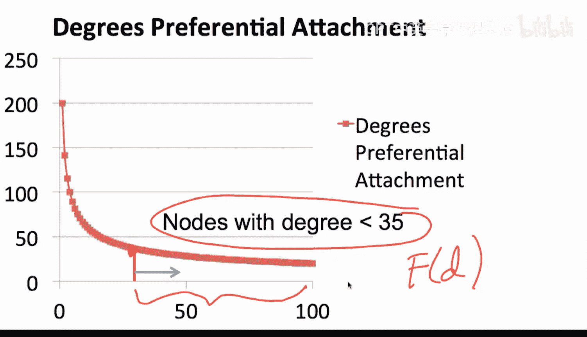

So remember your degree at time T is M times t over I to the half。

 so the nodes with degree less than 35 are going to be the ones for which this functions less than 35 so 35 has to be bigger than our M here is 20 T equals 100 so if you solve that out and solve that for I you get that I has to be bigger than 32。

7 So now this is 32。7 as opposed to the 42 something that we had before so what's the fraction that have degree。

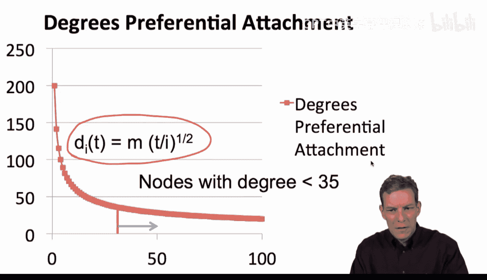

Less than 35 at this time， well， it's going to be 100 minus 32。7 over 100。

And then we can solve that out。Right， so roughly something like 68% of the nodes are going to have that property。

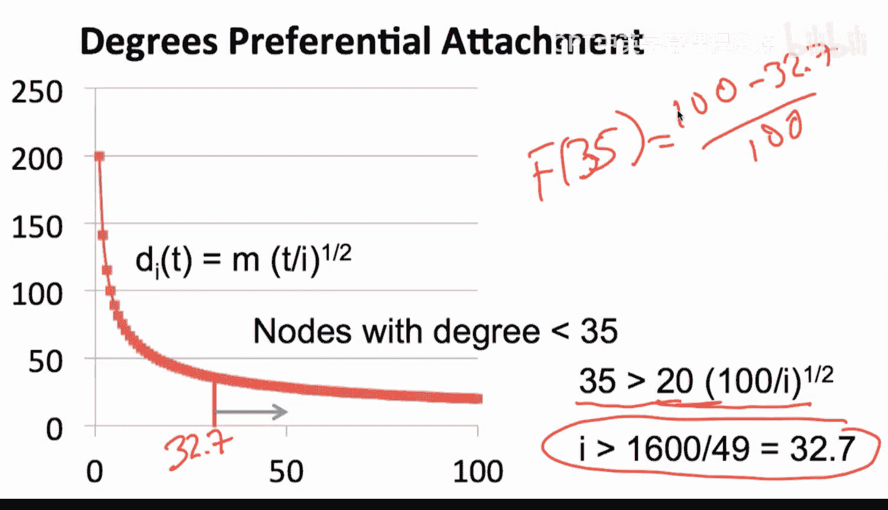

嗯。So when we look at this， just solving it generically， again， we've got this equation。

 the ones that have degree less than D are going to be the ones where this equation is less than D and therefore these are the I's that are greater than T times M squared over d squared and now then to solve for F right so we've got the fraction。

 these are the I's。

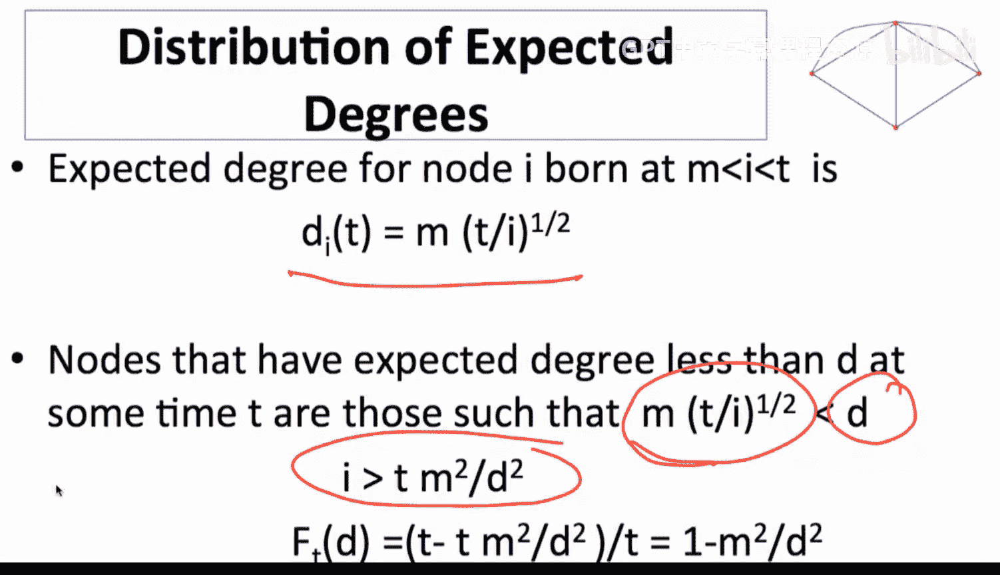

Beyond some level， so going back， we want to find the what's the fraction of eyes。

Above some degree D。 Well， we're just going to take the T。Minus these eyes。Over t。

 that'll give us the F。RightSo F is just t minus this compared to t which works out to be1 minus m squared over d squared。

 So we have a very simple equation for the degree distribution。

 So our degree distribution looks like1 minus M over D squared and if you take the derivative of that and look at what's the density function for the distribution generated by preferential attachment。

 it's two m squared over d cubed。 So this is proportional to d to the minus3 right so we've got two m squared So this is our constant times D to the minus3。

 So now we have a power law。 we have exactly something which looks like a power law and indeed when we take logs of each side。

 we get the log of f of d looks like log of2 m squared minus3 log of D。

 So we've got a nice linear equation in。

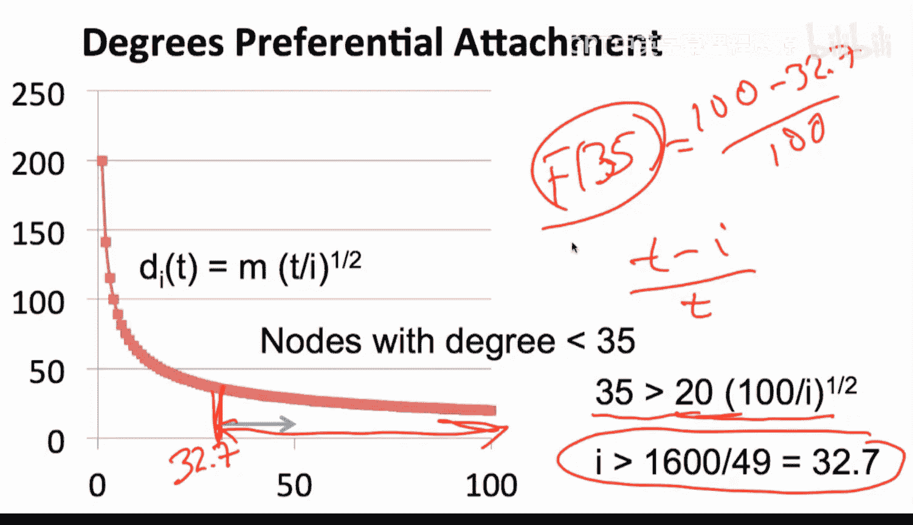

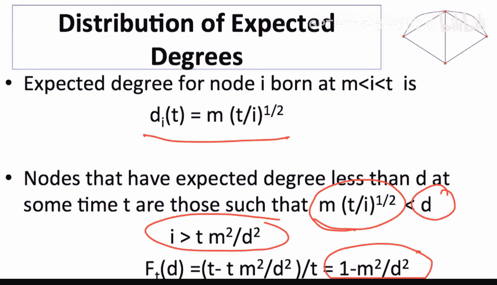

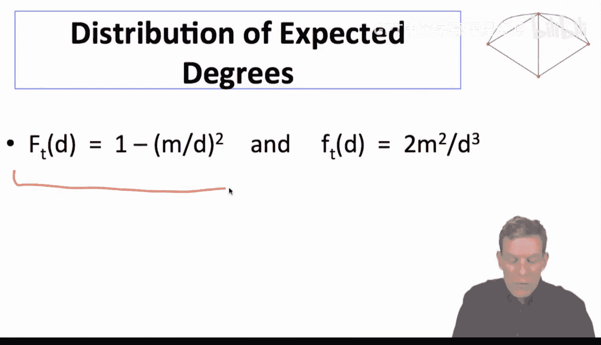

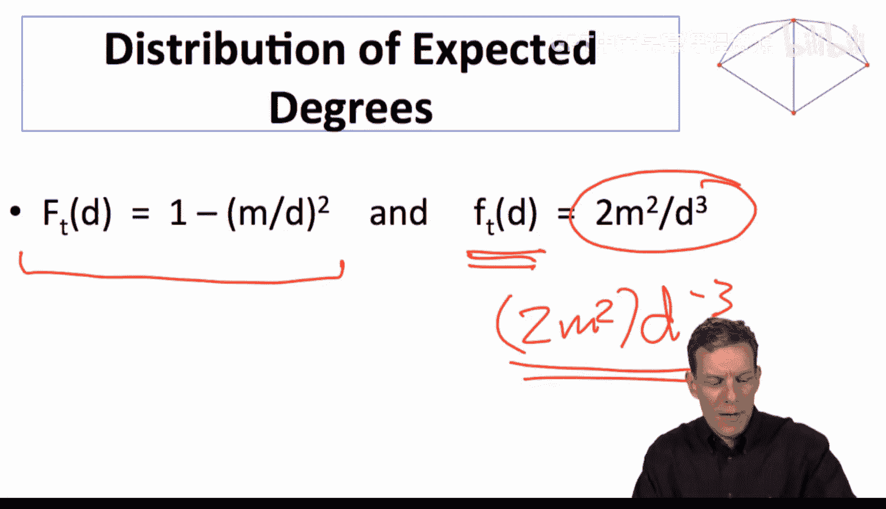

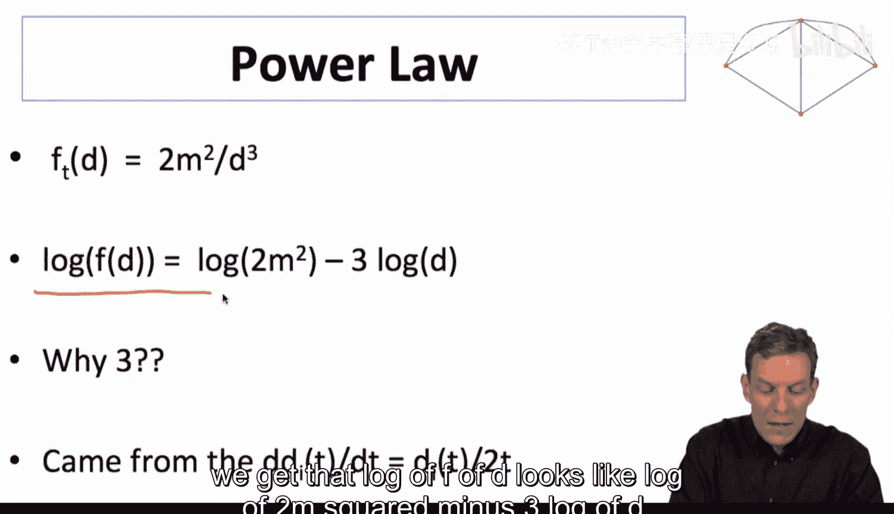

In log plots， which is exactly the power law that we were looking for。And in particular here。

 one thing that's sort of interesting。 when you look at the coefficient that came out。

 it's exactly three。So Y3， well that came from the fact that the change in degree over time had a two in a denominator and then when we do integration and so forth we came out with a three。

But basically that is coming from the fact that there's a certain number of links present in the society。

 and if you want to vary this， you can actually produce different variations on this coefficient。

And the way you can produce different variations on this coefficient is just having the number of links being formed at any point in time。

 either grow or shrink over time， so you can have the population。

 the number of newborn nodes not be a constant one per period but changing over time and thatll allow you to control this variable here so a slightly richer variation of preferential attachment can adjust that there's actually an exercise and the book I wrote that that shows you how to do that。

 but basically the idea here is that you can get different variations here by just changing the rate at which the system grows。

 but the important thing is that the fact that the older nodes are gaining things that are richer a faster and faster time meant that then we end up with these fat tails and a power law。

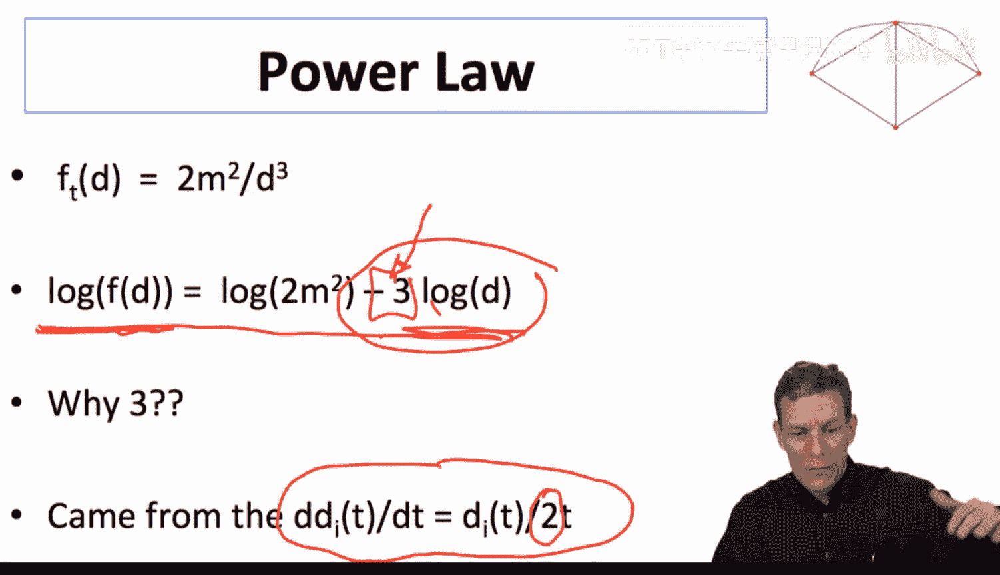

Okay so we've gone through a couple of different growing systems what we'll do next is try and enrich this a little bit more to span between the sort of uniform at random and preferential attachment and then that'll allow us to actually take these degree distributions and take them to data and see which ones actually match the data so which is the actual preferential attachment a good match for for the worldwide web data does which ones match the romance networks etc ce。

 so can we find。

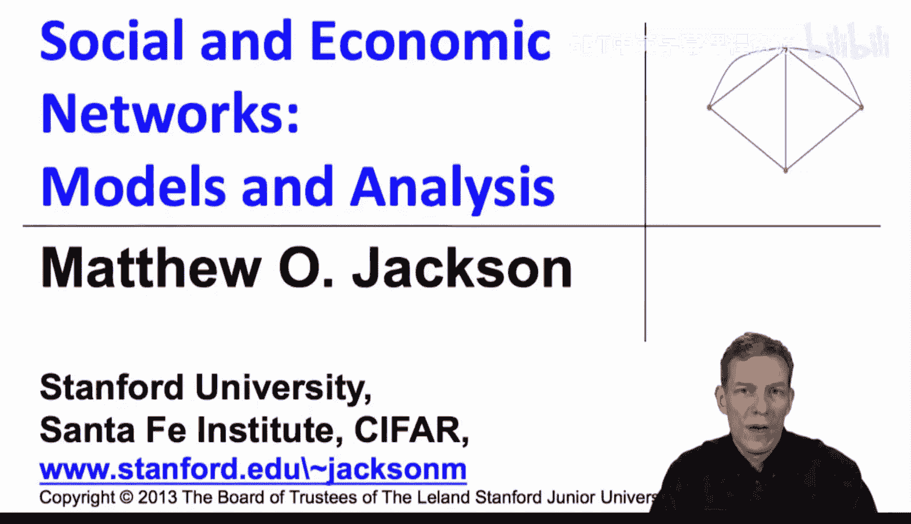

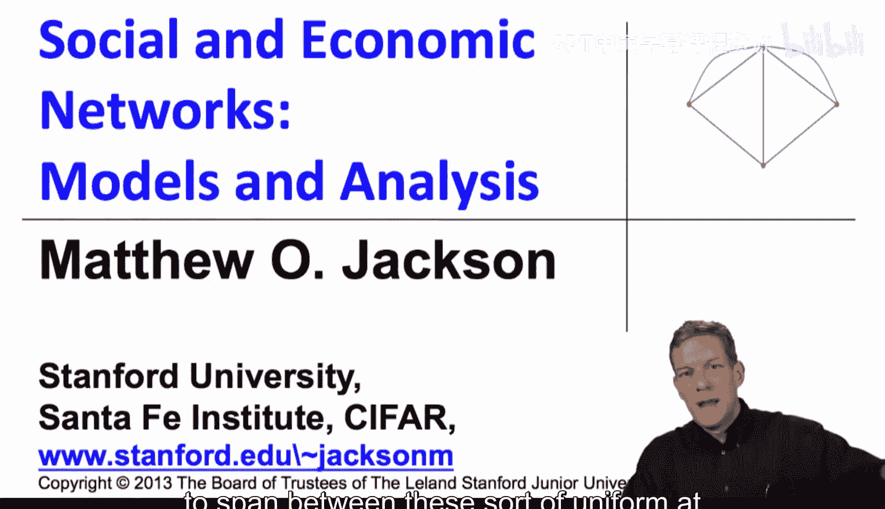

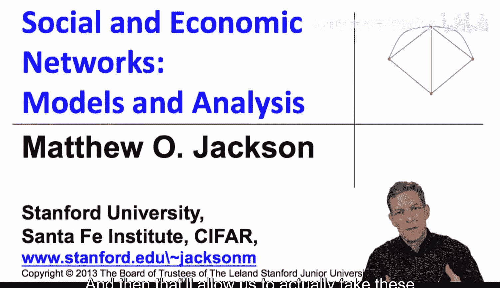

Variations on these models that actually match the observed data。

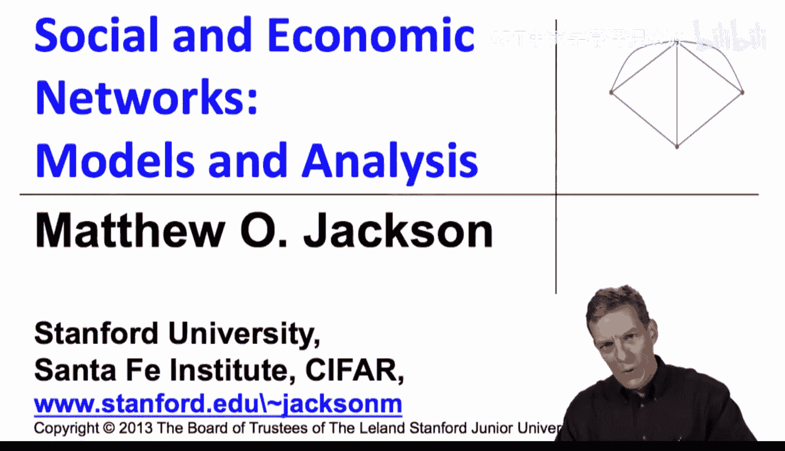

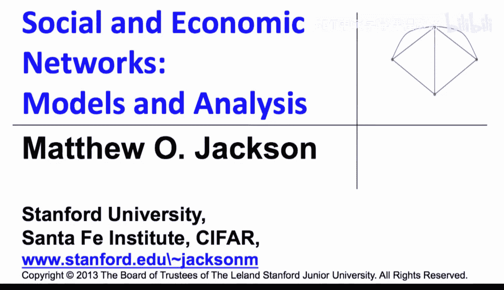