# 斯坦福大学《社会和经济网络：建模与分析｜Social and Economic Networks： Models and Analysis》中英字幕 p27 27_03_04_3-4-混合模型.zh_en -BV1v1421U7Nk_p27-

H again folks， so let's talk a little bit about other kinds of growing random network models and in particular we're going to talk about a hybrid model now that spans between these uniform at random models and the preferential attachment model。

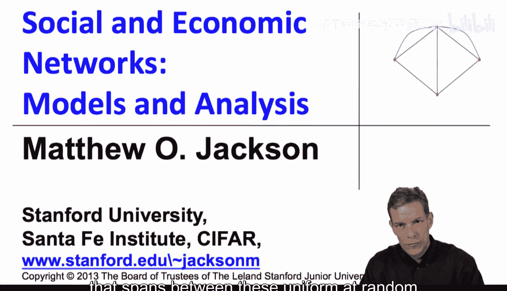

And you know the idea here is again， we're looking at random network models and now what we won't want to do is try and match degree distributions that are out there in the real world。

 so we have a variety of degree distributions that are out there in the real world。

 some of them look more like uniform at random， some of them look more like preferential attachment。

 but we want a way of actually fitting a model so that we can say that this one looks like know entirely preferential attachment or 80% preferential attachment or some percentage so we have some idea of exactly what is going on in generating different degree distributions and。

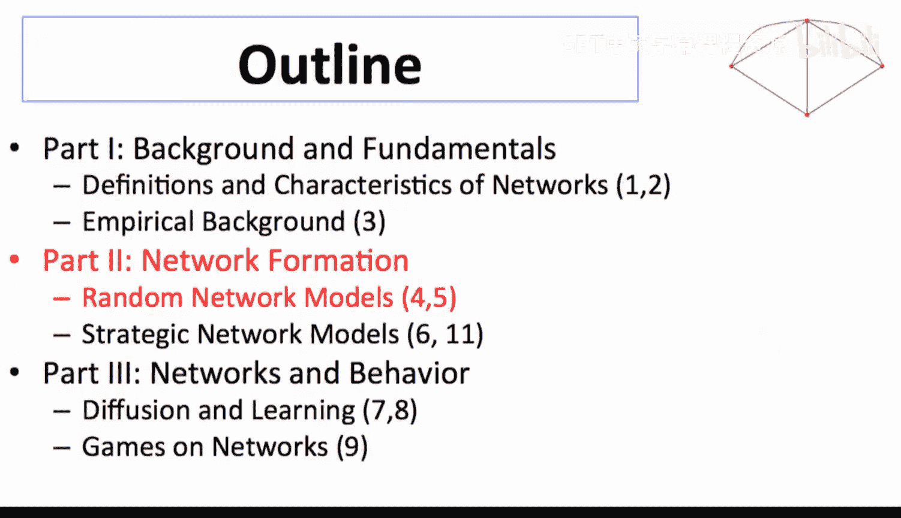

The idea here is that we'll be able to fit these models to data， so again。

 when we looked back at the Notre Dame World web and so forth and we end up working with preferential attachment。

 preferential attachment gave us a curve which has a slope of minus3 and would be linear in log log plot。

 at least to our eyeballs that looks like it might match this data pretty well but we'll have to actually get a test it carefully to see whether or not that's a good match for what's actually going on in those data。

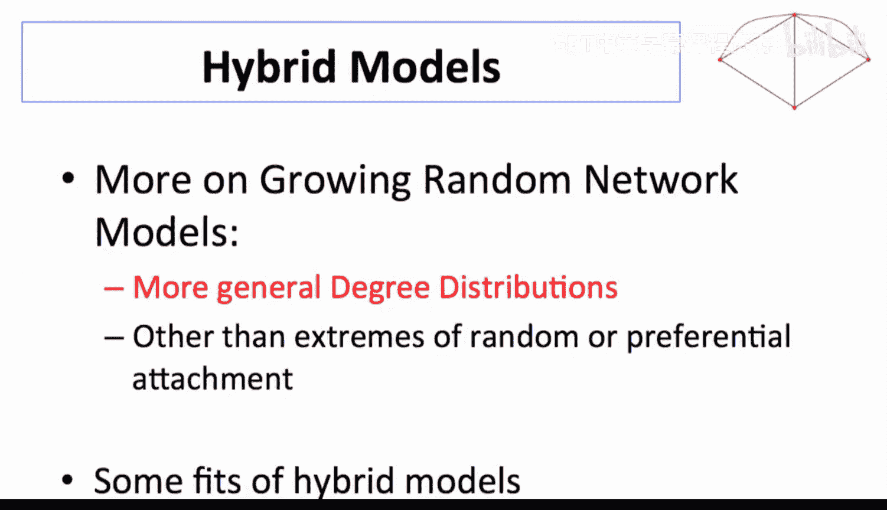

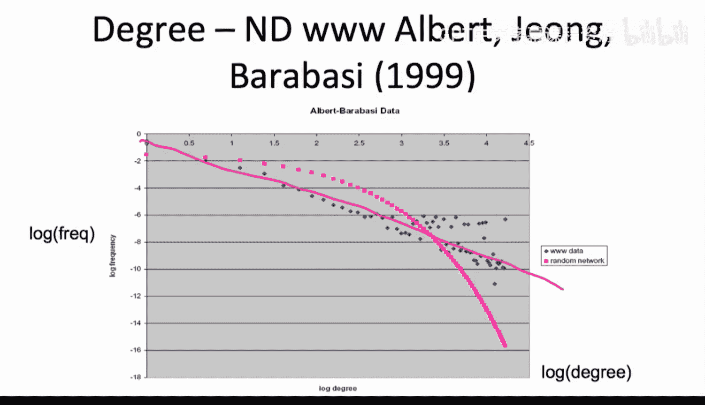

What's interesting though is when we look at say a co-authorship data so here this is co-authorship。

 this is data from the economic co-authorship data sets of Go Al Vananderlay and Morocco Gonzalez and in particular we see that there are fat tails right so we've got higher degrees and lower more high degree and more low degrees than you know for me at random but this is hardly linear right so if we drew a line through here it's not linear so we've got something which looks like it is has fat tails but it's not wellfi by a power distribution and so can we say a little bit about what's going on in terms of how this network might have been formed via this kind of growing process and again that's a natural kind of model to look at because co-authors。

Are coming in over time and forming new relationships as they're born and gaining relationships over time as they mature。

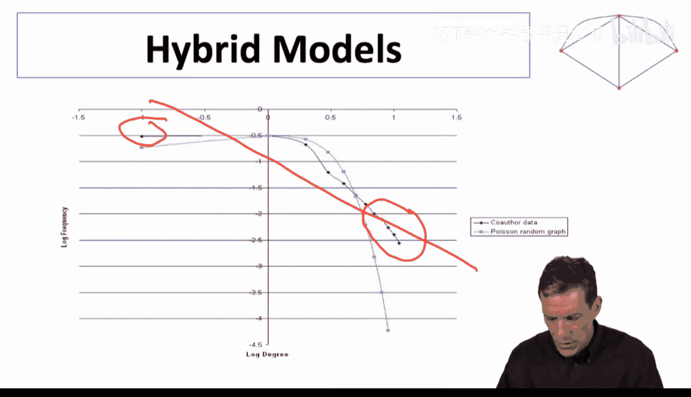

Okay so what we're going to do is look at a simple hybrid model and this hybrid model has been discussed in different papers I'm going to talk about a version that I did with Brian Rogers in 2007。

 the very simple version and will allow us to really span between these and then go directly and fit to data and the idea is the simplest one you could imagine in terms of forming hybrid of these what we actually do in the papers a little richer。

 but I'm just going to simplify this for the sake of our analysis here what we're going to do is some fraction of the new links that are formed at any point in time。

 a fraction a are going to be done uniformly at random and one minus a will be found via searching a neighborhoods of friends。

So what does that mean， that means there's a bunch of nodes which are already out there。

 let's suppose that they've formed some network。So they're already existing。And a new nerve is born。

And that new node first。Forms some links uniformly at random。So let's say let's do this with blue。

 so it forms a couple of links uniformly at random。

And then what it does is it picks new nodes to link to by looking at the friends of this。

 so this node maybe it identifies this node then and then forms some additional ones instead of searching uniformly at random what it does is it meets the friends of friends so it begins to look at the friends of the existing ones and then form links to those nodes so it picks some nodes uniformly at random and then also searches the neighborhoods of those nodes so you just for instance we go onto the world wide web。

 you start looking through some web pages and then you start clicking on links from those pages and then finding nodes or you meet somebody and then you meet some of their friends so this is a very natural process and what we're gonna to do is we're going to have one fraction formed uniformly at random and then the rest the one minus a fraction formed via meeting friends of friends。

What I want to convince you of is that that second part is going to look like preferential attachment。

 so thatll give us an explanation for how preferential attachment might actually be working。

 why would we have preferential attachment？

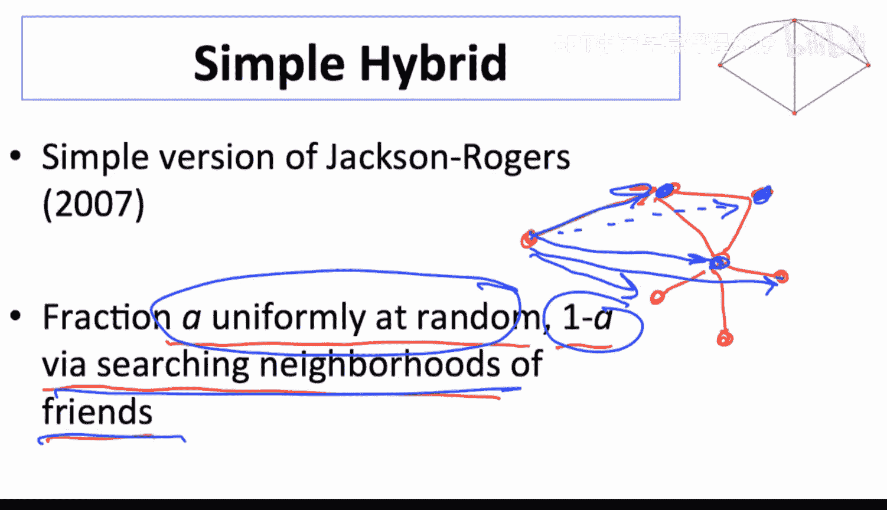

Okay， so let's think about meeting friends of friends。

So you're forming a M of your nose uniformly at random。

 and then also meets 1 minus a times M of their neighbors and attaches to those nodes too。

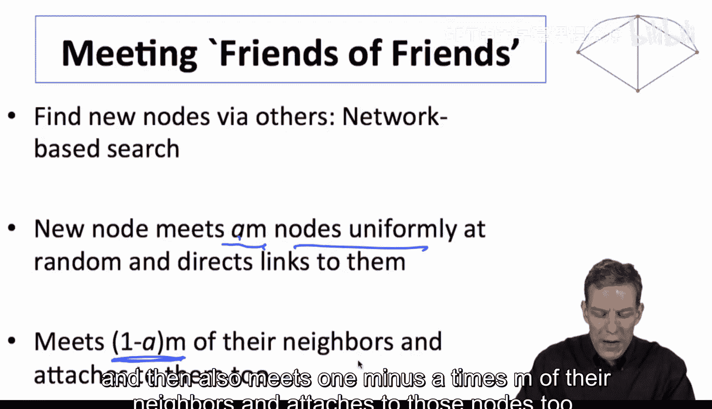

And the distribution of what's important is the distribution of neighbors nodes is not the same as the degree distribution。

 even with independently formation， so a neighbor is more likely to be of high degree and let's go through the logic of that why is that true。

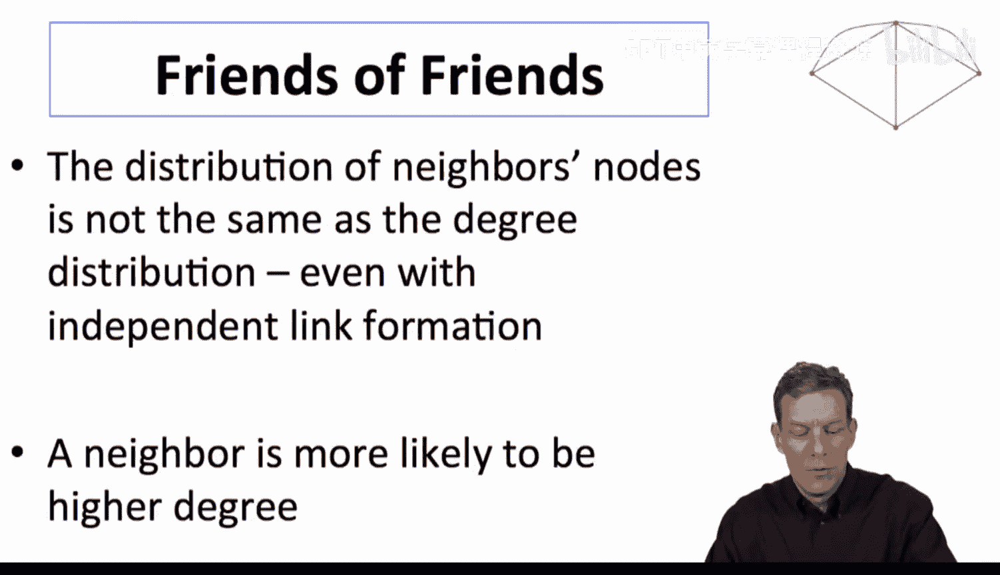

So let's think of a network， suppose that we were in a situation where half the nodes had degree k and half the nodes had degree 2K。

Okay， so some of them are twice as connected as others。

 and let's just do a simple thought experiment， so pick a link in that network at random。

And then pick a node at one end of that。ok。Now there's a two- thirds chance that the node you'll find is actually of degree to2 k and a one thirdd chance that the node is of degree K。

 So it's actually twice as likely that you're going to find the node with a higher degree as compared to the node with a lower degree。

 even though they're evenly distributed， even though there's half as many of each。

 I mean they're half the population as of each， they're equally likely in the society through this process。

 you're actually going to find the higher degree nodes with more probability why。

 because they have more links。

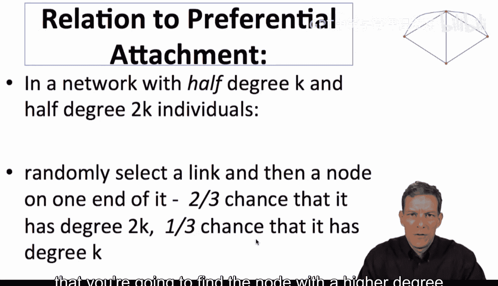

So if you find any node on the end of one of their connections， if you find one of their neighbors。

 you find them right so here if you select a link and then you select a node on one end of it if I have twice as many links。

 it's twice as easy to find me in that network as it is to find somebody who has half as many links。

And so if you're looking at my friends and then trying to finally me view my friends。

If I've got twice as many friends， I'm twice as easy to find in that system as somebody who has half as many friends okay so the idea is that if you're actually looking through a network and finding people by looking at nodes and then looking at their friends。

 you're going to be more likely to find higher degree nodes and then we're gonna to have a form of preferential attachment nodes that have more friends are going to be easier to find。

 they're going to get more friends through this process and it continues okay so very simple process。

 very intuitive and natural one now that'll explain why we' get preferential attachment and then as we vary this parameter a。

 we can have things look like just forming uniformly at random network or if we're doing things mainly through the network search process。

 we're going to tend to have most of the links formed in ways that are going favor better connected nodes。

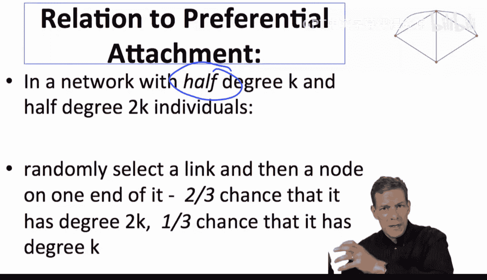

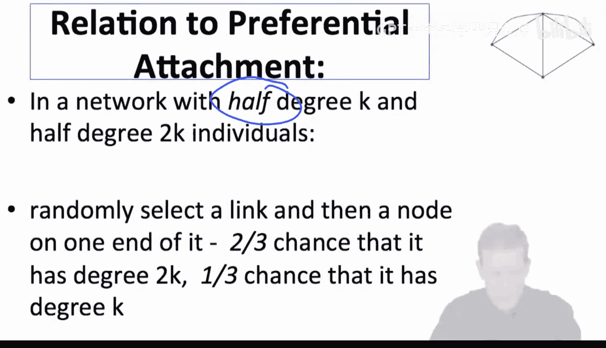

So what we're going to do， we again the chance of so randomly find a node。

Randomly pick one of the nodes it's attached to。And that's this sort of finding the friends of friends bit and chance of finding some node via this second part of the procedure is proportional to its degree。

 We find it if you find one of the other nodes that attached to it。

 so if it had twice as many people attached to it， it's twice as easy to find。

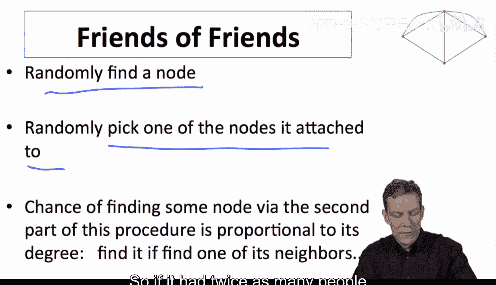

Okay， so now what does this model look like then？Fraction A formed uniformly random 1 minus AviA preferential attachment so we can go back to our meanfield approximation。

 do exactly what we did before。 We're going to still have the starting condition that when you're born。

 you form M links。And now what we're going to have is a fraction A of my new links over time are going to look like the uniformly random M over t and a fraction 1 minus a are going to look like they did in preferential attachment。

 which is proportional to my degree over 2t right so there's an M over 2 TM I've divided out the Ms。

 so we've got this simple differential equation。And if you solve that。

 so now we've got another differential equation， you can just check that this differential equation。

 if you differentiate this with respect to time， you'll get this back and the initial starting conditions So this is the solution to that differential equation I'm not going to go through solving differential equation。

 this is a relatively standard differential form and this is the solution for that differential equation and with that starting condition so now we have a very nice system again。

 what this does is tell us what an expected degree is at any point in time for a given node as a function of how much time has gone by。

And what its birth date was， and therefore we can then solve this to figure out which nodes are going to have degree less than some amount at any time that gives us a degree distribution so exactly the same procedure we've been doing a couple of times before。

 and so here the nodes that have expected degree less than D at some time are the ones for which they their equation for what the degree is is less than D at that time and here there's an expression just was simple to put an X in here to simplify this in terms of notation substitute in x is equal to 21 minus a and that makes this equation just a little easier to read。

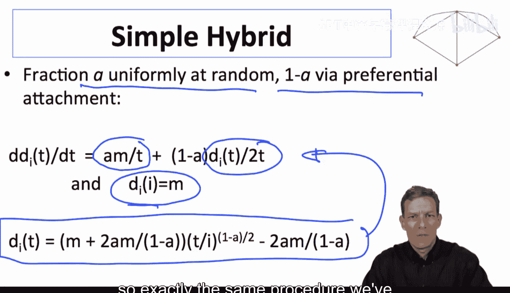

So the critical eye is the one for which this is true。

 so if you solve the I for which they're exactly at degree D， they solve this。

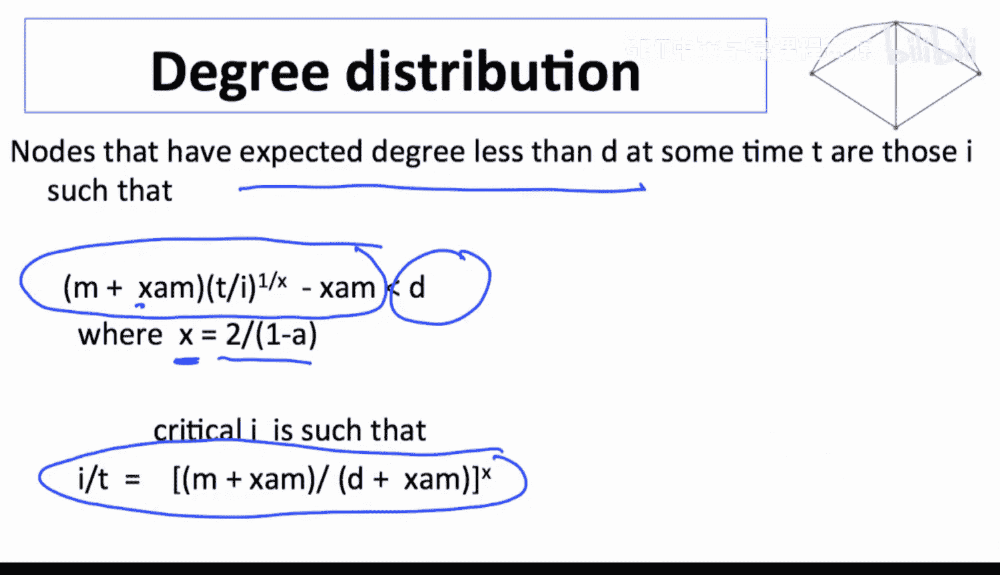

And therefore， remember the F of D are going to be the fraction of nodes that were born after the ones that have this critical I that has exactly that D and so if you substitute in from the I here what do we get and when we substitute that in。

 we get F of d is equal to this equation where x is equal to 2 over 1 minus a so this is a slightly more complicated expression than we had before。

And it looks partly like， so we've got a D in a denominator raised to some power。

 the power here depends on the parameters of the A and so forth and you can check that when you look at this equation。

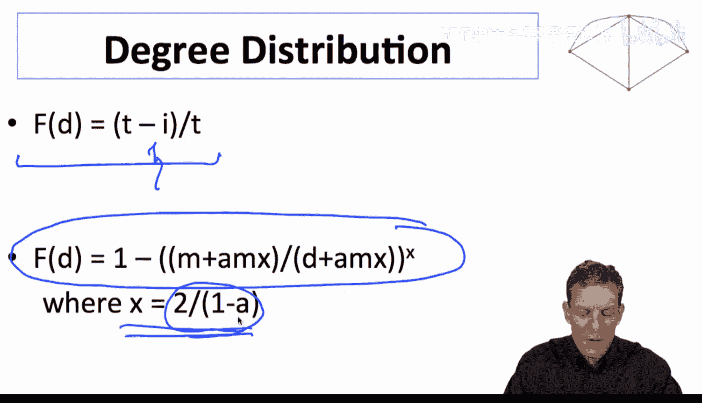

As a gets near one so that all of the links are being formed uniformly at random。

 then this is nearly a negative exponential distribution。Whereas as a gets close to zero。

 then x just becomes the two， this is going to disappear， this is going to disappear。

 and we're going to get our1 minus M over D raised to the two power， the differential the。

Density function and don't have a minus3， so this will look exactly like preferential attachment。

 so this spans between those different distributions and as we change a we're going to end up with a distribution which looks either like this negative exponential or begins to span out and look more like a power law distribution as we let a become close to zero and almost all the links before the friends of friends。

 which gives us preferential attachment。

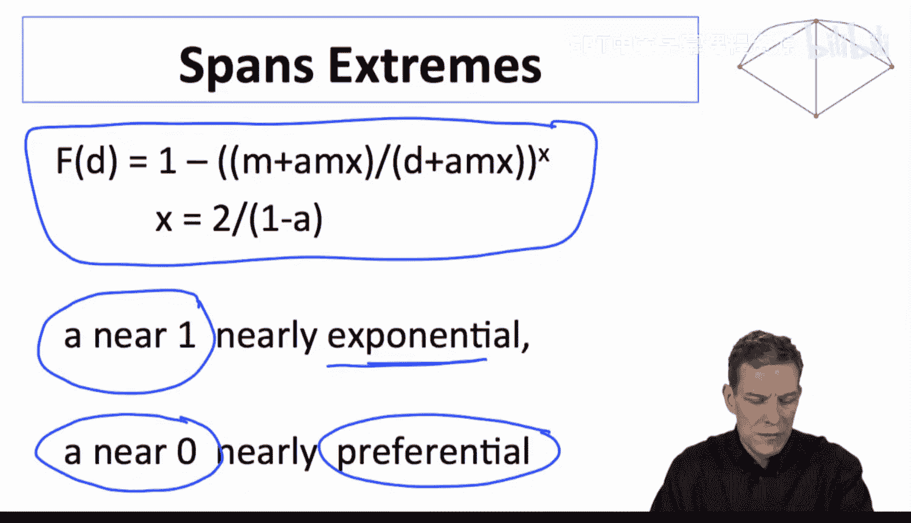

Okay let's simulate these things just to check so this is after1 thousand periods simulating when M is equal to 2 and a is equal to half and you can just check either the log of the distribution function versus the log of the degree or the log of the frequency so this is we know that the extremes that the expected degree is a good match for the actual degree distribution here if we put it in the middle it seems to be fitting well。

 so simulated degree distributions are coming out well compared to the actual degree distribution。

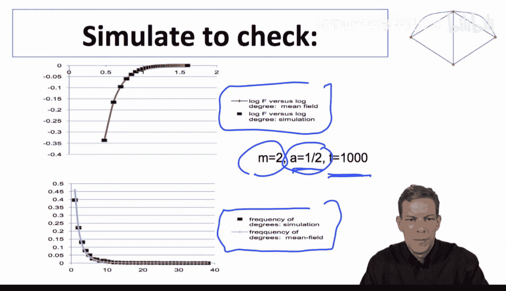

So when you simulate with a half， you get a good match， if you simulate with a equals1。

 so it's uniformly random， it's a good match， actually interestingly。

 if this is just done simulations when a is zero， it's not exactly on。

 but this is one where we know the proof actually shows that you get a good match。

 so it just means that for pure preferential attachment。

 you're going to need more than100 periods before this thing begins to be a good approximation。

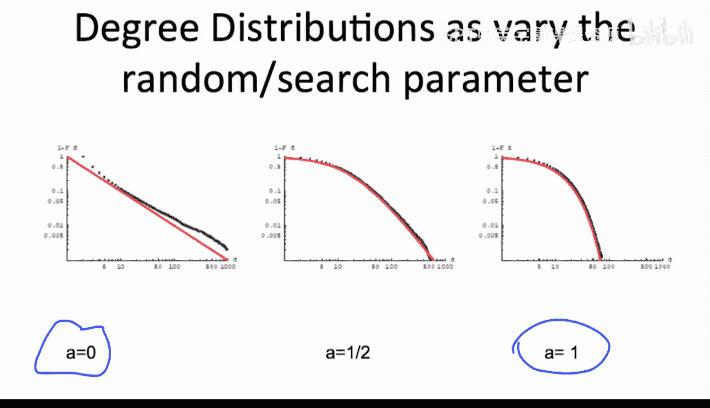

Okay， so we've solved for a degree distribution and what we can do next is now we've got a degree distribution。

 a hybrid distribution that spans between these different extremes。

 we can start taking us to data and begin to back out what that A is in the data。

 how many links look like they're being formed more at random。

 how many look like they're being formed through the network search process。

 being meeting friends of friends， and then see whether we see differences in different data sets。

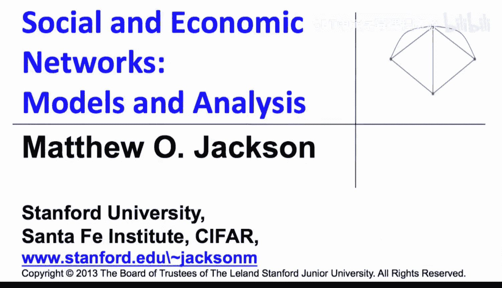

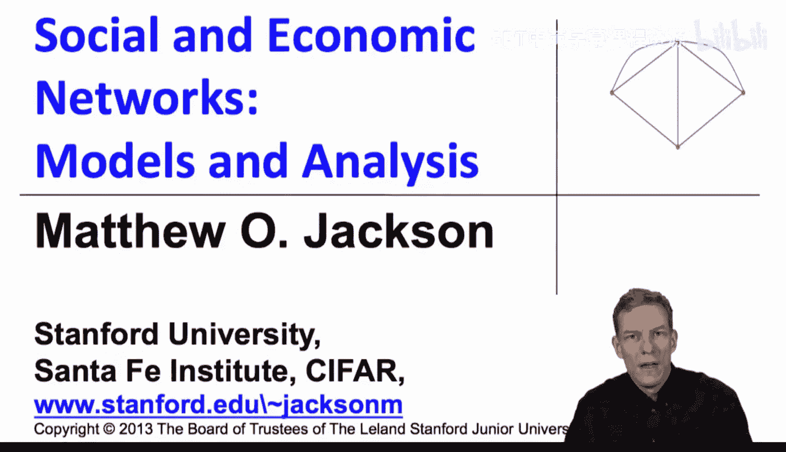

