# 斯坦福大学《社会和经济网络：建模与分析｜Social and Economic Networks： Models and Analysis》中英字幕 p28 28_03_05_3-5-混合模型拟合.zh_en -BV1v1421U7Nk_p28-

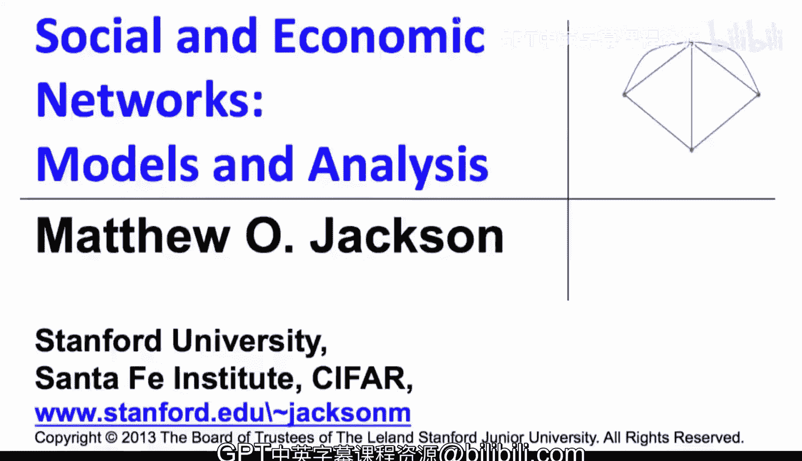

Okayi folks， so our next topic is again taking these growing random network models now we've got a version which is fairly rich and spans a whole series of different degree distributions。

 let's have a look at some data， see how these work out。

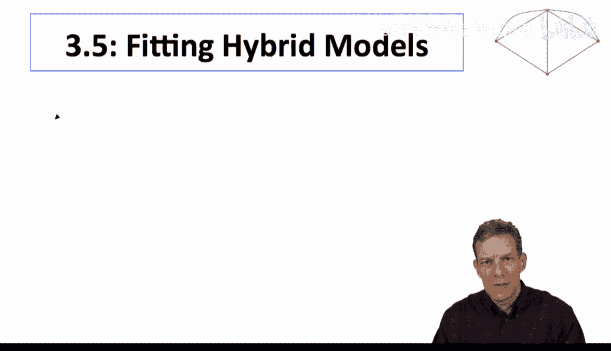

And if you recall， what we had in terms of the degree distribution was that we ended up with an equation for the degree distribution which looks like this。

And what that does is if we it's easy to do this in a log log world。

 take log of each side and well actually bring the f over here then take log of each side what we're going to end up with is log of1 minus the distribution function is proportional to C minus x log D of a plus times x so what's the difficulty with actually fitting this kind of equation we could just look at know frequency of degrees regress that off of log of a function of degrees and then try and estimate what the x is the difficulty is that the x here is entering in both parts so the x is telling us something about the a so we've got this a coming in in several places so a is the parameter we want to estimate how much is uniformly at random how much is being form v a preferential attachment the a。

Entering here， its also enters this X term， so what we've got is we've got C minus2 over1 minus a log of D plus AM。

2 over1 minus a， right， So we've got several。Places where A is entering both here and here。

And so what we want to do is what we'll do is search over A's。

 we'll search over A's until we minimize the distance between the distribution。

 degree distribution generated by this particular A and the actual degree distribution。Okay。

 so we'll try and select an name and minimize that distance between the actual distribution and the model's distribution。

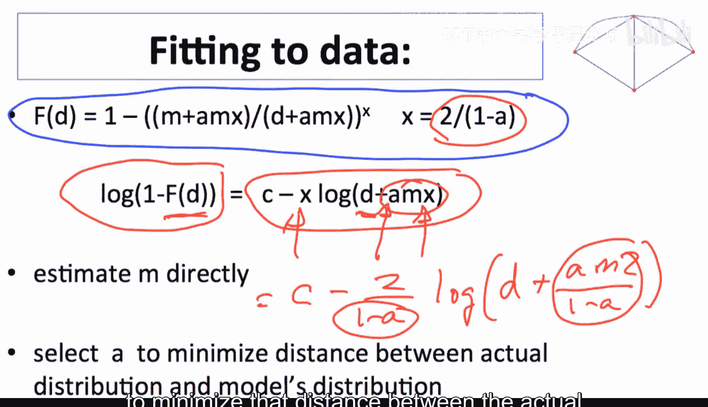

So when we search over A's to do that and let me say a little bit about how one can search so you can do the program search by different methods。

 one is you can just plug in a bunch of different A's and for each one that'll give you a degree distribution and then try and see to what extent the actual data。

 know what's the distance between each frequency distribution in the data and the actual ones here。

 some of those upquaum and try and minimize that。

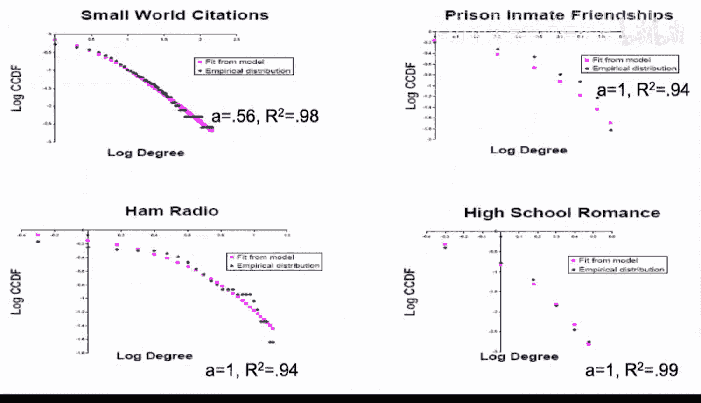

Alternatively， what you can begin to do is guess ane over here。And then do a regression。

 that'll give you an expression here that gives you a new estimate for a， plug it back in here。

Reggress again and so forth。 You can actually show that that is a contraction。

 It's a well behavehaved mathematical process。 It'll converge to the right A。

 I don't want to go through a proof of that， but that's an alternative technique。

 So one is just brute force， put down a bunch of A's between0 and one search over a grid see how each one。

 How close does it come to matching the data So you can look at the actual frequency distributions compared to the true frequency distributions right So what we're going to end up with is。

嗯。ASo what we've got is we've got true frequencies for each degree we've got for each A we've got。

Of frequency， we can look at these things。Sum them up。

 square them and say try and choose the A that minimizes the sum of the squared distances between the actual distribution and the one for a and just choose a to minimize this。

So for each A we've get an expression， plug it in， calculate all those numbers。

 and then minimize that， or you can do this iterative process where you guess an A， do a regression。

 get a new X that gives you a new AA estimate and iterate and that'll give you another way to do this。

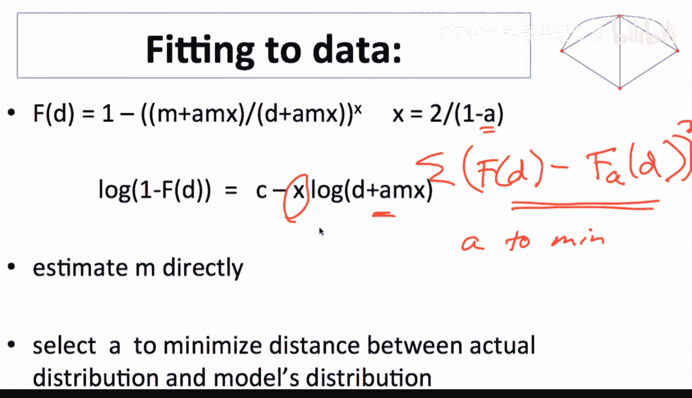

Okay， so what do you end up with， let's look at some plots。

So here this is so we've got different data sets， this is one where we're looking at citations of small the original small world's paper and what do you end up with you end up with a at about 0。

56 and the fit of that is about 98% so you're doing very well in terms of actually calculating the variation。

 so the actual variation and the frequency distribution that is matched by this model is about 98% so it's about a 2% error when you look at the F of Ds minus a of Ds compared to the overall squares of F ofDs so you're doing very well here。

 when you look at different ones， this is the prison inmate data set that we looked at we talked about before McRraray's data set here you get a the best fit is a equals1 so it looks like it's pretty much uniformly at random。

R squared of about 94% so again fairly tight fit that one looks like it's being matched fairly well by uniformly at random and in fact。

There's a number of ones that come out at one， so if you do there's another one amateur radio operators so for people that don't know before the internet people used to use short radios and talk to each other so instead of having chat rooms you could get on the radio and then just search to find somebody else who might be also broadcasting on a radio you could talk to them these were amateur radio operators there's a data set that looks at these again a equals one uniformly at random。

 fairly good fit the high school romance that we looked at Berman Moody and Svo's data the degree distribution there again very well fit uniformly at random so looks better like more like a uniformly random here the R squares 0。

99 so remarkably strong fit to uniformly at random model that says something about high school romances in any case。

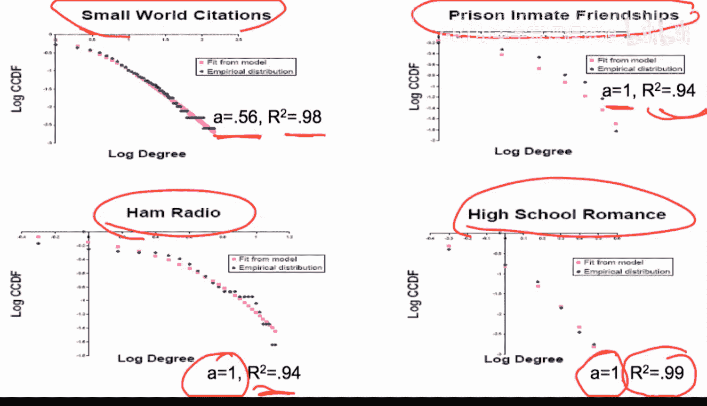

So you know just a couple of notes on these fits， some of these are actually even more curved than with a equals1 and in those cases it could be that instead of having this growing network model if you go back to the static uniformly at random model you can even do a better fit so those are fit better even by not including some of the growth so the growth isn't a major factor in those。

 the citations network know some of the things is it has too many with degree zero to fit and then part of what's happening in the model is the model starts with everybody having some degree and it's not taking into account the fact that the citations are directed and might never be hitting some articles。

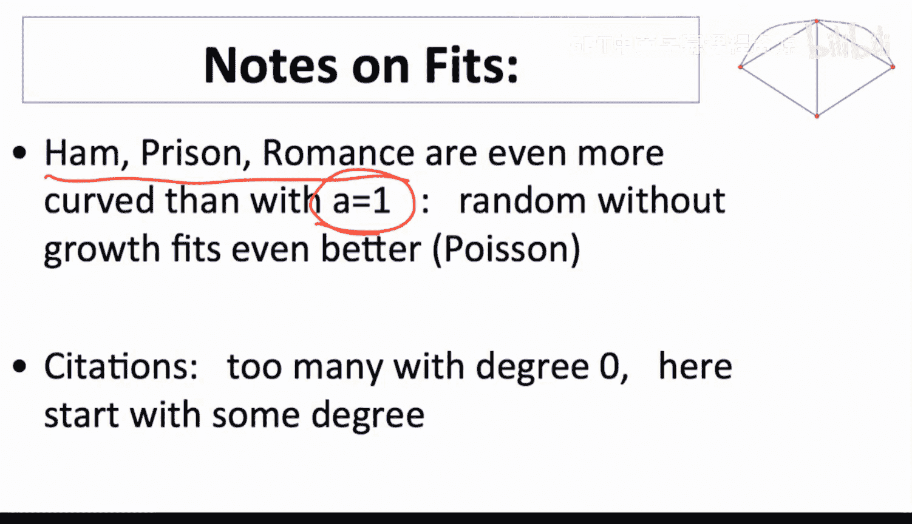

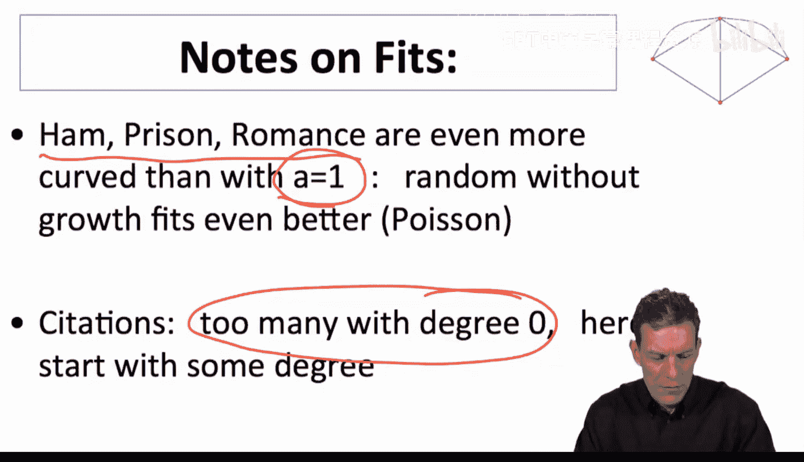

嗯。Interestingly， if we go back to the Notre Dame World Web that has sort of generated a lot of interest in the power law。

 when you look at the best fitted series， it actually has a at 0。36。

 so a little more than a third of the links are being formed uniformly at random now when you actually plot out。

 so this is now I've instead of just binning the things a very fine binning of the actual degrees。

 the R squared is 0。97 and interestingly this still looks in a log log plot。

 it looks fairly close to a line right？But it's saying that the actual fit is a little hassom curvature and one thing that's very important to understand about these kinds of things is that a lot of the data when you do a log log plot most of your data is actually in a smaller part of the graph right so the log of the frequency is changing the relative weights and so what you actually see in your eye is capturing the long tail and so this looks fairly linear but there's actually can be a lot of curvature that you've missed because the log straightens things out and it's very difficult for your eye to detect that and so what this tells us is if we actually want accurate understandings of what's really going on in these things just eyeballing these things is not going to give us a good idea of what the true distributions look like and when you actually fit a distribution the distribution here looks like it's sort of two-thirs preferential attachment but one-t uniformly。

I a much better fit than just a pure preferential attachment model and so there might be other things going on where pages accumulate some of their links through some other process other than preferential attachment and that's an important caveat to these things so when we understand power laws。

 one thing we should understand is there are fat tails but not necessarily purely linear relationships and when you fit them。

 it's very difficult to let your eyes do things in a log log plot。

 you can get a very different distribution if you're careful about its statistically。

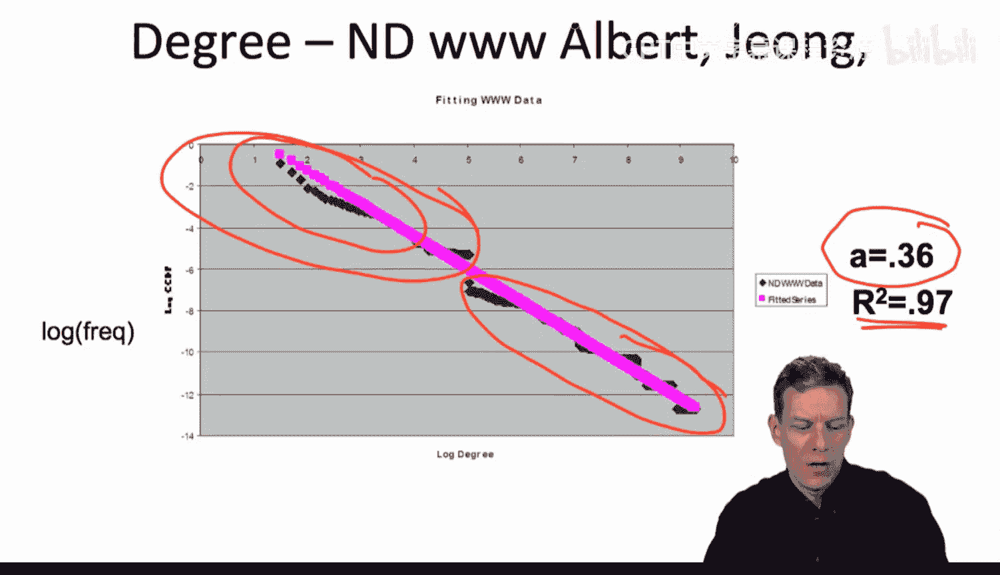

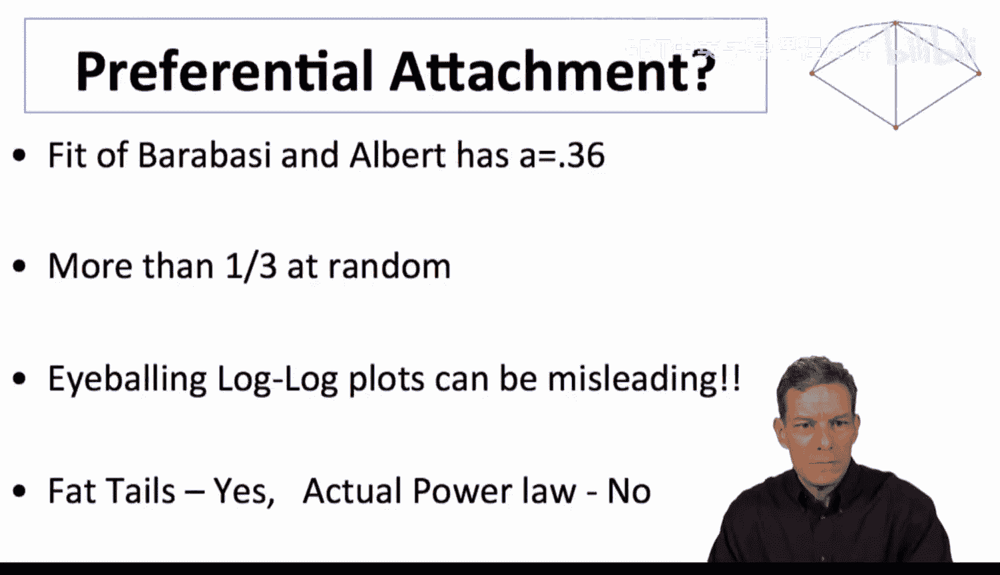

So we end up here just to emphasize that eyeballing， blah， blah plots can be misleading。

 so fat tails， yes， an actual power distribution， no。

 here we're finding about two thirds of a power distribution and one third of uniform at random seems to be a better fit of this。

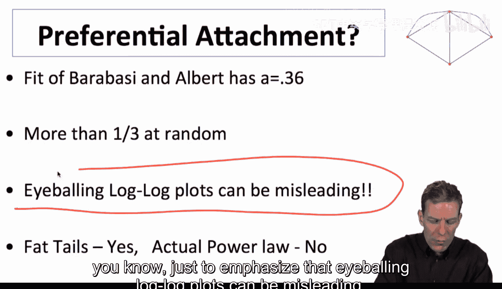

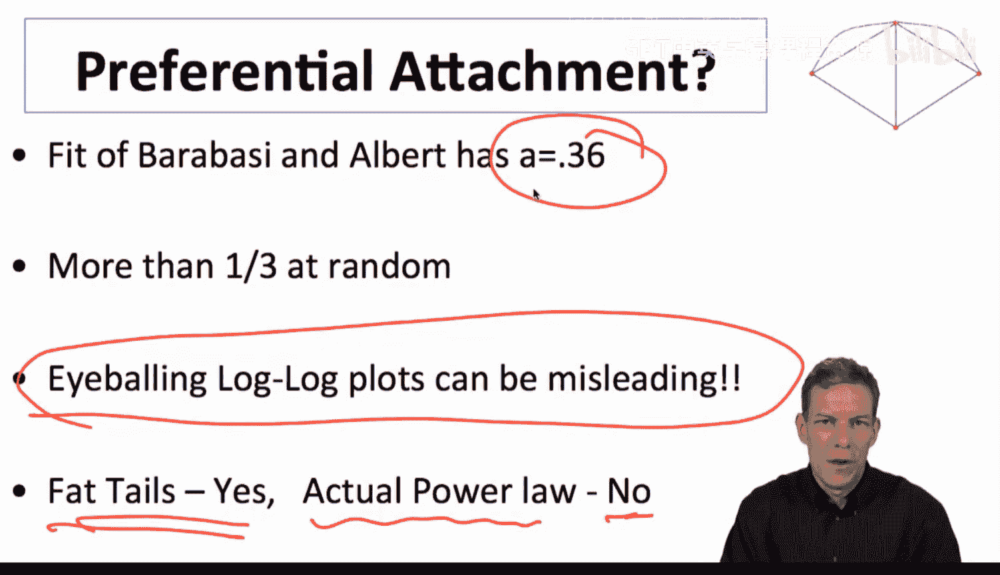

Okay， one other thing in terms of fittingness， this kind of model to data。

There are other things that the Friend of Friend model allows us to do， so you know it does。

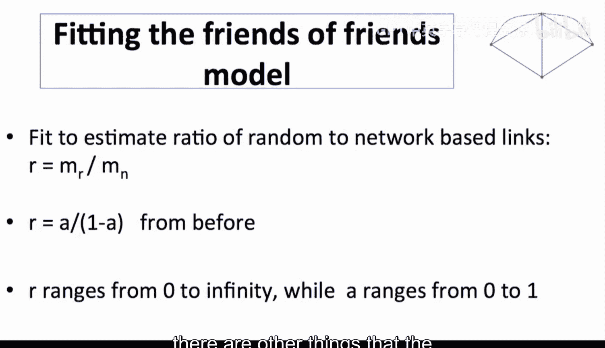

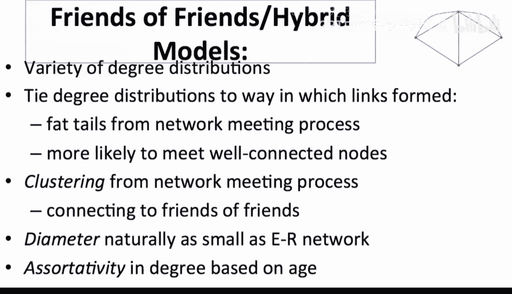

Give us a variety of degree distributions so we can span different degree distributions and it ties the degree distribution to the way that links were formed in terms of having some meeting friends of friends。

 But to emphasize some other things， things that were missing from the original models。

 includingial straight preferential attachment model is you still don't get clustering you're just forming links at random and the chance that two of my friends were already connected to each other begins to vanish as time will as large。

 when you actually do things by this friends of friends model then what you end up doing is connecting to people in ways that form triangles。

 So let let let me just sort of give you an illustration of that so you understand it's an important idea And so the idea recall here when we've got these nodes So we've got a new node and let's say suppose we have some existing nodes。

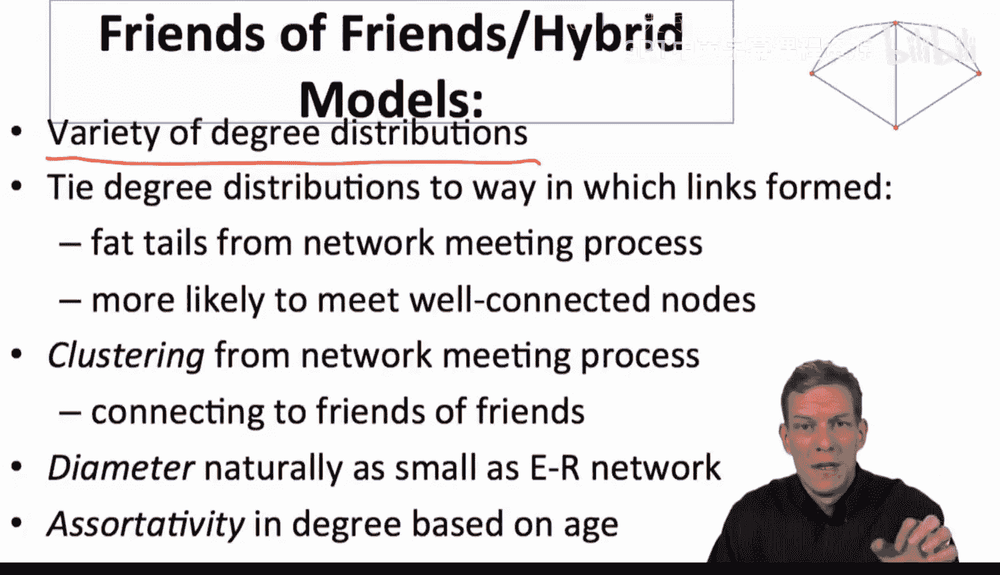

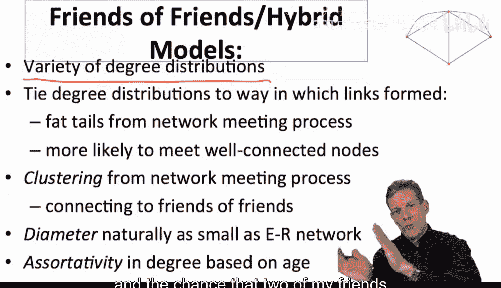

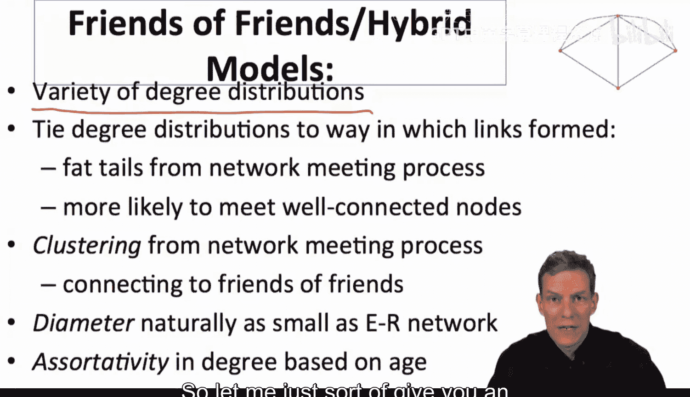

And let's suppose that those existing nodes were already connected to each other right so this network and the way in which the node formed some attachments was it first found one uniformly at random。

 it found this node， and then it attached。

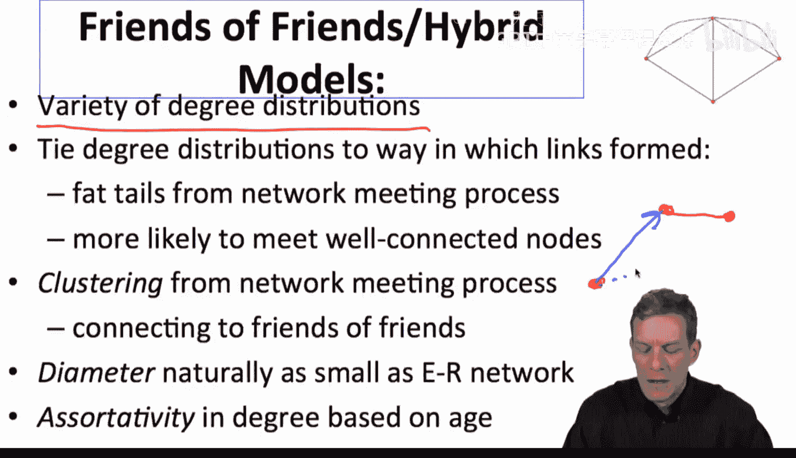

To one of its friends。So the fact that the attachment was via the search process of finding a friend of a friend means that we've actually formed a triple here。

 and so we end up with。

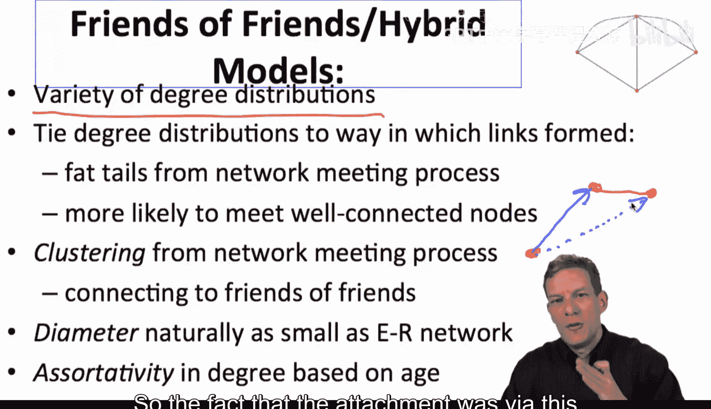

Two of this node's friends being friends with each other。

 partly because the way it found people was through finding friends of friends。

 So we get natural clustering directly through this process。

 And that's different than what happens in the pure preferential attachment model or the uniformly at random model。

 So the fact that your're doing things to a network search gives clustering directly。

 So the clustering is going to depend on this a parameter， but will find clustering in the data。

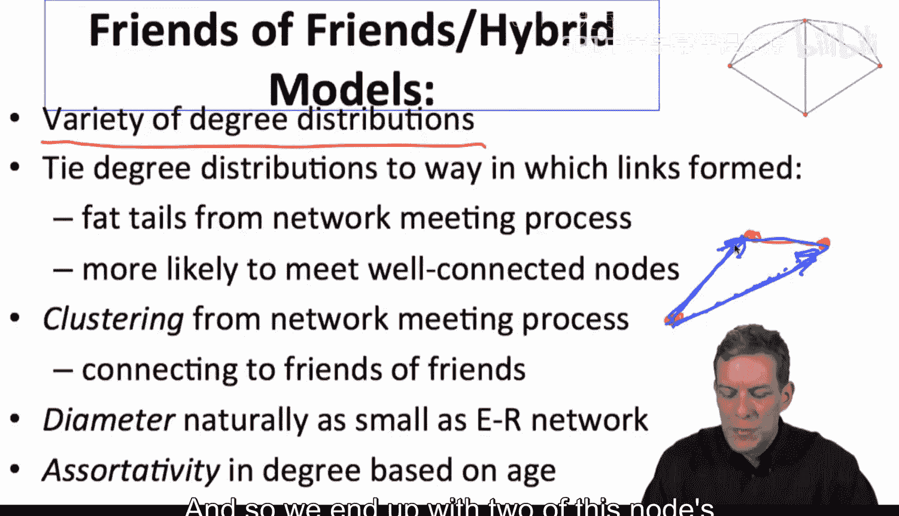

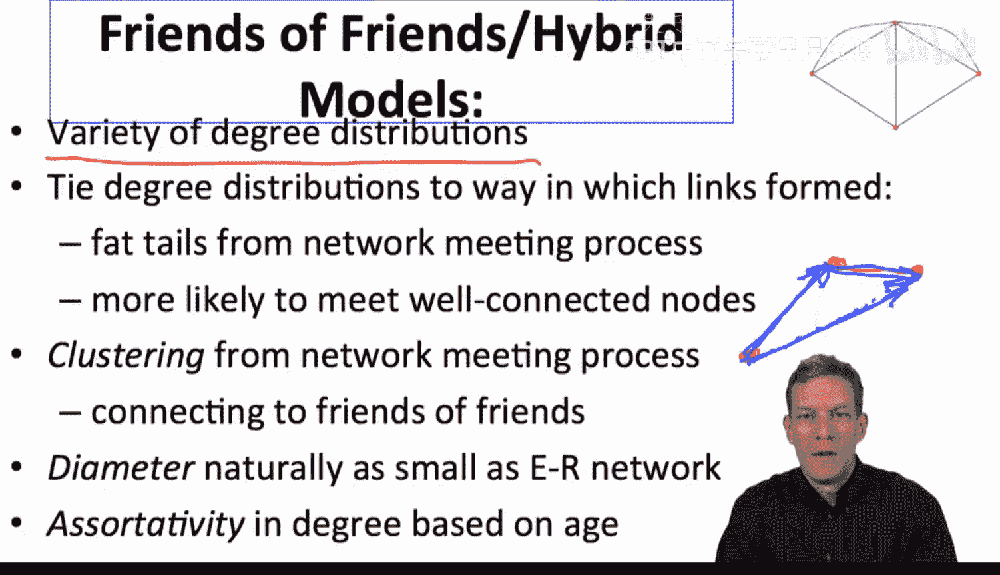

Second thing is diameter is naturally going to be small。

 partly because you've already got either you know you've got random network formation。

 so you've either got something that looks uniformly random or preferential。

 which even has a lower diameter than the Er ready kinds of networks。

 another thing and one thing we haven't talked about yet in much detail。

 but you will observe in a lot of the networks。It is what's known as asortivity。

And what does asortativity mean？Let's think of the older nodes。

The older nodes are more likely to be connected to each other because when they were born and young。

 the formation process was only between the ones that were existing at that time period。

And so older nodes are more likely to be connected to other older nodes。

And so what we end up with is a correlation in the age of nodes。Of connections。

 which also means that the ones that have higher degree are going to tend to be connected to other ones that have high degree。

And once they have lower degree are going to have more。

Connections to ones with lower degree because they're forming ones later on。

 they're forming their links later on。 and so we'll tend to have more links to younger nodes too。

 And so what we'll end up with is a degree distribution that exists that exhibits some correlation and degrees more of a high degree nodes。

 Friend will be high degree and more of a low degree nodes will be low degree。

 So we get a series of other things coming out directly。

 This is something which is going to come out of any of these growing systems。

 So this comes out of the growth。

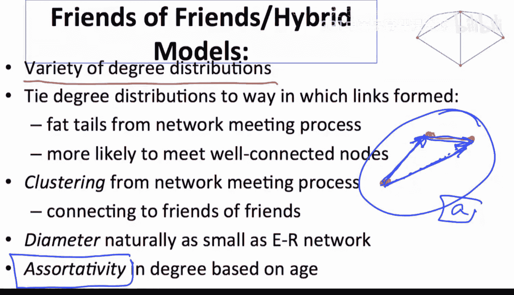

This just comes out of the fact that we've got random network。And this part。

 the clustering comes out of the Fri of friendsend part。

So we've got the growth thats giving us asort ofivity， the randomness gives a small world diameter。

 and the clustering part， the other part of small worlds is coming from the friends of friends of the process。

 so we're going to get three extra things。So here if we actually look at you know fitting these。

 so looking at these different data sets and then you can look at the number of nodes。

 the average in degree R， let's just instead of keeping track of A。

 let's let R be the relatives fraction of uniformly random compared to。

Preferential attachment or finding friends of friends part so as R becomes huge then it's really a random network as R goes to zero then it's pretty much pure preferential attachment and so you get these different Rs。

 you know some of them going off to infinity， looking like random networks。

 some pretty much lower and looking like more preferential attachment。

Then you can you look at the fit of these things， but you can also look at the clustering that comes out and the clustering actually from this model fits remarkably well。

 some of them it's the fit isn't doing as well it's not generating quite as much clustering as overall。

 but for some of them it hits remarkably closely the diameters。

 the actual diameters in the data the diameters from fits what you have to do is simulate the model and then you get some range of things。

 the ranges of the diameters are usually fairly well on。

 so this model also fits on a series of other dimensions besides just matching the degree distribution which is also interesting。

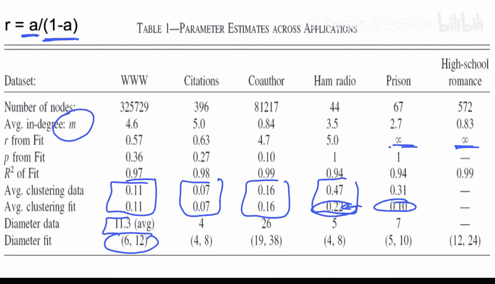

Okay so that takes us through a look at some of these growing random network models and what they've done is they've enriched the system to allow us to capture a series of other attributes of the actual observed networks。

 we can produce a variety of different degree distributions。

 we can take these things to data and actually estimate different parameters。

 see how well the models are matching some of the data and it gives us an idea of how the actual attributes that we see in the real world might have come from some formation process so we see a richer idea here now of how exactly。

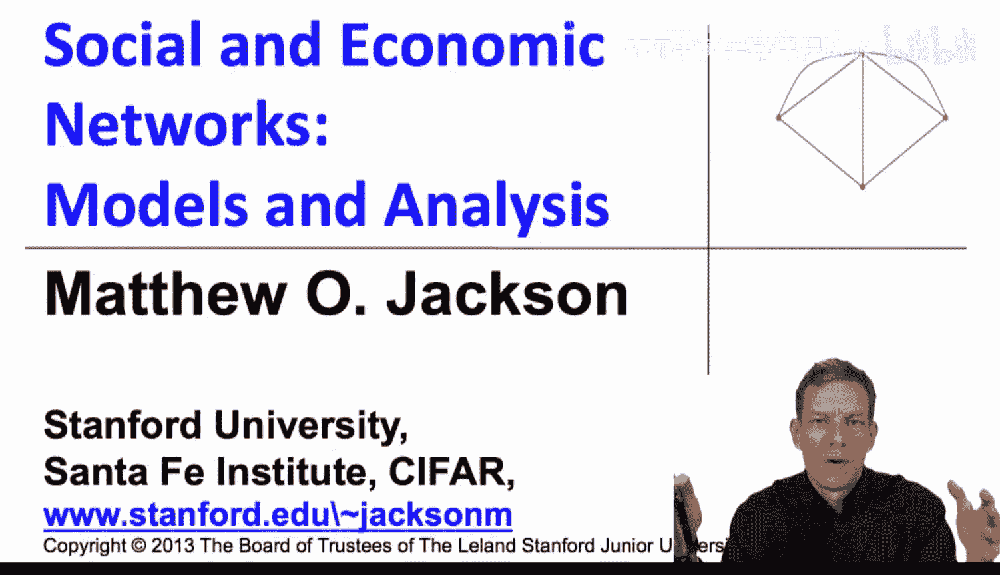

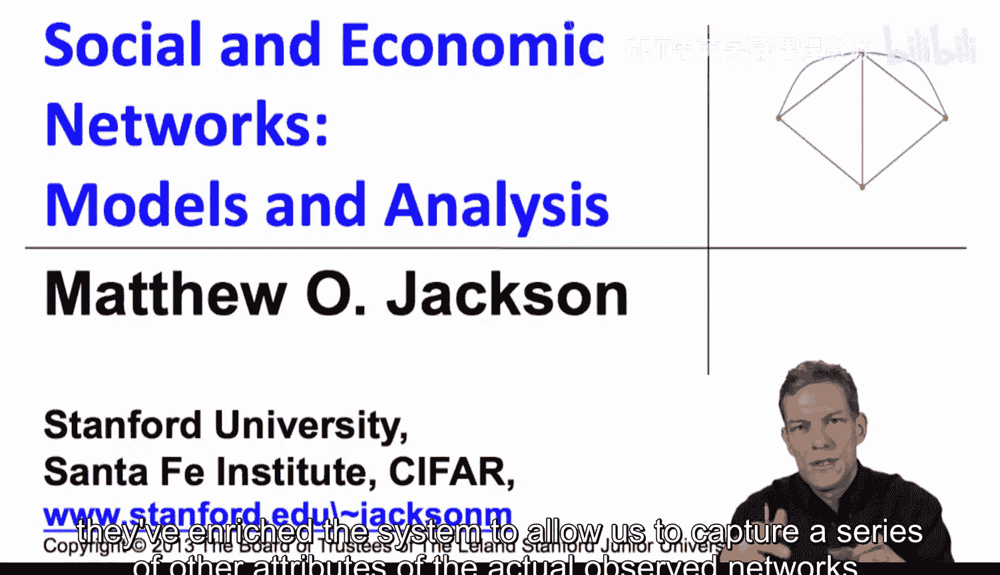

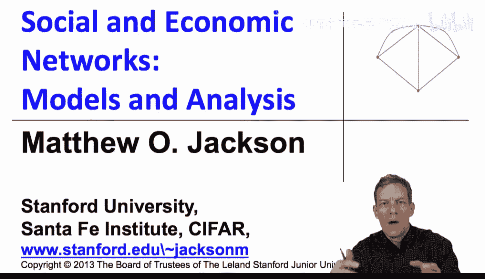

We can generate these particular attributes of social networks and why they might be arising。

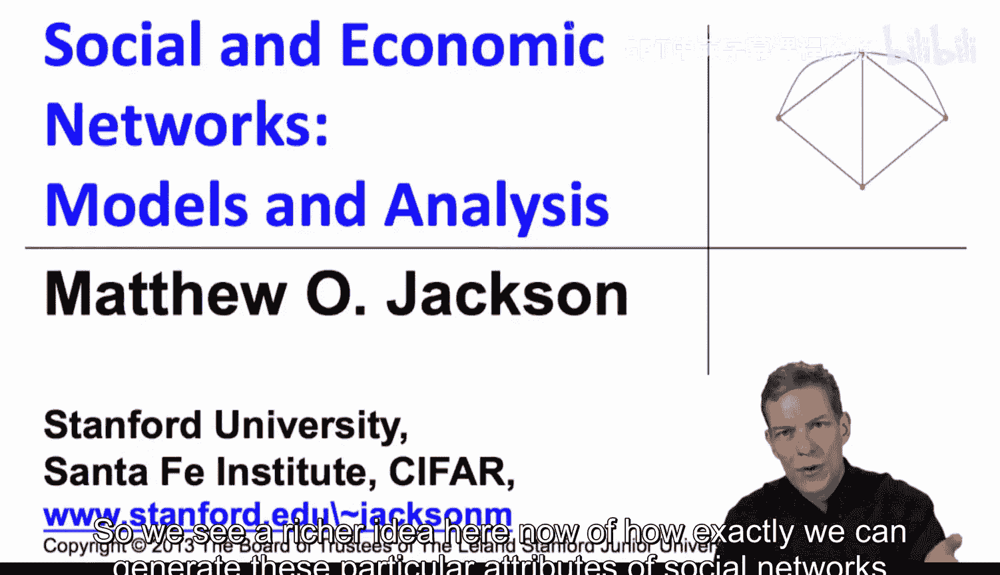

So our next subject now we'll be looking at some other classes of models and understanding a statistical estimation of those models。

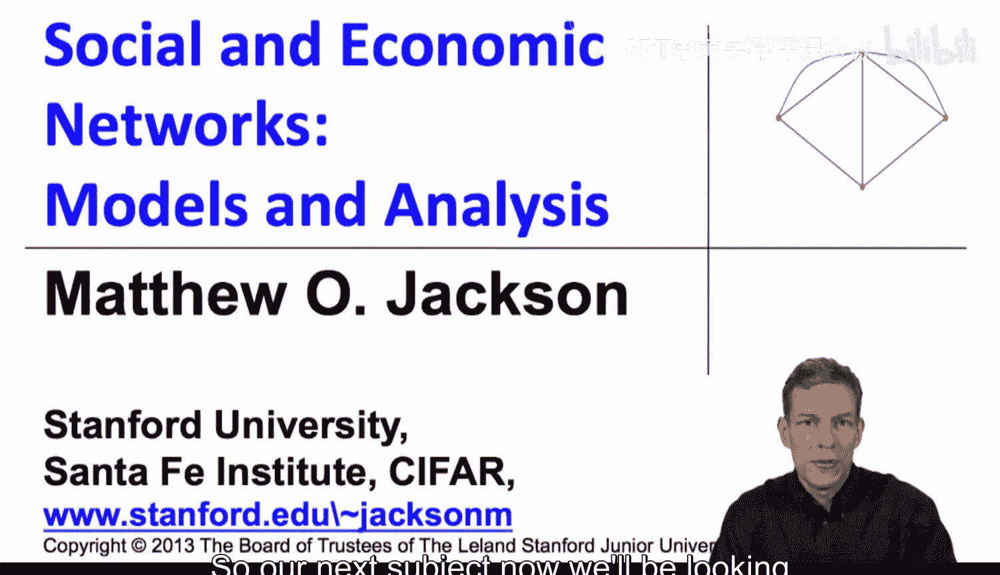

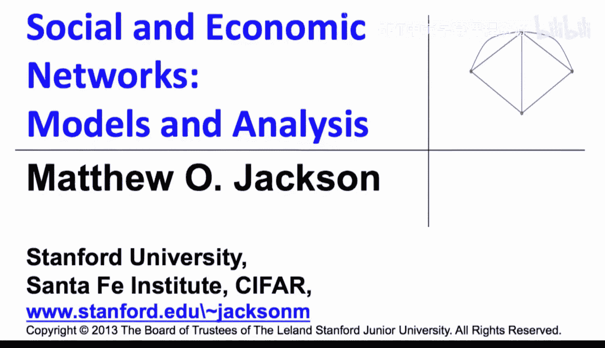