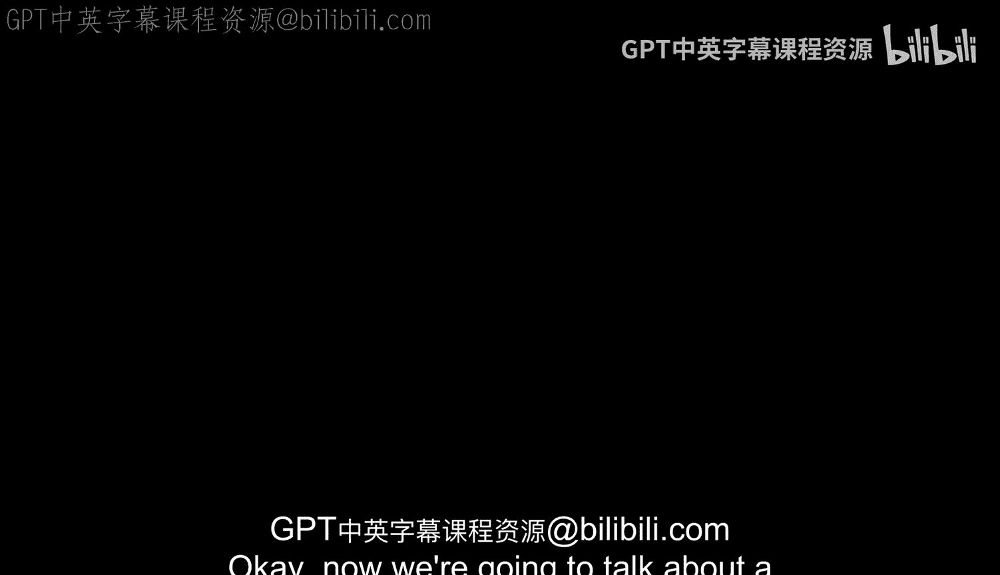
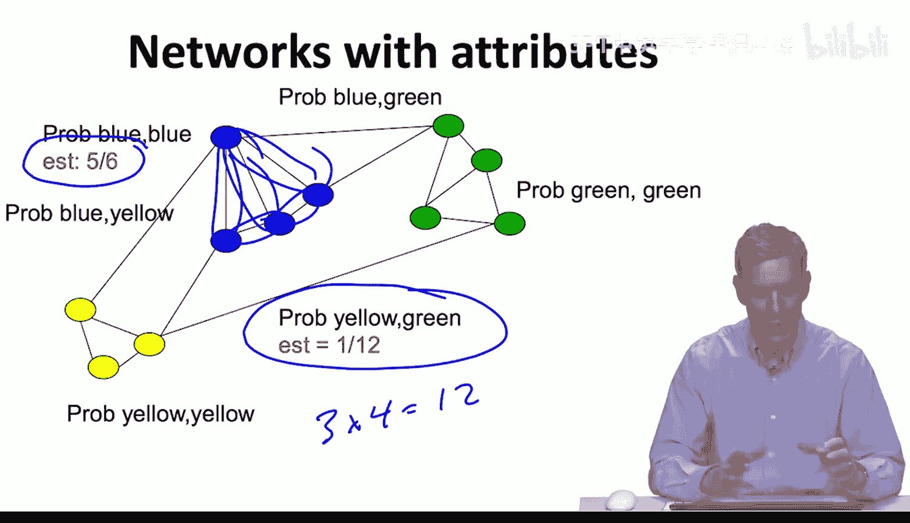
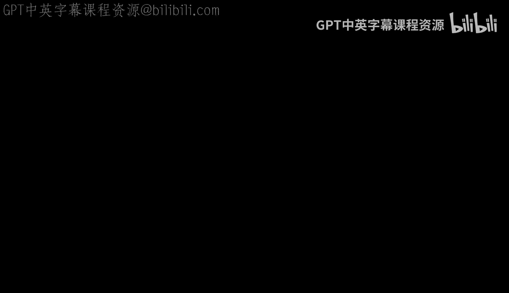
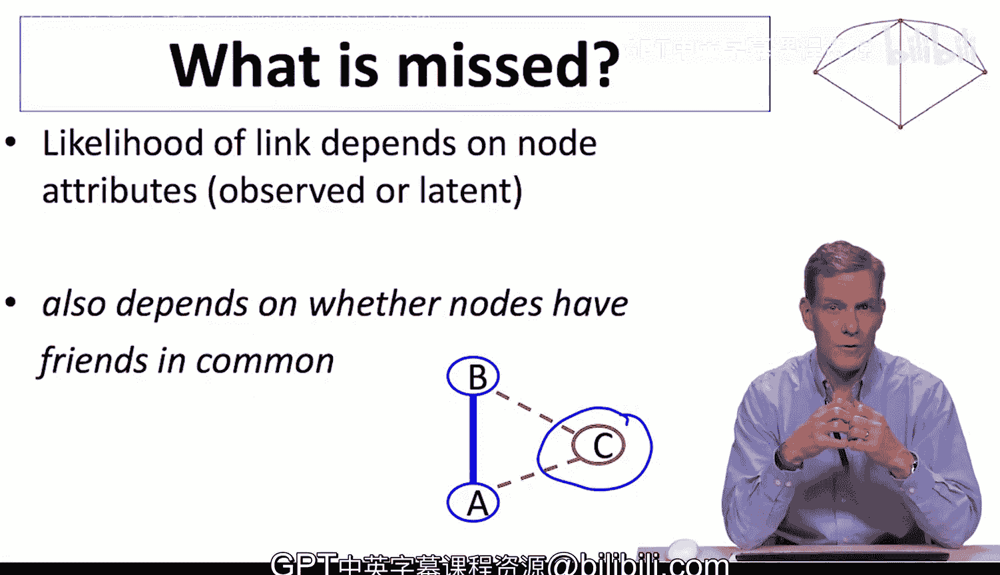

# 斯坦福大学《社会和经济网络：建模与分析｜Social and Economic Networks： Models and Analysis》中英字幕 p29 29_03_06_3-6-区块模型.zh_en -BV1v1421U7Nk_p29-

Okay， now we're going to talk about a different class of random graph models that begins to bring in attributes of individuals or nodes into the picture。

And as we've looked in terms of random graph models so far， we've talked about Erdarini really basic。

 uniform at random， useful benchmark models， and we saw that they missed a lot of real world features。

 then we talked about other kinds of link by link models that began to bring in features。

 we looked at models that capture clustering， that could match different kinds of degree distributions that could get some aspects of correlation。

And what we're going to start to do now is bring in attributeive nodes and so we'll start with stochastic block models which are sort of the natural enrichment of Erdareni random networks。

 so here they're going to allow the probability of a link to actually depend on some characteristics of the nodes and those could be attributes they they could be latent so it might be that we're not fully observing all these things and we try and infer them or they could be observed characteristics and so we're going to start with simple block models that where everything is observed。

And so here the idea now is that nodes have characteristics， things like age， gender， religion。

 profession， and so forth， and links between nodes depend on those characteristics。

 so people of similar ages are more likely to link than people of different ages。

 people of similar religions and so forth。And so you know let's start with a simple situation。

 we have three types of nodes in this example blue， green and yellow nodes。

 they're connected in a network， and we can imagine then that there the model is that there's different probabilitybabilities of connections so if there're homophily here we think of blues being more likely to connect to blues。

 there's a probability that yellows connect with yellows。

 there's a probability that greens connect with greens。

 probably that blues connected with greens and so forth。

 so we have different probabilities for every different possible combination of types of nodes in this situation。

 but then everything else about this model is independently， so the links are formed independently。

 it's just the probabilities are varying depending on node attributes。

 and any two pair of blue nodes have the same probability of linking to each other any pair of a green and a blue node has the same probability of linking as any other pair of green and blue。

 it's just that we're allowing the probabilities to vary with types of nodes。

Okay so if this were the resulting network that we observed。

 this is a very easy kind of model to go ahead and estimate probabilities for in this case。

 for instance， if we're trying to estimate what's the probability of blue links links between two blue nodes then what do we see while we see that there's five actual links present among blues1。

2，3，4，5 and out of four possible nodes we have six possible total so we end up with an estimate of5。

6 when we go to the yellow and green， what do we have while we have three times four equals 12 possible links between green and yellow nodes we have one link which is present between green and yellow so our estimate of what the probability is between yellow and green nodes would be a 12 so very simple model it's just that instead of having an Erdaenian random network where we estimate all of the probabilities just。

As being the same， now we allowed them to vary with node attributes。

More generally these kinds of models are going to be worked with often with continuous variables and so if we have continuous covariates so for instance。

 we keep track of age in days or some for instance or and fractions of years then we would have instead of just green。

 yellow and blue we might have people that are 34 and a half years old and people that are 60 years old and so forth。

 and so then when we start to think about links between two nodes we could allow them to depend in more complicated ways on the characteristics。

 so if we have some vector of characteristics that I has some vector of characteristics that J has。

 then we could have a vector of parameters， beta I vector of parameters beta J。

 it could also be that that the probability of a length depends on differences so people that are close in age are more likely to link than people that have distance between ages or we could be geographical。

GPS data， if you live closer together you're more likely to link together than if you live far apart and then we have basically a function which we're going to base the probability on and now the standard formulation for this since this could be depending on the parameters and so forth this might be positive or negative。

 the idea would then be that often one uses a logistic form where you look at the log of the probability that there's a link between I andJ compared to the probability that there's not a link between I andJ so you take the odds ratios here。

What's the ratio of the odds that there are a link compared to not and we just say that the log of that is proportional to this so this would be a standard way of fitting this kind of model and what that's going to do is then give you an ability to continuously estimate probabilities based on different attributes and so now it's a more complicated stochastic model but when it's still very easy to go ahead and estimate and you can use this most any standard statistics package will allow you to do logistic regressions and estimate this quite easily Now one possibility for using this kind of model would be to test for homoophilly for instance so is there a real difference between the probability of certain types linking compared to linking across types so for instance here's an example this is from the。

Data set I talked about earlier in the course from work that I did with Abajit Banerjirunundandra Siar and Esther DuF。

 so this is the 2013 science paper and this is what I did here is I pulled out one of the villages。

 Viage 26 in particular and here the nodes are color coded by caste and in particular the blue nodes are what are known as scheduled cast and scheduled tribes so these are castes that are under affirmative action by the Indian government。

 the reds are general cast and otherwise backward cast so these are not affirmative action caste so this is differences in cast and then we could look here and we could say okay let's do a very simple block model we're just going to see what's the probability of linking with somebody of your same cast compared to linking with somebody of a different caste so here we can go through and just directly count how many links there are。

Among members of the same cast and going across casts where cast here is just this dichotomous version actually the particular cast there's quite a number of casts in these villages so what do we end up with if you do the count here the probability of having a link between a red and a blue node in this graph is 0。

006 the probability of having a link between either two reds or two blues is 0。

089 so more than 10 times more likely to have a link within the same cast as cast designation in this case as opposed to going across this boundary and so we see that indeed there's a substantial homophily just based on this kind of simple block model and that's a block model then allows us to keep track of these things and if we hadn't colored these nodes it's not so obvious that we would see that there's a strong dichotomy here as once we start keeping track of this in an estimating directly。

Now we could have not had the pictures of the colors here and we could have tried to discover that that's known as community detection or clustering algorithms。

 so there's ways in which we could begin to look for things and we might begin to say， okay。

 look actually this， even the blues look like they're segmented into different groups。

 we could try and fit and see whether there's additional blocks and whether there's more density in here than over here。

 and there are algorithms and techniques that people use for doing that。

So what's the important aspect that's missed from block models well。

 the likelihood does depend on note attributes either observed or latent， but in practice。

Often the probability that two nodes will be interacting to people will be interacting could depend on whether they have friends in common so there's real social structure to it sos know the fact that A and B both have a common friend C makes it more likely that they're going to be linked to each other than if they didn't have a friend in common and so that could be an aspect which independently of their characteristics people tend to meet people through friends or have reasons for spending time together and triples and so forth and that's going to lead to extra things when we're going to need richer models to capture that so next up we be talking about classes of models that allow us to keep track of these explicit dependencies which is going to make our life a little more difficult statistically because things aren't independent any longer but will allow us to capture a lot of things and networks that are going to be important。

