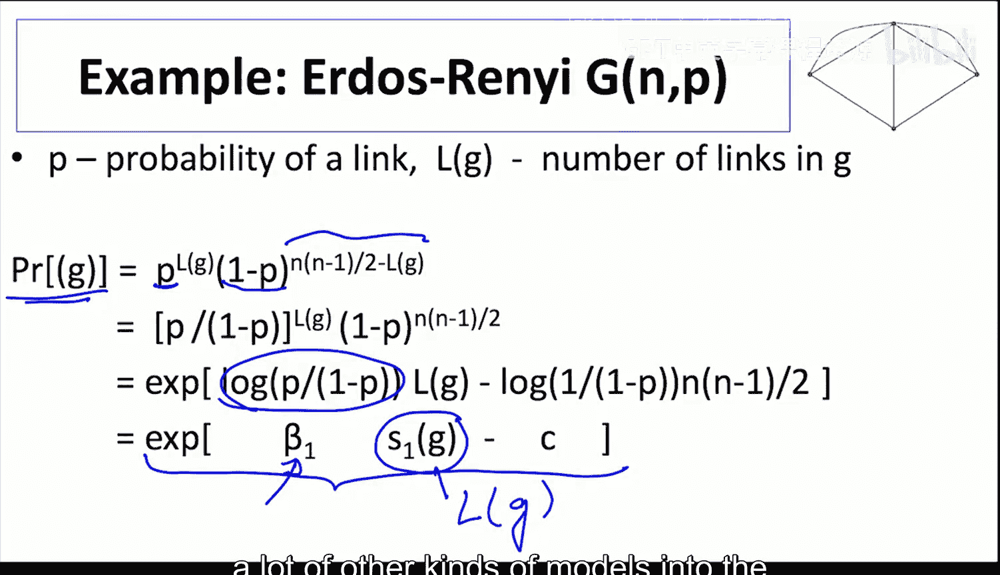
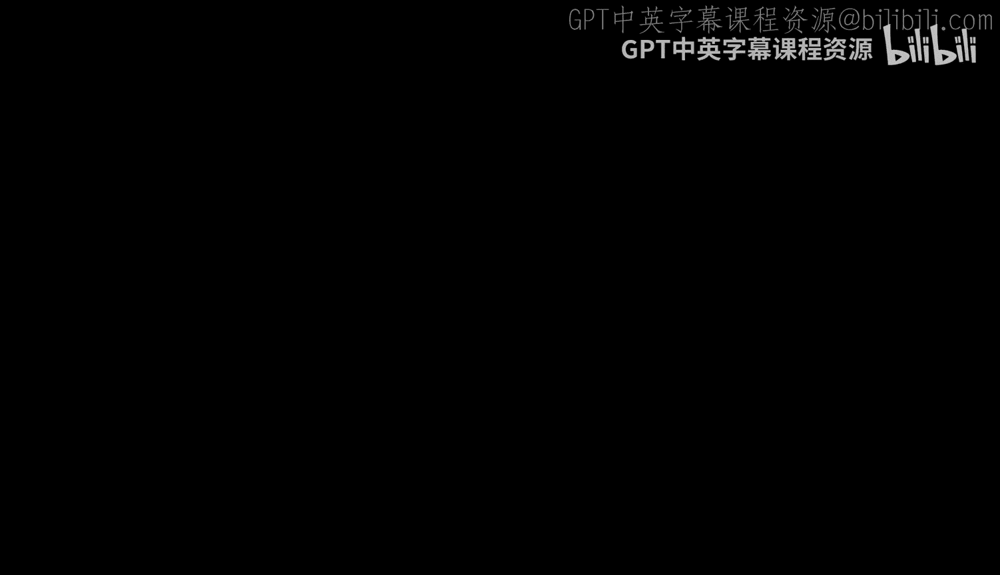
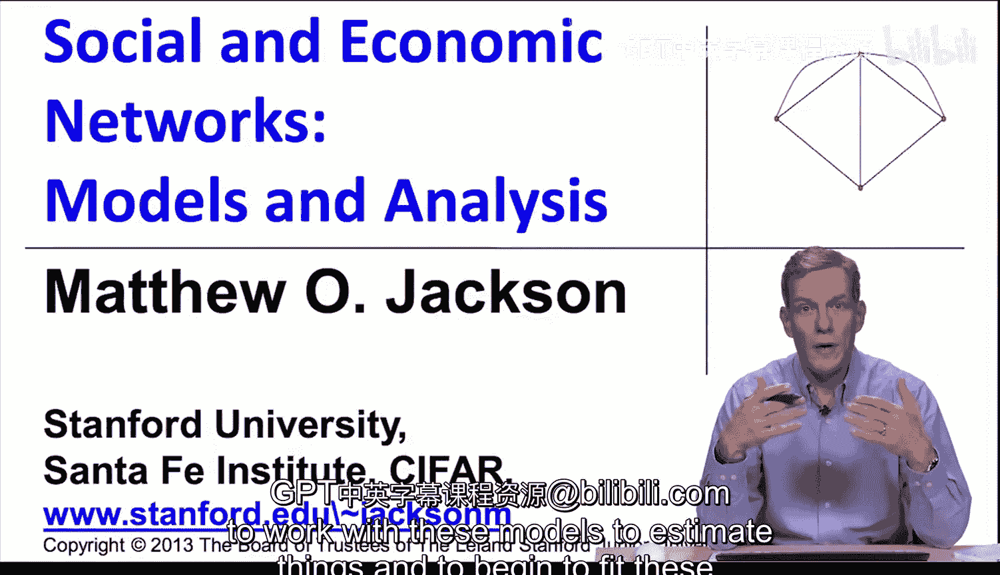
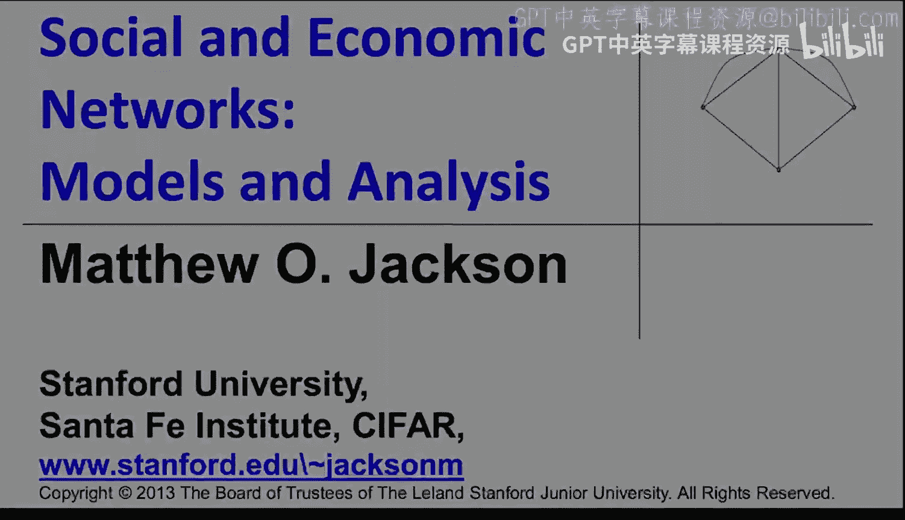

# 斯坦福大学《社会和经济网络：建模与分析｜Social and Economic Networks： Models and Analysis》中英字幕 p30 30_03_07_3-7-指数随机图模型.zh_en -BV1v1421U7Nk_p30-

y folks， so now we're going to talk about models of networks that allow us to capture interdependencies and these are often known as exponential random graph models So we went through these different forms of models last we talked about stochastic block models and now we're going to talk about a popular set of models which are known as exponential random graph models and we're also going to talk about some variations on these kinds of models some new types of models which are easier to estimate than exponential random graph models and so I'll talk to that after we get to the basics okay so first of all。

 a quote from Jacob Levi Moreno and Helen Hall Jennings from 1938 and this sort of you know gives us the idea that when we're looking at situations with we're looking at social interactions and people are interrelated we're not going to be able to look at just binary relationships dads we're going to have to be looking at bigger configuration。

And so that is something that is driven home by their original quote here that a pertinent form of statistical treatment is one which deals with social configurations as holes and not single series of facts more or less artificially separated from the total picture and a very interesting thing here I pulled a picture from Moreno in 1932 so actually the Moreino is also known as the father of sociometry。

 he was a social psychologist and here he was actually mapping out ties between individuals in different houses in New York he was at Columbia University in the 1930s and was one of the first sociograms or situations where we've actually mapped out a network in a graphic form of social interactions between individuals one of the first ones that I know of okay so let's talk about this class of models so the previous models we've talked about are not great at fitting data。

with lots of clustering and other kinds of dependencies and in particular in testing many social and economic kinds of theories which will give us reasons for which people might be interacting with each other in certain particular forms and so the idea here is that you know the link between two individuals I andJ could depend on the presence of a friend in common does J okay and I okay as well that's something we want to capture the difficulty with this is once we allow one link to depend on another link then we open a Pandora's box where now all the links could be interdependent so if I andJ depend on whether they have a friend in common and in that friend depends on whether they have other friends in common and also depending on whether I and J are there。

 everything gets put back together and so we have to specify all of the interdependencies and Frank and Strauss in 1986 and this started working with a class of models which became known as peace star model。

And were both sort of imported into the social networks literature and enforced by Vaerman and Patterson in the 1990s and have since become known as exponential random graph models and let's start by just going through an example of this。

 and this is sort of the simplest possible complication that we could have to a given model where instead we had links before now what we're going to do is allow the probability of networks to depend not only on a number of links present but also to depend on the number of triangles present so we could say that links with triangles are more likely to appear than links networks without triangles so we're just going to complicate things on one very simple dimension。

 but one it actually turns out to be quite powerful in terms of enriching the picture that we have。

And in particular， this idea that we could have that a link depends on whether you have a friends in common that's going to give possible presence to more triangles than would appear in something like an introduction in random graph and so what's the idea behind an exponential random graph model now we have the probability depends on the number of links we have the number of triangles times some parameters so if we set this parameter to zero then that would zero this out and all that would matter was links。

 but if that's not zero then we have a situation where now we have both links and triangles mattering in order to make things into probabilities what we're going to do is then make sure that this thing turns out to be something between has's going to have to be。

Non negative and lie between0 and1。 And so the first thing we can do is instead of just having a probability be proportional directly to this we'll exponentiate that thing。

 So it's always going to be non negative。 This is a standard trickricken in statistics work with the exponential family。

 So now we have something which is non non- negative or generally going to be positive。

 So the probability of a graph is proportional to some exponential function of something about the number of links and the number of triangles。

And one very powerful theorem by Hammerley and Clifford showed that pretty much any network model could be expressed in the exponential family with some counts of graph statistics。

 so it might not be links and triangles， it might be links triangles。

 a number of three prong stars you have， it could be that it depends on the number of cliques of size six。

 it could be a quite complicated list of statistics。

 but the theorem that they had said that pretty much any network model that you could think of could be expressed in this form。

And just as a check on this， let's go back to our Udarenni random network model and see how this works so let's let P be the probability of a link L of G is the number of links in a given graph what's the probability of G in that world well under the Udarunni the chance that you had exactly this network full of links is the probability P that all of the links that are present formed and one minus P that all of the links that did not form。

Didn't form okay， so that would be the probability of getting exactly a particular network with L links。

Then let's rewrite this， so we'll pull out the L， so I'm just repackaging this so that we can write this as P over 1 minus p raised to the L of G times 1 minus p to the times n minus1 over 2。

And let's write this now in an exponential form。 So another way to write this is this is the exponent of the log of p over 1 minus p times l of g minus some extra term。

 which doesn't involve the number of links at all。 So what does this look like。

 This looks like in an exponential function of a statistic of the graph where in particular。

 the statistic is the number of links in the graph。

 So you could write the probability of anreren graph as in this form where now this looks like log of P over 1 minus P。

So we can see that I mean， this is not a proof of the Hammerley Clifford theorem by any means。

 But what it does give us as an idea that you can convert a lot of other kinds of models into the exponential random graph family。

 And that's gonna be quite useful。

Now one other thing to make this a probability of course these have to sum to1。

 so in particular that means that we have to normalize by what the probability of all the graphs are to make sure that the probability of one particular graph when we sum across all the graphs this is going to sum up to one so the denominator of this probability is going to have to be the sum across all possible graphs of what the probability of those relative probability of those graphs would be so now if we sum this thing across all graphs。

 the sum of now the p of gs across all g primes this thing will now equal to1 because we'll get the sum to be the same on the top and the bottom and also you can write this you know we can bring this denominator which doesn't depend on g anymore into the numerator as minus sum constant is just going to be the。

Corresponding constant which captures this denominator。

 So what we've got is an exponential random graph family which allows us to capture different types of statistics and that's going to be quite powerful in allowing us to fit a lot of things and incorporate a lot of things。

 the main challenge is going to be in estimating these kinds of models。

 So now next in the next video I'll talk a little bit about how to work with these models to estimate things and to begin to fit these。

