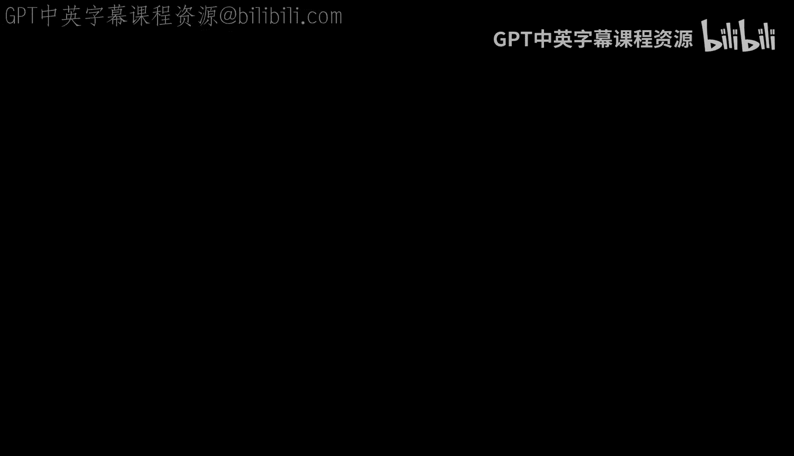
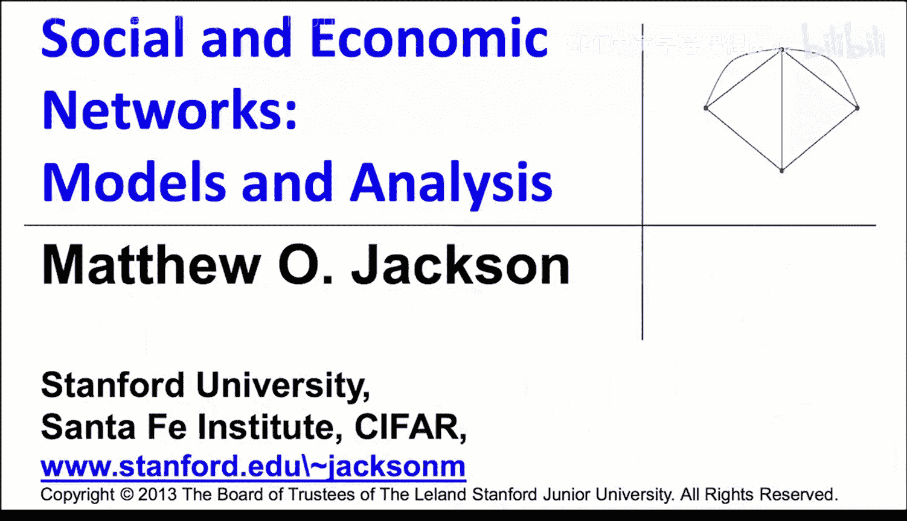

# 斯坦福大学《社会和经济网络：建模与分析｜Social and Economic Networks： Models and Analysis》中英字幕 p31 31_03_08_3-8-指数随机图模型估计.zh_en -BV1v1421U7Nk_p31-

Okay， so let's talk a little bit about estimation of exponential random graph models now and see what some of the issues are。

So in particular， what we saw， just to remind you， we have the probability of a graph now depends on some set of statistics of the graph。

And multiplied by some parameters and in order to make this a probability。

 then we have to sum across what this would look like for all possible graphs。

 the power of such models we can put pretty much anything you want in those statistics so if you wanted to keep track of links。

 triangles， you could make these based on covariates。 so as we talked about in the。Block models。

 you could have links among blue nodes and links among green nodes。

 links between blue and green nodes， triangles involving blue greens and yellows， etc ceter。

 So you could have all kinds of different statistics。

 keep track of those And the idea then is that using this kind of model would allow us to test to see whether certain things are going to be significant or not So are the parameters nonzero。

 are they positive， Are they negative， what are they look like。

 that gives us some idea of how these different things matter in the formation of a graph Now what's the difficulty。

 the challenge in these things is how are we going to estimate these。

And so let me start with just an example of an estimation of one of these things。

 so if you remember our Florentine families example， so there's a paper by Robins。

 Patterson Kish and Lusher and 2007， they're visiting an exponential man graph model to paget and Nsl's Florentine data and in particular they're going to look at the business ties between the major 16 families and what they're going to do is is try and see whether or not to what extent this depends on links。

 two stars， so two individuals connected to a given individuals so we've got links， two stars。

3 stars。😔，And triangles okay so these are the different things we can count up how many of each one of these different shapes is present in a network and see if to what extent each one matters in the determination of a graph so we've got the probability of a graph depending on each one of these things and then we can ask what do these different parameters look like right so what do the parameters look like on these。

Okay so this is the network in this case it's a very small set of nodes， small set of links。

 so we see a few triangles， we see some links， we see some two stars。

 three stars and so forth and we can go ahead and estimate this and here you can use programs we'll do one of these in a problem set you can use statnet for instance which is a program package in R and you stick in your data set and end up just directly trying to fit an exponential random graph model it asks which kinds of things you want to throw in and then it'll spit out an answer so in this case the software go ahead and estimate things and we'll talk about how it's done in a moment and what does it give us it gives us on links we get a parameter of minus4。

27 standard error of about 1。13 so this is statistically significantly negative so that's a network that doesn't like links so if we go back to this it's a fairly sparse。

Neworks， so networks that have fewer links are going to be more probable under this model with a negative parameter there。

 networks that have lots of links would be less probable。

 So this is a fairly sparse network so it's not surprising that it gets a negative parameter here It likes two stars1。

09 it dislikes 3 stars0067 and it likes triangles1。32 so we end up with some different parameters。

 Now exactly how we interpret those is a little complicated。

 It's complicated by two facts one we're not quite sure the combinations of these different things so links are going to be inside two stars inside three stars and so forth。

 we also haven't given us any theory of exactly why the business dealing should have one type of structure or another。

 So going at this with a social theory would then allow us to make sense of these and you can go to the original article for more discussion of that But what I want to do is talk a little bit about how these kinds of things are estimated and then what。

should take away from those estimates。So what's the challenge in estimating an exponential random graph model？

So we put down our formulation， we've got a bunch of statistics。

 we want to see if they matter and to what extent they matter positively or negatively and in order to make this a probability。

 we had to sum over all the possible graphs of what this could be so the idea is how likely graph G is depends on comparing it to how likely all the other graphs would be in order to figure out why this one got picked out not to the other one so in order to go ahead and estimate this to figure out so for instance。

 if we want to do what's known as maximum likelihood estimation。

 what we would want to do is let's pick the parameters that actually make the given graph that we saw as probable as possible so which parameters would make this probability as high as possible well the difficulty is in order to figure out which parameters maximize this function。

 we have to be able to do this sum in the denominator right。And that's going to be tricky。

 why is it going to be tricky， there's a lot of graphs to sum over。

And so a technique of instead of actually doing an explicit calculation here would be to try and estimate this instead and we'll estimate this。

 the standard technique is using MCmC Markov chain money Carlo techniques for estimation and this became popularized by Tom Snyders and Mark Hancock made some breakthroughs that allowed this to be applied to exponential random graph models and that's what underlies the software。

 So instead of summing over all G primes， what we'll do is we'll sample some G primes and then try and extrapolate and estimate that denominator based on that。

 the program' is a little more complicated but essentially what it's doing is walking a space and trying to pick out different G primes and then based on that it can get a relative likelihood and then figure out by looking searching across different parameters which parameters would meet the highest likelihood of seeing the data we actually saw。

 So what's the difficulty with this。Well， remember if we had just 30 nodes in our graph。

 there's two to the 435th possible networks， which is more than you know it's estimated there's less than two to the 258 atoms in the universe so we're way above the number of atoms in the universe so it's going to be impossible for us to actually look at that space and in even pick a small subset of that space so if we're just randomly picking some G primes in a denominator。

 the chance that we're actually picking a representative sample is tiny because unless we have an algorithm that really walks a space very well given how many different networks there are it's going to cause difficulty and in particular。

 there's recent theorem by Bamii， Bresler and sly， there's theorems related theorems elsewhere in a statistics literature and what it chose is if you've got a dense enough exponential random graph model。

This type of MCMC technique and in particular using what's known as global dynamics。

 which is a form of gib sampling， the estimates are actually going to become efficient only if you're able to look at an exponential number of graphs and unless you have approximately independent links。

 so that's a mouthful， but what it's saying is if you want to be able to do this with less than exponential number of graphs。

The network' is going to have to be one that has almost independent links。And of course。

 the reason we went to exponential random graph models was because we didn't want to have independent links。

 we wanted to allow for triangles， we want to allow for different kinds of stars to be more likely than one would see at random and so exponential random graph models that are really interesting are going to be ones where we have dependencies and those are going to be ones which according to this theorem are not going to be estimable in less than exponential time now this applies for dense enough graphs but we can also do some simulations to see whether there's going to be problems with with Sprser ones let's turn to a simulation next。

So this is actually a simulation that comes out of work I'd been doing with a Run under Cgar and here what we're doing is looking at the probability of a graph and let's keep things simple。

 we're going to look at links， triangles and isolates and part of the reason we're going to look at isolates is when you look at graphs。

 your tend to you often find more isolated nodes than you would find at random and so in order to really estimate things while this is something you often have to keep take into account。

So let's look at 50 nodes and we're going to fit a very simple model。

 just an exponential finished random graph model where we keep track of how many isolated nodes there are。

 how many links there are， and how many triangles， so very simple model。

And what we're going to do is we're actually going to draw a bunch of graphs。

 so we'll give it graphs that have basically we're going to feed into the program a bunch of networks that have roughly 20 isolated nodes so each node is isolated with probability about 0。

4 we'll feed 10 triangles in so we'll put 10 triangles down at random 45 links down at random so we're going to draw links so that on average you get 45 links we'll draw a triangles on average get 10 triangles and we'll do these by picking binomials so we'll just do this at random and then 20 isolated nodes so we'll start by picking 20 isolated nodes on what remains we'll put down a series of triangles and then what remains we'll put down a series of links we do this 1000 times so we'll drawing very similar graphs to each other1000 different graphs and each time we'll fit into the program and then ask it to estimate this function so we'll give it just a bunch of different graphs that all。

have roughly 20 isolated nodes， 10 triangles， 45 links， see what comes back。

So here's the link parameter estimates。So it gives us estimates often in a range somewhere between0 and4。

 but actually it gives sometimes it even gives in the negative3 range。

 so it's popping all over in terms of the link parameter and when you look at the estimates that it's giving back to us in terms of what is standard error are it thinks that it's picking things very accurately so part of the way that it picks standard errors is by looking back at the graphs that it wandered through and trying to figure out what the variation in possible parameters could be given the variation that you could see across different possible graphs and the noise that would be present if the parameters were in the vicinity that you're looking at so it's using a bootstrap method to basically estimate these confidence intervals and when we look at this it thinks that it's very。

so the median left and right confidence intervals are right on top of each other so it will tell you that it's very sure that the thing should be in a certain range。

 even though it's popping all over the place if we do the isolate。

 the isolates parameter is has much less variation in it so it's always coming out somewhere in the range between 15 and 19 basically again it overestimates how accurate it's being because if the confidence intervals were accurate they should be capturing the variation we're getting here。

And finally， then when we look at the triangle parameter。

 the triangle parameter ranges somewhere between zero and about5 and a half and you know again we see sort of sometimes it's very close to zero。

 sometimes it's closer to five and a half， so it's popping all over the place so it's giving us unstable parameters。

 estimates and it's coming up with inaccurate standard error techniques sorry estimates。

And one thing we can do。Is then recreate the network so take the parameters that we get out so the exponential random graph model gives us a parameter。

 the set of parameters so each time we estimate it so weve feed it in a network with 20 isolates。

 10 triangles and 45 links it spits out some parameters and then you can actually allow the program to then randomly draw a network from using those parameters and hopefully if you randomly draw a network with those parameters you ought to get one back that has fairly similar characteristics to what you started with so when we look know the isolates parameter was pretty tight it should hopefully give us back something with the right number of isolates but the link parameter was all over the place。

 the triangle parameter was all over the place， maybe it's not going to be so good at doing that well indeed if you recreate the number of isolates most of the time it gives you something in the range of around 20 isolates。

is good so it's recreating the isolates fairly well occasionally it gets stuck near 50 so it gives you an empty graph back so isolates are doing okay when it does triangles it does miserably so remember weve fed it a graph that pretty much have on average 10 triangles somewhere between5 to 15 most of the time so very few triangles and when it recreates them occasionally it gets 10 triangles but most of the time it's somewhere between 1000 and 3500 so it's just it's packing these networks full of triangles even though it shouldn't be。

When we do links， something similar is happening so the actual number of links it should be generating is about 45 and yet it either gets very close to0 or somewhere between 150 and 500 so it's having problems estimating these parameters and then when you try and recreate and draw random networks from it the networks that it's giving back to us look nothing like the ones we fed in and that shouldn't be surprising given the theorem that we had by Bmii and all that said that there's going to be difficulties and actually wandering through and estimating accurately what that denominator is and the exponential random graph model so there's some fundamental difficulties here so MCMC techniques can be accurate here and so we're faced with this problem of how we compute parameters and there's also questions about know even if we could do the computations are we confident that for all a a reasonable class of models that if we had large numbers of nodes that these parameters would be accurate。

There's a computational issue and then there's also just an open question of how consistent are these estimators of these and it's also important for us to be able to generate networks back so if we want to do questions of counterfactuals so what would happen if we had a program to encourage certain kinds of ties to form so we want to subsidize research and development and we put in subsidies to try and create research parks that's going to create certain kinds of ties in a research and development network what kinds of networks would emerge we want to be able to estimate parameters and then see what would happen if we did counterfactuals change some of those parameters okay so that's a question we'd like to be able to do next we'll look at a class of models where we can begin to actually do that kind of estimation。

