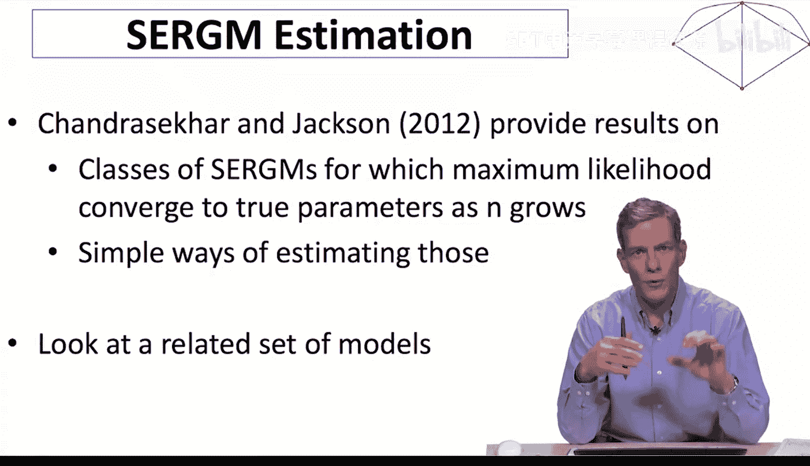

# 斯坦福大学《社会和经济网络：建模与分析｜Social and Economic Networks： Models and Analysis》中英字幕 p32 32_03_09_3-9-稀疏指数随机图模型.zh_en -BV1v1421U7Nk_p32-

So we're talking about exponential random graph models and some of the issues in。

Estimating those。 And so now what I want to do is is talk about another class of models called statistical exponential random graph models。

 So serrghums for short。And so what we've been through is we had sets of models that are linkbased other models which are still linked by linkbased。

 which can begin to capture different things like clustering and so forth。

 We brought in attributes into the stochastic block models and then we said okay now there's a class of models which allow us to capture richer things where there's true dependencies and try and estimate those things statistically exponential random graph models but as we saw there's difficulties in estimating those。

 And so what I want to talk about now is a class of new ones called statistical exponential random graph models that will allow us to keep the track of these local features and dependencies and actually do some accurate and fast and easy estimation So the exponential random graph models are not accurately est in many cases。

 there's basically too many alternative networks to consider So what's the idea here。

 what's the way out。 the way out is going to be that many networks lead to the same statistics。

 So for instance in the simulations we did in the last video what we had was。A series of 45 links。

 10 triangles and 20 isolated nodes in fact， under the statistical under an exponential random graph formulation any network that had exactly those characteristics would be equally likely。

 they'd all lead to the same function they' lead to the same probability So what we can do is begin to say okay look even though there's many different networks to search over In fact。

 what we really need to keep track of is just the number of different types of statistics because all the networks that have the same statistic have the same probability and so we can look at those as equivalent ones collapse all those equivalent networks and that makes the summation in the area that we have to be searching over much smaller than what it was before and part of this came out know why am I going to talk about this this is coming out of a paper with a Rochandra Cgar and effectively the way I got interested in this was in projects where I had to be。

ussing exponential random graph models or something that really accounted for dependencies and finding that the software just didn't work。

 and I couldn't find any models that were actually working。 And so the idea was， okay。

 we need some models。 so let's go develop them。 So so here I'm going to tell you about a class of models which I've been working with。

 which I think solve a lot of the problems that we have there in the literature。

 We're going to collapse these equivalent networks And so let's just go through the idea here。

 So we start with our exponential random graph model right so we've got some vector of statistics of vector of coefficients on that。

 We've got the summation that we're having to do。 And so what we're going to do is let's let n of S prime be the number of networks that would have statistics equal to S prime So how many different networks are there that have 20 isolates。

Okay， say 10 triangles。And45 links。So that's a set of statistics， that's our S of G。

 So how many different networks would have exactly this that will let N ofS be this Now that's not necessarily an easy number to calculate and in some cases。

 it can actually be a complicated number to even to estimate， but we'll talk about that in a moment。

So what we can do is is we take this original exponential random graph model and what we can do is is instead of summing over all G prime。

 we say that any G primes that have the same statistics are going to lead to the same。

Exponential here， right So if if G prime and G double prime have the same statistics。

 they're going to give us the same number down here。

 So instead let's just sum across the S primes and then weight that by how many different networks would have generated that same S prime So we've changed this into a summation over statistics instead of of the raw networks。

 So now now we just have to worry about how many instead of how many different networks there are in the world。

 we just need to think of how many， what's the range here。 Well。

 it's the number of triangles you could possibly have or the number of links you could possibly have。

 which is going to be much smaller。 Now the second thing we're going to do is then instead of thinking about the probability of a network。

 we can actually think of what's the probability that we see。

A certain set of statistics so ultimately it's not so much that we're interested in the particular network we saw as much as it had 20 isolates。

 10 triangles and 45 links so that was the really important aspect was that it had certain attributes that are the kinds of things we're going to want to test as scientists does the network have certain characteristics not was a very particular network realized as opposed to some other one whatever the characteristics we're really interested in we can put into those statistics and so this is what we're ultimately interested in what the probability that we see a network that has certain characteristics so now we're going to call this the statistical form here because we've gotten rid of the networks and we're just talking about the properties of the network and all the summations are now in statistics space which can be a much smaller space that we're working in than the original space and that idea is the idea behind these statistical exponential random graph models and of course any one of these representations of an exponential random graph model。

Has a corresponding。Representation in this format。 And if we can estimate the parameters here。

 then that tells us what the parameters would be in the original model so we can work in this space if we can do the estimation and track back and we get the exponential graph So the basic idea here just to emphasize instead of asking what the probability of a specific network is。

 we ask what's the probability of seeing certain density of links， clustering， average path length。

 whatever the statistics are you're interested in what the probability of seeing something that has those characteristics。

Okay now one other thing is when once we start representing things in this form so we've got this statistical form then we can begin to say you know why do we have what's known particular what's known as reference distributions so here this is the number of graphs that have a certain set of statistics but it's not obvious that we might not want something else and in particular you could put in whatever k function you want instead of the number of graphs that have a certain staistic put in some other number you could weight these differently and that would still be a valid model of how statistics are generated and in particular in a few minutes we're going to see a model which give us will give rise to ks which will look actually very different than the ones that come out of the usual exponential random graph family so there's a natural way of thinking of other kinds of weights than the ones that are there。

Okay so I've just been through emphasizing the idea。

 so now we've got things in statistical space that's going to be easier to work with than working directly in the graph space。

 Okay now one thing is you can encode whatever you want in terms of these statistics you can also begin to put in preference based models and we'll see some of that I guess in the fourth week of the course so we'll come back and you can begin to do preferencebased models and test for whether people have certain kinds of preferences and biases and preferences in these models as well so what's the real challenge now still in estimating these just to reemphasize。

What we're usually faced with is one network right we don't see many different networks。

 So usually we just see one realization and now we've got these interdependencies。

 So we've got problems in working with large numbers because we've basically only got one observation but we do have many observations of how many links are present。

 which triangles are present even though these aren't quite independent， we can still ask a question。

 are they enough， is there enough information in one of these things to estimate a model and so it's not completely obvious that as you estimate these kinds of models we've got always interdependencies that whatever estimates of the parameters you're going to get are going to be accurate so we could do we can go ahead and do say maximum likelihood on this kind of model and exponential random graph model but now within the statistical form and we can go through and estimate these things So we saw certain statistics come out。

 we could say okay what are the betas which actually maximize this function make it most likely that we saw these statistics rather than。

other ones， now we can just go ahead and do maximum likelihood on this function and we can ask。

 when is it that these betas will be accurate estimates of the true parameters。

 how large does our data set have to be before we're pretty sure that we're getting an accurate look at what nature was doing？

Okay so there's a set of theorems that we have in a paper in a 2012 paper where we actually show classes of statistical exponential random graph models for which maximum likelihood is going to converge to the true parameters and grows and provide some easy ways of estimating those and instead of going into that detail you're free to look at the paper what I'm going to do is look at a very simple related set of models which will generate particular cases。

 give us some idea of how these things work and lead to really simple and fast estimation。

 so that'll be our next topic。

