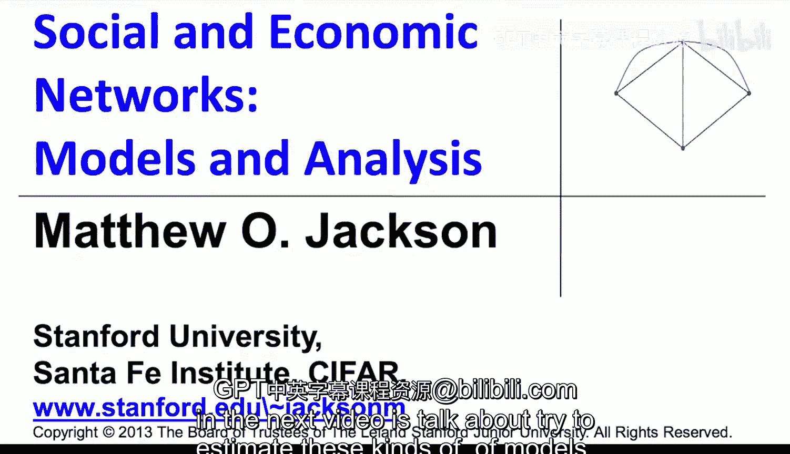
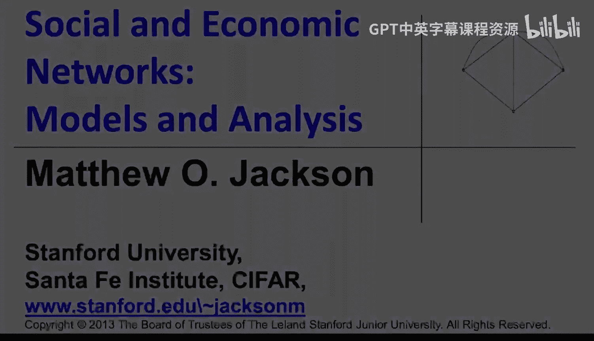

# 斯坦福大学《社会和经济网络：建模与分析｜Social and Economic Networks： Models and Analysis》中英字幕 p33 33_03_10_3-10-稀疏通用图模型.zh_en -BV1v1421U7Nk_p33-

So now we're going to talk about another class of models which are easy to estimate and related to these exponential random graph models and sms。

And these are called Sums， so we're very inventive in our names。

 so what the idea here is again we're going to be looking at ways to easily incorporate dependencies in networks and think about different kinds of subgraphs that might be forming and allow those to be generated and try and estimate how they're being generated。

And the idea of Suumms， the terminology is quite simple。

 it's from subgraph generation models so we think of subgraphs as being generated， links， triangles。

 small stars， et cetera， those are the things that are going to be generated and then the network is a byproduct right so what's happening is people are forming different types of relationships。

 different kinds of cliques and the network bubbles up from that。Okay。So in particular。

 what we're going to think of is think of whatever type of subnetwork you like， so maybe it's a link。

 maybe it's a triangle and what happens is these things will be independently formed with some probability P subJ and then we end up with some number of those so say S subJ subnetwork so our 45 links or 10 triangles。

 these things are going to be generated and the difficulty is that they may overlap so sometimes people form links。

 they also form a clique， so I end up partnering with somebody but I also form a group so if you wanted to look at to say a co-authorship network。

 I might have written with one person and just one paper but then we also collaborated with somebody else on a different paper so we end up forming both a link in a triangle and if you just look at the co-authorship network then。

It's harder to see that directly in the data， so we observe the resulting network and then what we're trying to do is infer these different probabilities of different types of relationships that came out okay so let's just go through a simple example we start with a bunch of nodes。

 let's think of just generating links and triangles。

So there's some probability that different links form so in this case a bunch of links form here。

 nine different sorry triangles form， so nine different triangles are formed at random so out of all the possible triangles we formed nine of them then a bunch of links formed so the links are dropped down afterwards and what do we end up with we end up incidentally generating some triangles right so when we look at this there was these two edges had already been there because of a of triangles they were generated this one was generated as a link and it ends up generating a triangle and when we actually see it in the end。

 we can't tell which ones were generated in which way so what we're left with is some links some triangles and we're trying to estimate then what's the probability of these different types of subgraphs being formed。

So that's the idea so these are subgraph generation models so first of all let's try and see is there a way to view these subgraph generation models as statistical exponential random graph models now you remember when we went through exponential random graph models to begin with I showed you how you could take a a model of just an Erdreni type where you're generating links at random and you could represent that as an exponential function so you can do the same with just triangles and links and it's just going to sum up so you can go through that same kind of exercise and it shows you then there's actually a theorem this is from the paper with a run so if you have a subgraph generation model with parameters p sub J let SB the true counts of how many links were formed and how many different triangles are formed and so forth so。

That be the vector of true counts of subgraph， and so true is in italics here because we're not going to actually observe the true number。

 we're going to have to infer that。But then the probability that you would see that would be proportional to an exponential family so it would fall in the serrgm family and in particular the betas would actually be the log odds ratios。

 and the ks would be how many different configurations you could form of having exactly a particular count s subj。

 so the fact that how many ways could you get a certain number of triangles out of how many different possible triangles there were and then you take that product and that's what the actual K is so here the ks look different than the ends we had in the exponential random graph model。

 but if we just formed these networks， subgraphs at random and then percolate up a network。

 then that gives rise to a specific form in the exponential family and it has very particular parameters and very particular。

Ws， so what's the difficulty here。 Well， the difficulty is that the true counts of exactly how many triangles were formed and how many links are formed aren't exactly observable。

 but we can get close to estimating them and observing them when things are sparse。

 So if you noticed in our previous example， we had only one。

 given that there weren't too many links and too many triangles there。

 we only ended up with one incidental。 So the incidental were pretty rare。

 It's not that often that you actually get that the links fall down in a way that accidentally generate triangles and and so forth。

 And so if things are sparse enough。 Then we can actually use the particulars to estimate these things。

 And so what we'll do next in the next video is talk about trying to estimate these kinds of of models。

