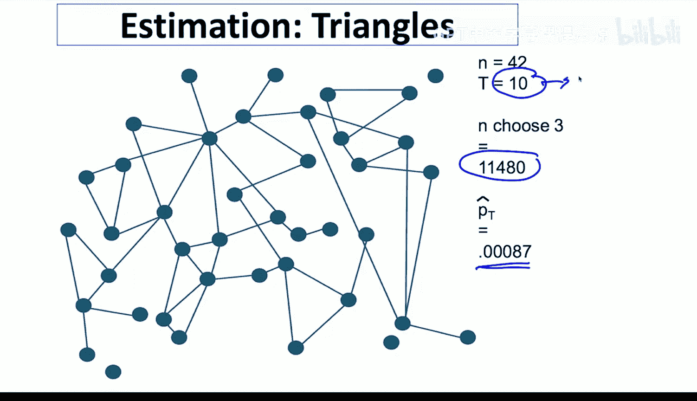
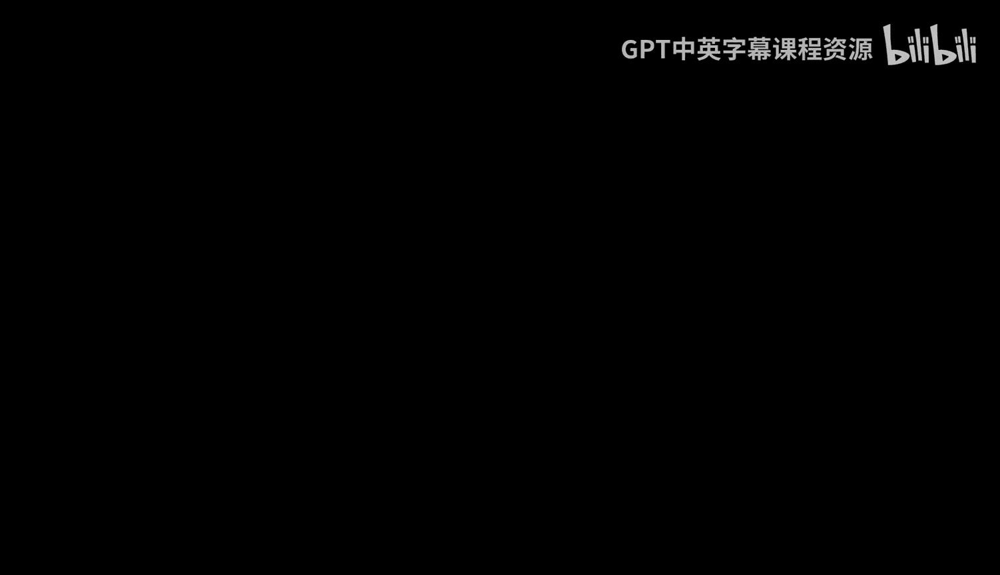
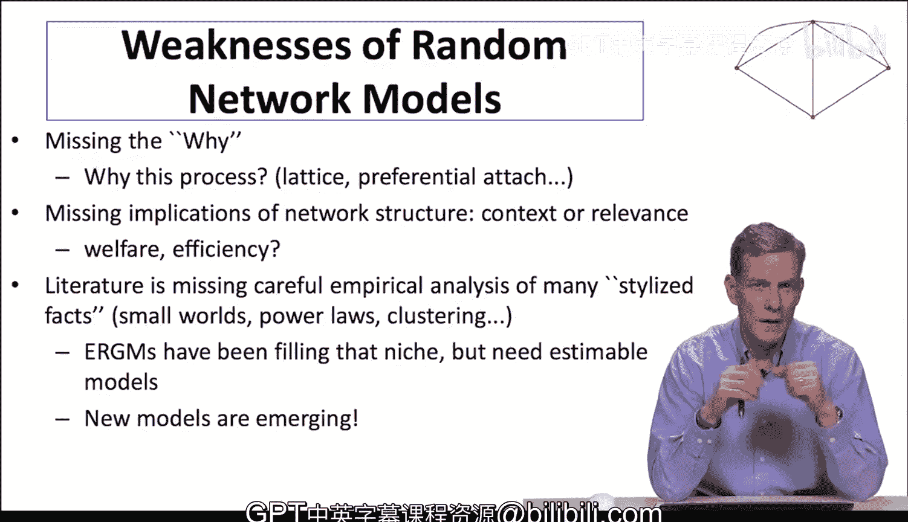
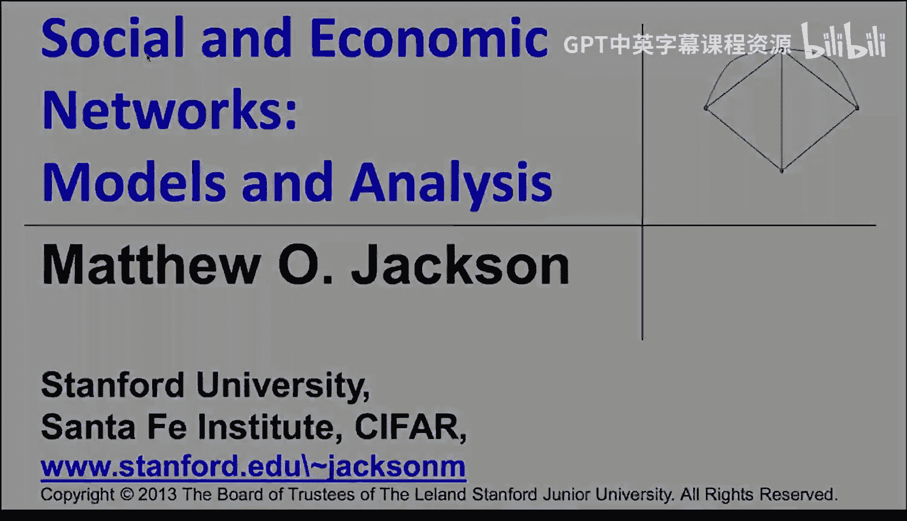

# 斯坦福大学《社会和经济网络：建模与分析｜Social and Economic Networks： Models and Analysis》中英字幕 p34 34_03_11_3-11-稀疏通用图模型估计（可选-进阶-21-03）.zh_en -BV1v1421U7Nk_p34-

Okay， so we're back and we're going to talk now a little bit about estimating these subgra generation models the Suhums。

And again， we're looking at sets of models now that allow us to deal with linked dependencies and allow us to have different types of subgraphs formed and we want to capture those features and so we want to see how we might estimate those statistically so again。

 just to remind you the form of the model now the model is that links form triangles form。

 you could allow that maybe its links between blue nodes， links between yellow nodes。

 links between blues and yellows， triangles involving three different kinds。

 so there could be different probabilities for each one of these things。

 but each type of different subgraph pops up with some probability these things might intersect and overlap。

 we observe a resulting network and then we're trying to infer what these probabilities were。

 So our triangles really being formed independently of links and so forth。

 so we're trying to estimate those probabilities so there's sort of two different approaches that one might use to do this。

 One is with sparse graphs then these incidental。Interactions are going to be rare and direct estimation turns out to be valid and consistent There's also in the paper with the run you can go ahead and we also provide an algorithm that corrects for small numbers or gives estimates for nonparrse graphs there's algorithms that you can use to actually just go through and try and estimate directly。

 how many links there would have been， how many triangles there would have been and try and figure out how many of those were incidentally or overlapped generated in terms of overlapping and then you can just do that directly I'm not going to go through the algorithm for you to the paper but let's just talk about the sparseness so the idea here is that incidentals are generated by combinations of subgraphs that overlap sparsity basically is a condition that refer you to the paper in terms of its full glory it basically says that you know different types of subgraphs are rare enough that when they're not going to interact so they can't draw too quickly and it。

on conditions that just go through and we calculate explicitly combinatorics of different possible things generating each other and then bound those and we end up with a fairly tight bound。

 but in terms of an intuitive example if we just go with our links and triangles。

 then as long as the probability of a link is smaller than the square root of n and probability of triangles is smaller than three end to the minus three halves。

 basically what does that tell you， that's in a situation where the typical node is involved in less than root n links and root n triangles。

So if you're looking at a fairly large social network that kind of condition is fairly weak。

 it's going to be fairly easy to satisfy know the number of friends I have on Facebook is actually fairly tiny and in that case it's not anywhere near the number of nodes out there or even a root end and so root end can be a fairly good bound here so again that limits the number of incidentals and if we went through。

 for instance， on this network and wanted to estimate things if we wanted to get estimates of what those probabilities were。

 what we could do is just start let's try and estimate triangles well we have if you go through and count triangles they were actually nine that were originally generated directly and then one incidental if we didn't see how they were generated we would estimate that they were actually 10 generated on these 42 nodes and so we weren to trying to figure out what's the relative likelihood of triangles forming well how many possible triangles are。

well there's n different nodes， 42 here 42 choosing triples you can do 42 choose 3 if I did my calculation correctly it's 11480 and so what's our estimate our estimate is going to be the 10 that we observed out of the 11480 and so what we end up with is something about one in 1000 of the triangles that could be there are there so that gives us an estimate on probabilities of triangles and in fact the estimate should have been if we were able to actually see what nature really did it should have been9 instead of 10 okay so the idea is with sparsity。

 we're not off by far in terms of what our estimate was。

Estimation of links what we can do is now look at how many links there are not in triangles so we've got different numbers of links that were formed not as part of triangles。

 we count up those。 you can go go through and count those you're going end up with 23 if I counted correctly So you end up with 23 not in triangles and here how many links could there have been well how many pairs of nodes are there there's n choose2 861 in this case minus 28 that appeared in triangles and so we don't count those So there's 833 possible links that aren't in triangles we saw 23 of them So what's the estimate there。

23 over 833 about a 3% probability on any link for me okay so that would be an estimate for this so we ended up estimating the number of triangles frequency of those things and relative frequency of links and that gives us estimates for what。

parameters are， and then we can test whether they're different from zero， are they fall some range。

 we could test for homophily in this if we had different colored nodes and so forth。

 so we can enrich that。So what's the theorem in the paper with a room again。

 so take a sequence of sparse sums and sparsity then has to be。

Dfined very carefully in a way that says that there are certain bounds on the size。

 the relative likelihood of the true parameters compared to the number of nodes。

Then the empirical frequency counts that we do by just looking at whatever statistic your is。

 you're looking at， figure out how many did you actually observe。

 how many could there have been and the theorem is that when you do this in this very simple way that compared to the true one the ratio of those two things will go to1 so we're going to get a consistent estimation we're going to zero in on the true parameters and in particular you can also show that a normal difference of these things is going to be a zero mean normal random variable So in fact you also know something about the errors there's a version of a central limit theorem that holds here so these things are consistent and they have nice normal distributions in terms of the differences between your actual estimator and true parameters and so then we if you look at what this d matrix looks like it gives you the rates of convergence and all the details are there in the paper but the idea here is these things will be very easy to。

You're basically just doing binomial accounts， so you're counting how many links were there。

 how many could there have been， how many triangles were there， how many it could have been。

 so really simple estimation techniques， and yet it gives us the same kinds of information that we can then back out of an exponential random graph family and gives us accurate estimation with trivially easy techniques。

Okay so let's try and see why we might be interested in these things。

 So what's the need for these kinds of models， why don't we just do straight block models。

 Why bring triangles into the picture， Why bring something else and what we're going to do is we're going to go back to the Indian village data and what we can do is then estimate a model and then use it to generate networks and then in particular。

 try and see how well do the models that we end up fitting end up recreating the networks so we just there's easy ways to estimate these for the to include things like triangles I it really necessary include the triangles。

 supposeupp instead we worked with a block model， we didn't bring this into the picture so what we're going to do is we're going estimate a sum based on covariates allowing for triangles we can also then compare that to what would have happened if we just did a block model accountinging for covariates Does it do better how well do they do it recreating the actual networks。

And does the inclusion of triangles really help us in some substantial way。

 so how are we going to do this？We're going to do a very simple version of categorizing things。

 we're going to have the nodes either be the same or different。

 so we'll allow probabilities of links between two of the similar nodes or different nodes and we'll say that they're in the same class if they have the same cast and if the GPS distance between the homes is less than the median distance between homes okay so go into a village。

 look at two households we say okay are they linked or not。

 what are they of the same cast is the GPS distance greater or less than the median distance so we're looking at two households we'll say they're in similar if they have the same cast and less than the median distance between homes and otherwise we'll say they're different okay so if they're either of different casts or greater distance than the median then we'll put them so we're just going to make it really simple model where we either keep track of nodes and we' allow for two probabilities。

Probabilities for nodes being similar and nodes for being different and similar here means they're very similar on both the。

Dimmenions of cast and GPS location so now what we can do is we can fit a block model so we can say what well allow block model where we have two different probabilities。

 probability of a link if both are of the same category are similar to each other and probability if they're different and then we'll also fit subgraph generation model where now what we're going to add in is also triangles and we'll allow triangles to have two different probabilities。

 probilities of triangles for people that are all similar and probability of triangles if some of the people involved are different from each other so we'll fit the block model fit the subgraph generation model both of these are very easy to fit here right so we can fit the block model is a special case of a Su where we just look at links so we can just count up links count up triangles count up whether the same different so we're gonna to have four different counts and that'll give us estimates on all these things and the block model just looks。

Ignoring whether they are in triangles or not， this subgraph generation model keeps track of triangles separately from links and estimated it that way。

So that's the basic estimation technique， so we estimate these block model， step one。

 we're going to estimate this probability of link， probability of link if you're same or different subgraphft generation model will do the same thing。

 but we're going to add in triangle counts and then once we have these。

The nice thing about these kinds of models is then we can generate back networks very easily So how do we generate a network Well。

 once we have these probabilities there， we can just take the set of nodes， pick pairs， flip coins。

 put in links with probabil same or different depending on whether they're the same or different and then generate a network for the Suga and what we can do is randomly pick triangles or randomly pick links and put them in with these probabilities。

 and then we generate networks Okay so we randomly generate these networks。

 and then we try to see whether or not these networks， recreate the actual original observations。

 Okay so here's what we get。So here's the data， how many triangles are there。

 how many links were there that are not in triangles， so we'll call those unsupported links。

 so links that aren't part of a triangle。And then we also have what's the average degree。

 how many isolates there are and so forth， so this the red here in the first column is the actual data。

So we have 161 unsupported links， 39 triangles， averagever degrees is 2。355 isolated nodes。

 so then we can go through and here's the block model the block model does very well on fitting average degree Well it should because what is estimating is just link probabilities the suumms don't actually do quite as well on the estimate of the average degree because here they're also putting in triangles and so the number of links is slightly off but the number of triangles and the number of unsupported links actually match much better so in particular it's doing better at matching the number of triangles and unsupported links not surprisingly because it's counting those things directly and that's the way we're doing the estimation。

嗯。The subgraph generation models are not doing as well on isolates。

 and so here this last column here is you can also do a subgraph generation model where you allow for isolates And if you do that then you end up doing better on isolates while still doing as well on links on supported links So okay so far nothing too surprising。

 What's interesting then is let's go down here and look at a series of other features of the graph that we weren't trying to fit directly so clustering how well do we do at clustering Well。

 the data actually has about a 10% clustering rate the block model not surprisingly where all links are independent doesn't pick that up。

And so you know one explanation people often say okay。

 well you can get clustering out of block models because if people are in the same group。

 then they're more likely to have higher density of links since you're going to pick that up and here you do see that people are much more likely to form links if they're of the same cast and close in GPS distance。

 but that still doesn't come close to generating the clustering that you need。

 whereas once you put in the triangles then you come back and you hit this and actually if you pull out the isolates you hit it right on the money so you can get the clustering much better by allowing for links to be dependent in a triangular form。

Then you can also ask you know what's the fraction in a giant component And we see that， you know。

 again， you do better at fitting the fraction of nodes in a giant component。

 you can the first eigenvalue of the adjacency matrix。 That's how rapidly things expand again。

 the subgraph models are going to do better than just the block model and in particular once you get the isolates。

 you coming pretty close。 Second eigenvalue of the sastics stochasticized matrix。

 This is a measure of homophily。 actually， once you throw the isolates in into the subgraph generation model this moves away a little bit。

 but it's still fairly good in terms of that。 average path length。

 you're going come closer with the subgraphft generation model。 these models aren't perfect。

 but what they are doing is it's allowing you to get a little closer on some of the features。

 and let's actually take a look at some graphs here。 So what do we have here。

 this is a graph at the degree distribution So the truth the actual data is this gray line。

The subgraph generation model is this blue line and the block model is the red one here and what you can begin to see is even though the subgraphft generation model didn't get the average right it actually matched the distribution of degrees much more accurately than the block model did so it missed the first moment but it was better at actually catching the full spread and doing better at matching the tails of this distribution than the block model did so it actually did better in some dimensions of degree than the other model when you get to clustering well the block model is just way off so here's you what's the clustering coefficient and what's the CDF value of that so when you look across the distribution of clustering the block model basically has it says most there shouldn't be any clustering at all the actual data has quite a bit of clustering and the subgraph generation model picks it up much better because it's allowing for these triangles。

But then you can look at other kinds of things， so here's another picture of the average clustering here there are two different types of subgraph generation models。

 one with different types of corrections done so the algorithm is doing a finite state correction algorithm。

And then you can also do the block models with just looking at links only or allowing for different types of covariates and so forth。

 and basically the block models are still going to miss the clustering no matter whether you're incorporating different covariates。

 multiple covariates or not。You know similarly， the first eigenvalue you get different pictures so the block models end up not doing as well when you look at the second eigenvalue。

 actually these are incredibly segregated villages so the second eigenvalue is quite high and in fact the suhums pick up that they're quite high the block models end up having a full spread on these things even though the actual data is all very close to one in terms of the level so here's the actual data numbers are all down here and the subg generation models are picking that up the block models aren't so what do we have we have better fits on these different things you can look at the fraction of the giant component neither of these do that well but if you throw in the isolates then you actually pick up things a lot better okay so what do we get dependencies are really important to pick up in social networks why well that's the whole nature。

Soal I mean what does social mean it means that we're interacting more well generally in more than two at a time and that's going to generate dependencies。

 we need tractable models to capture and test these exponential random graph models are a nice form it's a rich family that has a long tradition in history in statistics but they're not always accurately estimable if we take a step back from these and either work in a statistics space or just work with generating these things directly we get easy and consistent estimation these things are nice to work with and so there are ways of dealing with these things directly and then we can go ahead and test test things we'll see some tests of that in lectures coming up and lecture 4。

9 and others we'll begin to see how we can test different theories using these kinds of models and do that explicitly。

Okay， so。Statistical models give us a medium to go through and estimating these things。

 Often we're going to need to put these models in context So you know where do these dependencies come from。

 are they friends of friends is there some social enforcement so on top of these models we do need some theory。

 some social theory or some economic theory to guide our thinking of we don't want to just randomly put down different types of count into our exponential random graph models we want to have some idea of exactly what should be testing for and again when we get to lecture 4。

9， then we'll start with some particular theories we can go ahead and test those directly using these kinds of models Strs of random networks we can generate large networks with well- identified properties we can mimic real networks at least in some characteristics depending on the kinds of models we put down there so the beauty of these models is now we can tie specific properties to specific processes so it's either subg generation or could be preferential attachment or of meeting friends of friends。

 these different processes we looked at small worlds。

We get some idea of why these different kinds of things are happening in terms of the process that there and some of the weaknesses of these models is we're still missing the why。

 why this particular model and not some other one and there we need to put in some social theory or economic theory behind that and it also then would allow us to say something about relevance so are we really worried about this often we're worried about these things know why do we worried about segregation because it might call inequality or might lead to certain kinds of things so we have to have some idea of what the welfare is involved。

One of the thing is that a lot of the kinds of stylized facts we've talked about， small worlds。

 power laws， clustering and so forth， these things are stylized facts， but often by just saying okay。

 well here's another network that happens to have this and these laws are are basically something that we've seen in a series of different observations。

 but we need something that consistentlyally begin to look across and say。

 is something really statistically there is it there consistently do we see it across different types of observations。

 well we can have some theory and luckily now we have models that are beginning to address this kind of thing and allowing us to answer these kinds of questions。

