# 斯坦福大学《社会和经济网络：建模与分析｜Social and Economic Networks： Models and Analysis》中英字幕 p36 36_04_01_4-1-策略性网络形成.zh_en -BV1v1421U7Nk_p36-

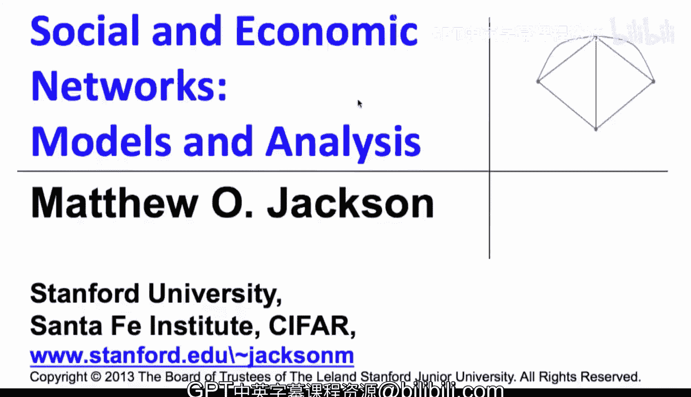

Hello there， so I'm back again and we are here now to talk about strategic network formation and strategic meaning people are actually making choices and the strategic aspect means that they have to worry about what other people are doing and they care actually about things beyond just the possibly the direct relationships they're involved with so we end up with a rich。

Context in which to analyze network formation。

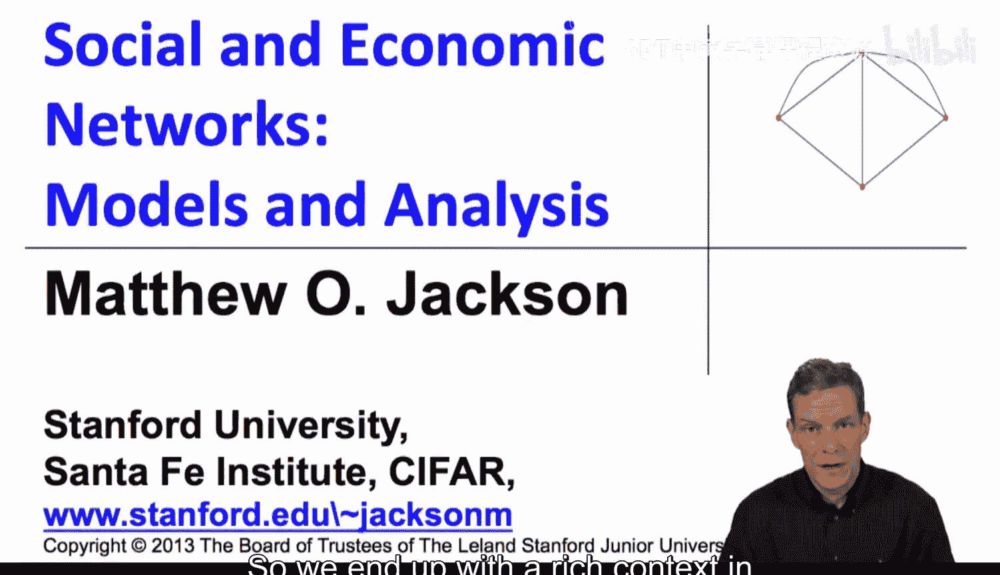

So in terms of our outline of where we are in the course。

 we've gone through and we've talked quite a bit about random network models after we did our background in fundamentals。

Now we're moving into the course where we're dealing with， again， network formation。

 but choices of individuals， and then once we've got this behind us。

 we'll start looking at how networks influence behavior。

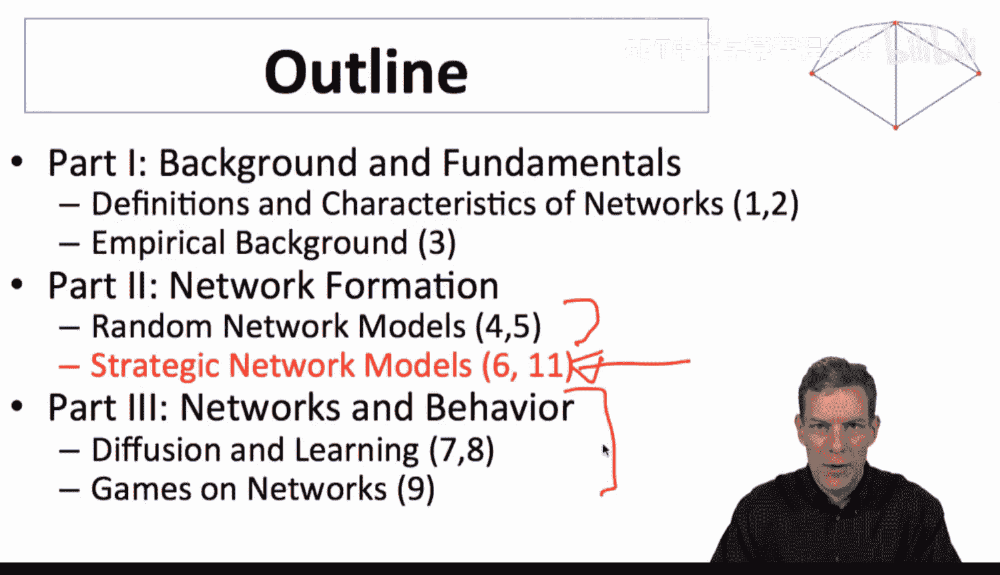

So in order to understand the network economic game theoretic models of network formation。

 this idea that people are making choices， the basic techniques are we're going to think of nodes now as actors that are actively making choices。

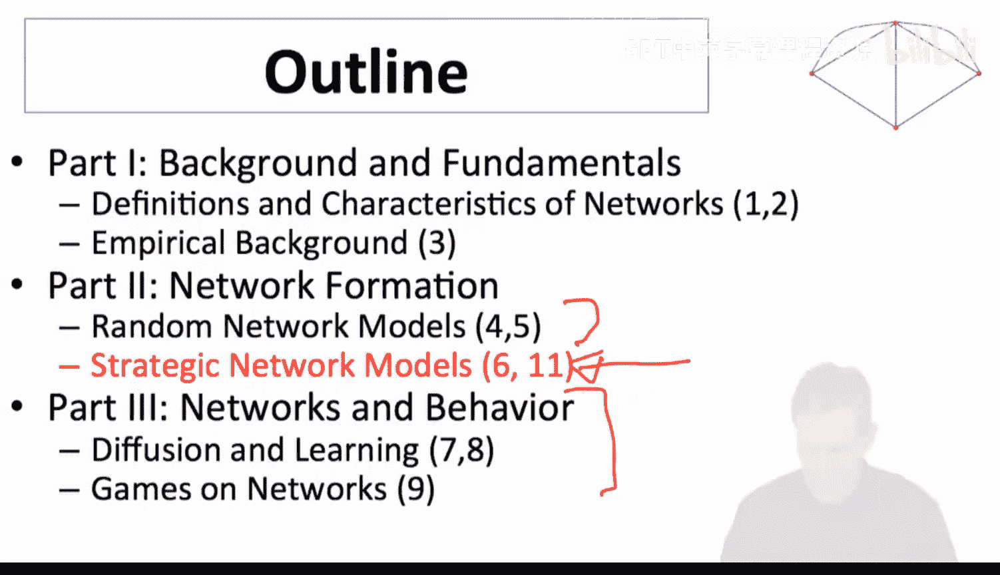

And there's going to be costs and benefits， I'll often refer to these as players。

 so they could be nos， they could be players， agents。

And that'll be fairly vague because sometimes they might be countries。

 sometimes they might be people choosing friends， sometimes they might be researchers choosing collaborators。

 sometimes it might be firms choosing with whom to have a research and development agreement it could be a whole series of different entities it might be an employee thinking about a company to work for。

 so the ideas here are that this could be fairly rich。

 but the main item is that there's actually choice。

 and what we'll be doing is contrasting the incentives of the individuals to form relationships with what might be best for society we'll call social efficiency。

 what's the overall optimum in terms of networks compared to what people will do when left to their own devices to form networks so that's the basic underlying theme。

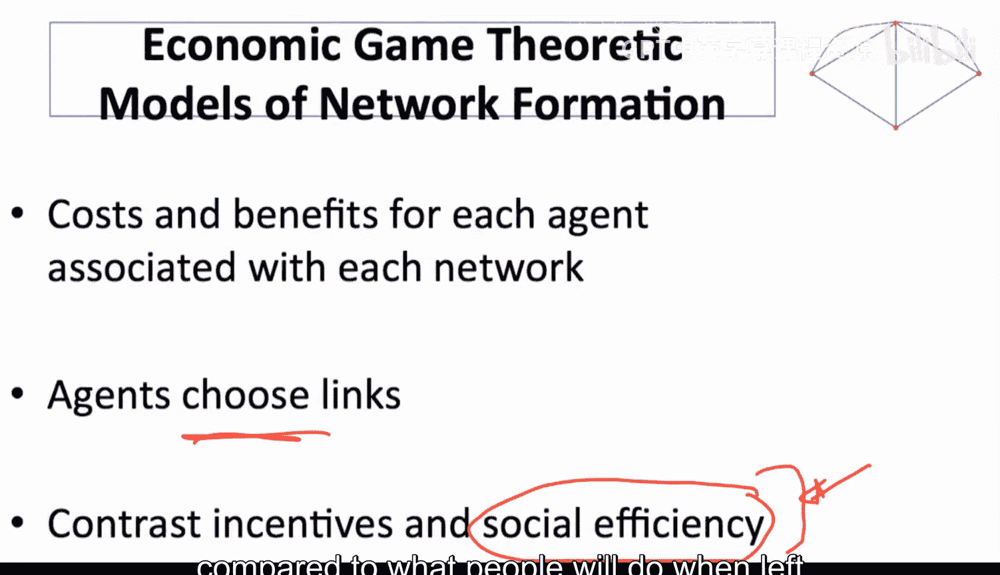

Now once we go in this direction we've got all kinds of modeling choices to make so how do we model the incentives to form ever links first of all is consensus needed。

 is this a directed or undirected network so you know does somebody have to say yes to me to be my friend or can I just。

be friends with somebody otherwise， often in things like citation networks。

 I can cite somebody else without having their permission， but informing a friendship an alliance。

 a collaboration agreement， we're going to have to have consensus form。

Can people coordinate changes in the network so can we at one time say okay， look。

 I'll form a new alliance with you， but only if we can also align with somebody else at the same time。

 is the process dynamic or static is it sort of we going to think of a lot of people coming together and forming friendships at the same time or is this ongoing how sophisticated our agents。

 are these people who are calculating know in the case of international agreements。

 you know there are people calculating what's the value of these。

 how should they be structured or are these people kids in a high school bumping into somebody and forming a friendship？

How much are they forward looking about this， what do they know when they're making a decision。

 do they know a lot about the structure， do they make errors， what's going on。

 what's generating value， I mean where are people getting value from this。

 where the benefits coming from what are the costs can people compensate each other so you know if somebody's a very valuable friend can I do favors for them to make it more worthwhile are there different intensities of links are we going to think of01 there's all kinds of modeling choices which come up and which are very interesting a lot of these different things have been looked at in the literature I'm not going to go through all of these different things in detail in in a short time that we have together but instead I'm going to give you some basic feeling for how these kinds of things are modeled and what the issues are and then you can dig into the literature as you see fit in seeing how people have dealt with a lot of these things so we'll do some examples of different variations of these things but we're not going to go through all of the different issues that。

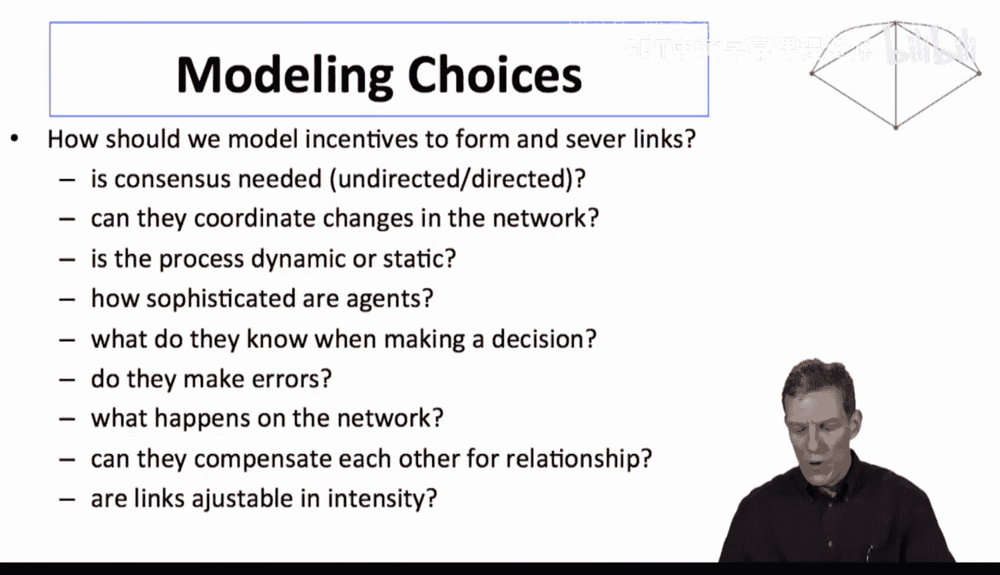

That you can think of associated with this。OkayNow questions to keep in mind as we are going through this。

 which networks are going to form are some more stable than others。

 are the ones that form going to be the right ones from society's perspective， if they're not。

 are they way off or are they pretty close？Somebody wanted to come in and improve the networks。

 can they do so， so for instance， if a government decides that there's not enough collaborations between firms in terms of research and development。

 can they subsidize things to make more of these research and development alliances come true？

Can such models provide insight into observed characteristics so these will be fairly stylized models so we can actually say something about them。

 can we take these to data， are there ways of enriching these to the point that they begin to be data friendly。

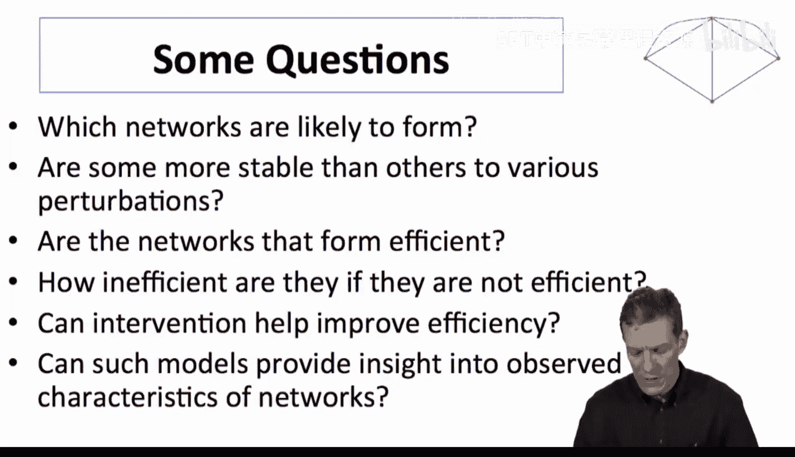

Okay， so what I'm going to start with is just the basic approach in terms of how we would represent this stuff and it comes out of a work I did with Ashher Walenssky in the mid-1990s or early 90s。

96 by the time it was published。So what we're looking at is we are actually going to have a network。

Now generate some payoff to given individuals， so we'll keep track of a utility that a person I or node to I gets from a graph G。

 so an agent， I is going to get a payoff if the network turns out to be G and for the simplest version of this we'll think of undirected but you can do directed weighted networks and so forth。

 but for illustration purposes will take this to be undirected network formation。

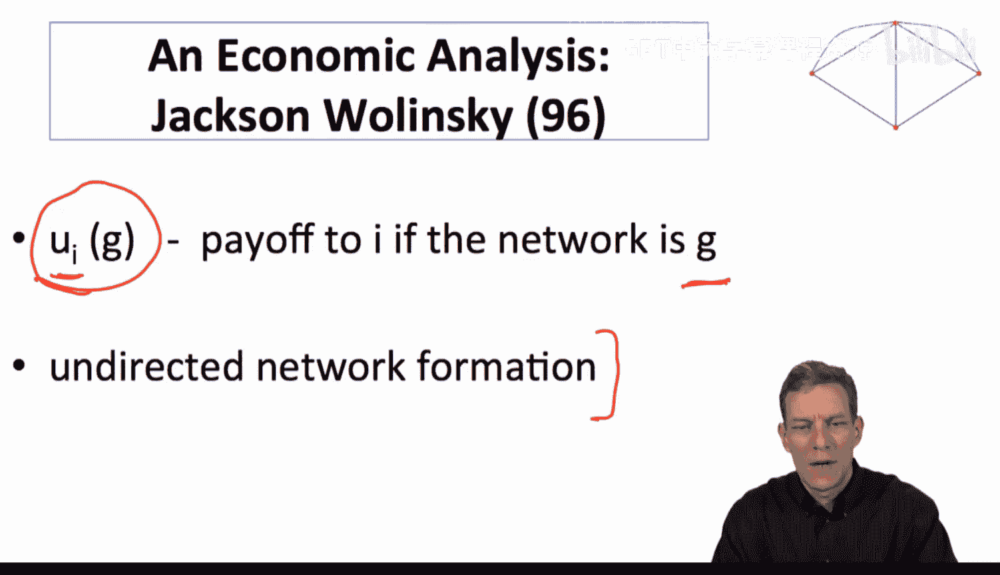

Okay， so let's start with a simple example that came out of the work。With Ashher in the 90s。

 so this is just one of the examples that we use to sort of illustrate some of the ideas。

 so this is called the Connections model， it's a very simple model that gets the idea that I get benefits from having friends。

I also get benefits from having friends of friends。

 so simplest possible network thing is there's values to having friends of friends and friends of friends of friends and so forth。

 And so we'll think of some Delta。As a parameter， which is going to capture how that decays。

 so if you remember decay centrality， there was some decay。

 decay centrality is actually based on this model。So the benefit parameter for I from a connection between I and J is going to be some value of delta。

And there can be costs， so the value of a link between INJ could also have some costs associated with it Now this the general version of this model。

 you could have the delta depend on INJ as well。But let's for now just take delta to be some parameter cost between INJ。

 and when we're thinking about different individuals， I could be directly connected to somebody。

 I could be indirectly connected to somebody， and what's going to happen is the benefits you get from being connected in a network are going to be proportional to the delta is raised to the power of how far away you are。

So for instance， if Delta is 0。5， then I get 0。5 from a direct friendship， 0。

25 from an indirect friendship and so forth， right 0。2125 from a friendship of 0。3。

 whereas if it's 0。9， then it falls off more gradually an indirect friendship is almost as worth as much whereas here it's worth half as much and so forth right so we're sort of moving at different rates depending on how big Delta is。

 and then the costs are just going to be cost for maintaining direct friendships。

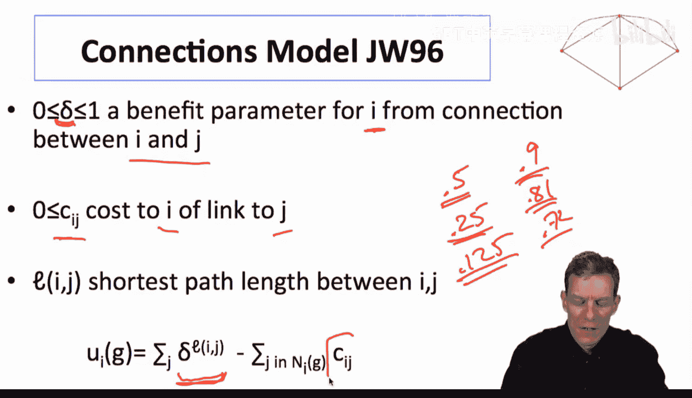

So if we take a symmetric version of this model everybody has the same delta and so the benefit of a friend of a friend is delta squared and so forth costs some C greater than zero so if there's just one link in the world then both of the individuals get a benefit of delta and a cost of C so their net utility。

 the worth of this network to them is delta minus C in this case everybody else is just getting zero。

 they're not connected they're not paying any costs they're not getting any benefits so this would be just one link worth delta minus C okay so what happens is we add a link so now we add a link between not one connects to two and one connects to three one is now involved in two relationships so they're getting two benefits two deltas paying two costs two Cs。

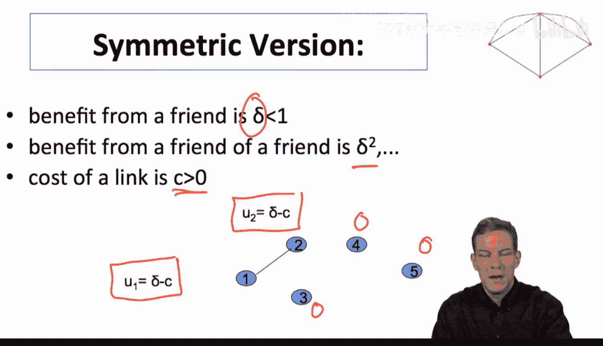

Let's look the more interesting utility is say， person two。

 who's now getting a delta from their direct connection between one and two。

And they're also getting an indirect connection， so they're getting the delta squared from this indirect connection to person three。

They're still only paying to maintain one relationship。

 but now the fact that one has this other friend is beneficial to two。

 so I two might be getting extra information from three through one or getting favors from3 through one Now deelta squared given that delta is less than one is worth less than delta so two doesn't get as much value from the indirect value of the relationship to three。

 but they still get some value。So the idea here is for any network configuration。

 we can assign values。

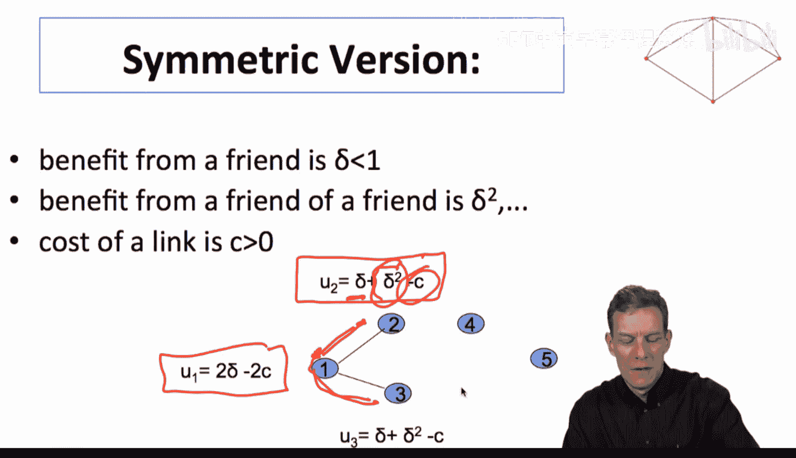

So now if we add another link here， then we can go through right now， one has two direct connections。

 one indirect connection of length two， four has connection to two， a connection to one。

 a connection to three， delta delta squared， delta cubed minus C and so for every network configuration we can talk about how much value each individual in the network gets。

 and so once we've got that， then we can talk about well which is the most valuable network for society。

 which is the one that each individual would like to be in。

 which is the ones they'll choose which links will they choose to form if they can make these decisions。

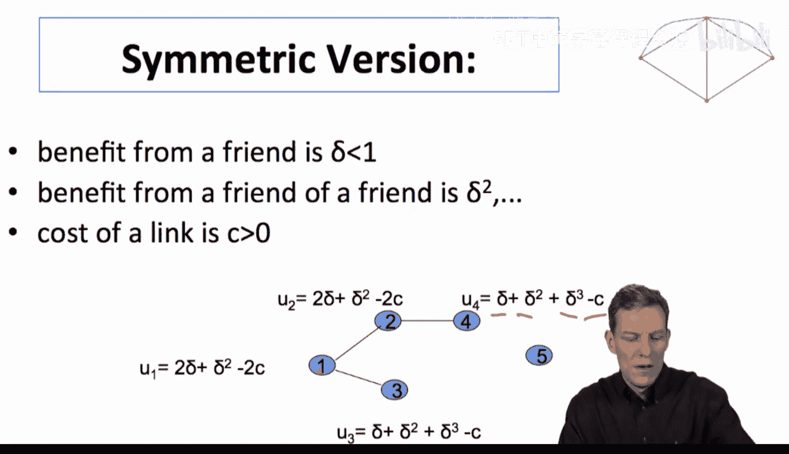

So that's the basic idea right and you can just keep adding links。

 keep doing calculations as you go through for each different configuration。

 you can do different calculations。Now here， for instance， three， when counting the distance to four。

 the way that we work this model is that three counts four as a delta squared。

And doesn't account for the fact that they could also have other paths that are longer to get to four。

So they have a delta cubed to5 and a delta squared to four and then the two deltas to the two people they're directly connected with。

 but they're not counting these extra paths that they have now you could enrich this model to have multiple path variations and so forth。

 the basic ideas here are already going to be captured in the fact that direct relationships are valuable indirect relationships are slightly less valuable。

 you could allow for multiple paths to matter that's something that would enrich this。

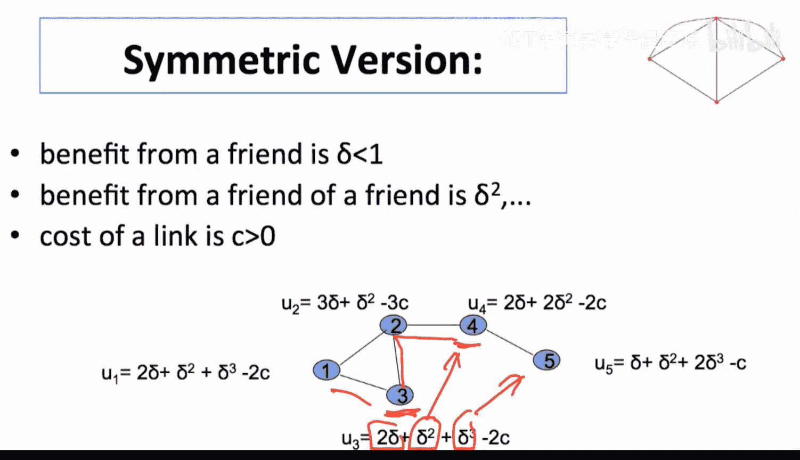

Okay。So major questions we have， which networks are best for society and which ones are going to be formed by the people involved。

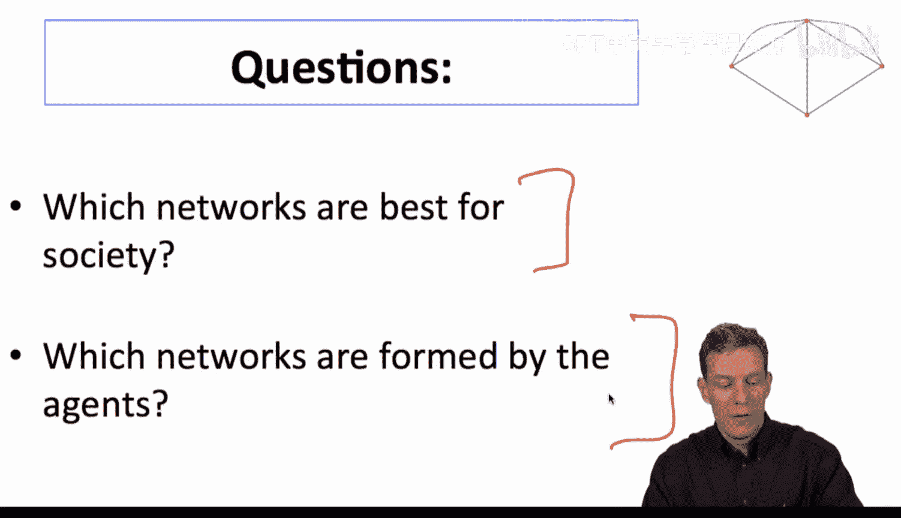

So we'll take a look at both of those next and the idea is going to be that we're going to have to first of all。

 model how the network formation process works and then also have some ways of evaluating the overall societal benefits from a network。

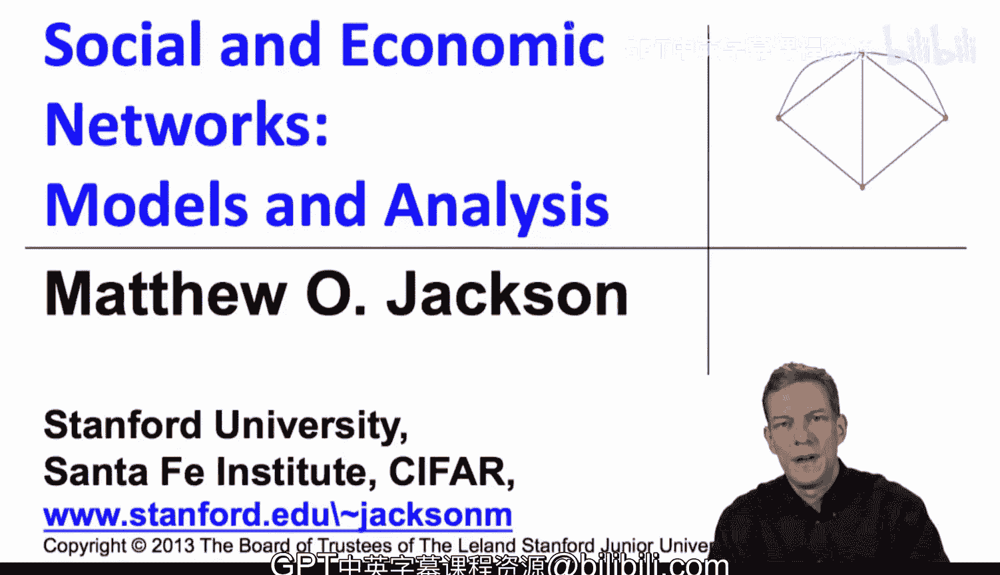

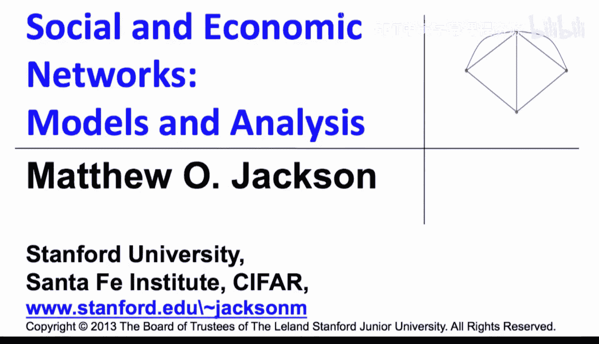