# 斯坦福大学《社会和经济网络：建模与分析｜Social and Economic Networks： Models and Analysis》中英字幕 p37 37_04_02_4-2-配对稳定性与效率.zh_en -BV1v1421U7Nk_p37-

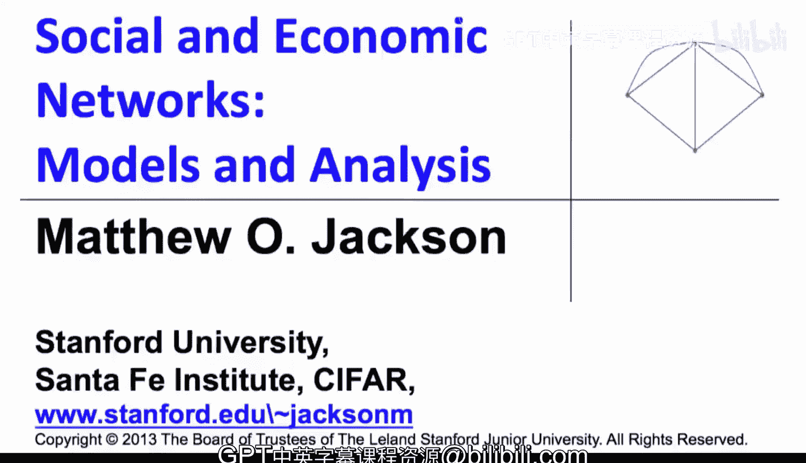

Okay， so we've got some basic ideas behind strategic formation and now we're going to talk about modeling how we measure efficiency and also how we can model people's decisions to form in delete links。

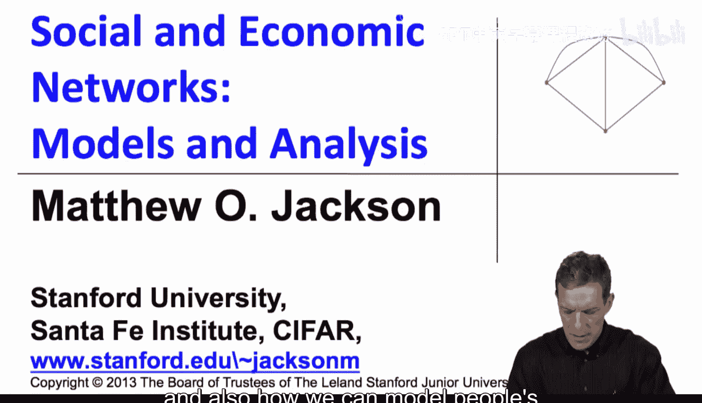

And so in terms of modeling incentives and you know just sort of keeping track of these things。

 let me just first make a very simple point， so let's think of a world where we need consensus to form links。

 so two individuals have to agree to be friends and I can't form a friendship with somebody else if they don't agree to be friends。

With me now one way people might think of doing of modeling this would be as just modeling it as a game and the simplest possible game you could imagine as everybody just announces who they want to be friends with and then if both people。

 if two people both announce each other， then we form a friendship between them and if they don't both announce each other。

 then we don't form a friendship。Okay， well， Nash equilibrium would be a situation where nobody wants to change their list of announcements given the set of announcements of other individuals。

And so let's just talk through why that doesn't really work so well as a model of network formation in these kinds of settings。

 and imagine that we're in a setting where they're just two individuals and if they're separate。

 they get a value of zero and if they're connected， they get a value of one。

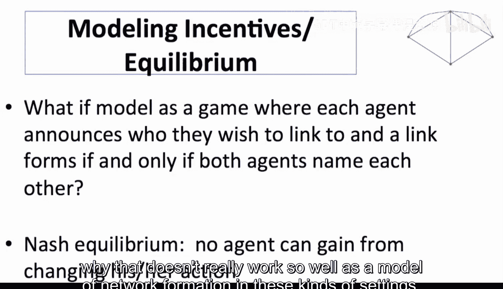

Okay， and now we have a game where they simultaneously announce whether they're willing to form the relationship。

Well， both of these are N equiria。It in this case， it's a situation where if I don't think the other person is going to announce me and that doesn't matter at what I do。

 I can't get the friendship anyway， so I might as well not announce it so there's an equilibrium where neither person announces the other because they can't unilaterally change things there's also an equilibrium where both of them announce the friendship and then it forms。

And so there's two Nash Eria。And in this case。That's somewhat problematic as a model here because this is the simplest possible model and it predicts anything could happen in terms of the link into forming or not forming。

 and yet any reasonable communication among these individuals should lead to this link forming。

Now there are ways of dealing with this in terms of the game theory we can put in stronger solution concepts and try and do things that way。

 so instead of looking at Nash equilibrium we can allow for slight errors by players and see what happens。

But there are other examples that aren't quite as simple as this one which give other solution concepts trouble so what we're going to do is instead of using off the shelf noncooperative game theory we're going to model incentives using a very simple concept which we'll call pairwise stability okay so the idea here is simple what we'll do is we'll look at a network。

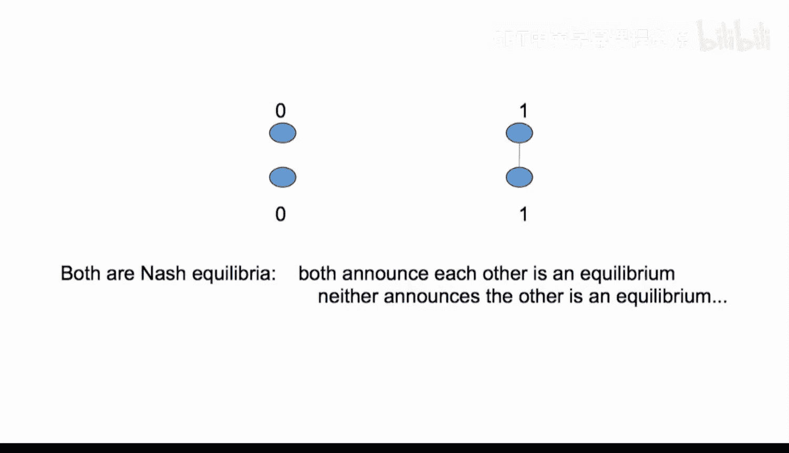

And will say that it is stable。In particular， we'll say it's pairwise stable。If no。

Nobody who's involved in some particular relationship would gain by deleting that relationship okay so in a situation where it takes mutual consent to form a link。

 either person can get rid of a link so if one person decides they no longer want to be friends with somebody else。

 they suffer that relationship so one person can delete a relationship and it takes two to form one so what we do here is we have a situation where no single agent。

Is going gain from deleting a link。And note two agents both gain from add in the link with at least one strictly gaining so we can worry about differences。

 but the idea is that if two people both gain weekly and somebody gains strictly then a relationship should form beneficial relationships should be pursued when available and ones that aren't beneficial should not be pursued and should be deleted very simple concept in that already what we'll begin to put a lot of structure on networks so in terms of notation pairwise stability is defined as follows。

 so we'll say that the network will say that G is pairwise stable。

 so this is pairwise stability of a network G。

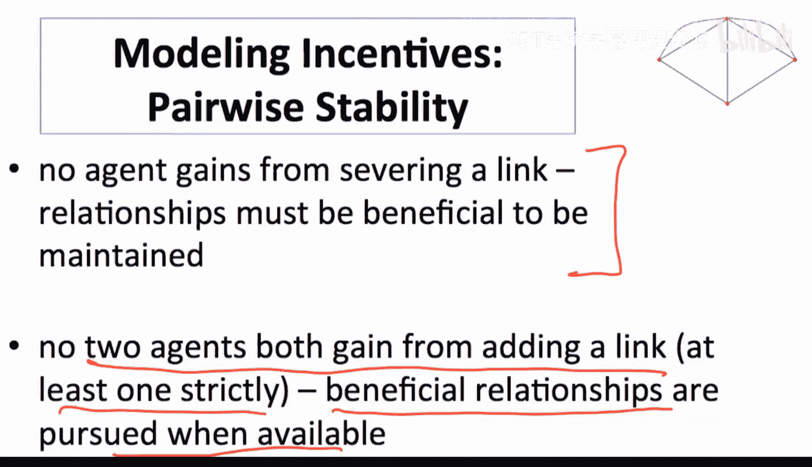

It's stable if the utility of I for any link that they're involved in。

Is greater than or equal to what they would get from deleting the link。Okay， so if it was less。

 they should have deleted it。 so for G to be stable。

 it should be that they get at least as much as they would get from deleting any of the links that they're in。

 nobody gains from sever the link。And if somebody really wants a new link。

 if somebody wants a new link， then it should be that the other person didn't want it。Otherwise。

 it should be added Okay， so for this to be stable and not to be subject to further changes。

 it should be that if somebody wants to add it， their partner doesn't want to add it。

 So if some link IJ is not in in G。if IJ is not in G， then it should be that if one person wants it。

 the other person doesn't want it， so it could be that neither person wants it。

 but it can't be that they're both happy to have this link in it not to be in there okay so this is a very weak concept。

Why is it weak， well it's only looking at pairs of individuals。

 it's only looking at one link at a time， and it just makes sure that there's no single link that would be better deleted and no link that's not present that would be better to add。

But often this already is a fairly powerful， so sort of the minimal set of requirements that we might think of in terms of stability。

It'll often begin to narrow things down now there's all kinds of other variations so this is this concept came out of the paper with Ashher Walinsky。

 so the Jacksonlinsky 96 paper people have looked at a lot of other variations on these kinds of things we'll talk about some of them。

 but this will give us some basics to work with。

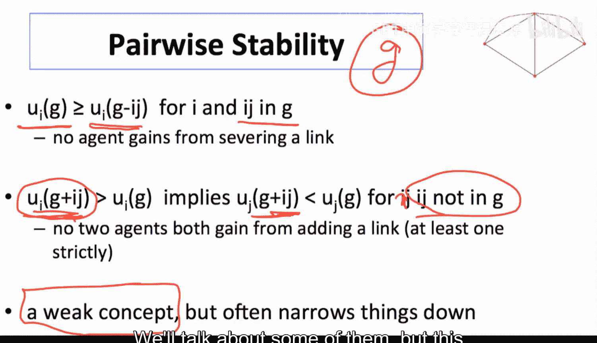

Okay， so now when we go back to that example we had before。

 both are Nash equilibriumlibo but this is the only pairwise stable network right。

 so both people would gain by adding this pairwise stability just as this is the only stable network。

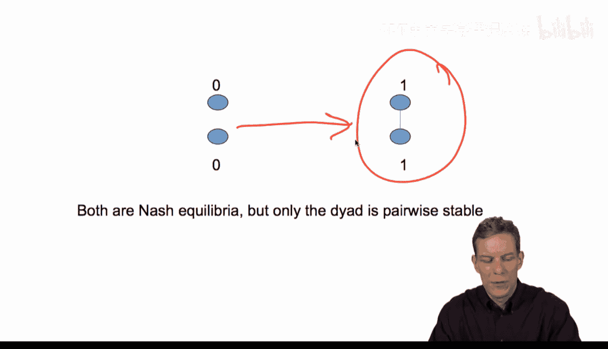

Okay， so let let's take a look at this in action so let's look at a slightly richer example and we'll talk about where these numbers come from a little bit later。

 but let's suppose that we have a situation where everybody's symmetric if nobody's connected they all get payoffs of zero so we'll just normalize payoffs with no connections to zero。

 let's suppose that if you form a relationship with one other person you get a value of three each。

 so if two people form a dietad， they get a value of three， so if。

Both sets of people formed relationships， then if we have four people and we have two relationships。

 then if everybody gets a three。If we add a link to this network where these two individuals now decide to form a link together。

Then their payouts go up， so now they have two relationships each。

 they get a marginal benefit a little bit more， they get 3。25。

 but let's suppose these people are jealous。They don't like their friends to have new friends。

 so this is different than the connectionsions model。

 this is a situation where now I'm losing time with my friend because now they're spending more time with somebody else。

So they get a value of two now these people， if they connect to each other they get more value。

 but then these people are losing value because now their friends are spending time with other individuals so you can think of this this will come out of a collaboration network where if people I'm collaborating with or collaborating with other people and that means we spend less time together I get less value so this is one where we've got negative impact of other people forming new relationships and so you can go through and have different payoffs of here and here you know when these people now form a relationship。

 their value goes from 2。5 up to 2。78 but these people go down from 2。

5 to two so they're losing more time and so forth and then these people form a relationship they go up from the two to 2。

3 and so forth so this is a very simple setting。And what we see in this setting。

 in terms of the value， the arrows represent moved from one network to another network。

 which would be improving or would sort of means that this network is not stable because the individuals here would gain by adding a link and then this one's not stable and this one's not stable。

 right so each one of these is pointing to a new one and we end up with the only pairwise stable network for this set of payoffs。

 given all the permutations of these things， you're going to end up with everyone connected and everyone getting 2。

33 so that's the pairwise stable network in this setting。Okay。Now， the interesting thing is， well。

 they're worse off than they would have been， had they stopped here。

 The difficulty is this is not stable in the sense of individual incentives。

 people would have incentives to move on from that。

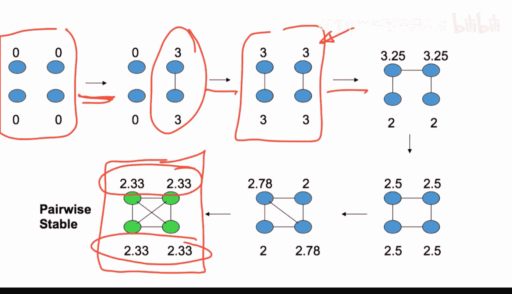

So let's talk about that a little bit in more detail。

 so let's talk about the efficiency and contrast that with the individual incentives。Okay。

 so pair wise stability handles individual incentives。

 now let's talk about evaluating overall welfare。So one notion that comes out of economics due to Alfredo Parreto and the。

Late 19th century。Is known as Pareto efficiencyff。And what does Pareto efficiency mean。

 it says that a network is Pareto efficient if there is not some other network for which everybody is at least as well off and somebody。

 some of the individuals are strictly better off okay so there's not something that one can do。

 which is unambiguously better for everybody， nobody suffers and some people are made better off。

So if something's not prereto efficient， then society really has better options。

 just unambuguously better options， if something is preto efficient。

 then it means that if somebody gains move by some change， somebody else loses， okay？

So Pareto efficiency is a weak notion of efficiency， there can be lots of Pareto efficient outcomes。

But it does rule some things out， so it's going to rule out things which are just unambiguously bad and you can do better by。

OkayNow when we look at a stronger notion， instead of just keeping track of well some people might be better off or is everybody better off or not。

 sometimes we have choices to make this， some people are going to be better off and some people are going to be worse off。

 we could talk about just a stronger notion of efficiency。

 which will refer to as efficiency or we could refer to as strong efficiency。

If G is a maximizer of the overall sum of payoffs。Okay， so， you know。

 this would be Pareto if you allowed for people just to move utility back and forth。

 you could always make， you know， if you make everybody。

 if you make the sum better off then you could make everybody better off by making appropriate transfers。

 but more generally this is just going to be a notion which is known as utilitarianism。

Which means that you care just about the total utility or some weighted in this case the equal weights on all the individuals of the utility in the society okay so this is utilitarianism with equal weights on everybody。

 I just care about total utility and I actually don't care some people might gain and lose but if overall it's better then I want to go with that okay so this is a stronger notion it'll narrow things down a little bit more。

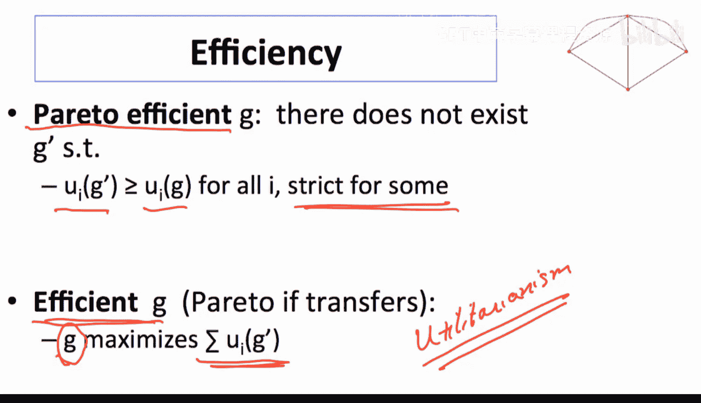

So if we look back at the picture we looked at before。

 Parawise stability was moving us to this complete network， if we look at the overall maximizer。

 the overall maximizer would be here。So this is an efficient network and it's also Pareto efficient。

This one is Pareto efficient， there's no other network which makes everybody better off。

 this one is better in terms of the overall sum right this one gives us a higher sum than this one does。

 but these people， some people go down and other people go up。Okay。

 so this is the overall efficiency and its Pareto efficient。

 this one is Pareto efficient but not overall efficient in terms of maximizing total sum of utilities。

You know this one is not Pareto efficient or efficient。

 this is better for everybody and you similar here， these are so here already in this example。

 we see that what society would like to do in terms of picking something which maximizes over all utility or even something which is Pareto efficient they can end up with things which are worse in the sense that everybody is worse off than what would happen if the society can impose a network and part of it is due to the fact that individuals aren't accounting for the harm that they inflict on others when they make their decisions so they're selfishly maximizing their own payoffs and not accounting for what that does to other individuals in the society now that's not unusual in a lot of settings once we start looking at individual incentives they're going to be misaligned and especially in network contexts where what individuals do。

What benefits they get depends on the full structure of the network and what other people are doing。

 it's not going to be unusual that we're going to find some conflict between what individuals are going to do and what society would like them to do。

What's going to be interesting is trying to figure out when this happens and to what extent it happens and why it happens and whether interventions can help or not。

 so there's going to be a whole series of questions。

 but one of the basic themes once we start looking at strategic network formation is there's payoffs involved and individuals are going to be forming the relationships that they find beneficial but what's good for them is not necessarily good for the overall society because their actions have implications for other people that they're not necessarily taking into account when choosing those actions。

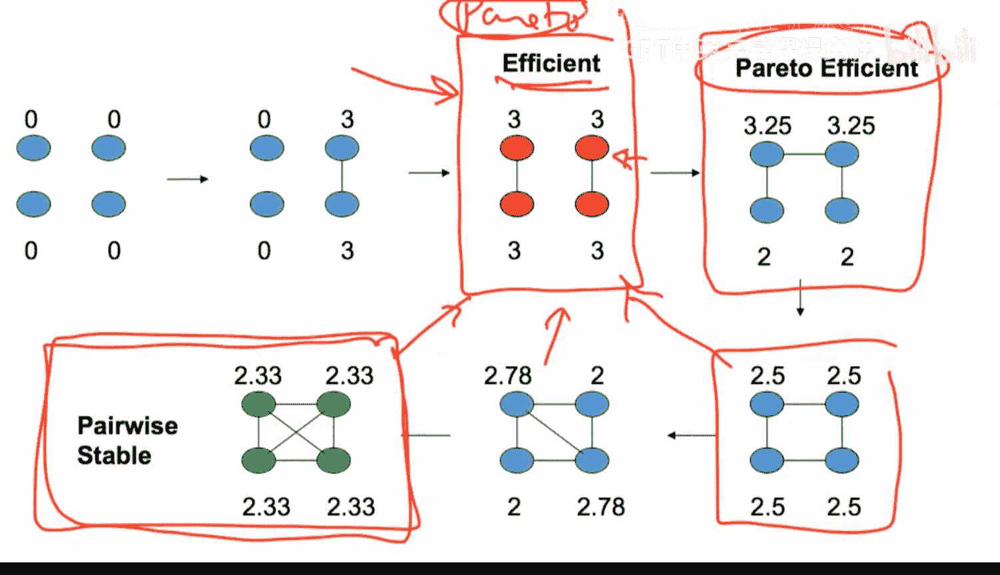

Okay， so we'll look at this in a little more detail now。

 we'll come back and let say at the Connections model and some other models to try and analyze what are the efficient networks。

 what are the Paraway stable networks， do we see conflict and so forth。

 and that'll be our next topic。

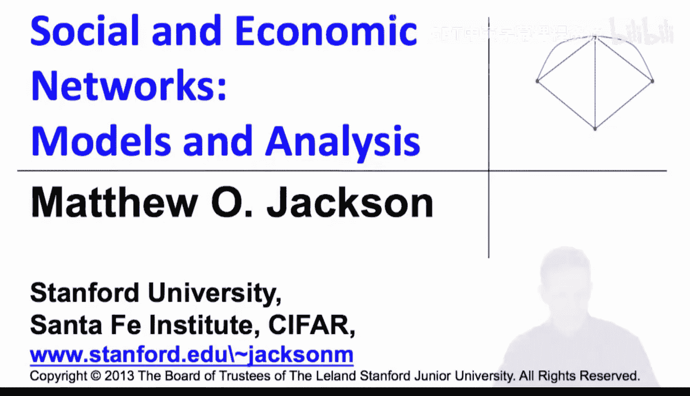