# 斯坦福大学《社会和经济网络：建模与分析｜Social and Economic Networks： Models and Analysis》中英字幕 p39 39_04_04_4-4-连接模型中的效率（可选-进阶-12-41）.zh_en -BV1v1421U7Nk_p39-

Okay， so now let's take a look at a careful analysis of the value in the symmetric connections model of different connections and try to understand why it is that stars turn on to be efficient in this middle cost range so in particular。

 if you recall the characterization that we had for low costs， we got complete networks。

 for middle costs， stars for high costs， no links。

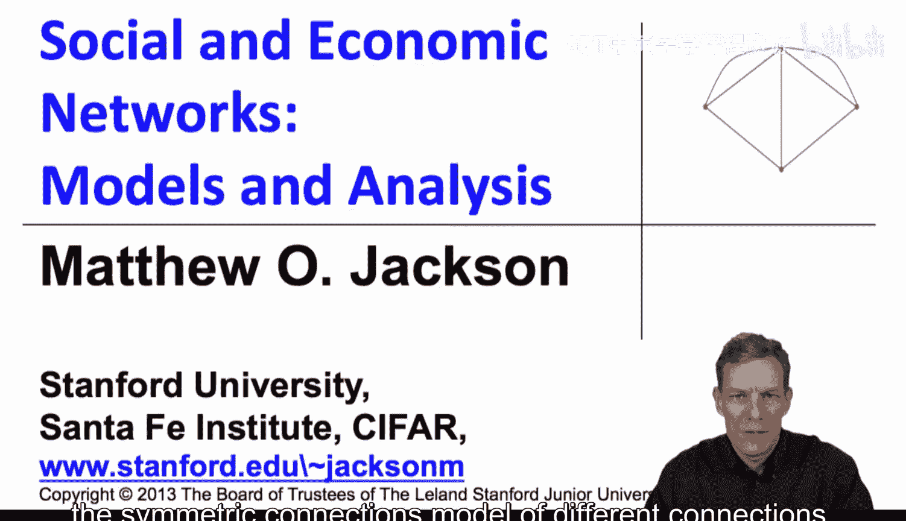

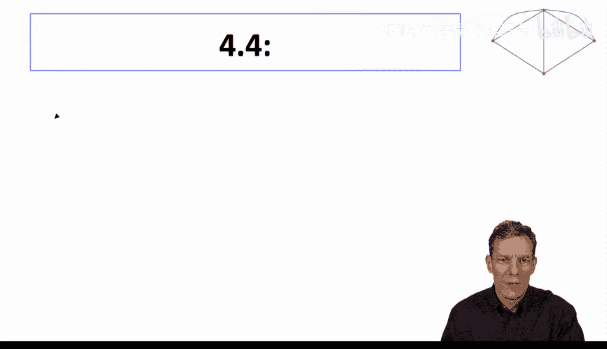

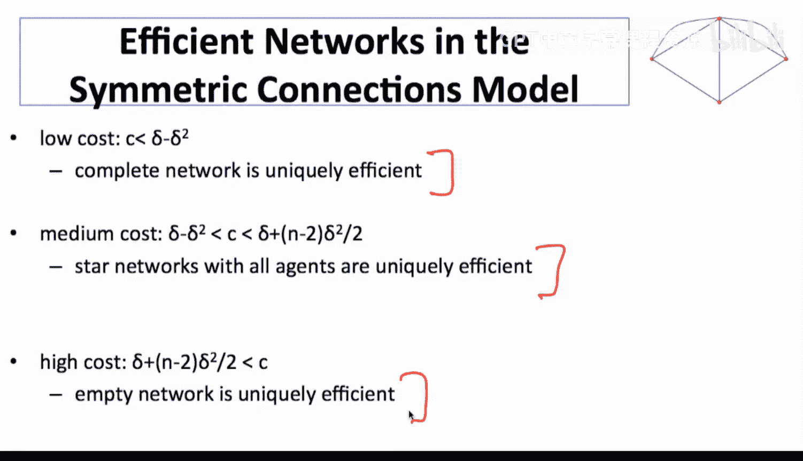

And so in terms of proving that the star is the right thing to do in the middle cost range。

 so first of all， it's very easy to analyze the case where C is less than delta minus deta squared。

 because now if IJ are not already connected， the value that they're getting from their relationship is going to be less than or equal to delta squared。

And if they add a direct link， they're going to get a deelta minus C。For that relationship。

 possibly some extra bits too， and if c is less than delta minus delta squared。

 then delta minus c is bigger than delta squared。 and so the value that they're going to get is at least what they got before。

And so both of these individuals will be better off， right。

 So UI and UJ of adding this link is better off。But also in the connections model。

Everybody else benefits is not hurt by adding new links so you know you get benefits from the shortest paths if we add extra links that just shortens their paths so everybody else is doing at least as well as they were before plus these two individuals are doing strictly better。

 therefore it's better to add the links So here the idea that when C is less than delta minus delta squared we're going to get the complete network that's straightforward so what we're going to do is instead look at the case where C is bigger than delta minus delta squared so we don't want to form a complete network and we're going to do two things first we're going to show that the value of a component is highest when the component is a star。

Okay。And then we'll actually show that so if you're going to arrange people you're best off doing it in a star and then you don't want to have multiple stars。

 you be better off having one star and then we can just compare whether it's better to have a big star with everybody in it or no star at all and that'll be the difference between the medium cost and the really high cost。

 so when cost get high enough a star is not even valuable so basically what we're going to show is if you're going to arrange people in this one C's bigger than delta minus Delta squared。

 you better do it in a star and then there's a question of whether a star is valuable。

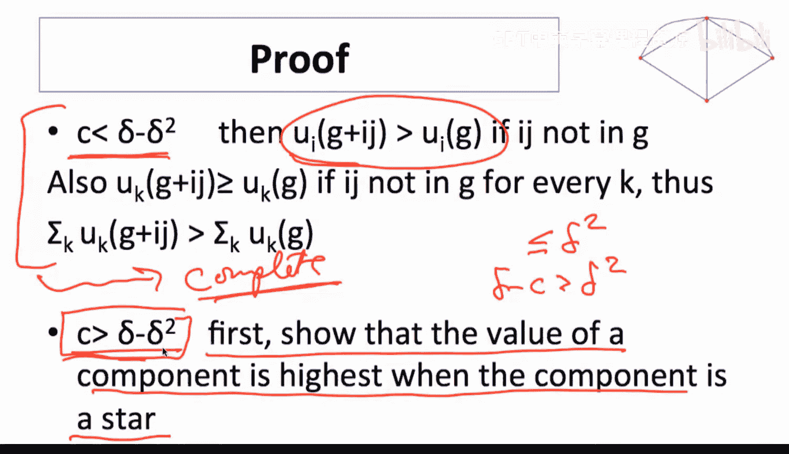

Okay， so value of a star with K players， what is it well with with K different players。

 then we've got one person in the middle K minus one other。Individuals out here。

 so we've got K minus1 links in total。And so each one of those links gives a value of delta minus c to each of its participants。

 there's two people in it， k minus1 links， so the direct value of connections is two times k minus1 times the delta minus c。

And then the indirect values that we're getting。Are coming from the fact that each one of these indirect people。

 There's K -1 of them， right？ They have K-2 other neighbors， each at a distance of2。

 So each of these K -1 people have K -2 neighbors each one of those gives the benefit of deelta squared。

 So the overall value of a star is。Two times k minus1 times delta minus c and k minus1。

 k minus2 delta squared。Okay。So that's the value of a star now let's look at the value of some other configuration that involves K players and M links where M has to be at least K minus1 in order to connect these K players together。

Okay， so if you've got M links。First of all， what's the value you can get out of the links directly Well。

 again， the same kind of calculation， you've got M links to people in each link， deelta minus C。

 so that's going to be the value there of the direct value and the most you could be getting indirectly。

Is you've got。Kay players。K minus other1， K minus1 other people that they could be connected to。

2 M of those connections are direct connections。 So the remaining connections。

 this is how many remaining indirect connections there can be。

 and at most they could be with Delta squared。 Okay。

 so this is the maximum possible value we could imagine for some other component with M links。嗯。Okay。

 so let's take the difference between these two。 So let's take this。

We'll take the difference between these two different。This expression， subtract off this expression。

And what do we get if you subtract this？From that， well， you can do the arithmetic。

 the difference is going to turn out to be 2 m minus k minus1 times delta squared minus delta minus C。

Okay。And if you remember correctly。We're in the region where。

We've got Delta squared is actually bigger than deelta minus c， right。

 because we're in a region where C is bigger than delta minus delta squared。

So we've got that holding， that means that this thing is positive。

And so if M is bigger than k minus1。Then， this whole difference is positive。

Okay so this is more valuable， this is more valuable。

 The first expression is more valuable than the second expression in a situation where M is bigger than k minus-1。

 So if we're using more than M links， we're doing worse than if we just did the star okay。

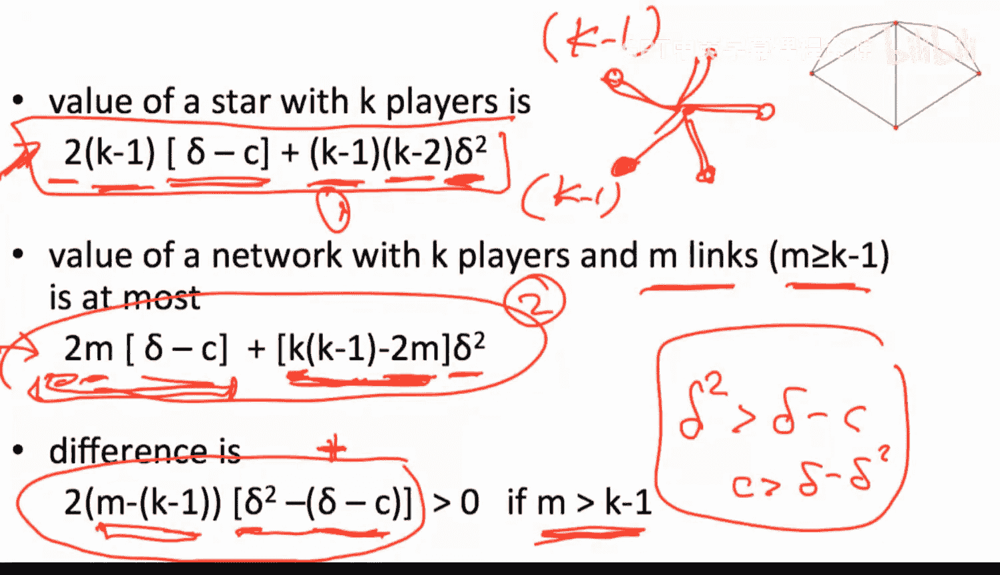

Then if you set M equal to K minus-1， so suppose the other possibility is that we did some other configuration than a star。

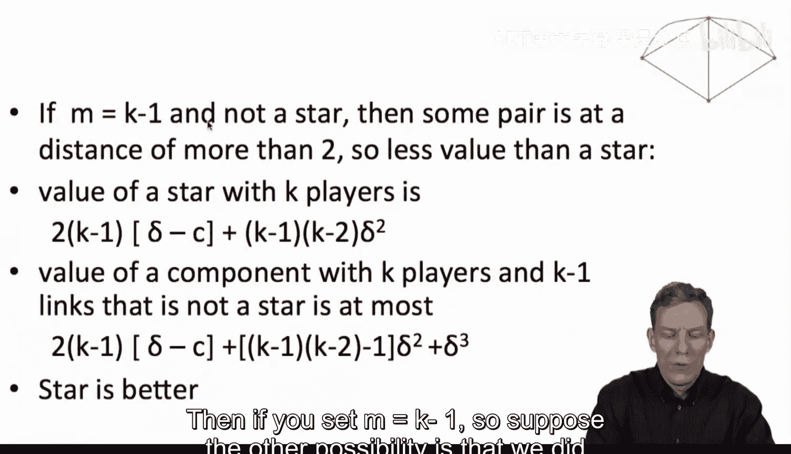

Well， then what's true， some pair of individuals， if it's not a star。

 has to be at a distance of more than two。so the value of a star， we just did that calculation。

 the value of a component with K players， K minus1 links that is not a star。Well。

 we get the direct value of connections and then at most。We can have。

All but one relationship at a Delta squared， some relationship。

 at least one of them has to be at a distance Delta cubed。Okay。

And then if you do the difference between these， all we've done is move some relationships which could be closer to some that are further away。

 so we get the same value in direct connections， the same number of indirect connections。

 but some of them are at higher distances， it's got to be lower value than a star。

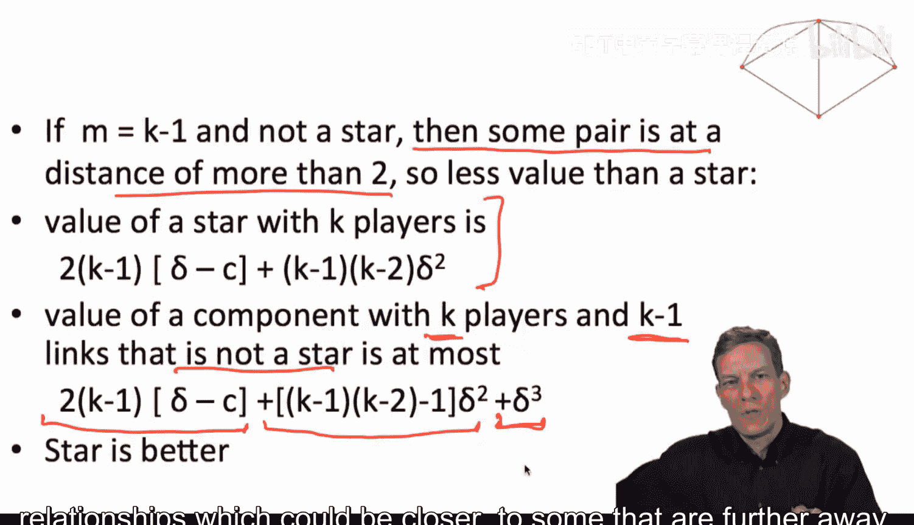

So the star is better。So what we've shown is if we're going to connect K individuals。

 the best way to do it when we've got C bigger than delta minus delta squared is via star。

So star is the best way to connect K players in that situation。

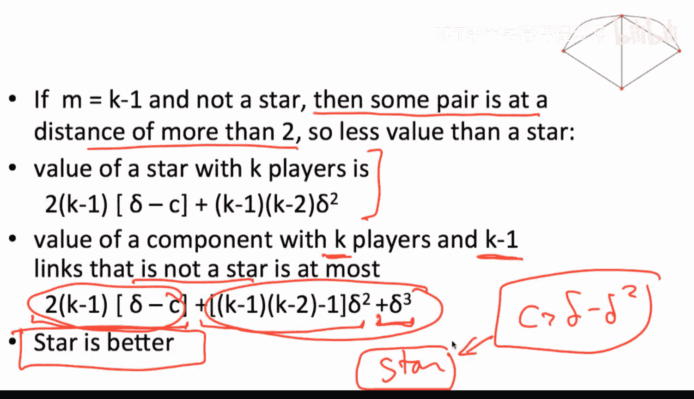

Okay， so now what we can do is say， okay， well， one possibility is maybe two stars are better than one。

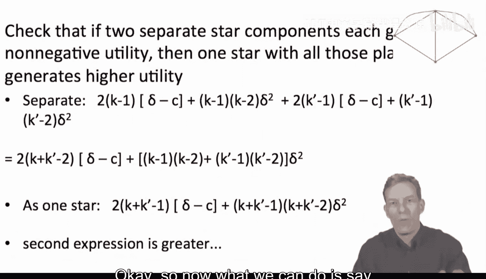

So we can check that if two star components each gives non negative utility。

 then one star with all those people generates a higher utility。

And so what we can do is just look at what's the value from the separate。Components right。

 so we've got K people in one of the stars， K prime and the other stars， two stars。

 what are the two the values， if you put them all together now we've got K plus K prime people together。

嗯。So before we have this value， one star， we have k plus k prime people together。

Compare this expression to this expression， and it's easy to check the first parts of these are identical。

Right and you can just go through and check that the second expression here is larger than this one okay so just simple arithmetic you can verify this expression is bigger than this expression and therefore having one star is better than two stars and what's the reason the reason is if you've got two separate stars you're not getting the value of indirect connections sorry actually there's one difference here one star we actually get a higher value even in the direct connections than we save on one link。

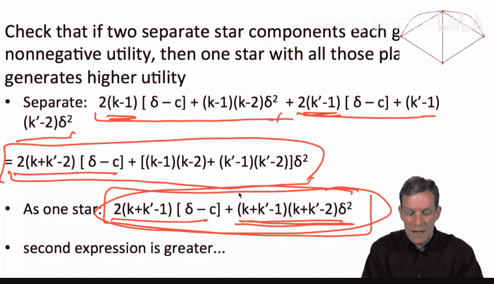

And in terms of indirect connections， we're getting more people indirectly connected than we had before。

 And so the second expression overall is higher， both in terms of the direct connections and the indirect connections you're better off having one giant star than two separate stars So what we've shown is if you're going to connect people。

 you want to connect them in one star rather than in some other possible configurations。

 put them all together in one star。 So then the last thing we have to do。

 So efficient networks are going to make either collections of stars or empty networks。 Again。

 here's the situation where C is bigger than delta minus delta squared。So we're in this case。

 so either a star or the empty network。And now what we can do is check the value of a star and the most。

So check putting all people together in a star when is that valuable。

 so if putting some people together in a star is valuable。

 putting more people together in a star is it going to be even more valuable and when is a star have a positive value with everybody's involved。

 look at the value of the star when is it bigger than zero and that's that last expression that we saw in the medium cost range so if C is bigger than that then it makes sense not to connect anybody just keep everybody separate if C is smaller than that。

 then a star is the best thing and what we've shown is a star is the unique efficient architecture net setting and then for cheap things it's easy to see that we've got the complete network so this does this kind of analysis and again to emphasize that there wasn't anything special about deltas and delta squares。

 it just mattered that there was some value we could think of some value of a distance one relationship that's。

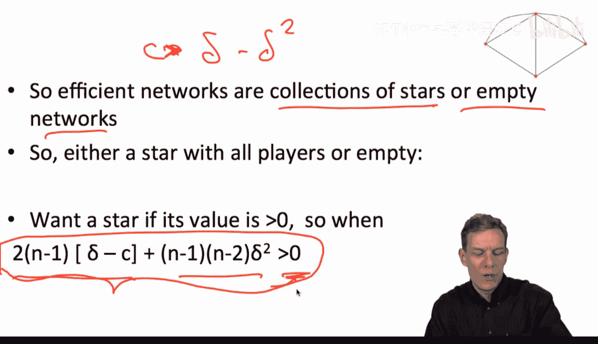

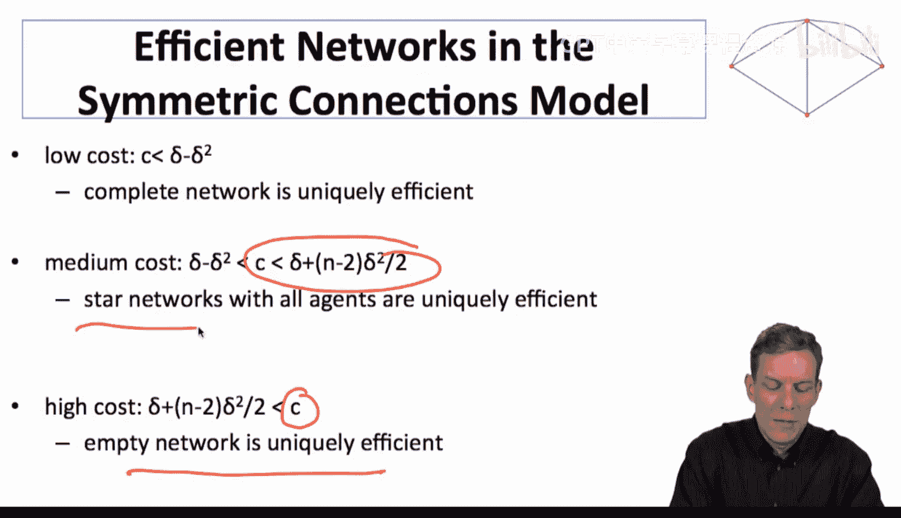

than a value of a distance two relationship， bigger than a value of a distance three relationship。

 you could plug those in everywhere for delta， delta squared and so forth。

 and exactly the same propositions would hold， you'd have something where star architectures are going to be the valuable things。

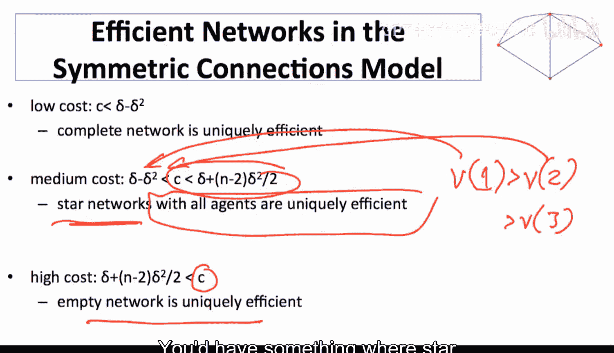

Now a couple of things just to say about this model。

 the model is obviously special and the special nature of it is that there's not sort of diminishing returns if I add 10 more people to the society and I have indirect connections to them I still get 10 extra indirect connections values it's not as if they're less valuable than the first 10 indirect connections so if you start putting in diminishing returns。

 then it can be that you get other kinds of architecture so we can start enriching these models and one thing to emphasize is this is a simple one。

 gives us some intuitions more generally we can know embellish these resolves them。

 see what works and it's sort of the methodology that's being emphasized here okay so that's a look at the efficient networks in the connections model next let's see what's parawise stable see if there's some differences between those two things。

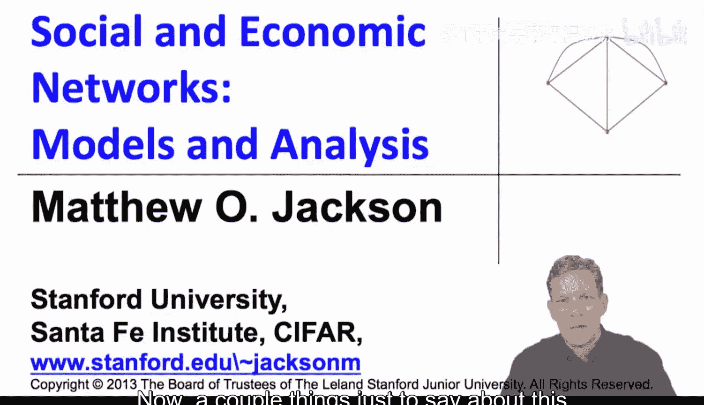

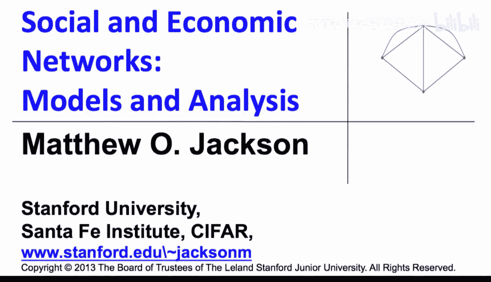