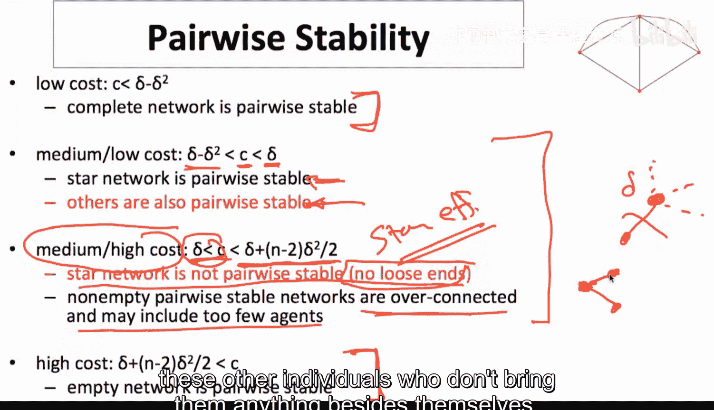
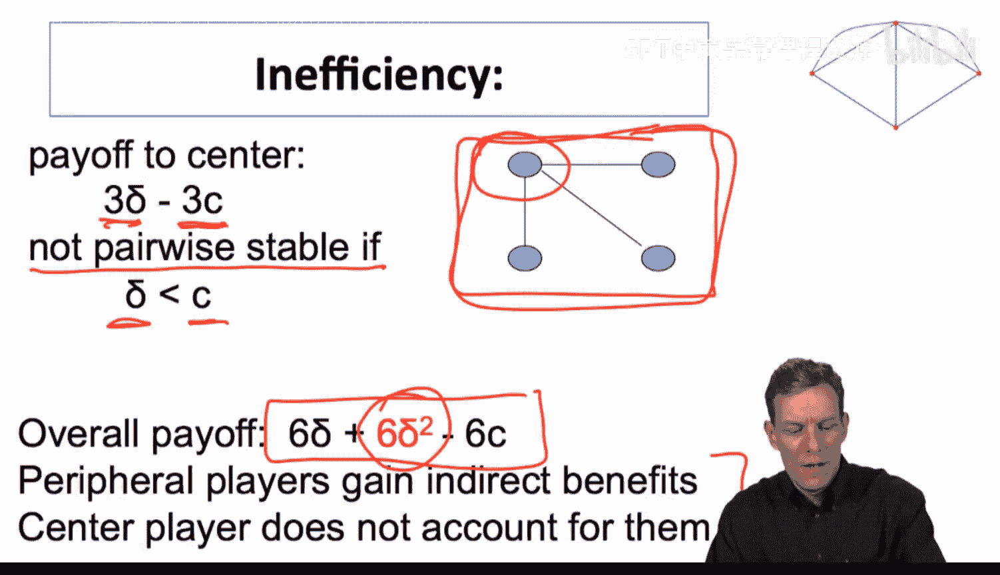
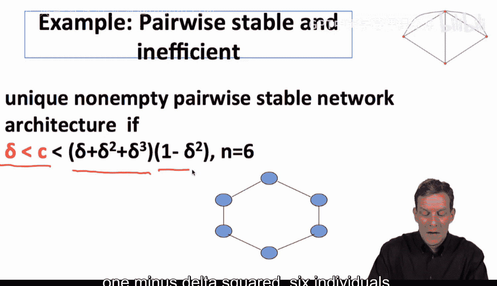
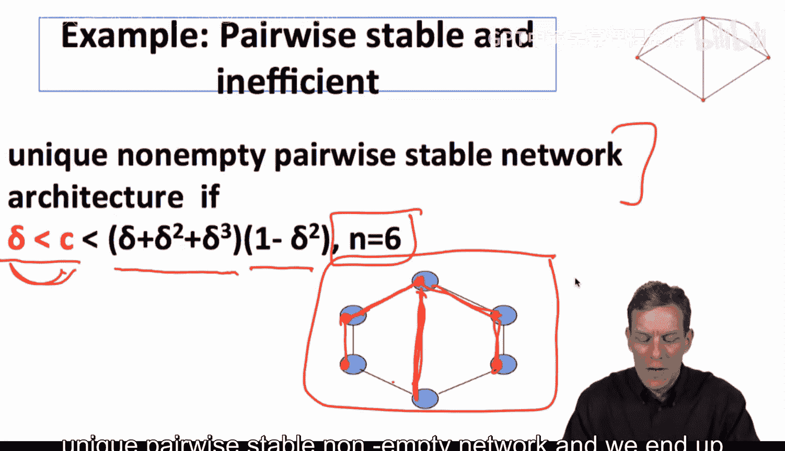
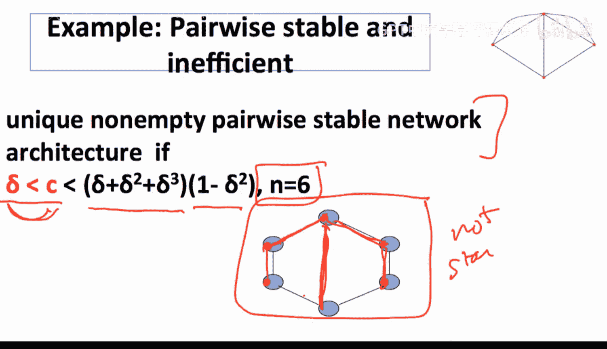
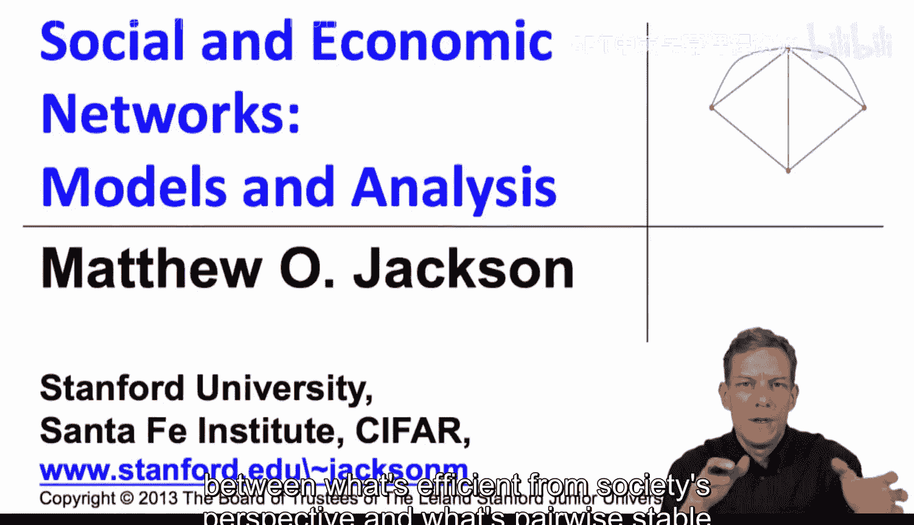
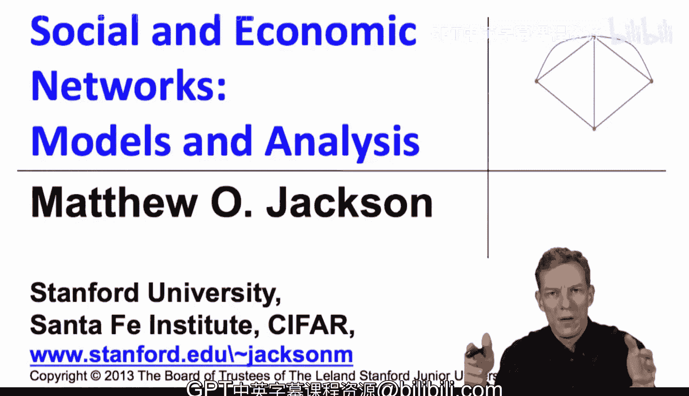
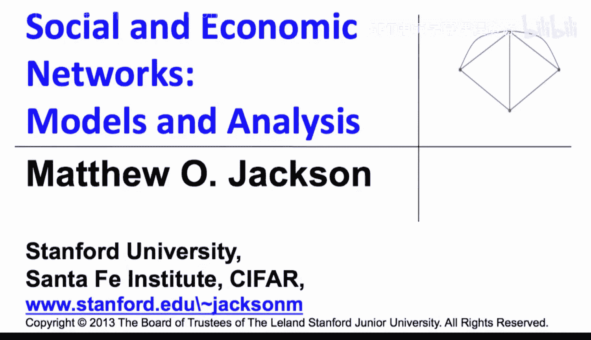

# 斯坦福大学《社会和经济网络：建模与分析｜Social and Economic Networks： Models and Analysis》中英字幕 p40 40_04_05_4-5-连接模型中的配对稳定性.zh_en -BV1v1421U7Nk_p40-

Okay， so let's have a quick look at pairwise stability in the connections model。

 So here we are now looking at the same range where for low cost we had。

Complete networks being efficient， medium cost stars， high cost， empty networks。

 and when we start thinking about pairwise stable， now we're asking which ones are ones that people want to form when they have the choice of adding links and deleting links and what we'll find is that indeed low cost the complete network is going to be pairwise stable so we end up with the right network and that situation and in fact the complete network is going to be uniquely pairwise stable when we end up with a very high cost the empty network is Parawise stable and that's going to be the only network that's Parawise stable in the middle cost range things now are going to break into two different pieces。

One is sort of a medium low cost。So C is less than delta。

 so it's still valuable to have a connection。But bigger than delta minus delta squared。

So we're in a situation where it's valuable to have connections。

 but it's not worth it to shorten indirect connections necessarily to direct ones。

The star network turns out to be pairwise stable， There can also be other pairwise stable networks。

 so it's not the only pairwise stables。 you could have some inefficient networks for some parameter values also being pairwise stable The interesting case breaks in to this part where now we're dealing with a medium high cost here C is bigger than delta。

 but still less than deelta plus n minus2 delta squared over2。

 So this is a situation where the star is efficient。So society would like the star to form。

 but the ST network is not Parawise stable。And in particular。

 non empty Parawise stable networks are going to be overconnected and may include too few agents。

So what does all that mean， basically what that means is now C is bigger than Dlta， so the cost。

 the only reason you want to have a relationship。Is if it's bringing also some indirect benefits with it。

So having a relationship with somebody that only brings that one person is not going to be worth it because C is bigger than Delta okay so the only reason you're going to form relationships is if you're also getting indirect benefits in this region。

And in that case a star is still efficient， but a star is not going to be pairwise stable。

 what does no loose ends mean， it means there's no individual that's going to want to connect to some other individual that doesn't bring them any indirect benefits。

 they'd rather sever that link because they're only getting a delta here and it's not worth it。

 so that certainly means that a star is not going to be worthwhile the center is not going to be willing to take these other individuals who don't bring them anything besides themselves。

So for instance， if we look at you know a star in this case here what we get。

 we get the payoff to the center， three deltas minus three Cs。

 it's not going to be pairwise stable if delta is less than C， they're paying too much cost。

 they're not getting any indirect benefits， the center says it's not worth it。

 yet the overall payoff。Has these extra delta squares and so the peripheral players are actually getting indirect benefits and the center does not get those。

 so the center is willing to sever the links even though the outside players the peripheral players would rather have the center maintain the star So here we get a simple inefficiency and now we see why there might be a difference between what's socially efficient the value is highest from this and yet the center isn't seeing enough of the benefits and so says forget it it's not worth it the peripheral players are seeing indirect benefits。

 I'm not seeing them and severs the links so that's the difference between the efficiency and the pairway stable networks here's an example you can play with this example if you like deelta be bigger than C and in this case smaller than deelta plus delta squared plus deta cubed times one。

Minus delta squared six individuals。

And there's a unique non-empty Parawise stable network architecture which looks like this。

 so it doesn't look like a star， it actually looks like a ring or a circle and the idea here is that each individual is willing to have these other relationships even though sees bigger than delta so sees higher than Dlta but that's because they get indirect benefits from having these so by having these they get indirect benefits as well。

 and that makes it worthwhile and it all holds together。

 nobody wants to add any extra links across because the value of adding that link it not worth the cost it doesn't change the indirect relationships to anybody else but adds extra cost and it's not worth shortening that path from a delta cubed to a single one so in this setting you can check as the unique pairwise stable non-empty network and we end up with something which is not a star。

Right， so not a star， and yet pairwise stable。

Okay so what we've seen is we've seen a conflict between what's efficient from society's perspective and what's parawise stable from individuals' perspective in terms of how they'd like to form or delete links and this is going to be a theme that runs through a lot of the strategic network formation literature and a lot of the models we're generally going to see some distance or differences between what's pairwise stable and what's efficient。

 an occasion you'll find these two coinciding， but often we won't given the externalities that are present in the society。

 so the next thing we'll look at is looking at other kinds of models。

 some different kinds of externalities and seeing how inefficiencies might arise in those other settings。

