# 斯坦福大学《社会和经济网络：建模与分析｜Social and Economic Networks： Models and Analysis》中英字幕 p41 41_04_06_4-6-外部性与合著者模型.zh_en -BV1v1421U7Nk_p41-

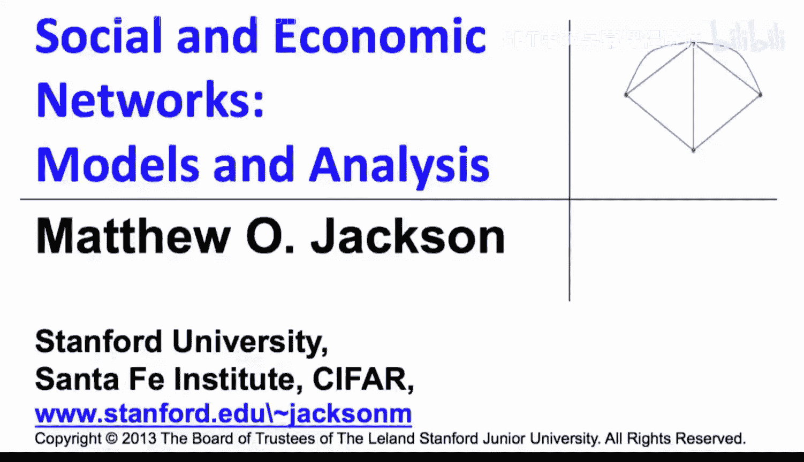

Okay， so let's have a look at general forms of externalities in these network formation models where we're modeling the payoffs to players。

 and in particular we can differentiate between two types of externalities。

 there can be mixed externalities， but we'll think of positive externalities as a situation where if we add a link IJ to a network G and we consider some other individual who's not one of the participants in that link。

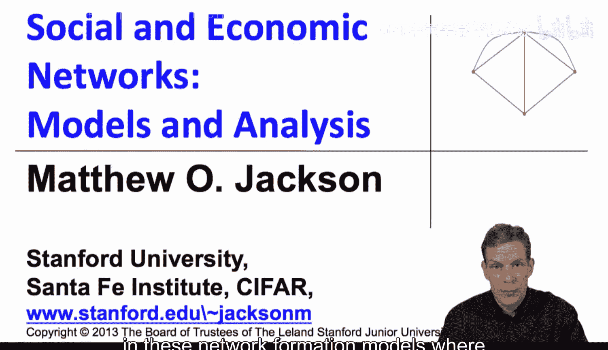

That they do weekly better。Then they did before and you know we can have them strictly positive。

 we could have be the people benefit who aren't directly involved。

 but basically what's happening is any spillovers that go to other individuals from a relationship or net positives So if I form a new friendship。

 my current friends get value from information that I'm getting or they can get indirect favors so they're not harmed and sometimes they might be helped the connections model had positive externalities Every time we add a link between two individuals that either shortens paths or keeps them the same for other individuals nobody's heard and sometimes they're actually helped。

So that's positive externalities， negative externalities is exactly the opposite。

And this is a situation where if two people add a link， the other individuals are hurt by that。

And this can come about in different settings where now I'm losing time with friends or if you're a company and two other companies merge or form some sort of alliance that might hurt your。

 your ability to compete with them so we can think of situations where ties among other individuals somehow is detrimental to a given individual。

 and so these kinds of externalities， often in some situations that might both be present。

 some are going to have more positive， some more negative。

 but it's useful to keep these in mind when we're thinking about networks and thinking about different structures。

 what's really going on in terms of the way payoffs are generated how are externalities are they positive are they negative。

 and whether they're positive or negative， well have different implications for which networks we might want to see and whether they're going to tend to be underconnected or overconnected。

 what's missing in terms of the extra values that people might not be considering。

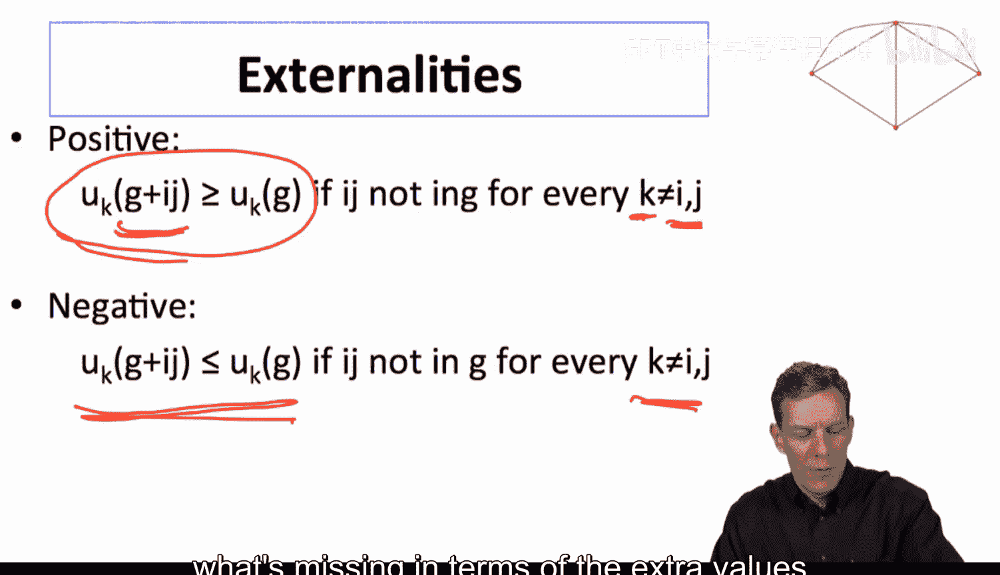

Okay so inefficiency in the connections model was due to the fact that there were positive externalities and basically you know the fact that that the star wasn't willing to maintain these external relationships was coming from the fact that those weren't giving the star the center of the star any value and yet there were positive externalities to the other players that the center was not taking into account so this led to the fact that that there weren't any loose ends and it led to either complete failure where nothing formed or overconnections in the sense that we ended up with people having to have multiple indirect paths before they were willing to or indirect paths before they were willing to link with somebody so let's have a look at a different model where we see negative externalities。

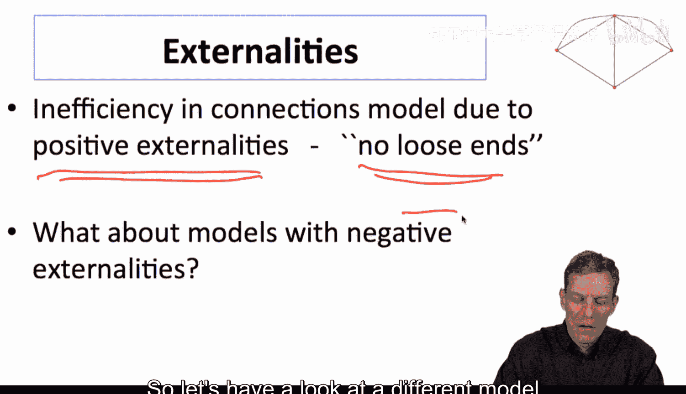

And this is another example that came out of the paper with Ashher， Jackson Moonssky '96 paper。

 and it's what's known as the co-author model， and it's a very another simple variation on something we could imagine generating value for individuals and here people are going to be involved in research collaborations。

And the value from each relationship depends on how much time people put into those relationships。

 and then we also get an interaction term which is going to capture some sort of synergies that if I spend more time collaborating with somebody。

 we have more time to brainstorm， get better ideas and that's going to be valuable。 So in particular。

 what we do is look at all the friends that a given individual has in the network。

 So look at all the IJs。

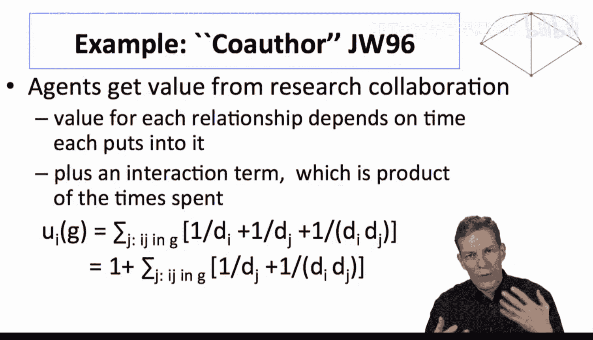

And what is a given individual get for each relationship in a network Well。

 they get one over their degree so if I have four people that I'm involved with。

 I spend one fourth of my time with each of them， so for each one of them I sum up one over my degree okay so I split my time。

I also get a fraction of their time。So they're putting something into it if somebody is that I'm linked to has five relationships。

 then I get one fifth from them。And then the value of this interaction term is synergy。

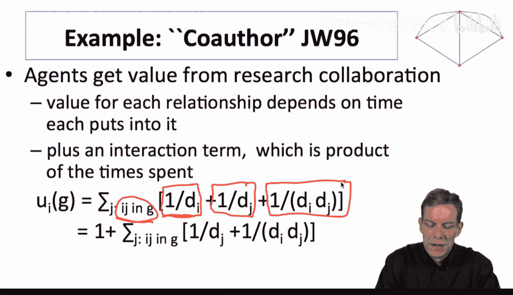

Is coming is proportional to one over D I times one over DJ。

So if I spend all of my time with somebody， I'm going to get more synergy than if I spend one quarter of my time with somebody then I only get one quarter of the synergy and I get something proportional to how much time they put into the relationship so the more they drop it。

 the less productive it is so this is going to be maximized when we leave limit these things to one and then when we put them as two。

3，4 and so forth， the value of the synergy is going to decrease okay so if you add these things up。

 then what you get you get a value here which just。

The sum of one over DI is going to come out to be a one。

 so basically what I'm getting is I look across my co-authors， I get one fraction of their time。

 and then the synergy term， which is going to be proportional to how much time I invest in different things。

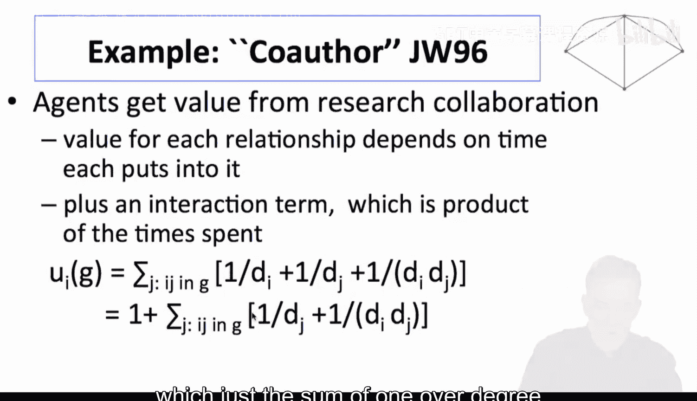

Okay so that's a very simple value here't the benefits， the costs are implicit in this model。

 we're not going to put in explicit Cs or costs to links。

 the costs from adding extra links come from the fact that you're diluting your synergies with different collaborations so here you're just spreading your time out and the more thinly you spread your time。

 the lower the value from any relationship you get。Okay。

 so we don't put explicit costs into this model。

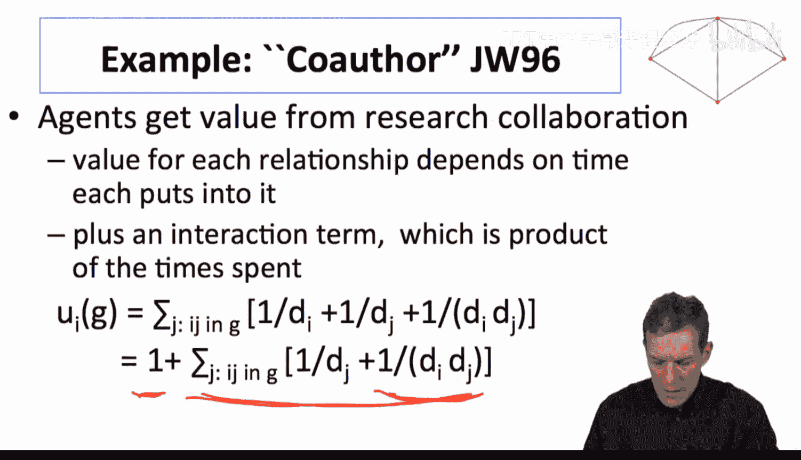

Okay， so let's look at these。 Well， if you have two people together， what's the value。

 you get one over one for your time， one over one for their time， one over。One times one。

 so you get three is a total value。 that's where in our earlier picture those threes were coming from。

If I have a connection here， I split my time between two individuals， I'm going to get a 3。25。

 where does that 3。25 come from well now I'm splitting my time between two individuals so I get a half on the first value。

 a half on the second。One of the people I'm getting， they're spending all their time with me。

 The other person is spending half their time with me。And then what's the synergy。

 the synergy from the person I'm spending。With time with who's spending all their time with me。

 I get one over a half。I'm spending half my time， they're spending one。

 and the other person I get a quarter。Add all these up。And you get your 3。25， right， so we get one。

We get2，2。533 in a quarter， so three and a quarter is what this gets。

 This person is just getting half this person's time plus their own time plus half the synergy so they're getting two and so forth so you can go through and do these calculations in this model and that's exactly where these payoffs came from and again。

 the efficient thing to do is form pairs and yet the unique pairwise stable network was that everybody overconnected and formed a complete network。

So here's another situation， now the externalities are negative。

And we're seeing people form too many relationships because they're not taking into account the fact that when they form an additional relationship。

 which increases their payoff。So here they went from a3 to a 3。

25 that they're actually decreasing the synergies that they're giving to some other players。

 which lowers that person's payoff and so they end up with lower payoffs when they continue and everybody keeps forming extra relationships。

 so it's a situation where we get too many relationships and the overall payoffs are diluted。

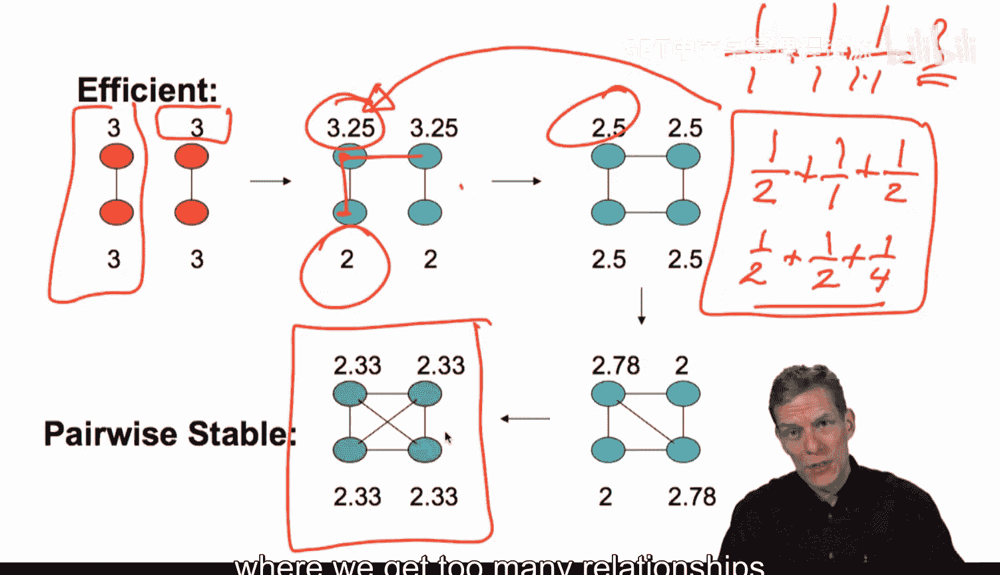

So here no direct cost to links， you can go through and analyze pairwise stable and efficient networks in this efficient networks it's easy to check。

 they're always just going to be having individual pairs。

 that's the best way to do things N is even if n is odd and you've got three individuals and so forth it gets a little more complicated if you have odd people hanging around but generally efficient networks are going to be just splitting society into pairs。

Pair wise stable networks。People are going to overconnect in the same way we just saw in that example。

 and you're going to see they're going to consist of completely connected components。

But there could be some separate components。 and what's true is that the components。

 if there were more than one component， they have to be of different sizes and each one has to have more than the square of the number of nodes and the other in order to work。

 So you have to have very different sized components。嗯。And。

basically by adding a link you dilute existing synergies。

 and so you only want to add a new co-author if they bring in sort of comparable worth to your own values。

 and that's what gives these the fact that Paraway stable networks if they have separate components have to have very different sizes so that one isn't willing to group with another。

Okay so you can go through and check those details。

 it's a fun exercise to play with to check your thinking on these things。

 but basically what we're seeing now is negative externalities again。

 there's a difference between efficient networks and what people are going to form and now we're seeing people form too many relationships because they aren't taking into account the harm they're doing to other people before in a connections model we saw possibly too few because the center of a star might not be willing to maintain a relationship even though it's beneficial to other individuals。

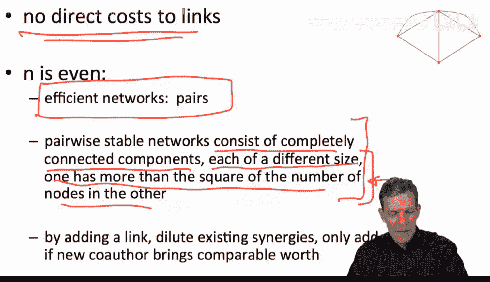

Okay。Stable and efficient networks are only going to coincide in special cases。

And so what we can begin to do is then ask you know can transfers suppose we start subsidizing the center will that help。

 can we say situations things about when these kinds of conflicts occur。

 can we say things about when transfers might help improve efficiency。

 our transfer is going to be in players' interests so we have a whole series of questions we can ask to try and rectify these problems so those are some of the things will take up next in looking at whether transfers can help avoid some of the difficulties we have。

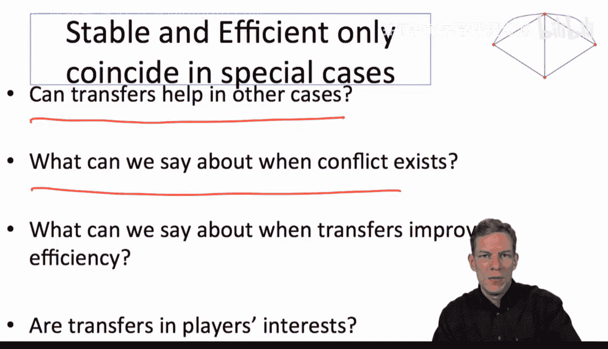

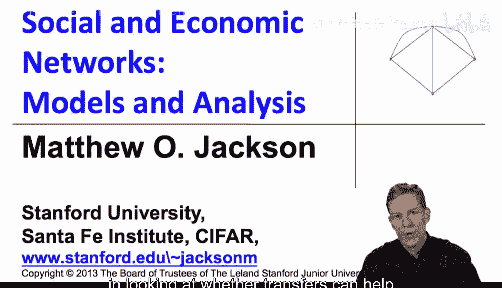

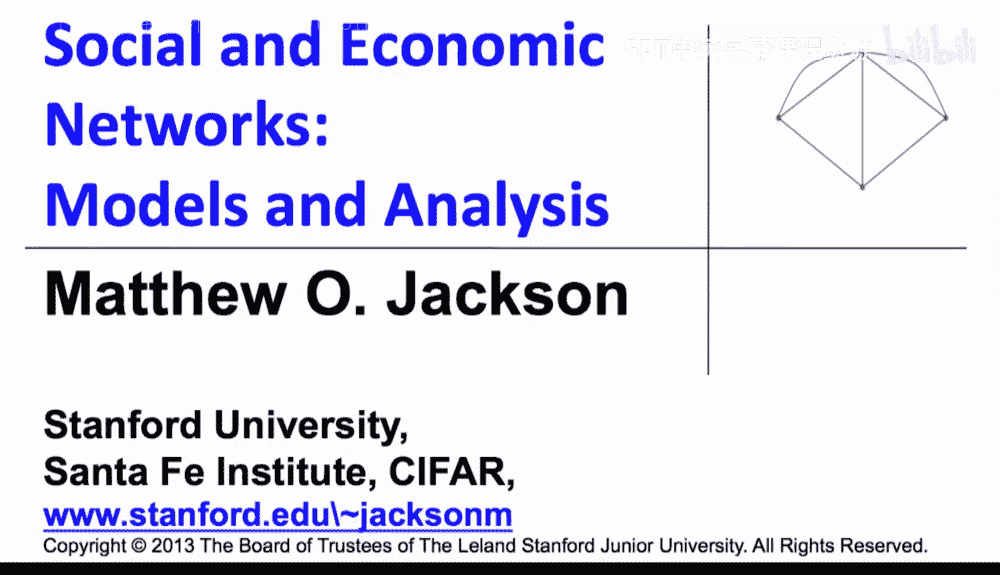