# 斯坦福大学《社会和经济网络：建模与分析｜Social and Economic Networks： Models and Analysis》中英字幕 p42 42_04_07_4-7-网络形成与转移支付.zh_en -BV1v1421U7Nk_p42-

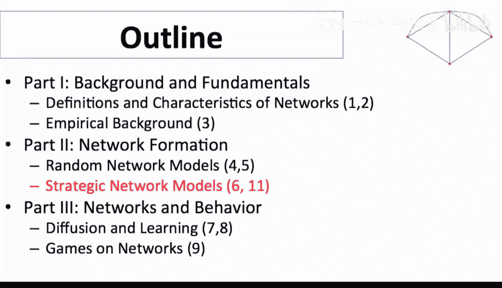

So we've been talking about strategic network formation and we talked a little bit about variations of positive and negative externality models and why you might end up having inefficiencies in terms of the networks that form。

And now I wanted to talk a little bit about the possibility of transfers。

 so subsidies payments across different individuals and trying to understand how that might rectify things and in terms of you what we've seen we saw this conflict you we can talk about all the different kinds of ways of modeling and fitting such things so here we're just going to talk a little bit about the transfers at this point and then trying to understand what we see there。

 there's a lot more that can be said on this subject but I want to give you some feeling for it and at least a little bit of a basic understanding so what do we mean by transfers so here we mean some sort of outside intervention。

 somebody taxing or subsidizing relationships， say governments supporting R&D relationships it could also be due to the fact that there's bargaining among the individuals involved so somebody says look know it's worthwhile to form this link I'm willing to pay something to you。

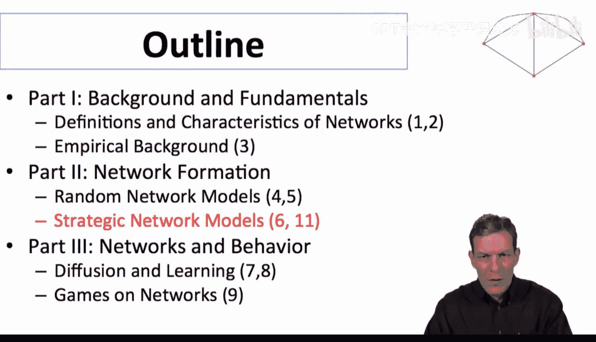

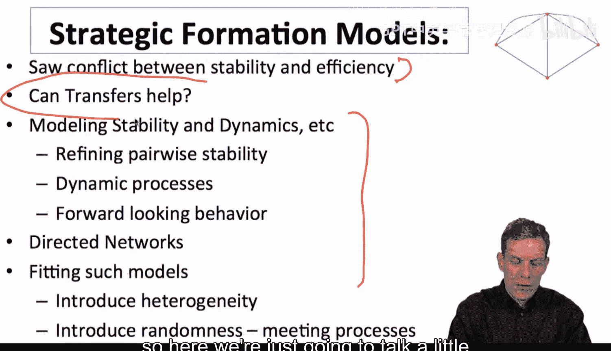

To help you form this favors exchanged among friends and so forth so the idea is that whatever those utilities numbers we're dealing with。

 some of that can be moved from one node to another either by some outside entities saying I'm gonna to attack some people and subsidize others or by individuals bargaining and saying look I'll give you something if you're willing to do it and certainly when when countries form alliances there can be payments made either explicitly or implicitly in terms of the arrangements to make sure that these things are in both people's interest in forming relationships okay so let's have a look at this in detail and so what we can think of is now we're changing the base utility to the utility plus some transfer where this could be the rep positive or negative number depending on whether somebody's making net payments or getting net receipts as a function of the network so for instance it could be that the peripheral players say look it's really beneficial to be connected in this star。

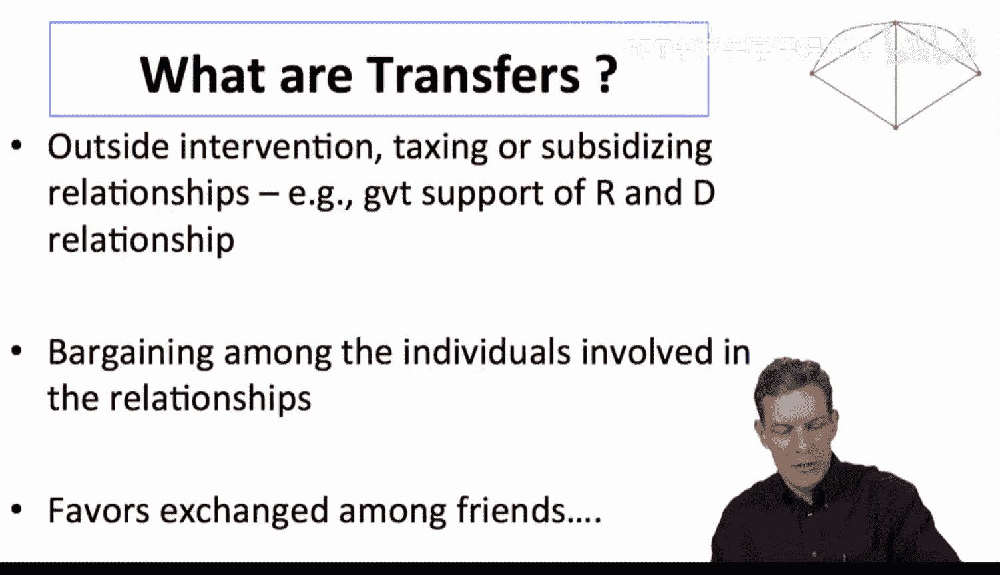

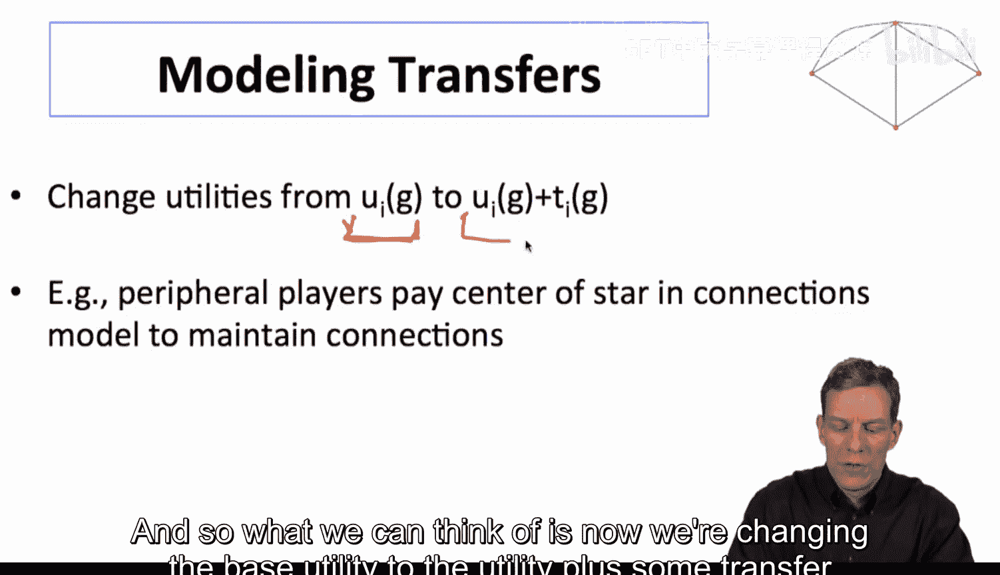

I'm willing to do favors to the center and then the center is willing to maintain these relationships because they get value from the other players。

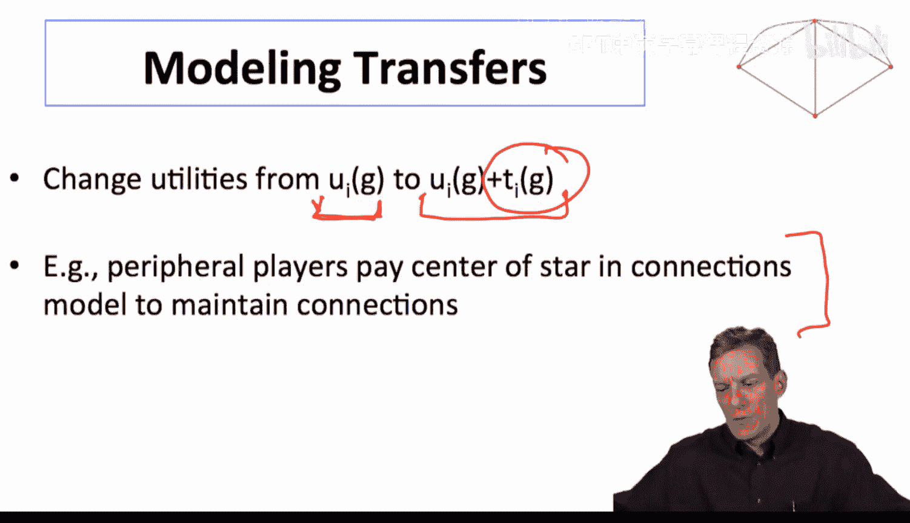

So if we was just sort of thinking about transfers， one possibility in terms of。

 you know let's go back to the inefficiency that we had in the co-authorship setting。

 so remember the coas model that we just talked about in our last video。

We've got a situation now where the problem was that people wanted to overconnect and we could imagine that in this situation。

 one possibility is the government says， okay， we're going to tax people who form extra links and then move that to the other players so the raw payoffs you know from just forming one relationship each was three。

 now if people formed this extra relationship here， their payoffs went up to 3。

25 and these people went down to two， one possibility is now what we do is we actually charge these individuals。

So we charge them a point 6，2，5 each。And then pay that to these individuals right so we tax people saying look if you're going to form more relationships you're going to have to pay something for that and then we reallocate those taxes so instead of these people getting the twos now they get 2。

625 so those particular taxes and subsidies are a way of equilibrating the payments in this model。

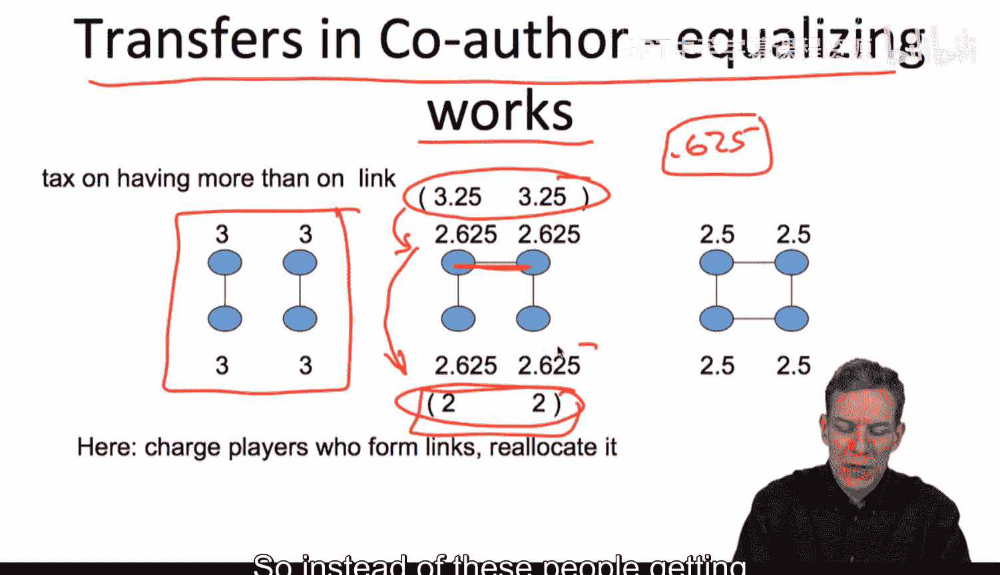

Right， and so now when we look at the incentives。What happens is the individuals no longer have an incentive to form this extra link because they have to pay the tax involved。

And so this now becomes pairwise stable。If they include the costs that they're going to have to pay in terms of taxes and so forth。

 and so what we've done is we've aligned the interests of the individuals now everybody sees an equal fraction of the value of this network and these people say。

 oh， that's not a good idea， I'm better off in this network。

And so they don't form this extra link and this turns out to be parawise stable。

 so that's a situation where you know equalizing the payoffs by proper tax and subsidy and reallocating that now everybody gets an equal payoff and they have incentives to form the right relationships。

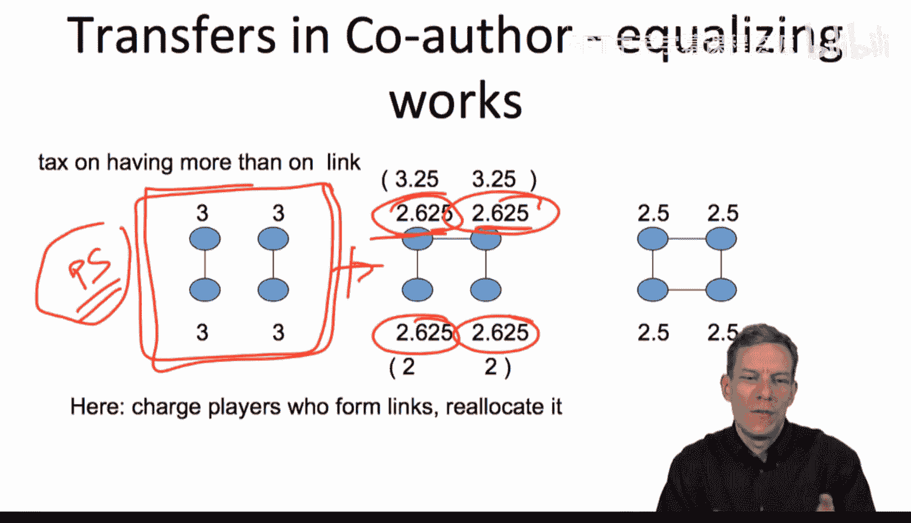

Okay， so one possibility is we just you know tax and subsidize in a completely egalitarian way。

 so set the transfers that are being made to any individual what we do is we just look at the total value of the network。

And average that across all individuals and if they were getting less than the actual amount then they're going to get a positive transfer。

 if they were getting more than the average amount then they'll have a negative transfer。

 so we're just going to adjust the transfers to move everybody back to the center so now everybody in terms of their net utility。

When we account for the transfers is just the average overall utility， okay？Now， everybody。

In the society has exactly the same incentives as a utilitarian planner would have because now everybody's utility is just one endth of the total utility in a society。

 so now the utility anybody gets is exactly proportional to the efficiency of a network so ones that are more efficient everybody gets more value。

 ones that are less efficient everybody gets less value now the most efficient。

 so directly out of this， we're going to get that the overall efficient network is going to be pairwise stable so now we've solved that problem of efficiency being pairwise stable by just equilibborating things and making sure that everybody gets an equal share of the pie that's wonderful it works well but it could involve a lot of transfers。

 it could involve a lot of spreading money around and in particular or spreading utility around。

 it could involve making transfers that are going to violate some fairly basic conditions。

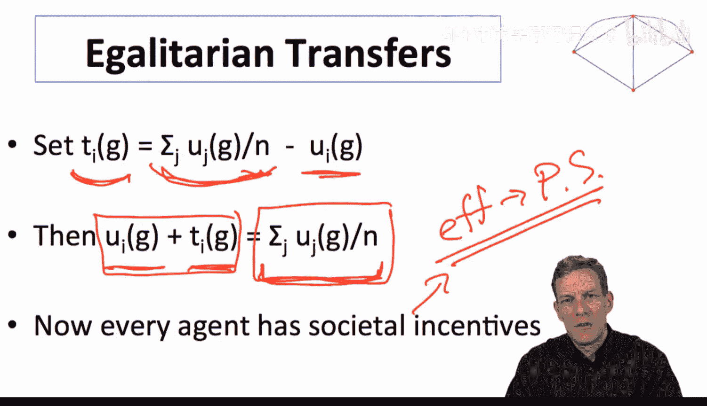

And let's put some basic requirements in on the types of transfers we allow and then see whether we can still achieve full efficiency in that kind of setting。

 okay， so we're going to put in some very basic requirements on transfers and we're going to put in two requirements one is that completely isolated nodes that generate absolutely no value get zero。

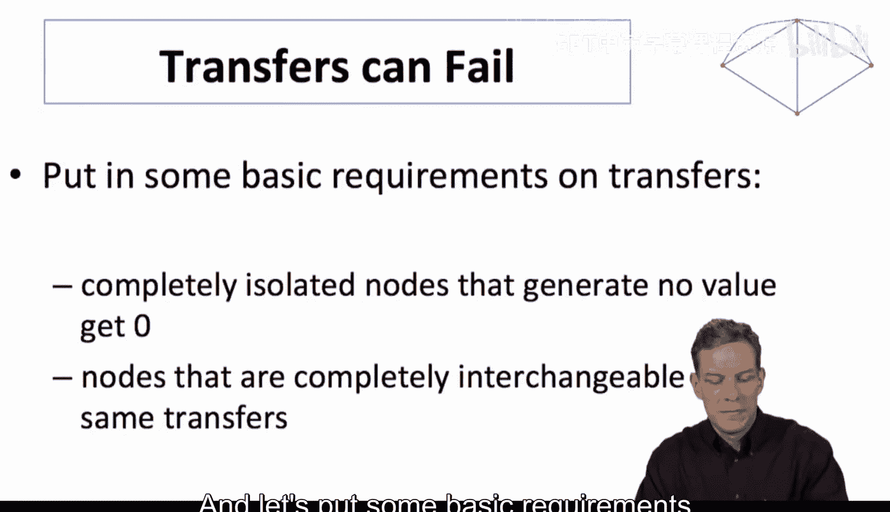

And this is a condition which you could think of as one that's going to make sure that the society doesn't want to sort of split up and fragment and secede。

 so if somebody's not generating value， other people don't subsidize that one。

 so this is somewhat controversial condition， but it's one that says that complete people who aren't generating anything and are completely disconnected don't get payments。

Second condition， two nodes that are completely interchangeable。

 meaning that they generate the same value different and any time they're in the same kind of configuration or interchangeable in a configuration so people that are completely interchangeable should get exactly the same transfers I'm not going to define this formally at this point but we'll see in an example the idea is very intuitive and so let's just take a look at example where that condition will become quite clear and we won't have to go through a lot of notation to talk about it so let's just do an example and show that transfers can't always help。

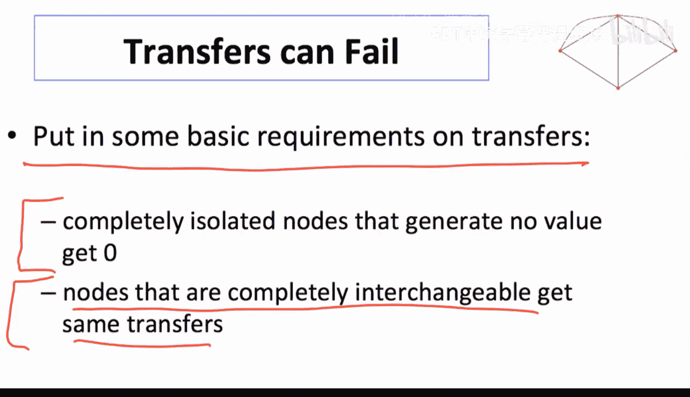

This is again from the Jackson Moononssky paper。 So here what do we have。

 we've got a situation where。Basically， we've got if everybody's connected。

 they each get a value of four overall total value to society is 12。

If we have people in a star configuration， the center gets five， the outside nodes get four。

 now we get a total value of 13， this is the maximizing value。

Two nodes on their own each get a value of 6 value of 12。 Okay。

 so the right network in this kind of setting is one of these networks。

 These are the efficient networks。And what we can begin to see is that these networks are not going to be pairwise stable。

RightWhy aren't they pairwise stable Well this center of the star could benefit by deleting one of these and they're going to get six instead right so this is a situation where these are all efficient and yet whoever is involved with two links could get rid of them and move it to a onelink network and improve their value so here this should be a544 as well and basically no matter what configuration you're in。

 somebody can benefit by deleting a link and getting a higher value so we've got efficient networks having a star configuration but none of them are pairwise stable。

Okay， so what we want to do is see if we can do some transfers to try and help this。

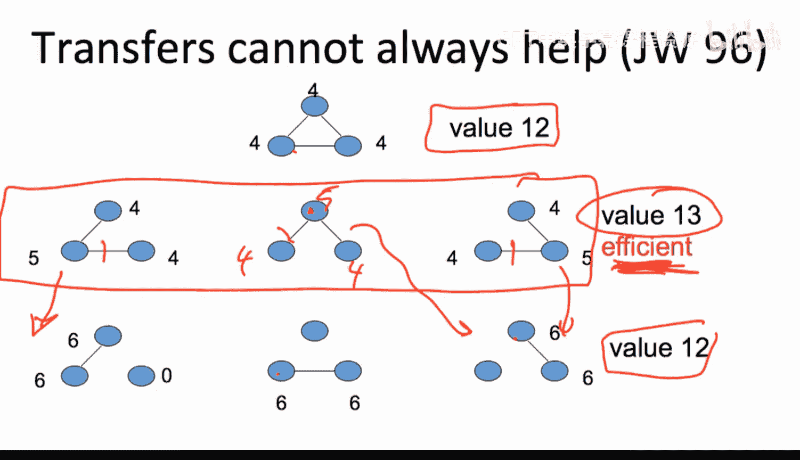

Okay， so in order to have the this， let's suppose we want to make one of these networks pairway stable。

 let's just take this one for instance， Well first thing we know is that in order for this to be pairbo stable。

 this person is going to have to get at least six right so they have five here， they get a six here。

 we're going to have to increase this by at least one。And。

Let's just sort of first go through the fact that other way we could have done it is reduced what they get down here。

 but this is where those conditions come in， the fact that somebody's completely disconnected and not generating value means they get nothing。

 so things have to be split between these two individuals。

 they're completely symmetric doing the same thing， so each one of them has to get six。So this。

 the value of how things are allocated here are tied down by those conditions on transfers。

And so here， in order for this person to be willing to maintain both links。

 they've got to get a transfer of at least one。Okay。

But in order for these two individuals not to want to form a new link。

 they have to stay at at least four right they are interchangeable。

 so they have to get the same value。And up here， everybody's going to get a value of four。

And so in order for these people to be willing not to form a new link。

 you can't take anything away from them。So somehow you have to give this person something。

 but you can't take anything away from these individuals。

So the only way you could make the efficient thing stable is by somehow infusing extra value into this。

 you'd have to take some extra value from outside and pay this person。

 in which case now you've lost the value that you were trying to generate。So in this situation。

 there's no set of transfers that satisfy those conditions that treat equal people equally and don't pay people that are completely disconnected to anything。

If you put those two conditions in， there's no way to have transfers such that this person's willing not to delete a link and you still have these people not wanting to add a new link。

 so there's different incentive constraints that you have to take care of at the same time。

 and there's no way to do that with one set of transfers so there's no way to arrange the transfers to make this work。

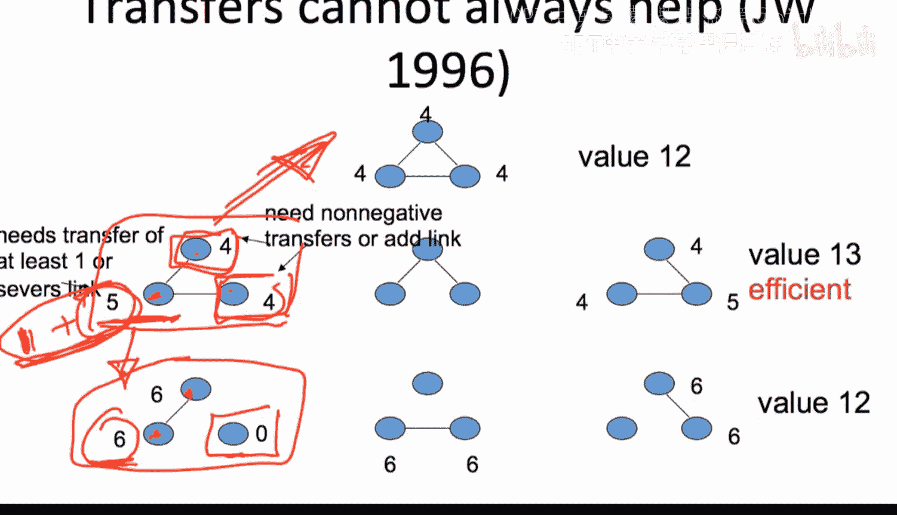

Okay。So let's talk a little bit about the ideas behind this because although the example is fairly simple。

 I think the point is more important， so there's something which is known as the coast theorem in economics and it goes back to a paper by Co quite some years ago。

Where Cos was talking about bargaining and basically was making the point well the paper is fairly complicated but one what was taken out of that paper to become the Co theorem was the idea that if people have complete information and it's clear what the externalities in a situation is there should exist some bargain that they can reach which will make sure that they take efficient actions in a society so without frictions transfers can help solve these kinds of inefficiencies and know Co's paper was actually about frictions and why that might fail。

 but what it does say is here we're in a world where we've got complete information。

 we can see what the value of each one of these things are and people can realize look we need to make some payments and the difficulty is that we' still not able to make the payments to make sure that the right network forms and the difficulty is。

Coming from the fact that we have to take care of multiple externalities all at once and we have to worry about making sure that that center agent is still willing to keep both things but also making sure that the other two agents don't want to form a new relationship and so the fact that we have to pay one agent and not take away from the other agents at the same time。

 it's the combination of those externalities which is detrimental here。

 the combination of the incentive constraints that we have to take care of。

 not forming a new link which will harm the center or not deleting a link which will harm the outsides。

 those are the combination of externality issues that are troublesome。

 and it's the combination of these things that all have to be handled at once which makes for the conflict between efficiency and stability and that that conflict can't be solved by reasonable transfers。

So that sort of tells us that transfers can be helpful sometimes but not necessarily always and it depends on the circumstances。

 so network setting introduces sort of an interesting problem it's not necessarily entirely correctable what bargaining or transfers it's going to depend on exactly what kinds of transfers we allow and what situations and sometimes they'll be ways out of this and sometimes they won't but there's an interesting issue there okay so summary so far efficient networks can take some very simple forms in a variety of models。

 efficient networks and pairwise networks need not coincide and transfers can help but not always without violating some fairly basic conditions so that sort of is you know a quick look at some of the issues of strategic network formation now we can also look at some more advanced topics where we've got some。

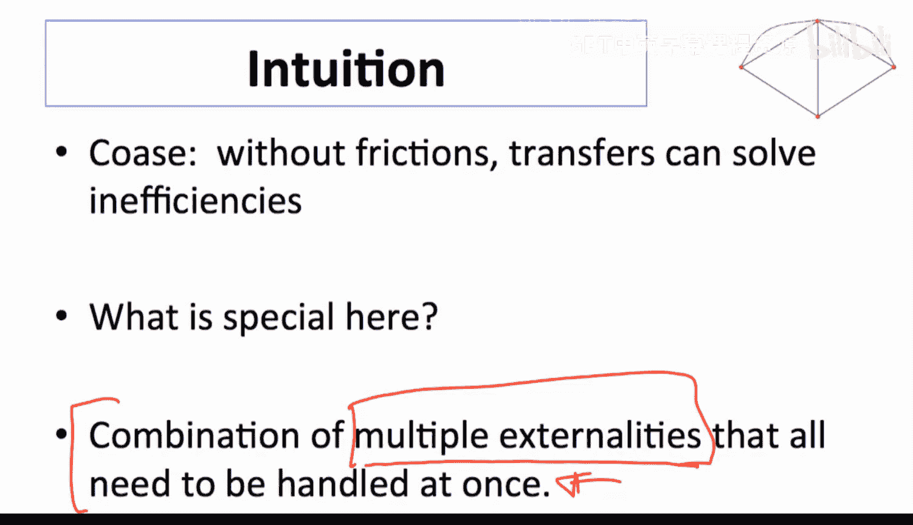

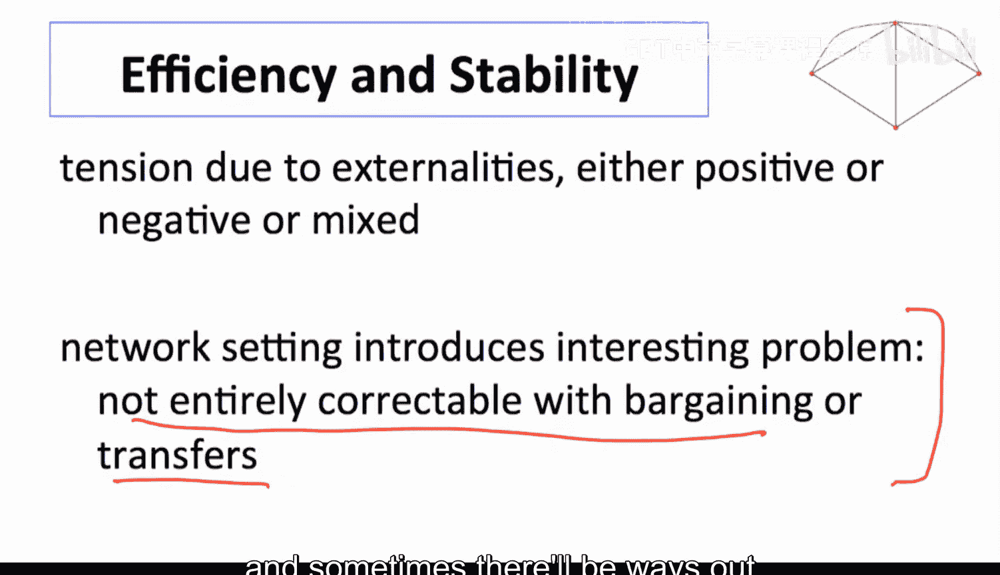

We work with slightly richer solution concepts， we think about dynamics。

 we can begin to talk about other kinds of of settings where we've got directed link formation and so forth so there's a series of other topics we'll take a brief look at some of those there's the literature here is grown quite large so it's hard to sort of give you a full understanding of all this in a few lectures but hopefully this gives you an understanding of the basic issues and a lot of the reasons some of these going to be interesting and there's an active area of research that will talk about it a little bit more going forward which has to do with sort of bringing together these kinds of strategic formation models with some of the random network models that we saw before to try and fit these together to data and understand what's going on。

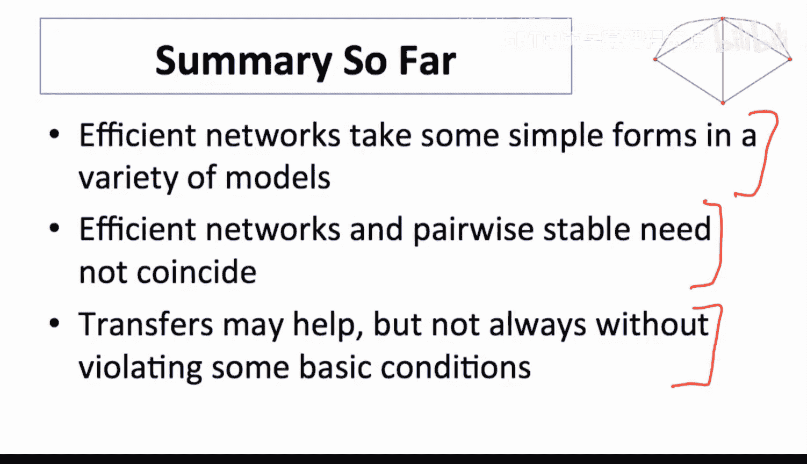

So that'll do it for now and then we'll take a look at some other formation models in just a moment。

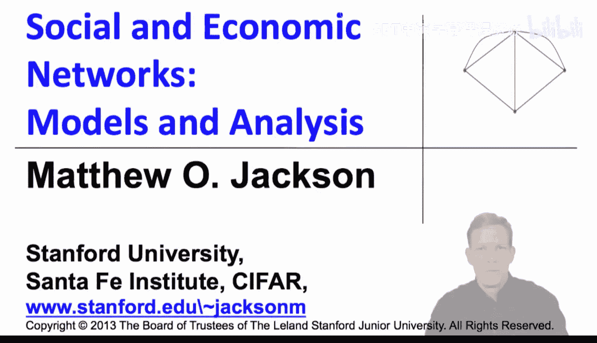

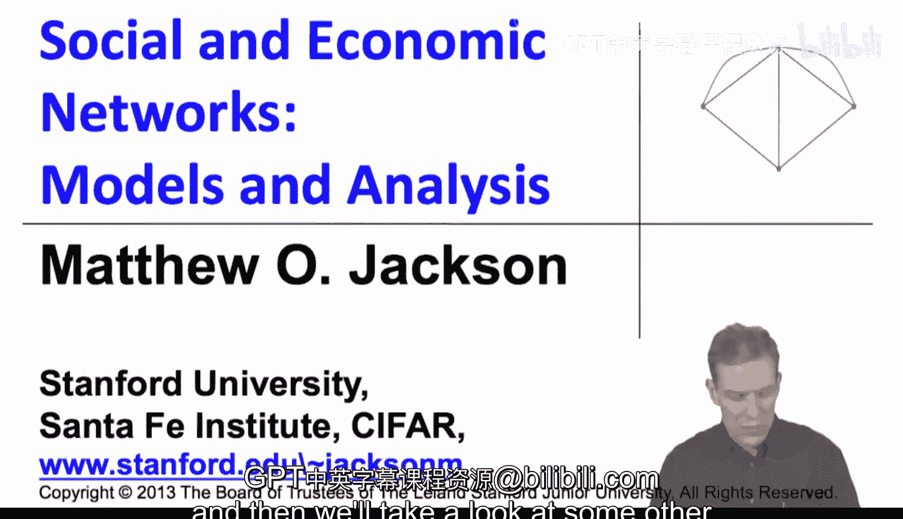