# 斯坦福大学《社会和经济网络：建模与分析｜Social and Economic Networks： Models and Analysis》中英字幕 p43 43_04_08_4-8-策略模型中的异质性.zh_en -BV1v1421U7Nk_p43-

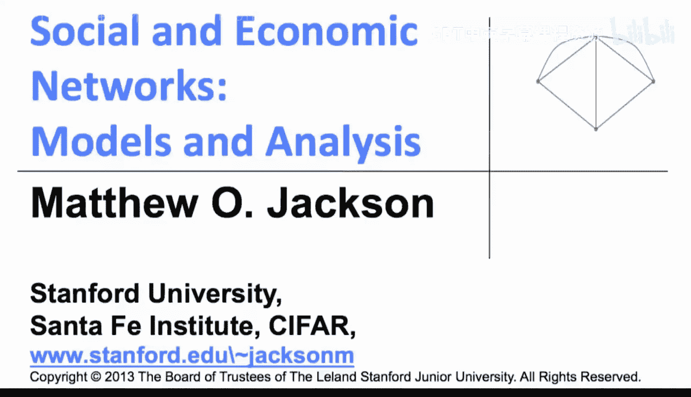

Ii， folks。So we're back and we want to talk a little bit about enriching some of the strategic formation models to be we have a little more heterogeneity in them so that we can help explain some observed facts and data。

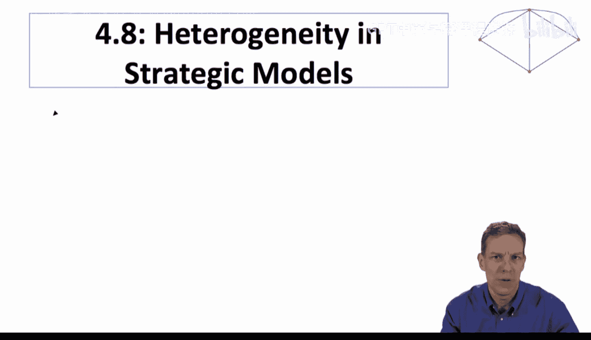

And so we're still in the part of wrapping up the strategic network formation and in particular what we're going to do is enrich things basically just in terms of cost structure。

 so costs of forming relationships can depend on geography and characteristics of nodes。

 so it's easier to be friends with somebody who lives very close by。

 it's easier to relate people to people with similar backgrounds。

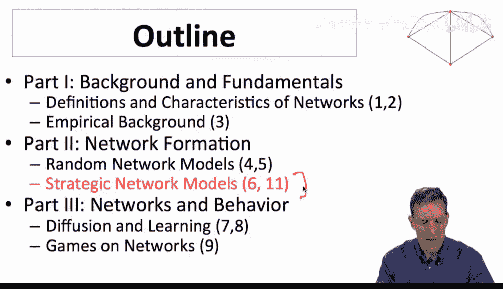

You could also imagine that that benefits would depend on the characteristics of nodes so that people with similar characteristics find it easier to work together or share share risk and so forth。

 There could also be complementities and benefits from diversity。

 So there's a lot of different ways we can enrich these models。

 We're going do this in a very simple way just to get some ideas out。

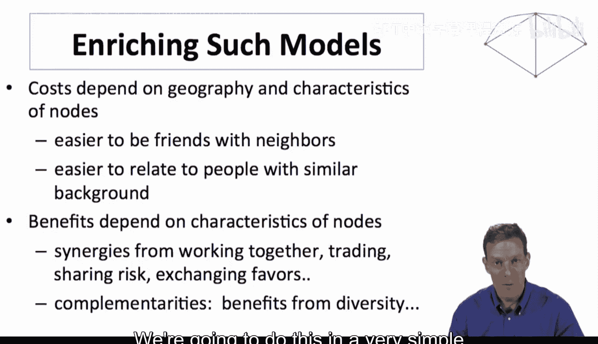

And the idea here is that we can get the so-called small worlds observations out from costs and benefits。

 so we want to get simultaneously the fact that networks tend to have short average path length and at the same time have high clustering and so we want to look and see whether we can explain that with a strategic model。

And let me just give you the basic intuitions before we get into the details。

 the ideas here are going to be that effectively the fact that there might be very low costs to linking to people who are very similar or very close by is going to give high clustering。

 so we'll get very dense networks on a local level just because those relationships are easy to have high value to distant connections。

Means that then we'll have a low diameter。 So if I'm not connected to somebody at a great distance。

 I'm not accessing part of a network that's far away from me then forming relationships with people who are distant can give me access to a lot of information or a lot of people I don't have access to before so that tends to give high benefits to those which help shrink the diameter and the high cost of distant connections means that you're not going to have too many distant links。

 so you'll have high density on a low level。 a local level， a few long distance links。

 so that's not going to diminish the clustering too much。

 but you'll still have a low diameter because people will connect far away if they're not already connected So that's the basic idea and let's just go through the logic in a little more detail So there's a whole series of models that have basically looked at the variations on the connections model where geography is added in some way and what I'll do is just take you through one version of that model where we have people。

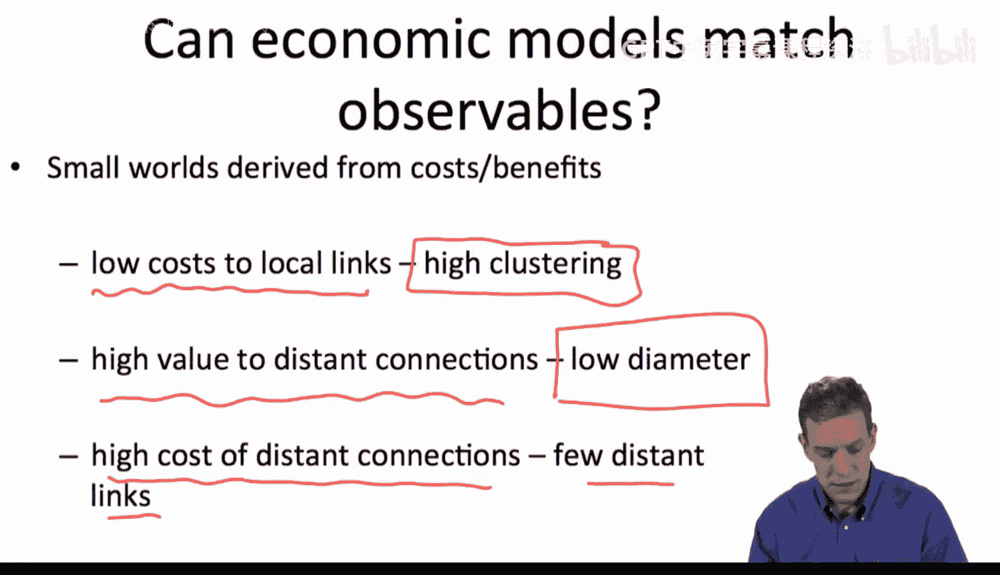

Living on an island and people that live on the same island can connect to each other very easily。

 and there's different islands， so there's a cost。Little C for connecting to somebody who's on your same island and it costs big C to linking to somebody on another island。

 But then the benefits the deltas and so forth are exactly as they were in the original connections model。

 And what this will do is give us high clustering within islands。 few links across islands。

 but will still have enough links across islands to have small distances。

 at least for some parameter values。 now the islands here are metaphors for it could be geography。

 but it also could be characteristics。 So people with very similar characteristics。

 find it easy to link to each other people with different characteristics， find it more costly。

 So the islands are a metaphor， but a fairly obvious one。

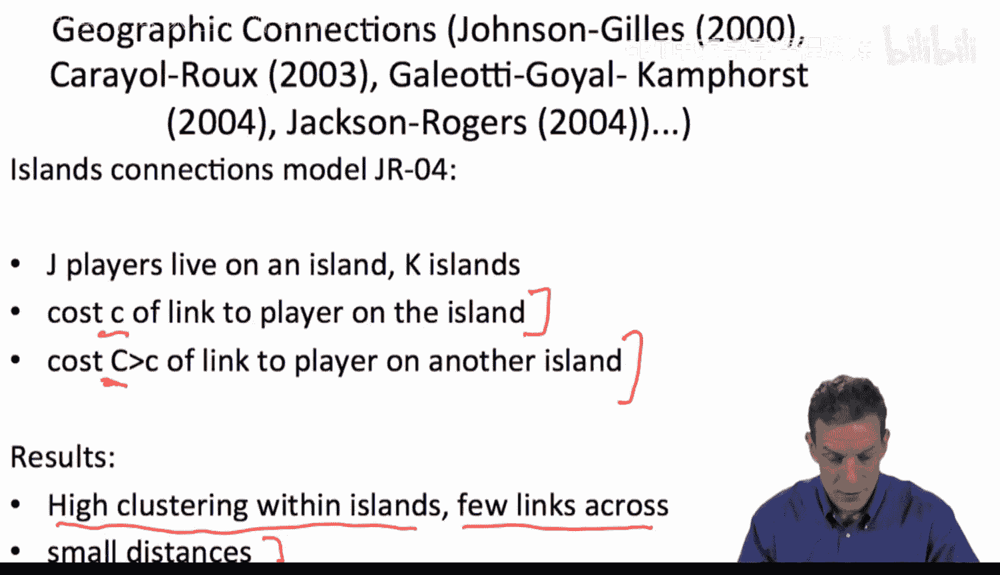

Okay so let's have a peek at just some versions of this。

 so imagine that we look at a given node here in network like this where we have here the five individuals in each group here are on islands so these are different islands。

 so the J the number J here is equal to five and we also have five islands， so。

We have five islands and five individuals per island and we can go through and look at the value to a given individual from their links。

 so for instance， if this individual is in this particular network or's their payoff well they have four little seas because they're connecting to the people on their own island。

 they're also getting four direct deltas。They've got a delta squared which comes from their connection to somebody two away。

 they've got seven delta cubes from people three away and 12 delta to the fourth from people at a distance of four okay。

 so this is similar to the connections model， but now what we've done is enriched the cost structured to have this geography involved。

Okay， so depending on whether you have only distant connections or only close by connections or some combination。

 payoffs are going to differ， so in this case we can see that this individual here is maintaining a connection to somebody on another island。

 they're paying a large cost for that， but they're seeing additional benefits and lower distances than an individual who's not connected across the islands。

So there can be incentives for somebody to connect and also if that person was not connected。

 then nobody on that island could access anybody on another island so if that person was to sever that link。

 they would lose connections with the other islands。

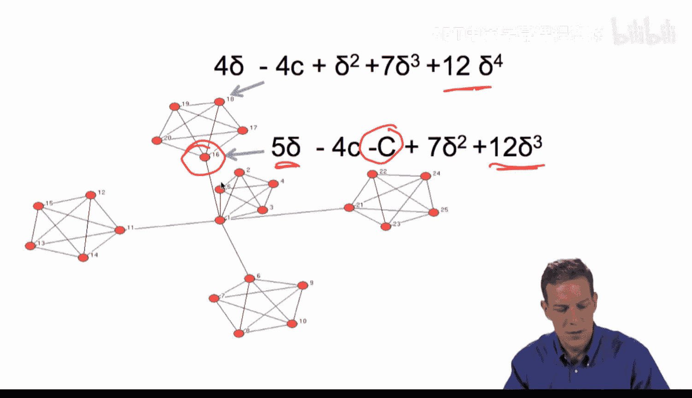

Okay so basically what happens here， low cost to an island means that you want to connect within your island。

 high costs across islands means that you only want to have limited number of connections across islands so here's a situation where for instance if the little C is below 0。

04 the big C is bigger than1 and still less than 4。

5 so you still want to have some outside connections Delta is reasonably large 0。

95 then this is a pairwise stable network so you can go through and check that nobody wants to delete a link and no two individuals who are not linked would want to add a link so you can go through and do all those checks for these parameter values hopefully I didn't make an error on that but you can go ahead and check that。

And hero what do we end up with high clustering and low diameter， so we end up with high clustering。

 given that many individuals have all of their friends talking to each other。

And we end up with low diameters because the greatest distance from somebody to somebody else in this network is for right so the diameter here is for and so if you kept enriching this model to have more and more islands you would end up with you very large number of nodes relatively low diameter so in this case we get high clustering low diameter you know obviously this is not is still a very stark model it ends up having very particular stable networks that are going to have certain kinds of regularities and degree and so forth which won't end up matching reality but what it does do is it gives us a different explanation and reasoning behind why you might see small worlds and we can begin to enrich this kind of model with some random formation to begin to try and actually fit things to data。

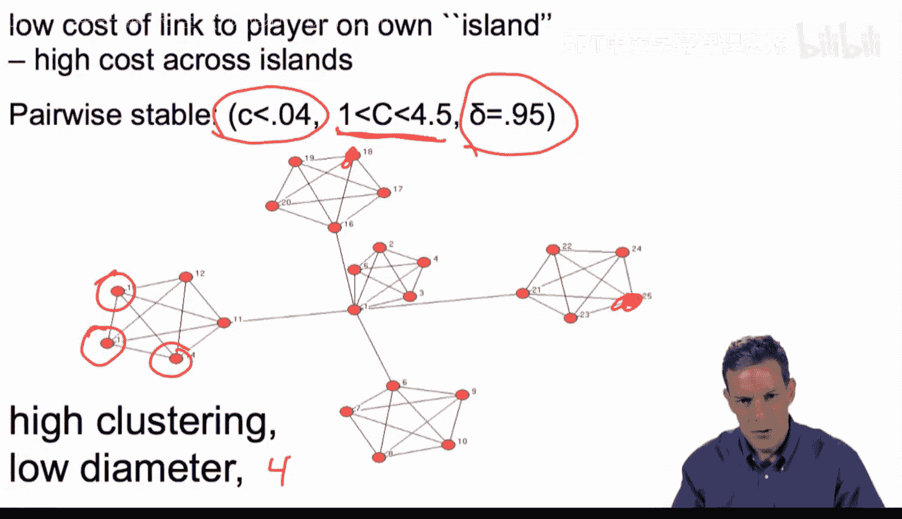

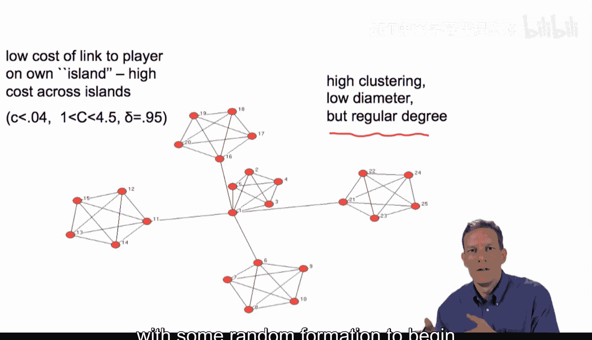

So you can go through and prove things about this model， so in the paper。Jackson Rogers 04。

 we proved some things about this model so here this is a first of all you can truncate the connections model so you only get value as long as you're within some distance maximum distance people so you don't get infinite if I'm a distance 50 from somebody I don't get any value from that so you can put in some CAD say for instance。

 I value friends out of a distance3 or distance four etc。

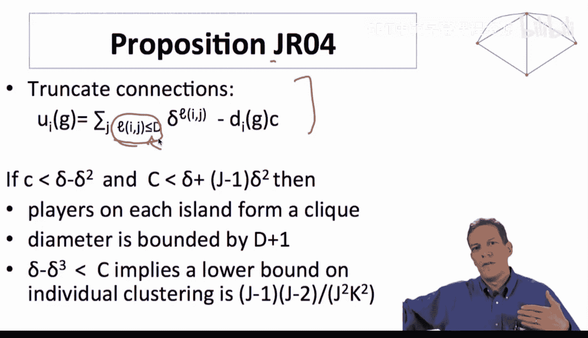

Then you can go through this islands model and basically you can show that if the little sea is small enough and the big sea isn't too large。

 then players on each island form a clique， you get a bound on the diameter。

 So here you're going to get clustering from the within island connections。

 you're going to get a bound on the diameter and if the big sea is large enough then you won't have too many inter island connections and you can get a lower bound on clustering which is depends on the number of islands and size of each island。

 So basically what you can get is some proof that this is a process sorry a set of properties which will hold for some parameter values within this kind of geographic connections model。

 the important thing to take away from this is now we see that we get in clustering because it's cheap to connect to people who are close by。

And we're getting low diameter because there's a high value to connecting to people who to whom you have only in very long indirect paths。

 And so the diameter is going to be limited just to the fact if there was too many missing connections。

 then it would pay for somebody to add them。

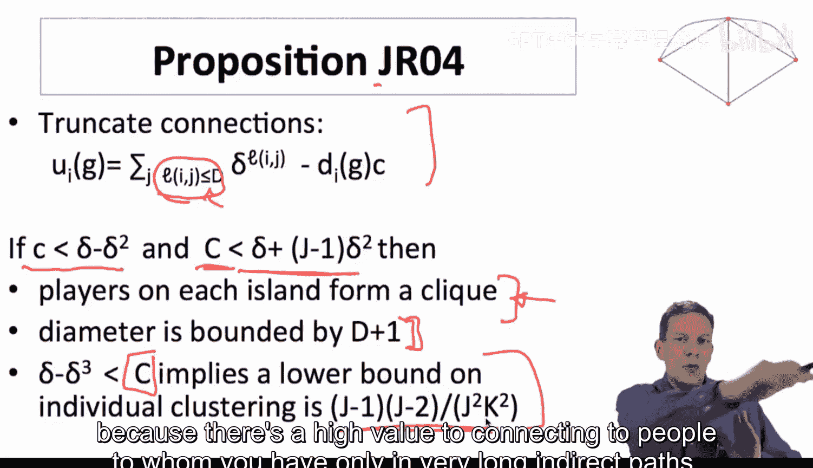

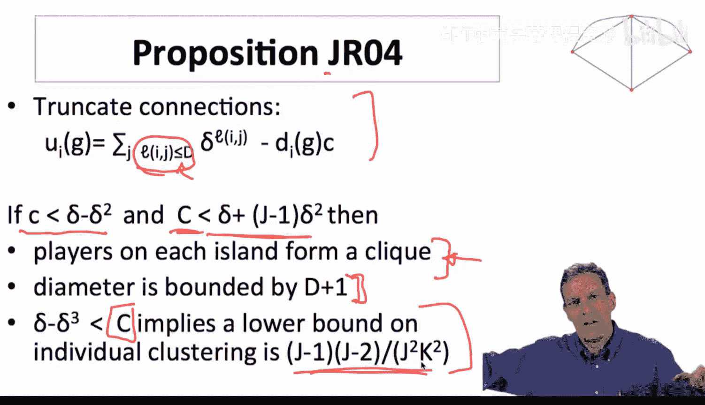

Okay， so in terms of the summary of the strategic formation we've gone through so far。

 we've got efficient and stable networks need not coincide。

 even when some transfers are possible and with complete information。

 the details of this depend on the setting， which kinds of transfers we might make。

 we didn't talk too much about forward looking， but that's something that you can add to these models。

 and you can match and explain some of observables with these kinds of models。

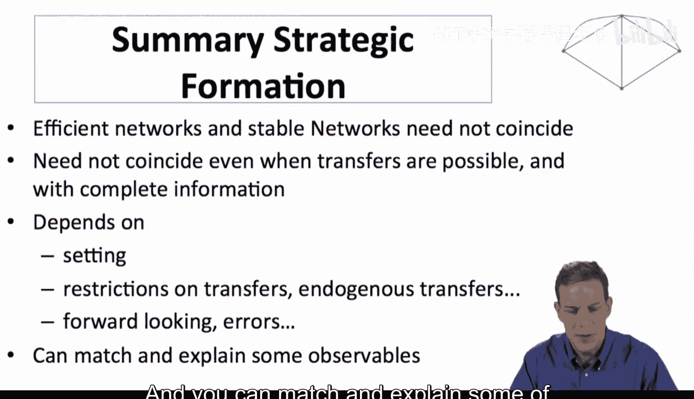

So in terms of the strengths of this kind of approach。

 a big part is that the payoffs allow us to have a welfare analysis so we can say something about which are good networks。

 which are bad ones and we can identify trade-offs between individual incentives to form relationships and societal goals and so we end up with this is a real understanding of whether or not the process of network formation that's out there is leading to good ones or bad ones and we're also tying the nature of the externalities to network formation。

 so are there positive externalities are there negative ones。

 how does this depend on context and so when we also end up accounting for some observable facts like clustering and the low diameter。

 there's an answer of why this might happen because of certain features rather than sort of a mechanical model which imitates it we have an idea of what kinds of fundamental assumptions about human behavior。

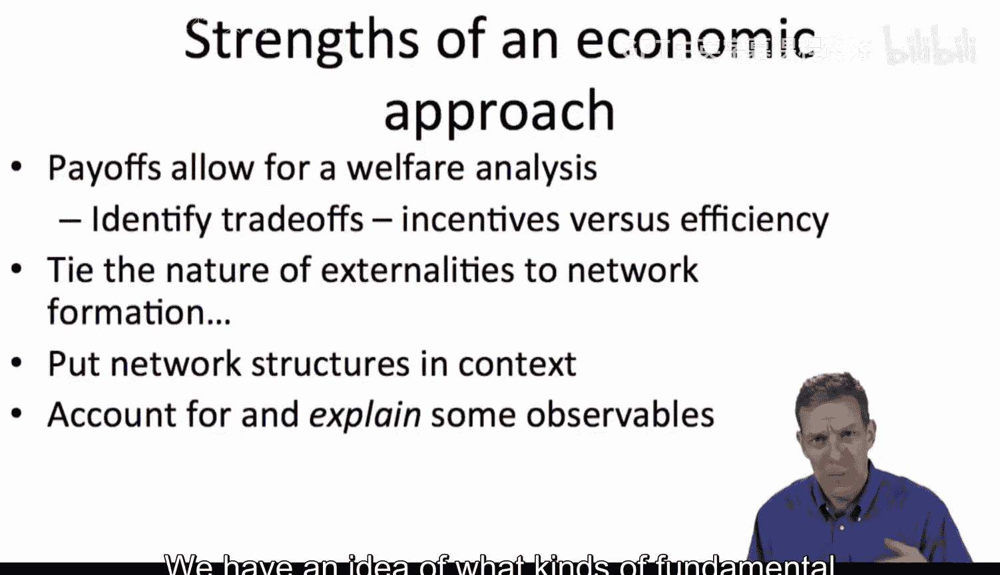

Would lead to this。Now of course， the problems with the economic approach that we've talked about so far is that a lot of the models we've looked at in order to solve them analytically have been very。

 very simple so they tend to be very stark overly regular lots of symmetry and we want to add heterogeneity to those if we want to enrich those models we're going have to add something。

 add some heterogeneity， simulations can help then if you want to take these to data。

 you can enrich the models， simulate them and see what happens there's also a question of whether or not you know the things are basically。

Ocurring at random or whether people are really making determined choices。

 and I think depending on the application， things might be swayed very much towards individual strategic choices and another applications they might be very much at random and so depending on the application you might want some mixture of those two in terms of applying these things。

 One challenge is figuring out what the payoffs are so what are the payoffs how do we relate network structure and outcomes to payoffs。

 how do we identify that。 that's not an easy question and it depends very much on the context。

 So you have to really begin to think about what is it what is it that motivates people to form relationships。

 Why do they maintain certain kinds of relationships。

 what are they getting from those things What's influencing their behavior So that's an important element that needs to go into these kinds of models。

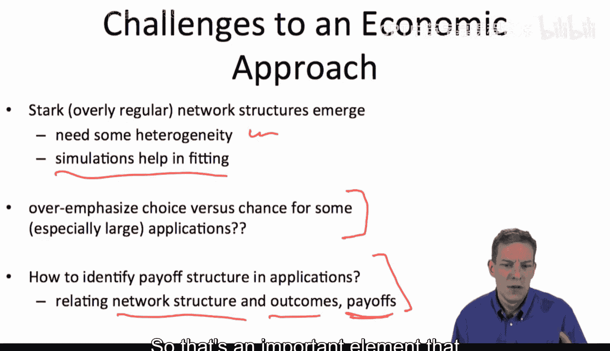

So models that start to marry the strategic random network models that we've seen before。

put these two types of models together are really needed。

 the strengths of the random network models in terms of being able to match data or fit to data are to some extent the weaknesses of the economic approach and vice versa。

 so we've got basically two sets of models with very complementary types of properties and mixing these together would then allow for us to do this kind of welfare and efficiency analysis。

 understand why things are happening， take the models to data and do so across a wide range of applications。

 these kinds of models being developed， we'll talk about some of those in some other videos。

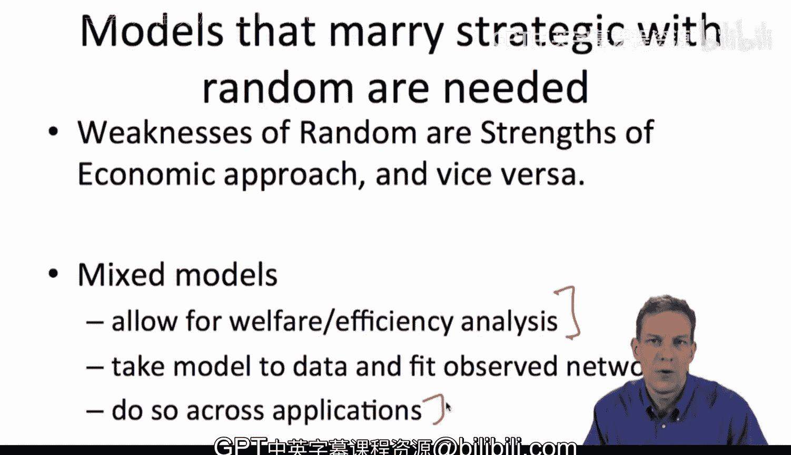

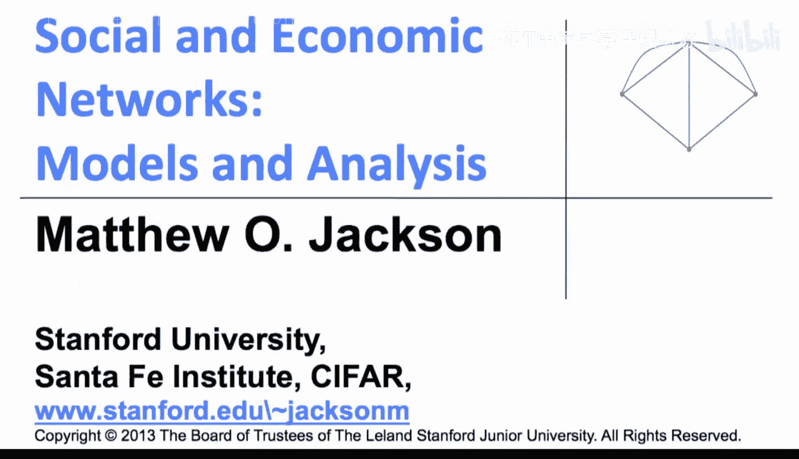