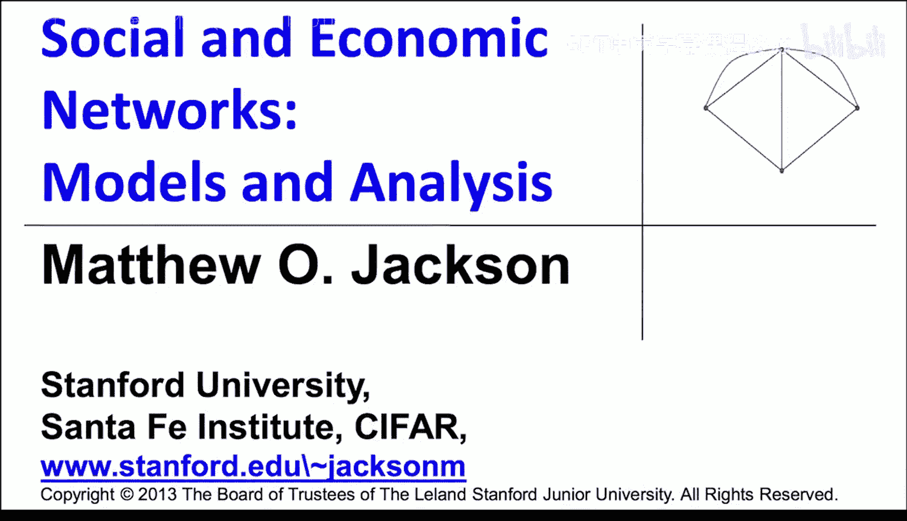

# 斯坦福大学《社会和经济网络：建模与分析｜Social and Economic Networks： Models and Analysis》中英字幕 p44 44_04_09_4-9-稀疏通用图模型与策略性网络形成（可选-进阶-13-47）.zh_en -BV1v1421U7Nk_p44-

Okay， so let's take a look at marrying the strategic formation models we have been looking at with some of the earlier types of models that we had for estimating networks。

 random networks， and in particular we'll look at subgraph generation model at Sugam and try and figure out how we might fit in some of the utility based calculations we've been looking at。

Okay so we've got utility from forming subgraphs， links， triangles etc。

 but what we're going to do is noise that up by putting in some randomness in the utility so let's have a look at how we might do that and let's do this in the context of a specific example so what we're going to do is try and ascertain whether or not when we look at cast relationships is there some sort of social pressure that's operating on these and not surprisingly we might find that there is and in particular are when we look at crosscast relationships。

 when we look at cast relationships they go across boundaries。

 are they more likely to occur in private when people have no friends in common or do they occur with the same frequency when people have a friend in common is when they don't have a friend in common so that's one of the questions we might ask so let's look back at some of the data we had from this work with Aji Banerji Runund Car and estradu flow。

So this is Vi 26 again， kerosene rice sharing and what we're looking at here then is again we've colored the nodes by just a dichotomist cast look so scheduled cast and scheduled tribes are blue general and otherwise backward cast are red and so what we've got is we see that there's fewer relationships going across the boundaries of this designation then within。

 so we saw the probability going across was 0。006， probability within was 0。009。

 but we can look at different here's village 48， a different subnetwork who visits which households which other households socially。

 it's a denser network， but we see similar patterns in terms of the segregation。

And so what we want to ask here is let's look at say somebody from the red。

 some from the blue categorization， do we see this kind of relationship where they have a friend in common less relatively less frequently than we see this kind of relationship。

 so do people have preferred to formerly things in private rather than in situations where there's going to be some sort of witness to the interaction。

 okay？So one difficulty in beginning to estimate this kind of thing is the fact that triads are going to take triangles are going to take three people to agree to form whereas links are going to take only two and so naturally it's going to be more difficult to get triangles to form and so we're going to get a bias that makes these things relatively less likely and then if we make any particular link less likely across than these things might have a lower likelihood just because we're looking at threes rather than twos and so what we want to do is account for preferences explicitly otherwise we're naturally going to find that the less desired triads compared to more desired triads is going to look less than less desired dads compared to more desired dads so there's going to be a bias there unless we account for this carefully so how are we going to do this so let's build preferences into this and then look at a subgraph generation model and then try and figure out how the probability of link forming depends on the likelihood that to pair meets。

Both wishing to form it so generally we can think of this as saying there's characteristics that I has。

 say in this case， their cast designation and there's going to be utility that they get from forming a link based on their characteristics and the other person's characteristics。

 And then there's some something either unobserved or some personality or something else which then also affects that utility。

 So we'll put it in an error term so we'll subtract off something which could be negative。

 it could be positive， so maybe it's a boost， but there's some random element here。

 and I benefits from a link， if and only if this error is less than this utility so if the error is less in magnitude than the utility。

 then this term is going to be positive and they're going to want to form that link and otherwise they're not going to so we have a very simple preferencebased model and now we're going to try and fit that into a subgraph generation model So how are we going do that。

Well， under pairwise stability， the links are going to form if and only if both of these two prefer it。

 assuming that the chance they' getting exactly a zero utility is0。

 so now we've got that links form if and only if I prefers to form a link and J prefers to form a link so that the error that J gets from forming a link with I is less than the utility that J gets from forming a link with I and so forth。

 okay so links are going to form when both of these things are true。

And so if we have some distribution of what the error terms look like。

 then the probability that a given links forms is going to be proportional to the probability that that error is less than I's utility and the probability times the probability that that error is less than J's utility so it has to be that both of them prefer it。

 so when we take this product that'll give us the product that the chance that both of these people prefer it。

 what's the chance that both prefer it， it's the product of the two。Okay。

That's under an assumption here and implicit assumption is that the errors are IID。

 so the chance that J likes I is the noise and the chance that J likes I is independent of the noise that I gets from the same relationship。

Okay。You could do the same thing with triangles。 What's going to happen is now we're going to have triangles depending on the three people's characteristics and then we'll have multiplied three times one for Ij and K okay so exactly the same kind of ideas and principles and so we could generate any kind of subgraph by doing the same technique putting in utilities for different subgraph forms depending on the characteristics of the individuals involved and then probabilities that people actually are going to have errors that are less than that and that gives us some distribution here okay so now let's go ahead and try and look at how we would use this kind of model to estimate something So what's the null hypothesis So if we think that there's no social pressure。

Then we think that a given person's preference for having being involved in a cross Ca triad compared to a within Ca triad。

Is the same as whether they prefer a crosscast link compared to a withincast link so what we're allowing them is to care about cast but what we're saying is they don't care the probability that they prefer something a crosscast in terms of a triad is the same as their relative preference for that within a link instead of a triangle so that's the null hypothesis that we have so now we can just go in and say okay well what's our model said that the frequency of crosscast triads compared to within cast triads is going to look like this ratio of utilities if we just assume now that everybody has a similar utility function that either varies am I going across or within and then we just get either synccratic noise on the particular relationships so then we've got a cube of the crosscast triads compared to within and a square on the crosslink。

Compared to within。 so now we're correcting from the fact that triads are harder to form。

And so that tells us the probability you prefer to form a crosscast triad so if we go back here。

 we want to back out what this utility looks like so what's the probability that I prefer this。

 well this is going to be the cubic we' just take a cube root of the relative frequencies so we can then just correct the probability that we prefer to form across is just going to be the frequency to the onetd cross for links it's going to be to the one half。

So now if under the null hypothesis， these two things should be the same that tells us that these frequencies in the data should be the same if the null hypothesis is correct so what we can do is plot what's the frequency of cross cast。

Tryads to compare to within to the one third power。 look at that compared to the links。

 to the one half power。 And these things should be the same under a hypothesis that social pressure doesn't matter。

 And if they're different， then we can figure out which one， you know， it does social pressure。

 encourage it or discourage it。 So if this number is if the top number is less。

 then we're seeing discourage based on the social pressure。 And if it's more。

 than we would see encouragement。 Okay so let's plot these out， here's links down here。This ratio。

And here's for triangles。Triangles up here。And this should be on the 45 degree line under that null hypothesis so this is the ratio of triangles。

 this is the link ratio raised to the three halves to correct for the three versus 2 and then when we look at these。

 they should all line up on the 45 degree line or half above or half below and these are for the 75 different villages and indeed we see that they're more lining up below and if you do a statistics test of just looking so one conservative test in this world is that if the null hypothesis were true。

 then you ought to have a coin flip as to whether a village ends up on one side or the other side of this line and in fact when you do that the preponderance of villages end up below the line and this is going to be statistical at significant at the 99。

99% level or more。One interesting thing you can do here is you can actually also then subdivide these villages by how。

Integrated they are in terms of or how。Balanced they are in terms of the cast designations。

 So some of these villages would be 50% red，50% blue in terms of those different measures we had of the scheduled cast scheduled tribe versus general and otherwise backward cast。

 So some of them split halfway down to middle。 So you have two people evenly matched。

 others are say 90% to 10% or 95% to 5%。 So there'll be a big majority of one cast group and a small minority of another cast group。

 And so what we can do is look at how balanced the groups are。

 So let's look at the relative size of the of how big the minority is compared to the majority。

 And if the minority is above median size。Then that gets a light blue， so these ones down here。

 we can see that most of them end up pretty far below。

 there's only a couple of them that end up anywhere above the 45 degree line。

 most of them are ending up below whereas the reds are the ones where there's a little more imbalance so that the smaller casts are more minority and this actually now you find that those the reds actually are a little bit closer to the 45 degree line so the more skewed the villages actually you find less of the pressure according to the statistics whereas here if you've got a very well balancedd village then the casts seem to separate more and in particular under the triangles you see even more pressure to separate so this is actually something that you see in different data sets is that the more balanced things are the more tension there can be in forming crossgroup ties and in particular here we see that the relative ratio of triangles to。

In crosscast compared to links you see that it's more often that you would get links compared to triangles in this kind of setting so this is just you know one illustration of how we might begin to marry these kinds of models but what it does show is we can use preferences together with other kinds of statistical models to begin to estimate some of these models and see what's going on in some of the data get a little bit of a lens it's hard to do interpret these causally but at least we can figure out whether there's certain patterns in the data and here there are patterns among the triangles in the links so we reject the nu hypothesis based on the model people show us significantly stronger preference in terms of what we estimate now whether or not they truly have those preference depends on whether the models correct the models is a little bit simple here more for the purposes of illustration but we can begin to build richer models that take more into account and see whether this finding holds up to those。

Okay， so you know when we model these strategic network in formation。

 we can begin to use these different types of models that allow for subgraphs and allow for strategic network formation and estimation that open us up a possibility of looking at systematic estimation and it allows us to you know include subgraphs is actually now a whole series of family of dynamic models being formed too。

 so this is a fairly interesting area of exploration these days。

