# 斯坦福大学《社会和经济网络：建模与分析｜Social and Economic Networks： Models and Analysis》中英字幕 p45 45_04_10_4-10-配对纳什稳定性（可选-进阶-11-34）.zh_en -BV1v1421U7Nk_p45-

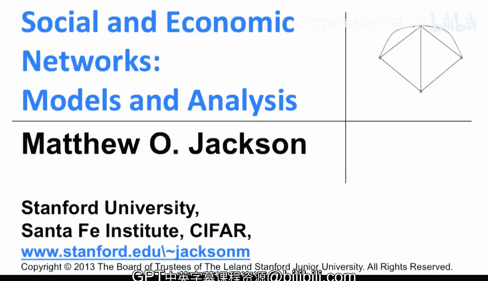

Hi folks， so we're back again and we're going to be talking a little bit about a refinement of pairwise stability now in an alternative way of modeling network formation。

 and this is known as pairwise Nash stability and the idea here is we're thinking just about other possible methods of modeling network formation and there are many different ways and so I wanted to just give you some feeling for the fact that there's not going to be any single notion which is perfect for analyzing network formation but there might be various ones and different ones are going to have different strengths and weaknesses。

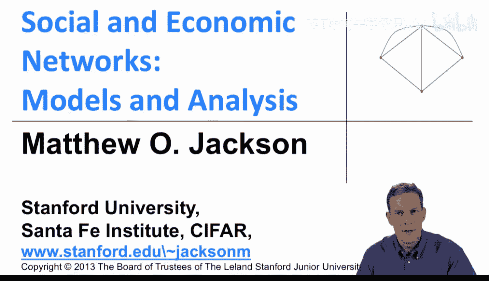

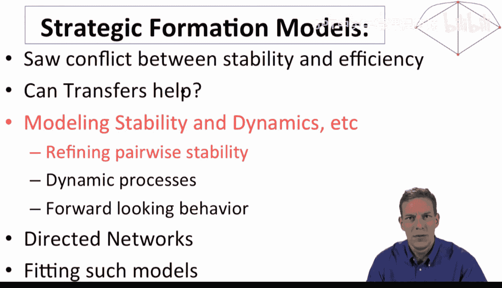

And so in terms of going beyond Parawise stability。

 part of the idea here is that we want to allow individuals， for instance。

 to make multiple changes to links not just one at a time。

 maybe you know already in Parawise stability we allowed for two people to act you could allow for many more people There's a whole series of other questions that we can ask we'll talk a little bit about some of these in coming videos。

 you know existence dynamics， stochastic stability， forward looking directed。

 there's a lot of topics here in a fairly rich literature I'm going to give you a peek at some of those。

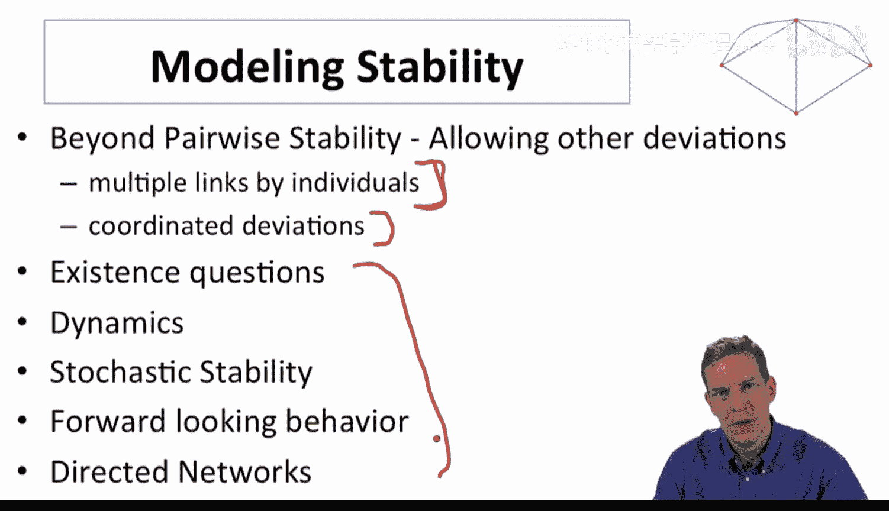

So let's think about this alternative way that we thought of early on of forming networks。

 which was just to think of each person saying who they're willing to form relationships with and then having relationships form if and only if both people named each other。

 so this is a game actually Roger Myerserson talked about this game in the early 1990s of an announcement game of forming relationships here players so you can use that here in this network formation setting。

 players can simultaneously announce。Which their preferred set of neighbors are。

 So each person I makes an announcement。 Let's call the set S I。

 This is the set of other nodes that I wants to be linked to。 So， for instance， you know。

 person 7 could say that they want to be linked with persons 1，2，5，11 and so forth。

 So they're saying these are my preferred neighbors。

 and then the network that forms as a function of the profile。

 the full vector of all the announcements made by different individuals are the links such that J was named by I and I was named by J。

 So this is consensual network formation， you form a relationship。

 if and only if both people named each other。

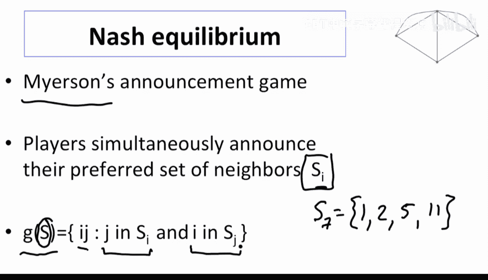

Okay so what's Nash stability then well just take a Nash equilibrium of that announcement game and we'll look at pure strategies。

 So this is a situation where the utility that a given individual gets from the network that forms under the announcements that are there is at least as good as anything that they could get by changing their announcements so they might want to announce。

 for instance they can't add some new links announcements that they didn't make and do better and they can't delete some of the announcements they did make and do better so we say that a network is Nash stable if and only if no player wants to delete some set of his or her links so that's going to be equivalent to having this be a Nash equilibrium of this game so Nash St basically looks at a given network and says does anybody want to take some subset of of links that are there and delete them so the set of Nash equilibrium of。

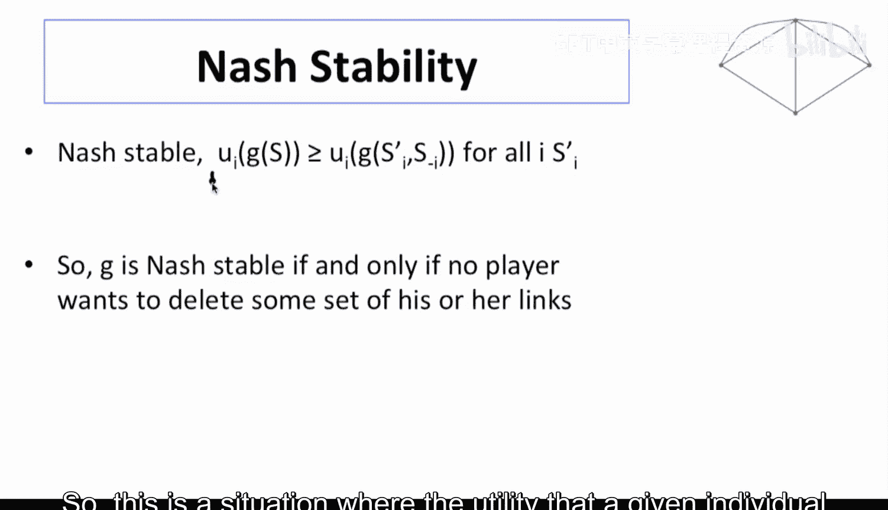

Strateggy and Ash equilibrium of this game are going to be equivalent to the networks where no player wants to deviate from the links that they have and delete some of them okay but it doesn't ask about adding mutually So if we look at a very simple example。

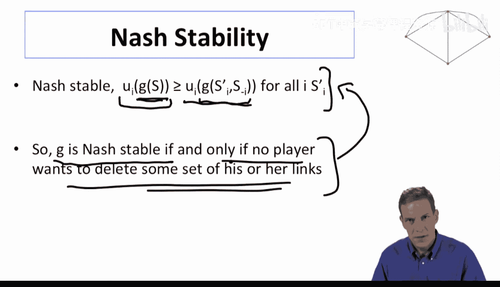

So at this example here， where do we have all individuals separately get zero。

A pair of individuals gets one。 if you end up forming a full triad。

 then you end up getting payoffs of one each and in this situation， if you end up in a。

Two link setting， then you get minus-1。 So this is a setting where when we look at the Nash stable networks。

 what do we end up with， we end up with three of them。So it's not terribly predictive。

We end up with three possible networks that could be Nash stable Now if you look at the comparison between these and Parawise stable。

 let's just go through why these are Nash stable why is this Nash table this is sort of a coordination failure nobody manages to name anybody else and nobody thinks anybody' is going to name anybody else so everybody each SI is equal to the empty set Nobody names anybody and now if nobody named me。

 I can't form a link anyway， so I might as well name the empty set。This is a N equilibrium。

 these two players are getting one they don't want to deviate and add the third player it doesn't make any sense they're happy。

 this is a N equilibrium everybody's getting one， there's no better payoff they could get this one is not。

And why isn't it， Well， this person must be announcing so if we call this player one。

 player one must be announcing player two， they could deviate and not announce player2 and they would be better off because their payoff would go from 1 to one。

 So this one is the only one that's not。Nash stable。Okay， so what do we end up with。

 we end up with three Nash stable networks。 If we look at the pairwise stable networks here。Well。

 this one's not pairwise stable。Right， so this is not pairwise stable。

For the same reason it wasn't Nash stable， this person can delete a link。

This one is not pairwise stable。Because these two individuals would both strictly gain from adding a link。

 so pairwise stability rules this one out， whereas Nash stability did not。

 and that was part of the reason that we went to pairwise stability because it eliminated this problem that we have with coordination failures leading to networks that really don't make a whole lot of sense in terms of if anybody really can communicate。

 they'd rather form the links that are giving them positive payoffs。

This one's clearly going to be pair wise stable because it gives everybody a maximum payoff。

 there's no better thing they could do。 What about this one is a pair wise stable。Well。

 if we think about Ging link， nobody wants to delete a link。 Do any two players want to add a link。

 Well， if they added a link。 So if these two players added a link， for instance， what would happen。

 they would go to play pay off of -1。 So indeed， this one is pairwise stable。

 They wouldn't want to do that。And this one's pairwise stable Okay。

 so what we end up with is a situation where we have three Nash stable networks and then two pairwise stable networks。

 so the pairwise stable networks are picking a subset of what the Nash stable networks are and so we could ask which ones are both pairwise stable and Nash stable。

 it would be these two in those we could call pairwise Nash stable networks。Okay， well， here。

 pairwise stability already was just picking a subset。

 So there wasn't really any reason to look at Nash stability in addition to pairwise stability because it wasn't narrowing things at all。

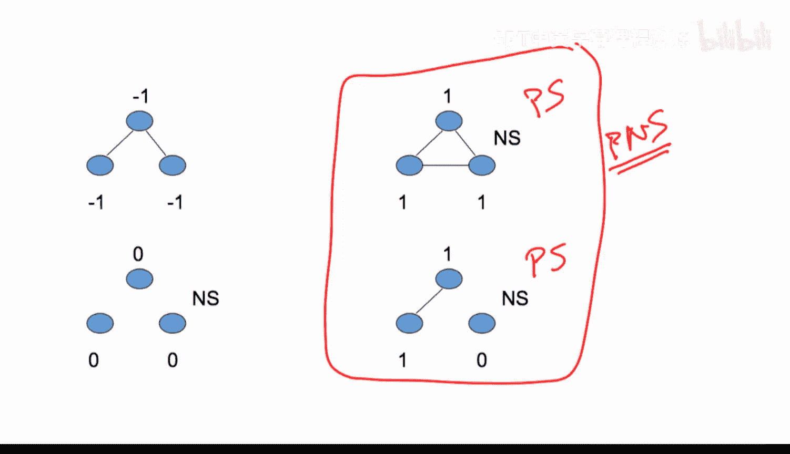

But more generally， if we look at pairwise Nash stability so we ask for something to be both pairwise stable and Nash stable。

 we can end up in some cases with more of a refinement so let's look at a slightly different example so here's the situation where if everyone is separate they get zero as before one link leads to payoff of one here this situation is one where two links together leads to minus two and three links together leads to everyone to a payoff of minus-1 so in this setting when we look at the Nash stable networks。

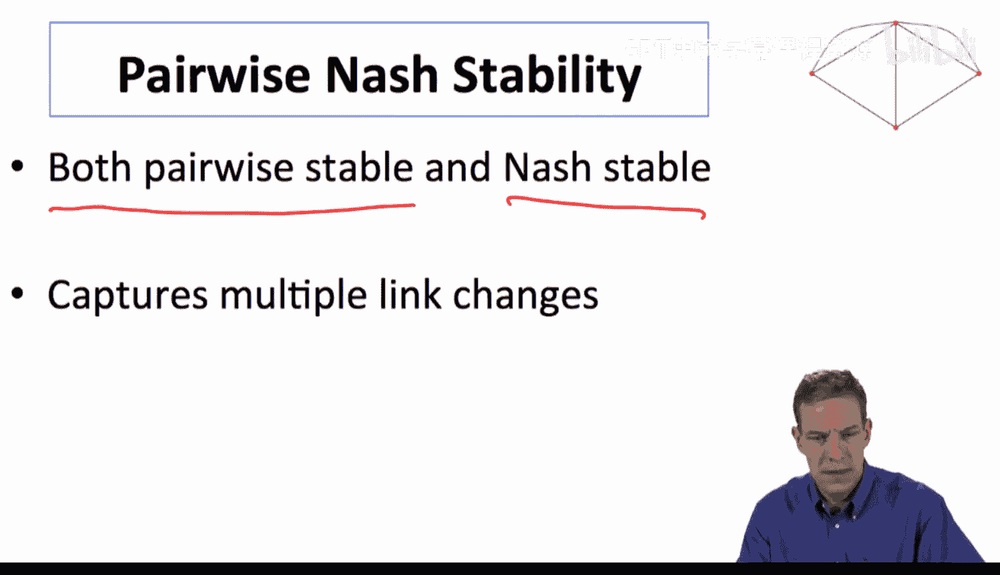

This is slightly different than our previous example。

 The only ones that are Nash stable are this one。In this one。Right so we've got this one。

 we still got the problem of a coordination failure we're getting the Nash table here。

 This one is also Nash stable。 This is not Nash stable anymore because now somebody could just sever both of their links and get a zero instead of a minus1 so they would be better off and this one is clearly not Nash stable because by severing both links and getting zero that' would be better off as well So in this situation what we end up with is the only Nash stable networks are the two at the bottom。

And when we look at pairwise stability， we end up with this one being pairwise stable。

 Nobody wants to add or delete a link from here。 That's clear。

 That's the maximum impossible possible payoffs that people could get。

 But this one ends up being pairwise stable as well。 And why is that， Well。

 if anybody deleted one of their links。Just severed one link， they would end up getting a -2。

 so they would end up being at the end of a triangle。

 they would go to a -2 payoff and so they don't want to sever a single link even though they could benefit from severing multiple links so pairwise stability was only looking one link at a time and it didn't allow people to say。

 oh look I'd be better off severing two links。So naash stability allows for multiple link changes but then has this coordination failure problem。

 pairwise St only looks one link at a time and so might miss some deviations where you could delete multiple links and be better off but putting them together in this case we end up with a simple conclusion that seems to sort of be the right network in this setting to expect a form which is the one that's both pairwise stable so nobody wants to add a link and nobody wants to delete multiple links and that combination of pairwise Nash stability ends up being more selective than either of the two and in some senses is picking out a more sensible prediction in this particular example so that's useful to have some refinements of pairwise stability。

 alternative methods of modeling network formation and it captures this multiple link changes you could do all kinds of other variations you could allow additions of links plus deleions of some links。

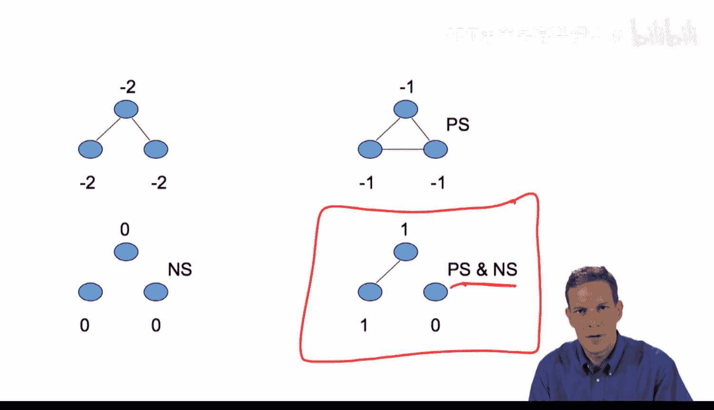

Allow us with larger coalitions， so there's a whole series of different ways in which you can embellish these definitions and of course game theorists love to work with different definitions and see what they give。

 so there's a nontrivial literature which looks at enriching a set of ways in which we model network formation。

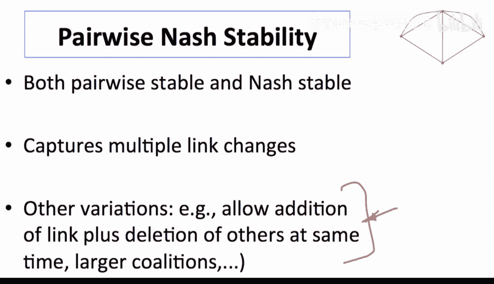

Okay， so that takes us through this， we also take a look at some dynamics and understanding how a dynamic network formation might work。

 what kinds of predictions we get out of that kind of model。

 and also some variations on fitting some of these models。

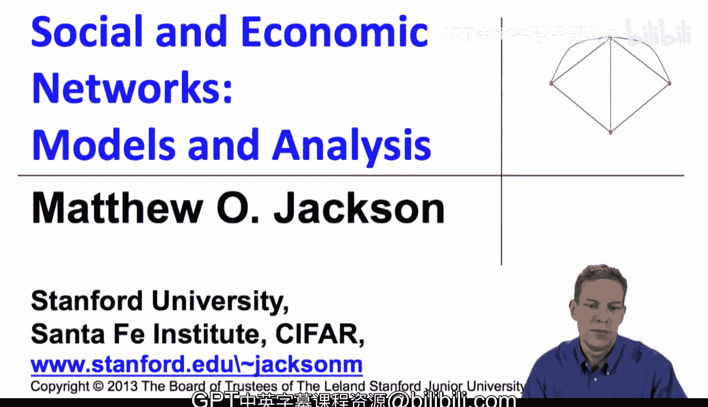