# 斯坦福大学《社会和经济网络：建模与分析｜Social and Economic Networks： Models and Analysis》中英字幕 p46 46_04_11_4-11-动态策略性网络形成（可选-进阶-11-57）.zh_en -BV1v1421U7Nk_p46-

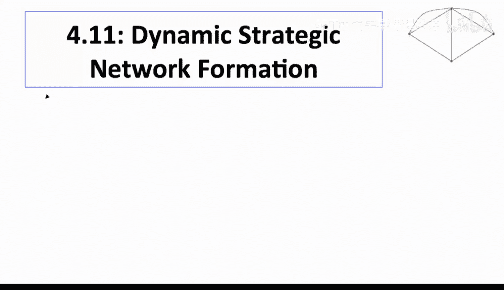

Hello there。 So we're going to talk now a little bit about dynamic strategic network formation。

 So add some dynamics to the process instead of just static look at what's stable。

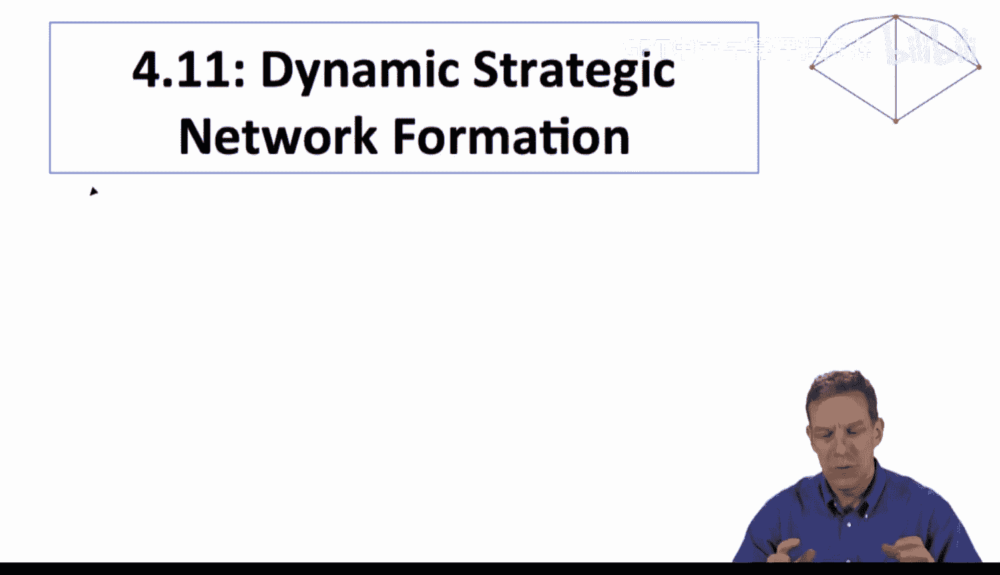

And looking at these dynamic processes， we can think of of。

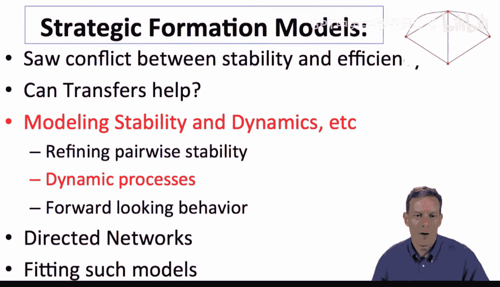

You know， adding dynamics for different reasons， you know， again。

 as I sort of mentioned earlier in the course， we don't necessarily want to just add。

Enrich models because that adds realism that's not a good reason to enrich a model because it complicates the model and we want things to be as simple as possible so we only want to add it if it's going to give us something that we didn't get before and here in particular what it's going to do is begin to give us some predictions of which networks might form when there might be multiple ones which are stable and you know another possibility is that by doing this you could begin to capture forward lookinging behavior where people are sort of asking well if I do this then what's going to happen further down the line we're going to start by just really focusing in on this fact that it's going to refine static models and there's very different approaches to dealing with dynamics we can think of dynamics where they're myopic and error prone and nature is just marching along and we're thinking about an evolution of a system or we can think of very forward looking calculating types and we're going to look at a fairly myopic version of model right now but a fairly simple one。

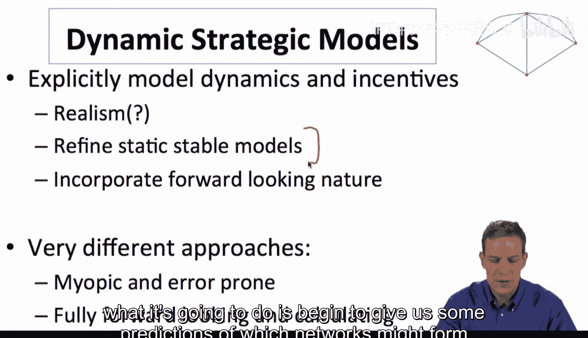

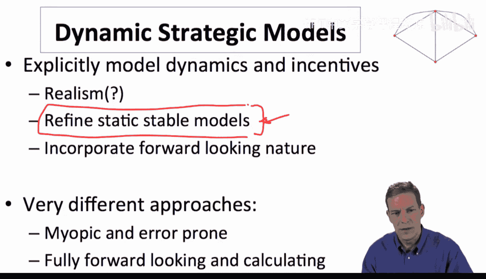

So the idea here is that we're going to look at a dynamic process where people can form links over time and even if there are multiple pairwise stable networks and some of them happen to be efficient。

 we might not reach those and the process we'll look at was first proposed by Allison Wats in 2001。

And the process is really the simplest one you could think of in terms of adding a dynamic。

 nature just finds a link， uniformly at random picks a link。

 and then that link is added if adding that link to the current network would benefit both individuals involved。

 at least one of them strictly benefiting。And if the link's already in the network。

 then it would be deleted if it would if deleting it would help either of the individuals involved。

 So it's basically like the pairwise stability concept。

 but instead we're just going look a link at a time。 So we started some network。

 randomly pick a link。 And then if it's already there， we think about deleting it。 if it's not there。

 we think about adding it and then just continue randomly picking links and so forth。

 So now we've got a nice dynamic process， it's going to march along and then we can ask where will where will it end。

 So first thing we can say is that any resting point。

 So if this process ever stops at some network and never moves from that network。

 it must be that whichever links are recognized nobody wants to add a new one and nobody wants to delete an existing one。

 Therefore， it must be pairwise stable。 So this process is going to identify。

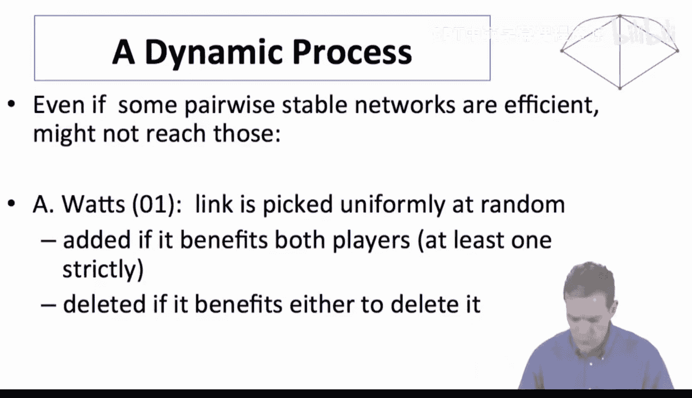

Pairwise stable networks， it's going to come to rest at pairwise stable networks。

And so the proposition that Elison Watts showed is an interesting one where let's suppose we consider the connections model where C is less than delta。

 so it actually makes sense to just to form individual links to people you're not connected with。

 but C is bigger than deelta minus delta squared， so stars are going to be efficient networks and a star would be pairwise stable。

 so if you actually had the center of a star were in a sort of low to medium cost range where stars are going to be efficient and pairwise stable。

 and the point that she made is that if we look at this dynamic process。As N grows。

 the probability that this process actually stops at a star goes to 0。

 So even though a star would be one of the pairwise stable networks。The chance that a process。

 a fairly natural dynamic process is actually going to reach one of those efficient networks is going to zero。

 so most likely you're going to end up with an inefficient network。

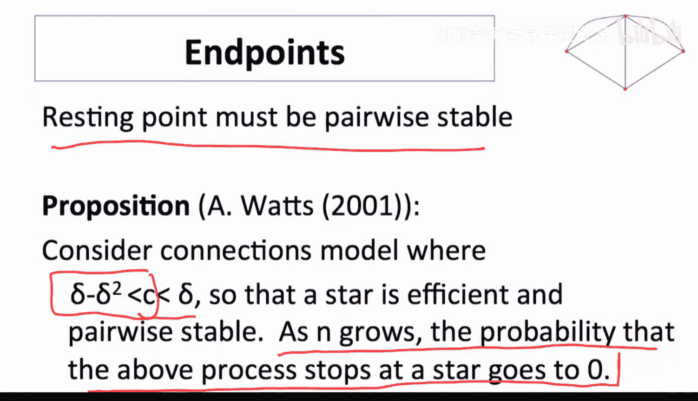

And let me just go through the basic ideas here and then we can go through a short proof of this。

 so the ideas are fairly straightforward so let's imagine we started at an empty network and we just start building these things up so we started an empty network and you know two people are identified and they can form a link let's call them one and two so they're the first two people who have a chance to form a link well we're in a situation where C is less than delta so they're going to form that link it's beneficial Now another person comes along we recognize another link。

Now there's different possibilities in this setting。

 one is that somehow the link involves two individuals other than one in two。

And those people would want to form that link if we happen to find three and four。

 they'd want to form a link because that link's not there， it's an their myopic。

 they think this is good， it's beneficial。They would want to form that link already。

 we're on a path that's not going to lead to a star。 And question is。

 we'd have to be careful to find out if would that 3。

4 ever be deleted and maybe they'd form a new link to one and so forth。

 But at this point that we're on a bad trajectory we could also think of a situation instead where maybe some individual is recognized along with a link to one or two。

 so we do happen。 So we do happen to to go on a good trajectory towards the star。And。

Once that happens， then as new links come in， it's quite possible that the new links being recognized are not directly to either one or two but to somebody else in which case we can end up having things move out in ways that are not going to lead to a star so the fact that people are bioopic and not necessarily thinking oh。

 we have to get to a star that's the best thing for us instead adding links when they're valuable means that this thing could arise in a way that's going to look very different from a star and we would have to have basically an order where the ordering of the links that are recognized would have to just happen to be exactly in a configuration of a star for a star to arise and the chance that these are the links that are recognized and not any other ones before we get to finishing it is going to zero so that's the basic idea behind this。

Proposition of Allison wantss。

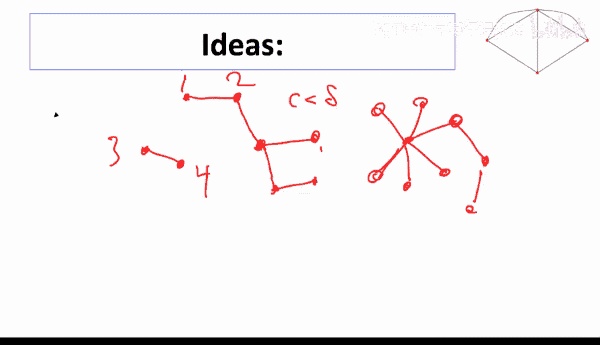

So to be a little more explicit about the proof。When key observation is in this cost range。

 once you have a link， you'll always have at least one。 Okay， so given that C is less than deelta。

 it makes sense to have a connection to somebody that you don't have any other connection to。

 You would never sever a link， which completely disconnects from you from somebody even indirect。

Because links are net benefits and so nobody would ever sever a link that would lead a node to be isolated okay。

 so once a node is connected into the network， they're always going to be connected into the network。

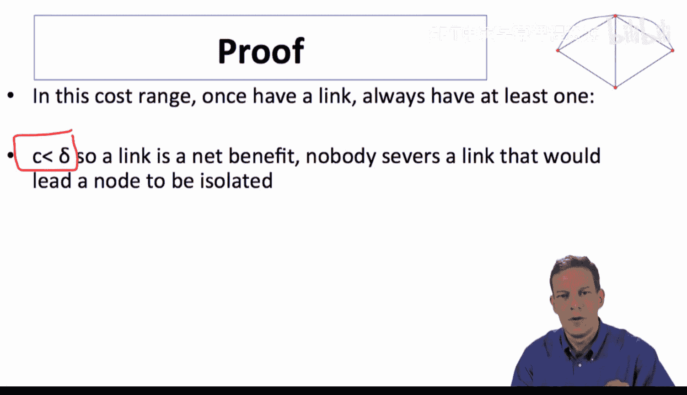

Okay， so that's the first observation and then so let's suppose that we you know somehow manage to reach a star。

 relabel let's label the nodes as one， whatever the node the center was。

 and two through n are labeled at the last date at which they connected their link to one okay so we ended up with the star formation so n is the last person who added a link to person1。

Okay， the observation here is that N， this last person to connect it couldn't have been somehow connected somewhere else in the network already when it attached to one。

Because and one would have already been at a distance of two。 So， for instance， if we've got。

 you know， one，2。1，3。One， for et ceter， and we go through and this is person N who's connected when they formed this link。

 this last link， it couldn't have been that they were already connected to somebody else in the network。

 otherwise they never would have formed that link because they already would have been at a distance of at most too and we've got the it's not。

In one's interest to to shorten that path， given that the cost exceeds delta minus delta squared。

 so it's not in person one's interest to shorten that link。

So this tells us that N couldn't have had been connected to anyone before connecting to one。

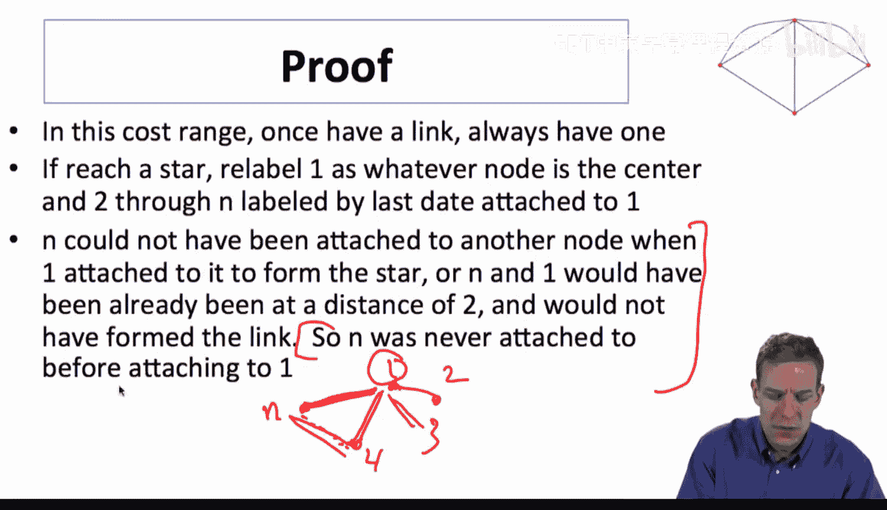

Okay and if you go through you know you can do the induction and do the same reasoning for n minus1。

 et ceter， basically each link had to be formed to one directly so it has to be that the only way that this could have happened is that you had to form a star directly and then you just have to show that recognizing the links to form a star the chance that that happens is going to be vanishing so you've got to form a star directly。

 so if IJ is the first link identified， the next one must involve either I orJ to get a star。

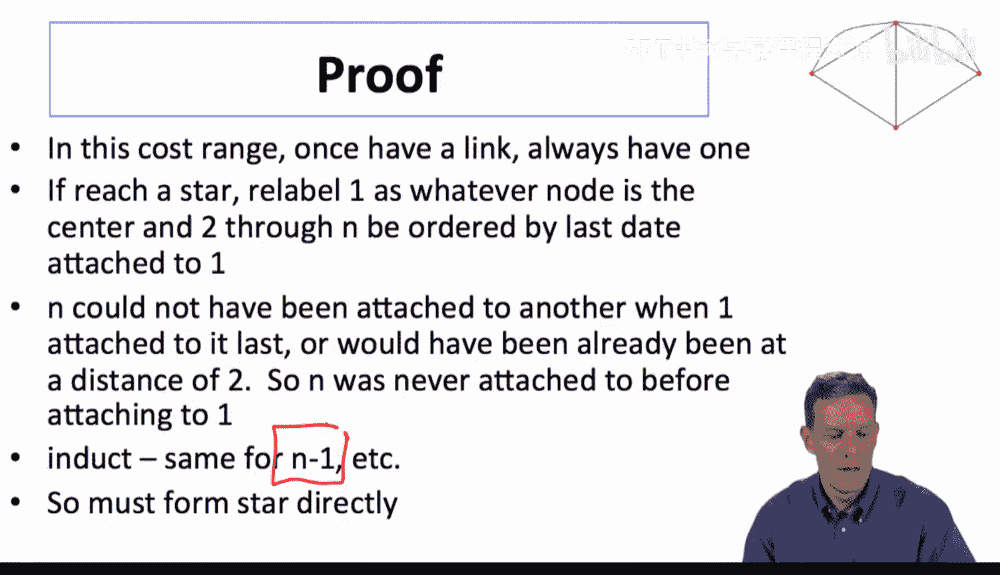

So if this is the first link that's recognized， then the next link that's recognized can't be some other link。

It's gotta be one that goes to I or J。Well，'s each of these people has n minus two people they're not connected to。

 so there's two times n minus two possible links that connect to either I or J。

And all the rest of the links。So minus the 2 n minus2 minus1。

 all the rest of the links are not ones that are going to lead to the star。

 and so the chance that you even take this first step once you've formed one link towards forming a star is no more than 2 n minus4 over the number of links at that time。

 which goes to zero at the rate one over n。 so if you look at this。

 it looks like it is at the order of n over n squared， it's looking like something one over n。

 its probability is vanishing and very tiny。

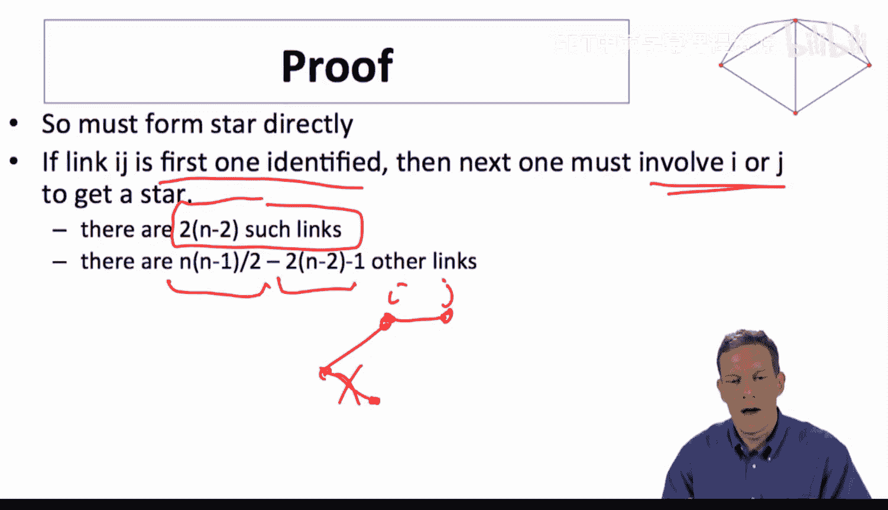

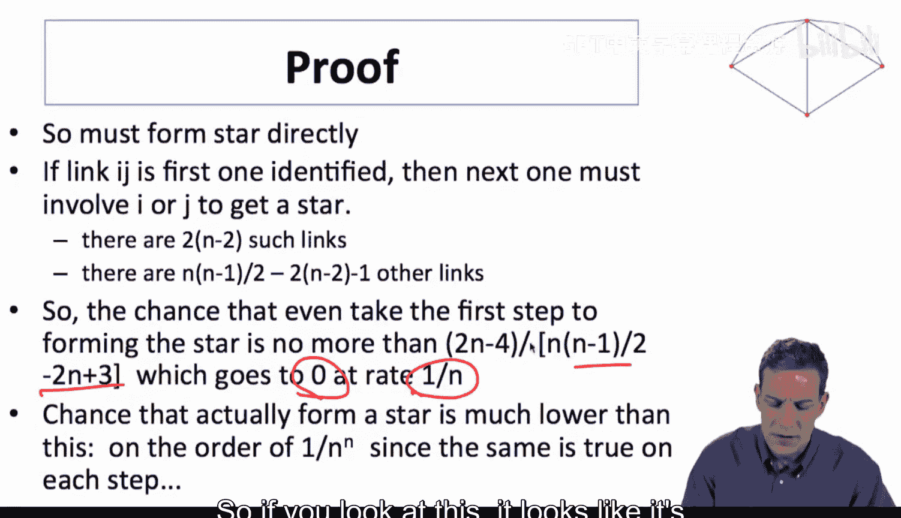

So the chance that you actually form a star is going to 0。 And in fact。

 if you go through and think about the probabilities that each one has to be recognized in order。

 the chance that you form a star when you look at all the orderings is actually even much smaller than this and goes to 0 at a very rapid rate。

 So the chance that you're hitting a star is tiny。

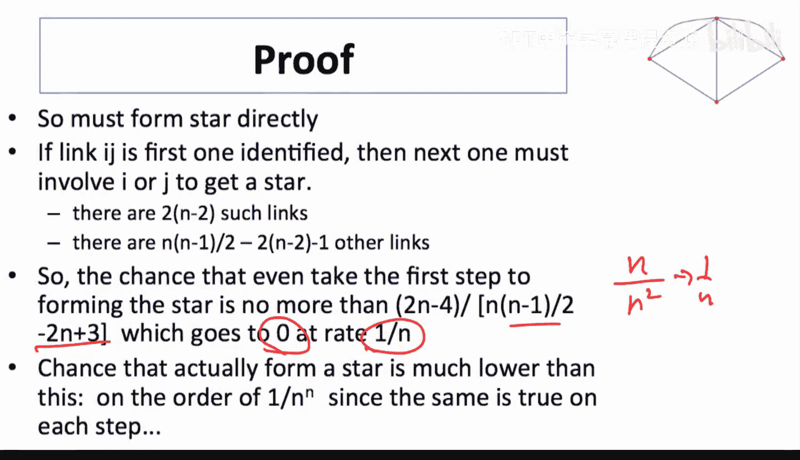

Okay so this was a very simple natural dynamic process。

 it finds Parawise stable networks if they exist， and even if Parawise stable networks are efficient。

 some of them are efficient， it doesn't necessarily find them so what this does is tell us that when we're looking at these things there might be many possible resting points it might not be that nature just because something' is efficient leads society to find that so we do want to be careful about what we think the formation process is in order to make predictions about what might be the outcomes。

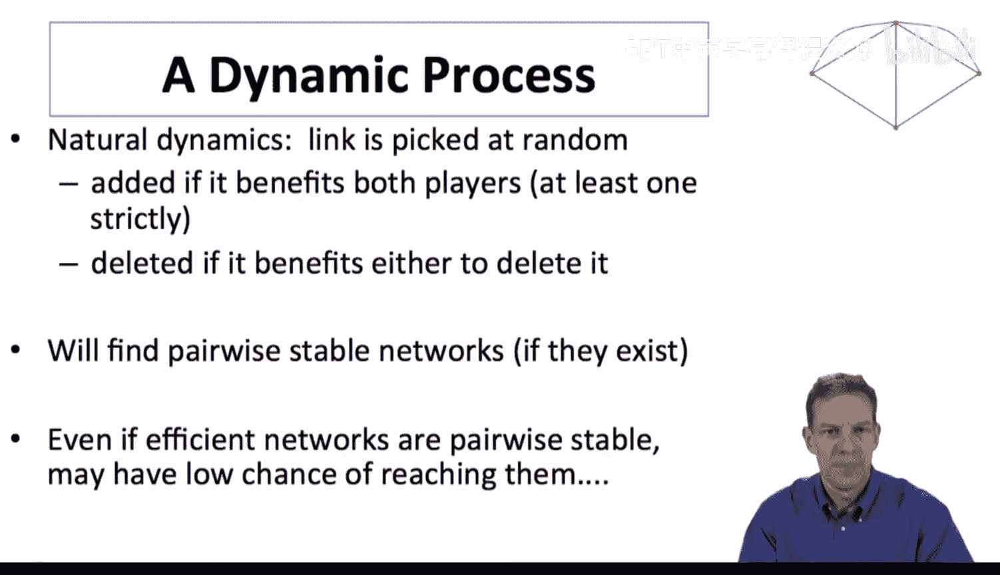

Okay， so the next thing we'll do is take a look at enriching these models a little bit further。

 we can even add noise to these， and that'll give us a higher predictive power in terms of which things we might end up at when there's multiple stable networks。

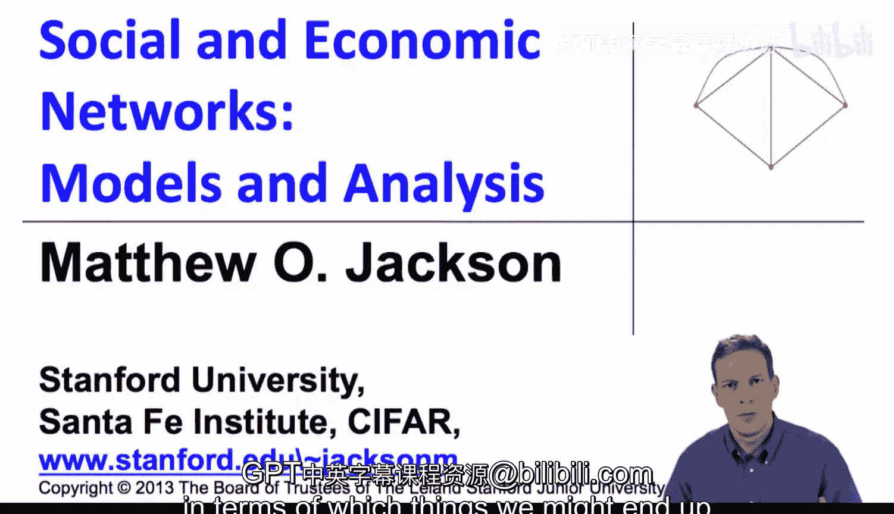