# 斯坦福大学《社会和经济网络：建模与分析｜Social and Economic Networks： Models and Analysis》中英字幕 p47 47_04_12_4-12-演化与随机性（可选-进阶-16-05）.zh_en -BV1v1421U7Nk_p47-

Hello folks， so we're back again and I want to talk a little bit more about dynamics and network formation and in particular adding a little bit of noise to the dynamic process and that actually has some nice properties to it so let's have a peek so we're going to talk about stochastic evolution of networks。

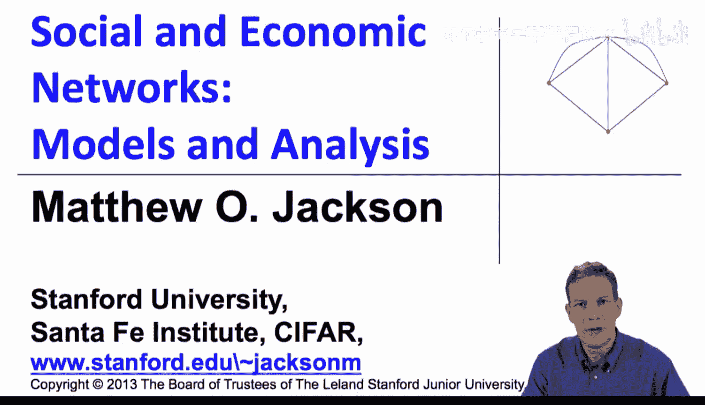

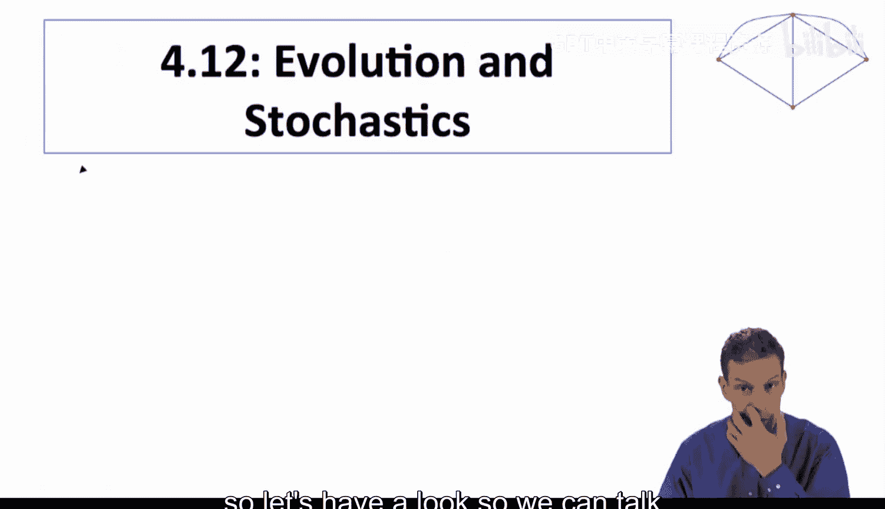

And we'll start with a concept which we called an improving path and this comes out of work I did with Aliison Wats so it's Jackson and Wats 2002。

 and the idea here is we've got this sequence of adjacent networks and just is in the process we talked about just before add a link if it benefits both at least one strictly to legal link if either person benefits from its deletion but what we're going do now in terms of looking at these paths is we're going to noise them up a bit。

 so first let's just make sure we've got the concept of improving paths down and the idea here is we can look at say a simple example。

 everybody disconnected has a value of zero so now what we're going to do is we're gonna have a diagram where we've got a bunch of different possible networks there and we're going to just keep track of what the improving deviations would be。

 so from here you could think of adding links。

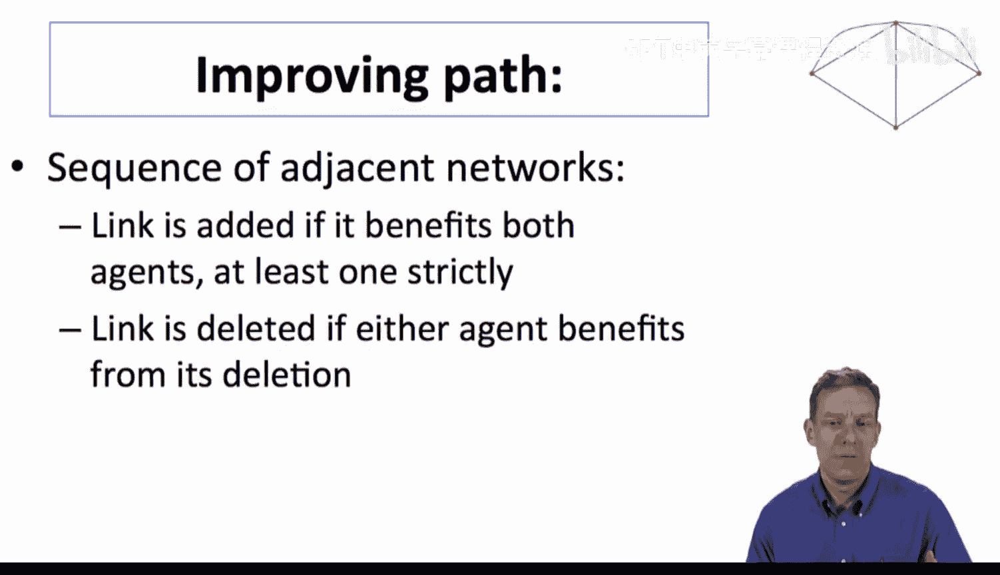

I'mAdd one link between any of the two players。Then you can think of adding another link so you've got two links or going to the complete network and the payoffs here are telling us that players either get zero from the empty network。

 a single link in isolation is not worthwhile you' only get a value of minus-1 Once you form two links then it's valuable and three links is the most valuable and what the arrows do here is represent the changes that would be value improving for people So if you were in a situation where you add one link then you could benefit by either severing that link and going to zero or if the possibility of adding a new link arose。

 then you would want to add either of the links that weren't there that would also be improving So there'd be three different ways to get out of this they would all be improving so that's the notion of improvements and the arrows point here in the directions of improvements。

So the idea of improving paths is going to be that there are paths here in this setting where everybody does better along each step so that an improving path from this network to the complete network would be one that passed through adding one link and then adding a second link。

 so if we follow these arrows we've got a series of paths where each choice is an improvement。

And there's also improving paths leading in this direction。 So for many of these networks。

 you can have an improving path leading down to the empty network。 So in this situation。

 there's actually two set of pairwise stable networks。 and in fact。

 they're both pairwise Nash stable networks。 So we've got the endpoints here。

 the empty and full networks being stable。 and there's improving paths leading from different networks to。

One or the other of these depending on which situation you're in。Okay。

 so that's the concept of improving paths。And what we're going to do now is so we've got two pairwiseized Nash stable networks。

 these endpoints are both parawise Nash stable and there's a question of well is one of them more realistic as an outcome than the other and in fact they're both strict equilibrium so if you are here。

 nobody would want to add a link it's strictly costly to them to do so and here obviously if anybody deleting a link as strictly costly so just looking directly at these concepts and actually even adding strictness isn't going to give us predictability。

So what we're going to do is add some trembles and errors to these improving paths。

 so we'll start at some network and with equal probability look at any one of its links。

 just like we did before， we'll add that link if it's not present and both people want to add it。

 we'll delete it if it's not there if it is there and somebody benefits from deleting it。

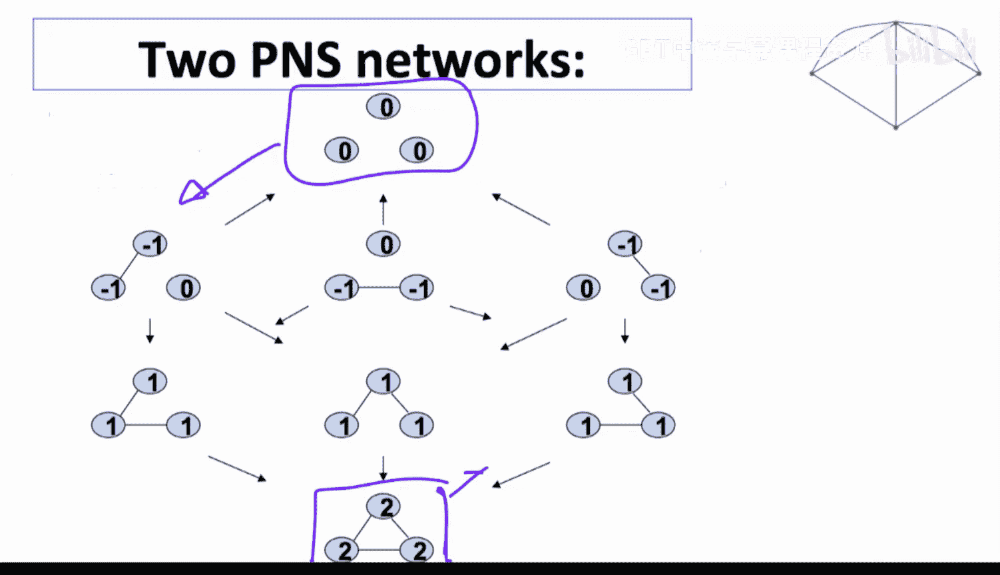

But the key thing is we're going to reverse the above decision with some probability epsilon。

So itll be a probability epsilon greater than zero that for whatever reason somebody makes a mistake and when they want to add a link。

 they don't or when they want to delete a link， they don't or a link that's beneficial。

 gets deleted or a link that's not beneficial gets added so we're in a situation where some link is recognized。

 people want to do one thing with it， either keep it or get rid of it or add it and the decision is reversed so whatever decision is made。

 it's reversed with some probability epsilon and we'll think of this as a small probability。

 So there's some chance that people make errors but most of the time they'll make the improving choice。

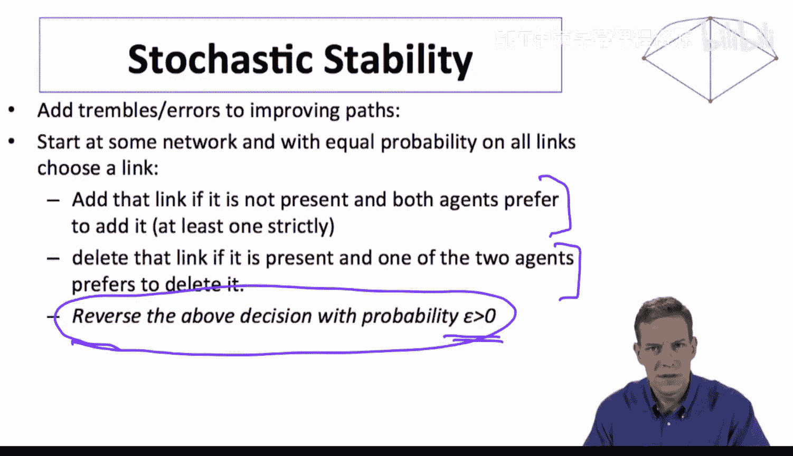

Okay。So what this does is it adds these trembles and errors to improving paths and what this produces is now this process is going to。

 as long as there's errors， there's always a chance that you're going to keep moving around so you're never going to stay anywhere forever。

And you can get from any network to any other network through a series of errors and improvements。

 And so this is a finite state。 There's a finite set of possible networks you could be in。

 It's irreducible in the sense that from anyone you can get to any other one。 and it's a periodic。

 can you could move in odd cycles， even cycles。 So this is a very nicely behaved Markovcha。

 ones that we know a lot about in terms of theory。 It's going to have a nice distribution over how much time you'll spend at each So give an epsilon and well have an idea of how much time you would spend at each network in this process over time。

 There's a steady state distribution which gives us the long run distribution of how much time you'll spend in each one of these networks。

 So let's have a look in more detail at this process。

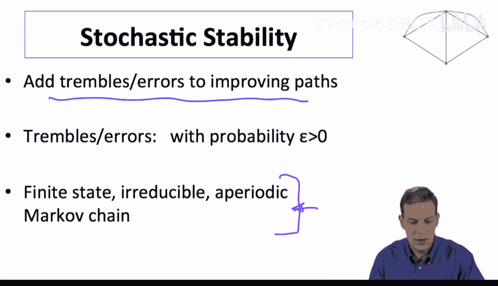

So when we've noised up our improving paths， let's suppose we're here we're at the empty network。

Well， now with probability 1/ third， any one of these links could be recognized。

 so what's going to happen is if we recognize a link it doesn't want to be added。

 but with a probability epsilon it would be added。So there's a probability of one third epsilon。

That you would end up。Recognizing this link and adding it by accident。

There's a probability  one third epsilon that you would move here and a probability  one third epsilon that you would move in this direction。

 So from a network with zero links， there is a probability of epsilon that you go from zero links to one link。

And there's a probably one minus epsilon that you just stay there。ok。And so forth。

 if we're here with two with three links， then there's a probability epsilon that you go from three to two and a probability one minus epsilon that you go from three back to three。

And so forth Okay， and so from one of these networks。

 there's a one third times one minus epsilon chance that you go to the complete network。

 there's a one third chance。Times epsilon， you go and delete a link that you wanted。

 one third chance， Time epsilon here and so forth。 So for each one of these things。

 we can figure out what's the probability that you move from a network with zero links to one with one。

 from one with one to 2 and so forth。 So instead of keeping track of all the networks。

 let's just keep track of them in terms of how many links they have。 So zero links， one links。

 to link， three links and what's the probability that we move between those。

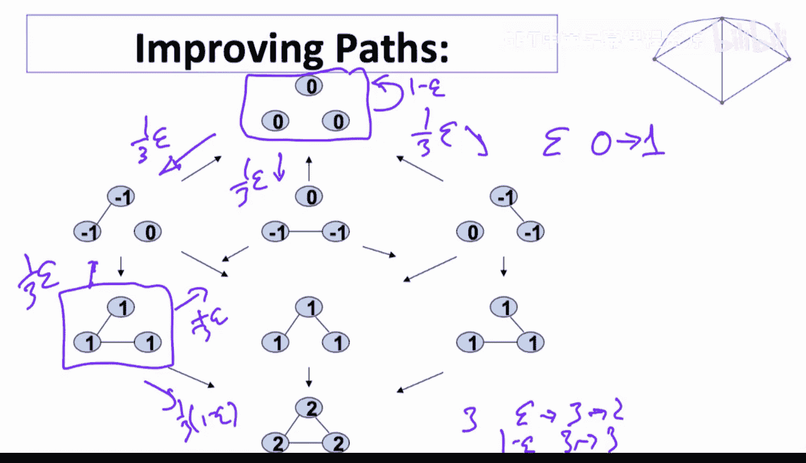

Okay well you can keep track of that what's the probability that you move from anyone to any other one and we can go through you know the probability that you want from one with zero to one with zero with one with two with three so you can't move directly to two links if you have one link there's a third of a chance any one of the ones you recognize you can go back to to zero。

 there's an epsilon chance you stay where you are there's a two- thirdd chance that you recognize one of the links that you want to add and go to a two link network and so forth right so we've got a chance this matrix keeps track of what's the probability that if you currently have zero one to or three links that you transition to a different state in the next period。

That's a well defined Markov chain。And given this， you can figure out what's the probability that you're going to stay in every state。

 So there's a solution of how much time do you spend in state  zero。

 how much time will you spend in state 1 in state 2 in state 3。

 So what's the average frequency of the number of periods you're going to spend in each one of these things。

 That's a well-defined Markov chain problem， you look for the steady state distribution。

 In this case it happens to be the lefthand side unit eigenvector of this matrix。

 If you don't remember things on Markov chains， or if you haven't seen Markov chains before。

 you can find detailed things on the Internet， Also。

 I have some pages in my book that just go through the basics of Markov chains。

 there's lots of sources where you can find information about this。

 The important thing is that once we've got this process。 It's a well-defined dynamic process。

 and we can figure out how much time you're going to spend in each different state。

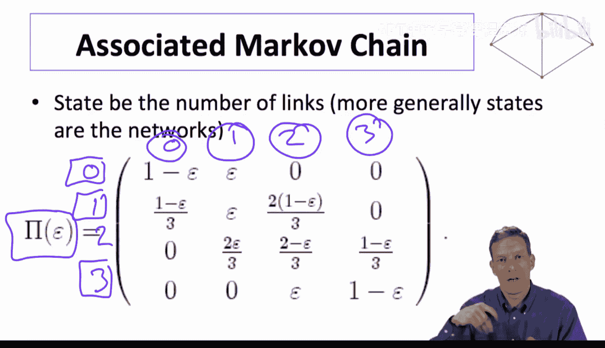

In this case， when you look at the probability the fraction of time you're going to spend in a zerolink network in a onelink network。

 in a twolink network， and in a threelink network， this is the answer to that unique steady state distribution。

 and you can find this by just checking what the left hand side unit eigenvector of that matrix was。

So what's the interesting thing about this， well， the interesting thing about this was we had two pairwise staple Nash networks。

The empty network and the complete network。And if you look at the amount of time you're spending in each one of these things。

As epsilon gets very， very small。As epsilon goes to zero。This approach is one。This term approaches 0。

 This term approaches 0， and this term approaches 0。

So this process is going to spend more and more of its time in the three link network。Over time。

 So even though both of these were pairwise Nash stable， this dynamic process。

Is going to end up spending as Epsilon becomes very small。 most of its time in the threelink network。

And so you can look at that by looking at the limit of this unique steady state distribution。

 This is what's known as stochastic stability in the game theory literature is a technique of refining equilibriumlibria that has become quite powerful and Allison and I use this to develop methods of working through dynamics in networks and here it gives us a prediction of which network is going to be visited most often and stayed at for most of the time in this process as epsilon becomes quite small Now one thing to notice is that as it's placing probability one here in the limit that's not the same as the steady states of the limit process So if you actually look at the process that had zero errors in it you could have ended up either the empty network or full network So the steady states of the limit process where you have no noise is different than the limit of the process with little bit。

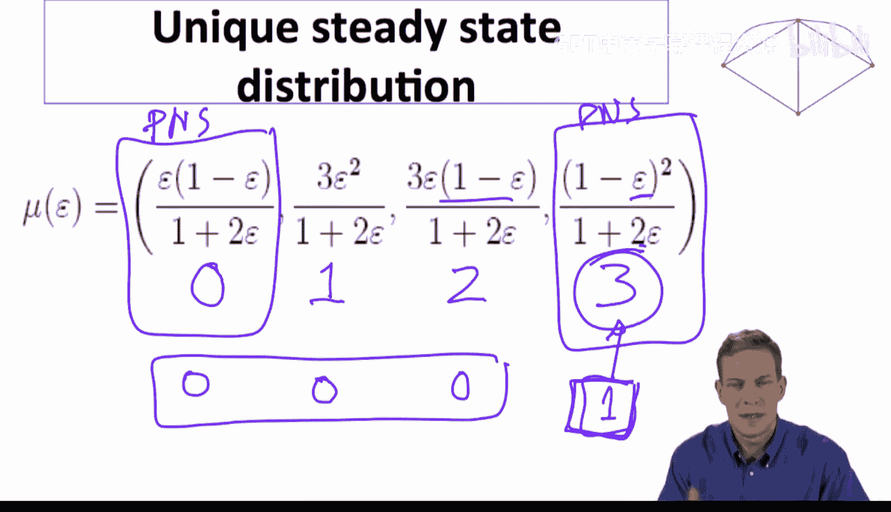

noiseSo the little bits of noise here are very important in making predictions and let's go through sort of the intuition of why it is that we're spending more time in the even though we have two Parawise stable networks。

 Nash stable networks， why is it that we're spending most of our time here and very little of our time here。

 even though this is Parawiseise Nash stable， when we go to the limit。

 we're spending most of our time here。

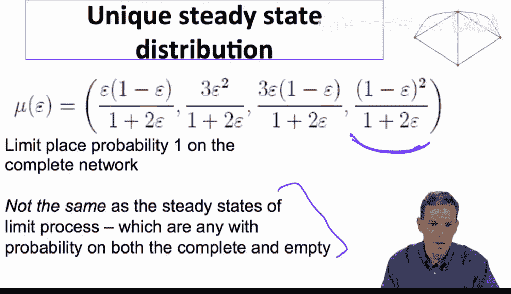

ok。And the idea is that if we think about trembling。So how do we leave this state。

 So suppose we were at at the the network with three links。 Well， we could make an error。

If we make an error and bounce to one of these， so there's probability epsilon of that happening。

Most likely it's going to come back。You would need two errors。

In order to get to a point where you might get to the other network， to the empty network。

 so you'd have to make two errors in a row before you could get to a point where you're going to find a network which then naturally sort of has a tendency to lead back to the empty network or the other pairwise Nash St network。

In contrast。One error on this network。Lead you to something which then leads naturally to this。

So when you've got errors， it's much harder， in some sense。

 the stochastic stability notion means this is a more stable。

 the full network is a more stable network， it's harder to get away from that network。

And it's easier relatively easier and only takes one error to get away from the empty network。

 And so what this does is it begins to look at what known as basins of attraction。

 when you look at these dynamic processes， this one has a larger basin of attraction。

 if you get to any of these networks， you can get back to this one to get to this one。

 you really can only get there from from a smaller set of states and as you begin to look at this。

 this process more naturally givess you a complete network than a smaller one。

 So this is a powerful tool for looking at dynamics you can simulate these things so once this we can solve for explicitly with only three nodes and relatively small number of networks as you begin to enrich these kinds of processes they' are going to get more complicated。

 but you can begin to analyze them by simulation So the idea is here again to emphasize you need more errors to leave the basin of attraction of the complete。

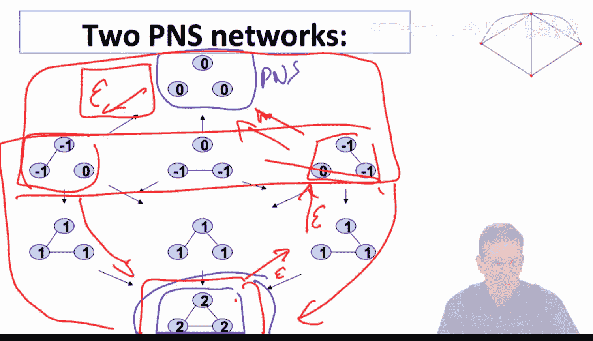

then to leave the basin of attraction of the empty network and more generally to solve these things you need to keep track of basins of attraction of many states so there's a theorem by Friedland and Wenzel in the 1980s on Markov chains and that allows one to leverage this and to do calculations of how these things work。

 but more generally this is going to this kind of process is going to select some of the networks。

 it's turning things into a Markov chain， we know a lot about them。

 even though it's difficult to get analytic solutions you can simulate these things。

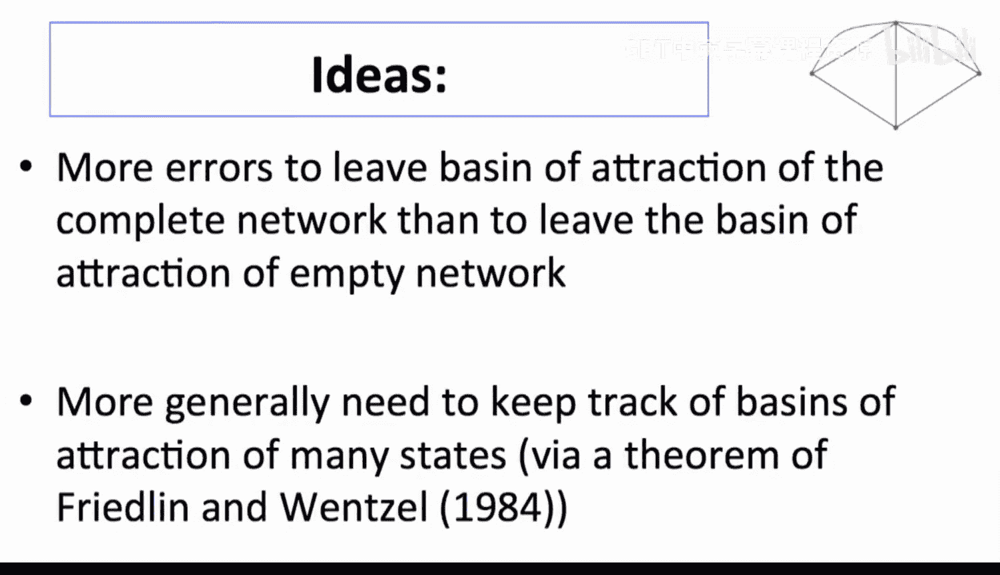

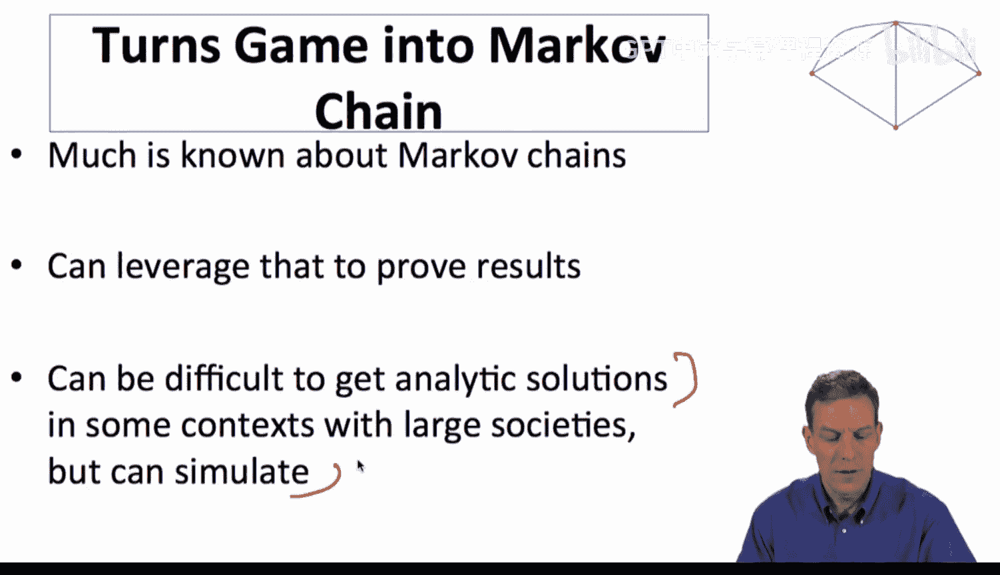

Okay so what we've done is we've looked at beyond pairwise stability， looking at some dynamics。

 some stochastic stability， there's other things in the literature that we're not going to touch too much on existence questions forward looking behaviors and another interesting question that we won't have time we've talked a little bit about transfers there's other richer models of transfers and bargaining to form networks so there's a series of topics which are important in understanding modeling that we know that you can get references form from the reference list here。

 but I'm not going to spend a whole lot of time going into in this course。

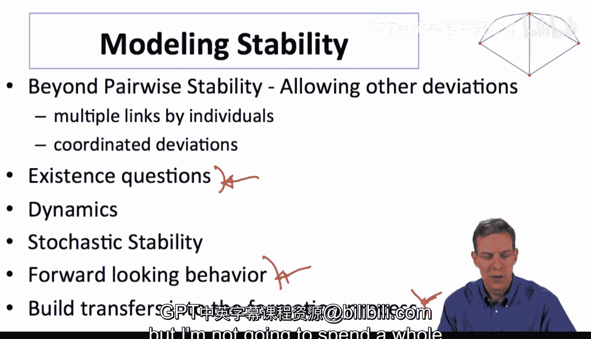

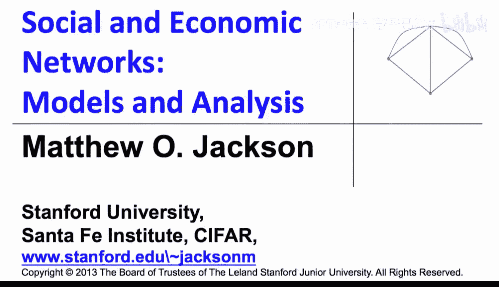