# 斯坦福大学《社会和经济网络：建模与分析｜Social and Economic Networks： Models and Analysis》中英字幕 p48 48_04_13_4-13-有向网络形成（可选-进阶-16-38）.zh_en -BV1v1421U7Nk_p48-

Hello again， folks。 we're here to talk a little bit about directed network formation。

 So in terms of our strategic network formation， we've talked about a lot of different things in terms of modeling stability。

 dynamics， transfers and so forth。 and we're going to talk a little bit about directed networks and then we'll also have a couple of videos on fitting such models。

 But let's talk now about directed networks。 and if the formation game in a directed network setting becomes much easier because people can just unilaterally choose to connect to somebody else and we don't have to worry about consent and so forth。

 So it's very easy to model these games。 the difference is really going to be in the applications So this has to be a setting where where I can connect to somebody without them having to want to allow me to connect to somebody。

 So it does work in settings like。

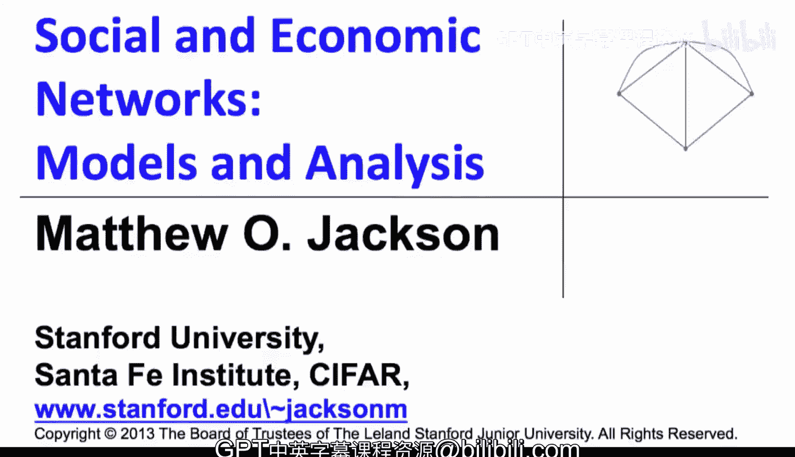

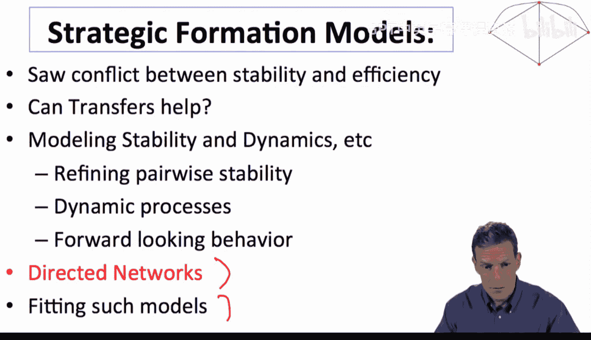

Citing somebody's article， I can do that without their permission or linking to a web page I can follow somebody on Twitter and so forth without them having to follow me so there are settings where you can have this kind of directed setting and so what we'll do is we'll model that as very simple situation where people just announce their preferred set of neighbors and in a network forms if any。

Based on whichever links people want to form。And here we're going to keep track of ordered pairs now so the fact that IJ is in this network IJ is now different from JI so this means I is following J。

 this means J is following I or I form a direct link to J and so forth and then just look at the Nash set of networks where each person is forming links to some the links that they want。

 given the links that everyone else is forming。

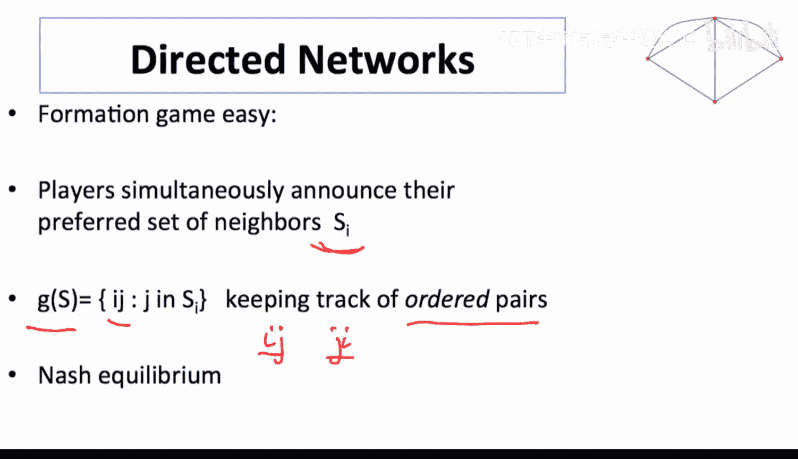

Okay， now when we think about these kinds of settings。

 we have to think about the flow of payoffs too。 So one situation is sort of a one way flow。

 If I follow somebody on Twitter and they don't follow me， then I get to hear what they say。

 but they don't hear what I say。So that's a setting where the person who pays the cost。

 then heres information from the node that they're accessing。

Now two way flow could be that one player forms the link and bears the cost but both benefit from it。

 So it could be that for instance， if I add a link to another page on the Internet。

 then that's good for me because people can get from my page to the others。

 it also helps the other page get new traffic that I direct there phone calls you know theres you could think of this as you know somebody bears the cost to people end up but phone calls actually are costly to both people involved if you think about time and so forth。

 So there's some situations where we could think about two way flow。

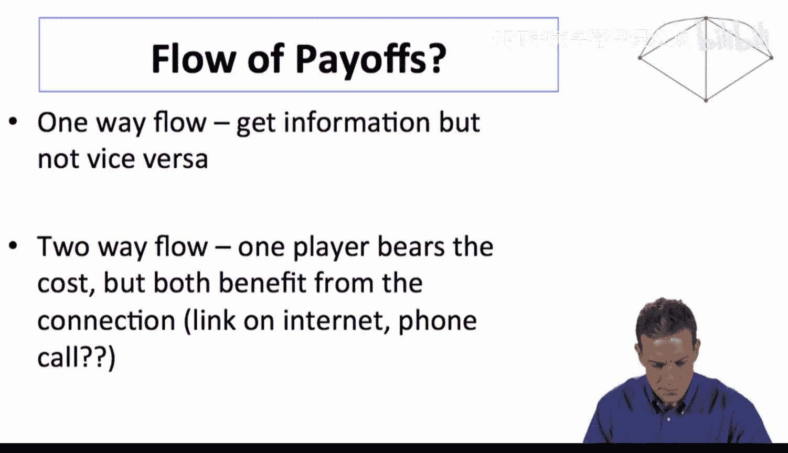

Now， the twoway flow， there's a paper by Bala and Goyle in 2000 that basically did a directed version of the connections model。

 So the model we can think of as being the same as what we saw from the Jackson Walenssky version。

 but now what's going to be different is instead of having consent to form a relationship people can form a relationship unilaterally and I can just direct my link to somebody else。

 will both end up benefiting so the benefits will look just like the connections model we had originally。

 but now people can form a link unilaterally， so it's a different formation process but the same payoff structure so the benefit structure。

 the cost structure is going to be different It's only the person forming the link that bears the cost。

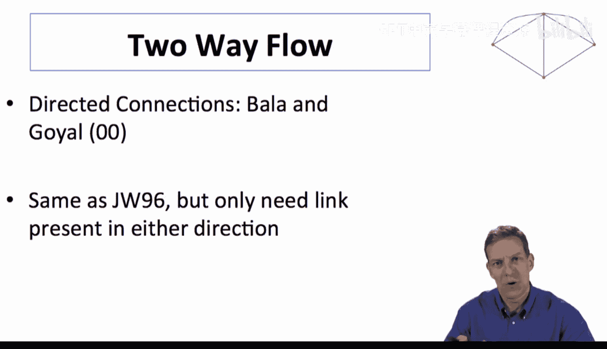

So if you just want to go through in terms of efficiency。

 the efficiency is going to be exactly the same as before。

 except now that we have half as much cost being born so instead of having two C per link。

 we're going to have one C per link and then in terms of what that does for the efficient calculations。

 is it just factors everything down by a factor of two in terms of the costs So the efficiency in this model is exactly as it was before。

 except we've just divided through by two and so you get complete networks of costs are low enough。

 star networks in a middle range and the empty network when costs are high enough。

One thing here is I put complete and star in quotes because complete doesn't mean that every link in both directions is present。

 it just means that every two nodes are connected and in this case they're connected by only one link。

 it doesn't make sense to have links in both directions because you bear twice the cost and there's no added information flow in this situation。

 So if you go through this， it's similar architectures slightly different cost structure。

 somebody has to bear the cost， but you only want one person bearing a cost between any two individuals because things flow in both directions once that's formed。

So efficiency is exactly the same as it was before。

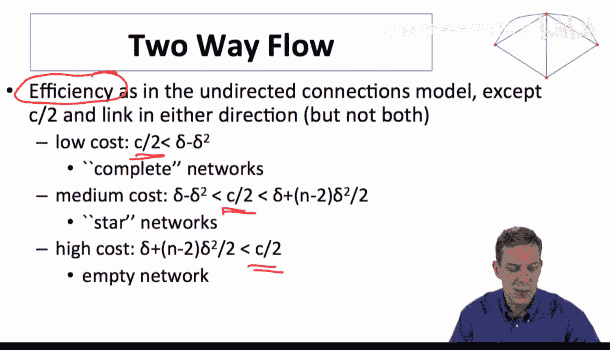

When we begin to look at Nash stable networks， I'll sort of list through what you can find you can check this so if cost is very low。

 then these sort of complete networks will be Nash stable so basically it makes sense to cut any indirect relationship to a direct relationship and somebody if the other person is not doing it then the other if one persons not doing it the second person will have an incentive to do it。

Medium cost range， medium low， all star networks arenaash stable plus some other networks。

 whereas a star now could be formed in different directions。

 so it could be that the center is forming some of the links and peripheral agents are forming some of the others。

 so you can have a star with multiple directions on the links again。

 know it doesn't make sense to form links in both directions because it doesn't add any benefits and adds to cost So you'll see stars that are going to be Nash stable and depending on the configuration it could be that the center is bearing more cost or the peripheries bearing more costs。

 there can be combinations of different types of stars So any star net network is going to be Nash stable when you get to a higher cost so that C is bigger than Delta。

Now， let's think a little bit about comparing two stars。

 So if we look at a situation where we've got a， let's look at two extremes。

 One extreme is where the periphery。Form the link。 So they all link to the center。Okay。

So what's going to happen in this setting is the center is not going to get any cost。

 but they'll get benefits。And let's think of another one where the center is bearing costs。Okay。

And you can think of hybrids of these， right？Well， what this says is this one。

Is the only one of the stars， which is going to be nash stable。And why is that。

Because if you think about it here， the centre is bearing a cost by connecting to somebody。

 And they're only seeing one deelta of benefit。 So that's less than the cost。

 They would rather sever that link。 So they're in a situation where they don't want to be maintaining relationships to other peripheral agents if the peripheral people don't bring them indirect benefits。

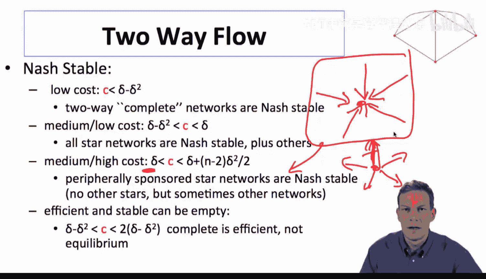

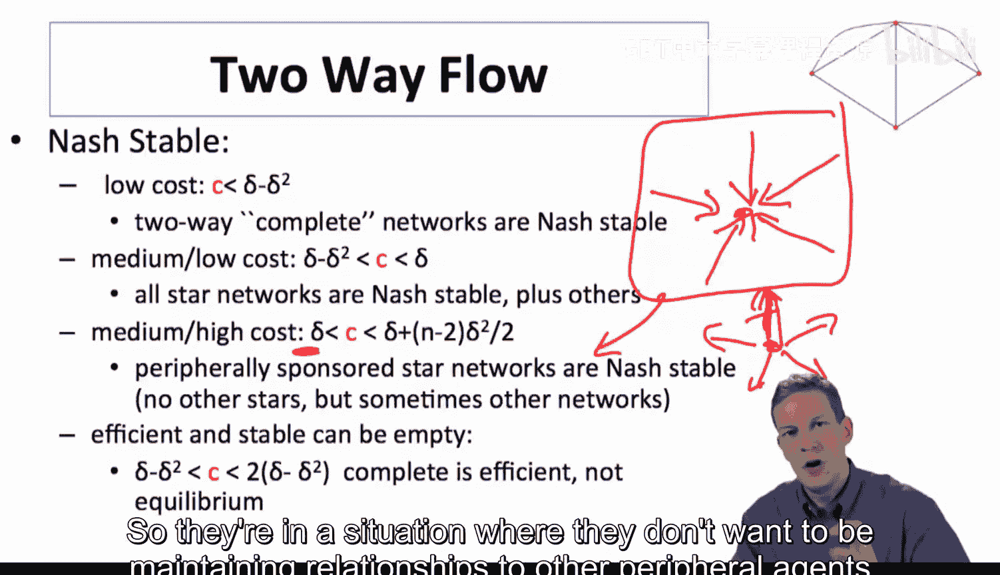

This one is stable why， because by accessing the center。

 these people are getting all kinds of indirect benefits of passive of length to， right。

 so they've got a bunch of indirect get they get a delta plus n minus2。

Delta squares by forming the one link minus the cost。

 so the peripheral agents are willing to keep those things because they're getting this extra cost。嗯。

When we look at a situation where when the cost becomes high enough。

 then we end up with situations where things be you can have complete networks be efficient but not equilibriumria。

 so Nsh staple networks are going to depend on the exact cost structure。

 what's a little bit different here than what was before。

 is that the relative costs are going to select out who might be forming the links and so you can have some prediction about links going in one direction or the other。

 even though flow might go in both directions。

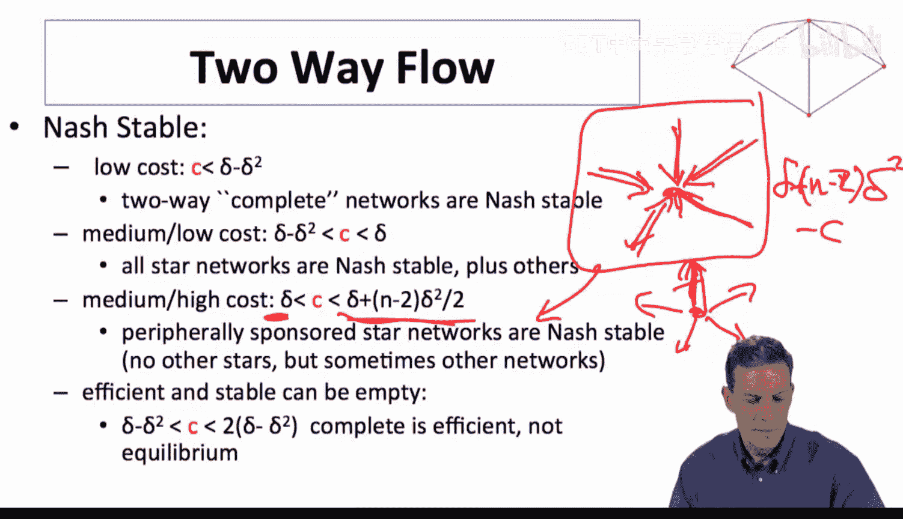

So let's talk briefly about another version of directed model and this is a one-way flow model so now we have to keep track of directed flow and this is when I form a link that I can access this person I can listen to them and I can listen I hear things indirectly that they listen to or hear so if I connect to somebody and they're connected to somebody else and so forth。

 then the benefits flow back to me from these connections but the fact that I connect to them doesn't give them this person any benefits unless they've also connected back to me or has some indirect connection back to me so things flow only into direction and so the person who bears the cost also gets the benefits the other person does not get the benefits。

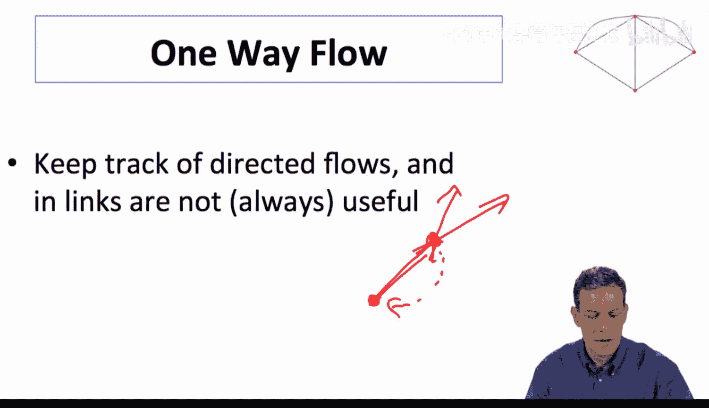

Okay so one example of this is a directed connections model with no decay where the delta is basically one。

And in that situation， then the utility becomes just the number of people that you can access via directed paths。

 minus however many links I've formed out outward so what's my outward degree in the network times the cost right so I'm bearing a number so if I have three different links。

 then I'm going to have an out degree of three， and how many people I reach is going to depend on how many people they're connected to。

Right so in this case， it might be that I can reach1，2，3 directly plus 4，5，6，7。

8 in total and so my reach would be8 so in that situation then you've got some number of people that you access for your links minus your degree times the cost where degree is now measured an outward degree so a very simple payoff structure and efficient networks in this world as long as C is less than n minus1 are going to be wheels and in particular wheels that have a particular direction to them we should be careful because there's wheels also means something else in graph theory but Ba and Goo use the word wheels basically this is directed graph where each node points to a subsequent node which points back and so each one here can access。

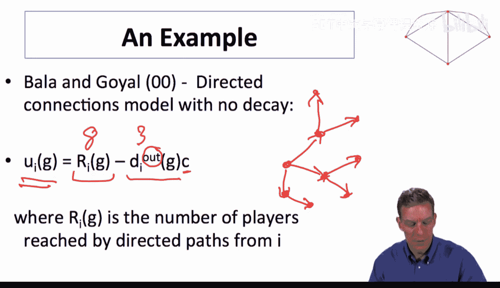

All of the others。So if you want to think about what's the best way to do this in so that each node can access every other node。

 so we've got maximum reach， everybody's reaching n minus1。We're doing this with only N links。

 so everybody's sponsoring one link。And we're getting the maximum reach possible in this world right so and each link is responsible then for connecting a given individual to n minus1 other individuals right so we've got a situation where we have the most efficient architecture possible being a wheel or if the cost goes above this。

 then it doesn't make sense to have any links and then you're better off with the empty network。

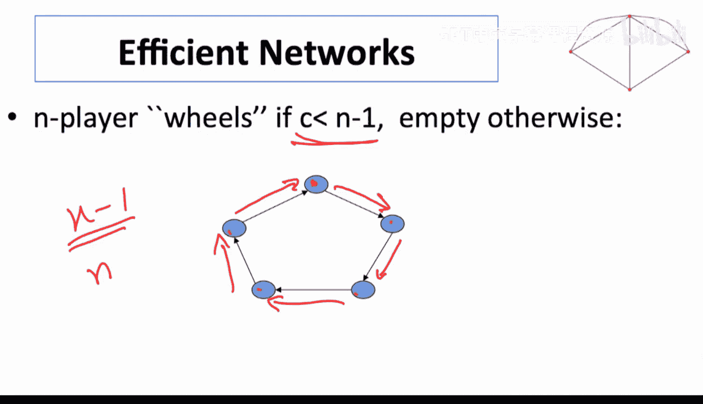

You know stable networks when cost is low enough。Then the wheels turn out to be the only Nash stable networks that are strict Nash equilibrium so that everybody has a strict incentive to keep the nodes that the links that they have。

If if the cost gets to a higher range， then wheels and empty networks are the only strict Nsh stable networks。

 so then you get stuck at the empty network because nobody wants to form a link to somebody else unless。

They bring in direct benefits。So so basically what we've got here is a situation where again。

 we have some conflict between stability and efficiency。

 you can go through and convince yourself of why these things are true the strictness is important here in getting these things there's lots of networks which are Nash equilibriumria that are not strict Nash equilibriumria so for instance。

 here we've got a situation where this is Nash stable you can check that nobody wants to delete any link that they have so for instance。

 two axises one and also accesses three and four via this link so they're happy three can reach everybody via the links。

 but they have to have two links because they have to reach four as well as as two and one and so forth。

 you can go through and check this but one is actually indifferent between where they place this last link right？

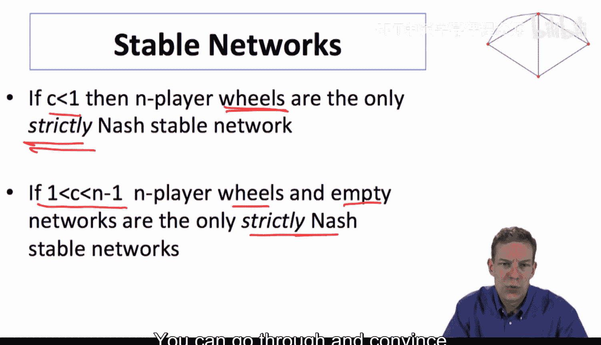

They're indifferent between having it here。They could also put it to four instead。

 and they could access everybody through either connecting to three or connecting to four since there's links in both directions between three and four。

Okay， so this is Nash stable， but not strictly naash stable。 So the if you check on the wheel。

 if we go back to the wheel， then that's a situation where nobody。

 So if we did this one in terms of a wheel。Now， anybody who changes。The links。

 so if you severed this one and put it somewhere else， you would actually lose access to somebody。

So they would no longer be able to be given the direction of the network now， the one way flow part。

 they would no longer be able to access that node， so strictness is important in making those results come out。

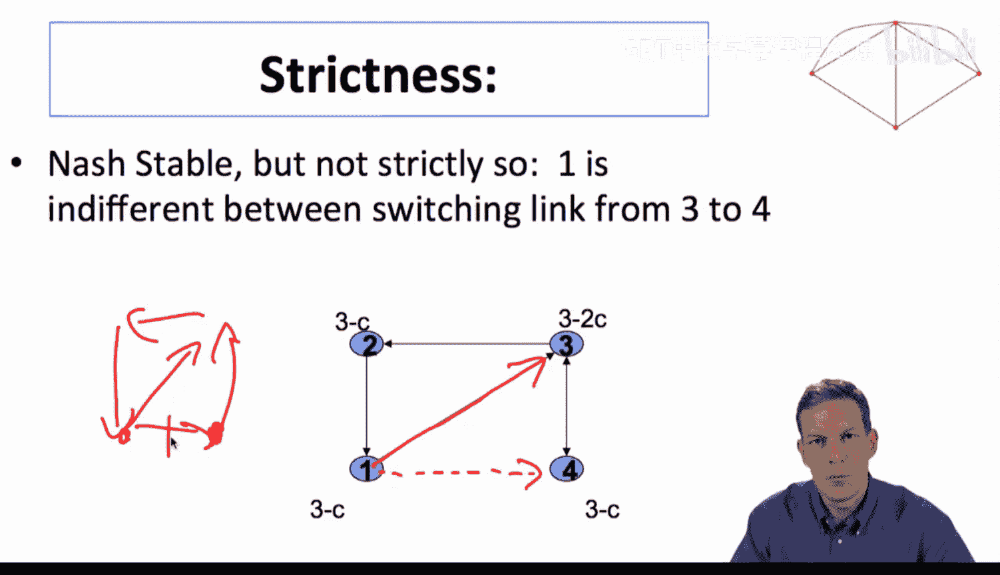

Okay so that's just a glimpse at directed network formation。

 There's going to be different applications and I think that's one thing that's important to emphasize here is that which model we should be using has nothing to do with whether we like unilateral or mutual consent formation as a model what's important is what is the application actually demand so if we're dealing with situations where alliances or friendships or social relationships。

 a whole series of things you really need to have mutual consent and two way formation processes if you're dealing with things like citing an article forming a link on a web page。

 then you can deal with unilateral network formation and so it's not a question of which is a better model they're different models and they fit different applications and some network settings are ones that are naturally directed and unilateral others are ones where mutual consent is really needed and a lot of social settings are going to fit into that category and so which model。

U really depends on the application， it's not an issue of which one's sort of a nicer model。

 they're different models。Okay， so that sort of takes us through a lot of the modeling of strategic network formation and some basic looks at different issues。

 and we'll have a couple of looks at。Models for fitting these things and dealing with data。

 and then we're going to turn to diffusion as the next major topic so we'll start working。

 this has been so far we've been looking at network formation and the next major subject is now given the network。

 what's actually happening on that network， how do we understand behavior on that network。

 and what are the consequences of different network formations for the actual behaviors， the result。

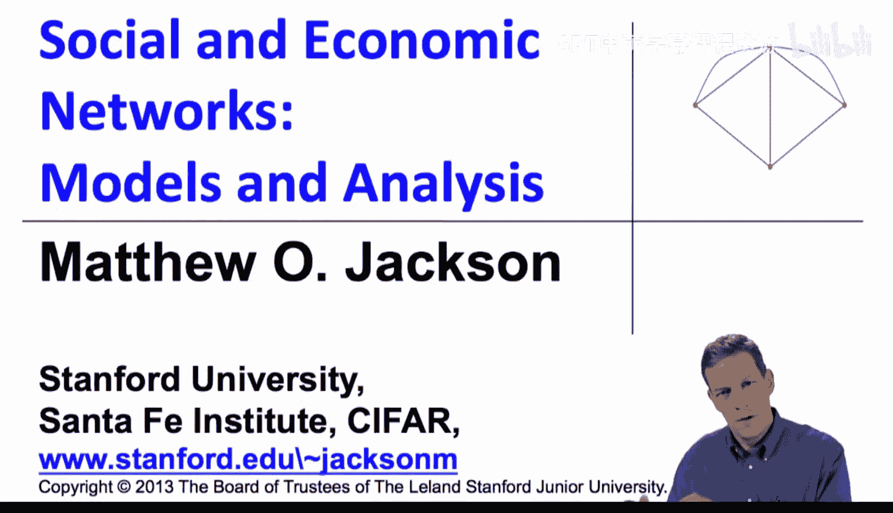