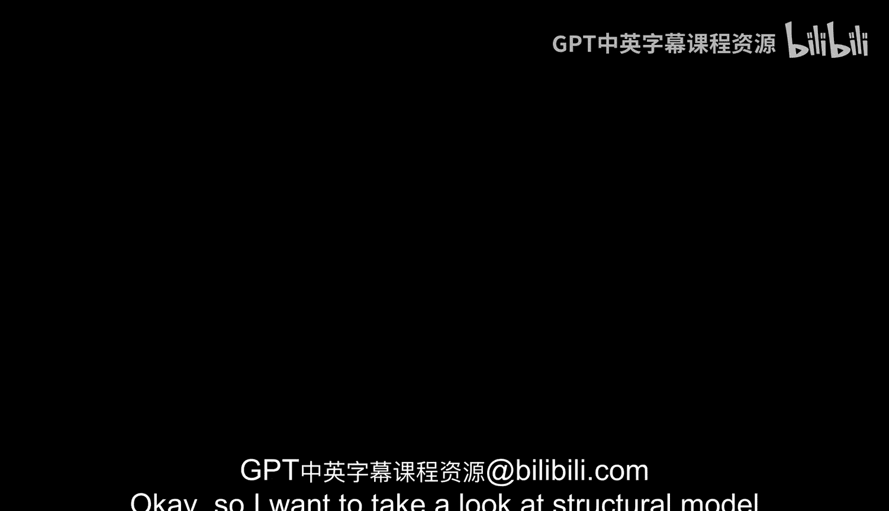
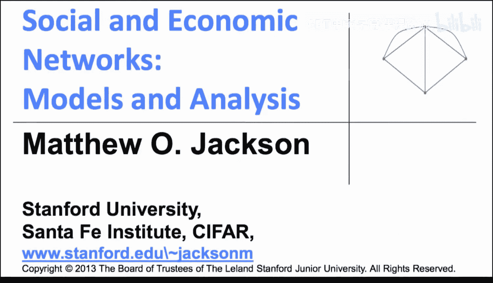

# 斯坦福大学《社会和经济网络：建模与分析｜Social and Economic Networks： Models and Analysis》中英字幕 p49 49_04_14_4-14-应用-结构模型（可选-进阶-35-06）.zh_en -BV1v1421U7Nk_p49-

Okay so I want to take a look at structural model and fitting structural models of network formation that combine aspects of both strategic formation and chance meetings the idea here is that we can build these models to explore the fact that in a lot of settings there's going to be some choice involved but also some chance involved and we might want to estimate things like relative roles and the random models can be too extreme and strategic models can be too extreme。

 we've seen the beginnings in terms of the exponential random graph models of ways to combine some of these things but we can also in particular instances fit models that are more precise to the setting involved and more directed at asking a very specific question and so。

In， let's ask a question of when we see homophily how much of that was due to the choices of the individuals and how much of that was due to the fact that you're more likely just to be meeting individuals of your own type rather than choosing to interact with individuals of your own type so if we want to ask a question like that。

 can we build a simple model to address that and so here what I want to emphasize is really the techniques for doing this rather than a specific model。

 so this is going to be a very specific and stylized model but what I want to do is just illustrate that you can use you can do similar things where you build what you think is the right model for a particular application and then use that to generate networks。

 look at the networks that come out， try and match them up with the data and thatll allow you to fit parameters to the model that best match the data and then do statistical test to see whether certain things are really going on how much choice is really going。

On how much chance is really there， how much noise is in the data and so forth so that's the idea here and so I want to emphasize basically an approach rather than taking so seriously the specifics of this particular model it's more as an illustration an example than to be taken seriously as the model so in terms of application of homophily。

Let's suppose that we've got two types of two groups。

 group A and group B and they form fewer across say race relationships than would be expected given their population mix so if we go back to our ad health data and look at one of those high schools and we see we see a segregation by race。

 we could ask us is this due to structure so maybe they just don't meet each other very often they don't meet each other very often because in the school there are certain kinds of structural patterns in terms of the way that courses are organized or the way that people take extracurriculars that don't allow for many meetings between different races or is it due maybe to the preferences of group A or the preferences of group B or both of the preferences and so forth So can we begin to sort these things out？

So I'm going to just take a look at a couple of papers。

 the techniques from a couple of papers that Ruth Sergio Kini and Pao P from 2009 and 10。

 and what we'll do is just we'll specify how much utility a given individual gets as a function of the friendships they have。

And then we'll allow a meeting process that has randomness in terms of who you're going to meet and will allow this both the utilities and the meeting process to depend on your type。

 so in this case say your race or your gender or your age or your profession， whatever it might be。

 and then begin to see what comes out of that and try and match up the parameters to the。To the data。

Okay， so let me say a little bit about the idea here and you know when we're thinking about trying to estimate strategic formation models。

 generally what we end up seeing is the result of some choices that were made And there's something that's known as revealed preference theory in economics。

 which refers to the fact that we might see， say a consumer buying certain products。

 And then based on the fact that they bought one product at a given price and not another product at a given price。

 we begin to try and infer what their preferences over different product attributes are。

 So what do they really want if they ended up buying something and not buying something else。

 And so here what we'll do is we'll be basically inferring preferences by saying， okay。

 this person formed these friendships and not another set of friendships that gives us some insight into what their preferences might be。

 Why did they form these friendships and not those well。

 it tells us something about what they preferred to form in terms of friendships。

Now again that could be due to what they have available and just as in consumer theory you might have a budget which says okay look these were the things I could have afforded and I bought this and not that here what we're going to have to do is sort of infer what are the what is the rate at which you had opportunities to form different types of friendships and so the chance part is going to be fitting what were the opportunities that were coming along and then what choices were made as a function of those and that'll give us information about what's actually。

The preferences and what were the relative opportunities that they had。 So that's the idea。

 One thing to emphasize here is this gives us， say a different kind of look at things than just direct surveys so you might for instance。

 ask people what's your attitude on race or would you like to form friendships across race and so forth and difficulty with asking people directly is that people often answer in ways that aren't necessarily congruent with the choices that they make So this takes seriously what did you actually do not what would you say on a survey and sometimes there can be differences about this。

 and so this is a different way of sort of measuring attitudes towards things like race or gender age or whatever it might be in a particular context。

Okay， so a simple model， what we're going to have is some set of types，1 through K。

 so this might be ethnicity， it might be the age of the individual。

 it might be a combination of their age， their religion， their gender， etc cetera。

And what we'll have is a very simple model in terms of the preferences that people have。

 so this is going to be a simple independentlink formation model so it's going to be simple in that dimension it's not going to be trying to recreate richer parts of the network but it's going to allow us to separate out some of the preference aspects from some other aspects and so what people value is they care about how many same type friendships they have and how many different type friendships they have so really simple model you just care about how many friendships do I have with people that look like me。

 how many friendships that I have of people that are of a different type and I get some benefit from just that so very the simplest possible formulation you can imagine and in particular what you get in terms of utility is then some number of same and different type friendships weighted by a parameter gamma I where gamma I is capturing how much do you weight a different friendship compared to。

A same type friendship Okay so it's a preference bias If this was one。

 then all I care about is the total number of friendships I don't care what their mix is If this is bigger than one。

 then I actually care for diversity。 I care more I have friendships with other types than same types if it's less than one。

 then I get a higher benefit from same type friendships than different type friendships right so gamma I is going to be the critical parameter in terms of representing preference bias。

And then we also have this other parameter alpha。 and what is alpha going to keep track of Al is going to be generally less than one is going to be some diminishing returns to friendships。

 So my first friendship might be very valuable to me， my second one additional value and so forth。

 by the time I get to my 10，12， etc cetera， these friendships are becoming less valuable。

 And so the fact that alpha might be less than one， would give concave function。

 So as you look at the utility as a function of total numbers。

 the utility is going to tend to be concave if alpha is less than one。

 So we've got a situation where as alpha is less than one。

 then we've got curvature in that utility function。Okay。So。

Let's let TI be the total number of friendships that we're forming and so basically people are socializing。

 they have an opportunity to form friendships， they meet people of different types。

 and in this model let's let QIB the fraction of own types that you're going to meet and be able to form friends with and then one minus QI is the relative number of other types that you're going to form and so if you spend if TI is the total number of friends that you form then the relative number this is going to be your Si is going to be the fraction that we're of same type and the DI is going to be the fraction that we're different type times your total friendship and so here in this model is's a very simple model I just have opportunities coming and the cost is just going to it's going to be costly for me to form some number of friendships so I'll cut off that total number but then the mix that I get is just going to depend on the relative meeting rate so I meet people at some rates and。

I take whatever friendships come， but it's expensive for me to form friendships and so after some time period I stop socializing or trying to find new friends okay so TI is just going to maximize it's going to be a maximizer of this overall utility function where you've got same type friends。

 different type friends and so forth and the rate at which they come is QI for same type1 minus QI for different types and that's going to be coming out of the random part of the process and right now then what we could do is say we can figure out if we knew what gamma was and what alpha was and what Q is and C and so forth。

 we could solve this function and say how many total friendships would have given an individual like to have and how would that depend on the relative parameters okay。

Okay so TI maximizes this function if you solve that you can get an expression for what TI is in terms of over the other parameter so maximizing that function take the derivative with respect to TI set it equal to zero the alpha is less than1。

 this is necessary and sufficient for the solution and then we'll also add some noise to a given decision so it might be that a given individual for whatever reason has more fewer opportunities or more or less value so they're going to we're just going to add noise in terms of the friendships that are given individual forms so a person A of type I is going to have an extra error term epsilon a and so the total number of friendships than any given individual forms is just going to be some noisy thing about this solution so very simple model in terms of the formation but now we can see if we write down a simple model of how much utility you get from some aspect of the network。

Maximize that and we got a solution for how many in this case， what degree。

 so we can think of this really as the degree of agent I。

 this is the degree that they would like to have in terms of this model and then what they end up with is some noisy variation on what they would like to have given the parameters of the model。

Okay， so how do we actually identify these parameters from the data？

So what we can do is in the data we'll actually observe the TIs， TAI。

 so we'll see how many and we'll use the Ed healthal data。

 so when we look at the actual networks of friendships in these high schools。

 we can see how many friendships that each individual form。

And so we observe this directly in the data， and that's going to vary with the QIs。

 So as a function of QI， a function of the alphas， the gamma I and so forth that gives us a TAI。

 And so one thing to notice is that when we look at this expression for T AI， this is increasing。

In Q， I。If gamma is less than one， right？ So if gamma is less than one。

 then you've got a plus one Q I， and then you've got minus gamma。 So you've got Q I。

Times 1 minus gamma I。In here。And so if gamma I is less than one。

 then you've got a positive expression for T T as a function of Q。

 So more of my if the fraction of people I'm meeting is more of my own type。

 I should form more friendships。 and so that's what's going to allow us to begin to fit what gamma I is right。

 So the idea is that T I should be a function of QI and how quickly it varies with QI is going to be dependent on what gamma I is okay and in particular。

 if you actually look， this is a picture of the。Add health data。 so these high schools here。

 there are 84 schools。And each dot here represents a certain race group within a particular school。

 so for instance， this dot here is a group of white students that formed so it was a particular school and in that school the white students formed about a little over between 60 and 65% of the population this school right here。

 this is a group of black students in a high school where their group size is a fraction of the school was just below between 20 and 30%。

 a little closer to 30% and this then tells us on average。

 how many friendships did they form they formed on average， about eight friendships。

 this group formed on average， you know about three and a little bit of change and so forth。

What we see here is that indeed， if you do just a slope here， you see that the slope is 2。3。

 so there's an increase as a function of your group size。

 So the more prevalent your group is in the population that's going to lead to higher QIs。

And indeed we see that there's a higher group of friends as a higher friendship as a function of the the size of the group。

 so the easier it is to meet your own type， the more friends different groups are forming and so we will be able to actually identify that gamma parameter from these data and in particular when you look at this thing。

 you know the slope peers 2。3， the T statistic on that 7。

3 so you're quite a number of standard deviations away from from zero。

 so we're actually seeing a highly significant slope here so we will be able to identify the fact that groups that have higher proportions are forming more friendships which would indicate that they're getting higher utility under this model and we can then estimate what the gammas are based on that and in particular I'll just sort of show you the best fit lines if you。

At the best fit lines for different parameters， for different races。

 you'll end up seeing different slopes and that'll allow us to back out gamma eyes。

 the gammas for different races because each one of them has having a different relationship between how big their size is group sizes and then how many friendships they're forming so the last part of the puzzle in terms of figuring out the randomness in this kind of model is where do the QIs come from。

So we've got that how many friendships each person would want to form as a function of the parameters of their utility function and the rate at which they meet different individuals。

 but now we want to ask， what's the rate at which they meet different individuals okay？

And the important thing here is that the way at which they're going to meet different individuals is going to depend on the decisions of the other agents。

OkaySo if everybody was trying to form the same number of friendships and we were just sort of mixing in the population。

 then if my group formed 30% of the population and some other group formed 70% of the population than I would meet my own group at a rate 30% and I meet agents of different types at a rate 70% but if the other types。

 imagine that the other types are actually trying to form they form many more friendships。

 they're spending more time circulating and mixing。

 then they're going to be easier to meet and my types going to be relatively less likely to meet and so it's not just a function of the relative sizes it's also a function of how many friendships different groups are trying to form and so we need to solve this overall as an equilibrium given that the teas are going to be determined by these relative rating the cues and the cues are going to be determined also by the actual decisions of the。

AtsSo in particular， let's think of the meeting process and we'll think of this like a giant party so we can think of this like a cocktail party。

So let's think of a given individual say is a green agent and this green agent is bouncing around in a party where there are green agents and red agents。

 and so what's going to happen， imagine that the incoming proportion of reds is 80% and greens is 20%。

 but if the reds spend more time trying to form friendships and are generally forming more friendships。

 it's going to be easier to form friendships with reds than greens， and so even though it's say 08。

2 coming in， the mixture in here could be say 90% 10% or even more skewed than that。

 if the Reds are spending， say twice as much time in this party than the greens are。

 so the rate at which they come in and go out is not necessarily going to be the same as what the relative stock of people if the greens are exiting much more rapidly than the reds are。

So as we go through this process then you know this given green node bounces into somebody meets one friendship。

 meets two， three， four， so it's got three red friends and one green friend and it decides okay that's enough I'm satiated you know I formed four friendships and that's enough for me and then it decides to exit a red might find this to be if gamma eye is less than one then reds are meeting reds at a higher rate they might want to stay longer and that's basically the idea of the model okay。

So we've got this QI is the rate at which I meets I，1 minus Qi。

 the rate at which you meet the different types and the way in which this is going to be modeled is the QI。

 the rate at which you meet your own type in terms of this process is going to be dependent on the stock。

 how many of those individuals are actually in the room， but we' also allow this to be biased。

 so that even when I'm in the room， it might be that that I'm biased in terms of meeting my own types。

 So maybe I'm in this large room， but I actually look for greens and try and find greens in which case I'm going to meet greens at a faster rate than actually they're in the room。

 and so if beta I is exactly equal to one then the rate at which I meet people is just what's the stock of these people in this party。

If beta is greater than one， then you're going to meet your own types at a rate faster than you would just milling around。

 you're actually going to meet your own types at a faster rate so this particular formulation says the way at which you're going to meet people is dependent first of all in how many people are in this party and then also can be skewed by this extra parameter which represents some viscosity in this meeting process so own types are going to tend to meet own types。

 so this is going to be the bias。In meetings。This is going to be the parameter beta I。

 where beta i greater than one means that you're meeting your own type at a rate。

Above what you should be meeting them relative to how they're mixing in this population setting Okay so we've got QI equal the equal to this stockling so if I was 50% of the population and beta was one。

 then I would meet my own type at a rate of one out of two。If if we set beta to2。

 then the chance that I meet my own types would be about 71% and if beta was as high as7。

 then the chance that I would meet my own type would be would be about 91% So as you begin to know this would all be with the half and sticking in whatever my relative sizes what this does is sort of bias。

 this relative rate at which I'm going to make own type friendships compared to other type friendships relative to what the mixing the total number of friendships are where this stock is going to be just based on the sum of the TIs for my type compared to the sum of the TJs over all the Js right so it's keeping track of sort of what's the relative size of me and the population compared to the others and then we raise that to some power so what is this all work out to be。

 then we've got the TI maximizing this function。The stocks are going to be relative to the relative number of meetings that different groups want rated by their relative sizes。

And then the meetings are going to be determined by what the stock is raised to these bias parameters。

And so。If the beta if。呃。The the fact that the。Stocks have to add up to one。

 tells us that we have a balance equation in terms of what these Qs have to look like。

 when you sum across the Is， the Q raised to the beta I have to equal 1。 Okay。

 So what we end up with in terms of having balance on the meetings that know if one group's meeting other groups at a certain rate。

 they have to to match up。 that's going to give us an equation which will help us solve for this beta I parameter。

 So we're going to be able to solve for the beta I parameter from this。

 so simple model where we maximize utilities。 we have a meeting process。

 we estimate the meeting process。 we put all these pieces together and we'll be able to estimate both the beta I from here and the gamma I from here。

 and then see what it looks like in the data。Okay， so we've got these two conditions。

This maximizing this， this will help us identify these parameters。 We've got this。

 which will help us identify these parameters。 The QIs will actually observe in the data。

 So what's the relative proportion of own type friendships other type friendships for each group。

So we basically can identify these parameters by fitting this model to data。

 the only parameter we've got left is we've still got this cost of forming friendships that we don't know exactly what that is。

嗯。so when we look at the equations that we have for the T's and the betas putting in some errors。

 then what do we end up with， we end up with these two equations we have to fit。

 we still got this C out here and so what we can do is when we look at solving this out。

For two different groups， we can say that the relative way which I should be forming friendships compared to Js forming friendships。

 including the errors should be a ratio here， where now this ratio is going to divide the C out so that C we can factor out by just looking at relative numbers of friendships because the C scales everybody's friendships up or down and so if we look at relatives numbers of friendships formed by one group compared to another then that factors out the C。

 and then we don't have to estimate the C directly。

 we can just estimate the alphas and gammas so basically what that tells us is that we're going end up with T minus Tj equaling some error and now this is cross multiplying so we end up with an expression which no longer has a season because we're comparing relative T's to each other rather than absolute TI so that is one way of just factoring out one of the。

So that's a technical detail in terms of estimation。

 which will make our life a little easier now we just have three parameters to estimate we estimate alpha。

 the gamma I and the beta eyes。Right。So these are the parameters that are left。

 and we factored out that C parameter。 Okay， fitting technique， very simple。

What we'll do is we'll just build a grid of alphas。Beta I， gamma I。

 so we've got grid over all these things for each network and each school and each specification of biases。

 we can see what's the actual number of total friendships that would be predicted for each group。

What's the realized number and so we can calculate an error in terms of how big the error is in total friendships compared to what it was。

 what's the error in terms of actual group relative group meeting rates。

 the QIs so we can these predict TIs and QIs。So for each one of these it predicts TIs and QIs。

 and then we can look at what the actual ones in the data are。

And sum the squared errors across all the networks， so for each one of these we're going to have say。

 if we have four races， we'll have four sets of TIs， four sets of QIs。

 and we can sum the squared errors for each school we'll have a set of eight errors。

 sum all those up and then choose the biases to minimize the weighted sum of the squared errors。

So we， we just choose those things to minimize these。

Okay so what do you get when you fit this so you can go through there's actually five categories of students because there's the Asians。

 blacks， Hispanics， whites and there's also some that are miscoded or didn't indicate race so we have some others and then we have the fit alpha comes out to be about 0。

55， so roughly like a square root in terms of diminishing returns， when we look at gammas。

 what do we get， we get Asian they get different type friendships are worth about 0。

9 of a same type friendship， blacks 0。55 Hispanics 0。65 whites 0。

75 so we get different fits of that parameter， all of them are less than one。

 but they're varying in terms of at what rate they would like to form or they get a value of different type friendship compared to same type friendship。

And then the second thing we have are these beta parameters and the beta parameters indicate that for Asians and blacks。

 we're seeing a high rate of bias terms of meeting owned types。

So a good portion of the bias that they actually observe is due to the fact that they're meeting themselves at a much higher rate。

 whereasas for Hispanics and whites， these parameters are much lower。 And in fact。

 the whites see a mixing rate， which is roughly one Hispanics about 2。

5 and then Asians and blacks a factor of 7 higher Now， one thing we can do is then ask。

 you know are these statistically significant numbers。 Do we have any idea whether these could be。

 you know maybe all these numbers are just noisily different from from one。 And in fact。

 the model isn't isn't all that different。 So are these you know truly different in terms of some statistical sense。

 And what you can do is we can test a hypothesis。 So what we could do， for instance。

Is look at the sum of squared errors， so this is the residual sum of squared errors。

 so this is the sum of squared errors that we get by looking say just at the preference biases。

 so look at al the gammas and look at the TIs that are generated。

 see what's the errors that you actually see in the data and then say let's suppose that we restricted all of these to be equal to one。

So we， we forced all of the gamma parameters to be equal to one。

So you force those to be equal to one and then you'd do the best fit of the model what you would end up was you would end up with alpha would drop to 0。

2， but the error would go up to 17，000 compared to 4000 when you allow these parameters to vary then you can do an F test and what this says is that this the F value here is 42 the F threshold for even a 99% confidence level is 3。

3 so just thing is I mean the size of the squared errors that you're getting is so much larger it's a factor of4 larger。

 so you're getting basically you know a huge amount of the error is actually being explained by allowing these gammas to differ so if you allow the gammas to differ across race you're actually explaining a huge amount of the error。

 the error blows up by a factor of four when you force all of these gamma parameters to be equal to1。

So you know you can reject so the ones reds here indicate that you're rejecting these things this particular hypothesis。

 So they're certainly not all equal to one statistically under this particular model are they all equal Well。

 the error goes up to 61。75 if you force them all to be equal the best guess would be that they're all 0。

8 And then you can ask okay is it true that Asians and blacks have the same preference parameter bias。

 if you fit a model where you force those two things to be the same and reestimate the model know you'd end up with an estimate of alpha to be 0。

7。 the gammas for those two races that are forced to be the same that Asians and blacks to be 0。

8 and then so forth， What would the error be there。 Well， it it would go from 4700 to 5300。

 it actually has an f value of 9。93 It's still highly significant So it looks like Asians and blacks have different parameters the reduction。

The error is not just due to randomness， so using these kinds of models。

 you can go through and do F tests and other kinds of statistical tests by looking at the errors you observe under the model and the errors that you would observe if you forced or if you work with some null hypothesis or alternative hypothesis。

 then the one that allows all of the parameters to be fit。That gives you a new set of estimations。

 you can compare the errors that you get under the two and then ask whether that reduction in error came up at random or not。

 a standard statistical test in this case an F test tells you which ones so you can't reject the hypothesis that Asians and whites have the same preference bias you can reject the hypothesis that Asians and blacks have the same and so forth so you can go through and do so blacks and Hispanics are not distinguishable here but blacks and whites are distinguishable right so when you look at these F tests。

 which ones are statistically significant， you get certain differences that you can say are statistically significant and other ones or not。

Okay you can do the same thing for the meeting bias。

 you can go through and you know the same kind of tests and indeed the meeting biases are also highly significant。

 so it really appears that there's bias both in preferences and in meetings and what again what I want to emphasize here is not this particular model but this approach of if you're careful about writing down a structural model and you can begin then to derive implications of that model。

 that model then generates certain observed patterns match those patterns up with the data so in this case what it was generating is total number。

 the degrees of all the agents and the relative fractions of friends of different types they should have and then you can we can look at the degrees and fractions of different friends that they have in the data try and best match those parameters up that gives us estimates for the preference parameters and so forth and then we can test whether they're significant and learn something about the relative choices that were made here it appears that。

Both choice and chance were present， if you believe the model。

 then it looks like people have biased preferences towards own type。

 and that's accounting for the fact that you're forming more friendships when you're put in a school that has more of your own type。

And and so you know we end up with estimates there and you know the kind of thing that that allows one to do is then do analysis where you can go to look at say counterfactuals what would happen in a school if we change the way in which people meet and so we try and eliminate beta parameter and move that towards one。

 so we want to make sure that everybody meets each other how much of an impact is that going to have on friendship formation using this model you could begin to estimate something like that。

 so it allows you to look at different policies or as opposed to a policy that tries to influence a preference parameters that would have a different impact on what would happen and so using a model like this you could begin to sort those things out and so this is just an idea of one particular model that marries strategic formation with some randomness very specific model but it's a technique that can be used much more generally。

