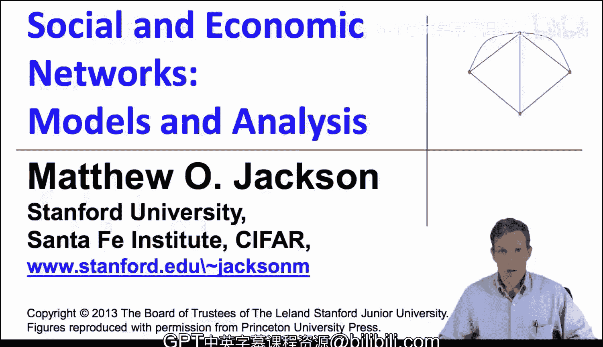
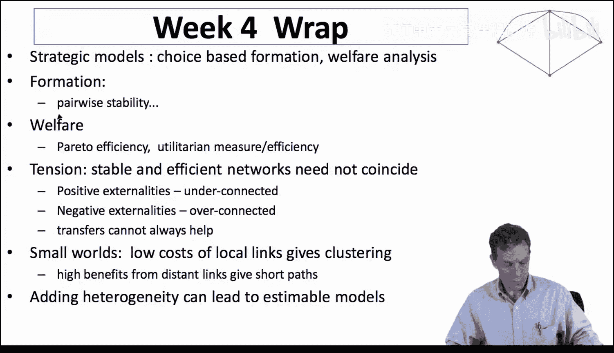

# 斯坦福大学《社会和经济网络：建模与分析｜Social and Economic Networks： Models and Analysis》中英字幕 p50 50_04_15_4-15-第四周总结.zh_en -BV1v1421U7Nk_p50-

And folks， let's take a look back at what we've learned in week four。

So we've been looking at strategic network formation models where we think of nodes as individuals making choices。

 they could be organizations making choices， but the important point is they're choosing which links they want to form that allows us both to look at a different aspect of networks but also to get welfare estimations where we have payoffs for different nodes and we can say whether a network is giving lots of people high payoffs or low payoffs so we get welfare consequences and we looked at different concepts here so in terms of formation we looked basically at what's known as pairwise stability where nodes form links if they're mutually beneficial you severalever link you can do that unilaterally if it's not beneficial。

 there's variations on this kind of thing but it gives us a prediction of which networks might be stable or rest processes rest points of some dynamic process。

 then in terms of welfare， there's concepts of pareto efficiency。A standard concept in economics。

 there's also utilitarian measures， basically just looking at trying to maximize the overall total payoff to the society and the important thing that we see coming out of this is generally given the externalities that are present in networks We're going to see some difference between what turns out to be stable when the individuals choose to form the links and what we might want from a social perspective in terms of maximizing the total payoffs So when there's positive externalities you're going to tend to see under connection So what does that mean it means that people aren't taking into account the fact that their links are benefiting others by information flowing things and so they might not form links even though those links would be good for society。

 negative externalities， situations where there's congestion problems or taking time away from my friends by forming new links。

 I don't take into account those negative aspects and so I intend to overconn So there's going to tend to be differences depending on the setting of whether you get。

Overconnection under connectionne， if you've got both positive and negative externalities。

 it could be more complicated。Transfers are not always going to help so it could be that people could offer bribes or favors to other individuals to forming links we could think of explicit bargaining。

 so when countries sign treaties there's often things which exchange hands is a very complicated bargaining process so transfers will go on and those can help but they don't necessarily always help given the number of externalities and the complicated patterns in which they can arise taking care of multiple ones at a time is not always possible so we've got a fundamental tension between the stability and efficiency in that sort of an overriding theme in this part of the literature。

These kinds of models can help us explain observed phenomena。

 so if we go back to the small world's kind of phenomena， now we get a why kind of answer to that。

 so low cost of linking to other individuals who are very close to you either socially or geographically。

That means that you're going to tend to have high clustering just because a whole series of individuals have very similar characteristics or are located similarly。

 and they will all tend to be friends with each other。

 High benefits from cross long distance connections means that then you still can have little short average path lengths。

 So these models can begin to explain that。 And I think one of the things going forward。

 It's very important in these models and is starting to be done is to bridge the。

Random network formation that we saw earlier with these strategic models that allow us to understand what's going on and why it's happening and putting together some random meeting process with choice allows us to have heterogeneity and match observed characteristics and take these models to data。

 so I think that that's a very important and growing area of research going forward。

So now that we've looked quite a bit at network formation。

 next thing we're going to be doing is starting to look more directly at behavior。

